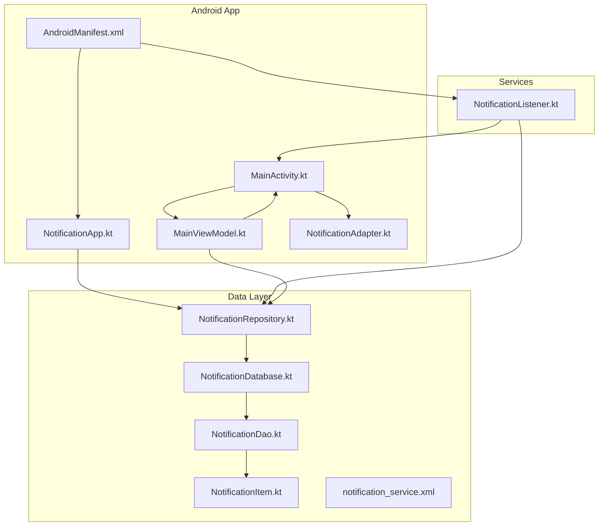
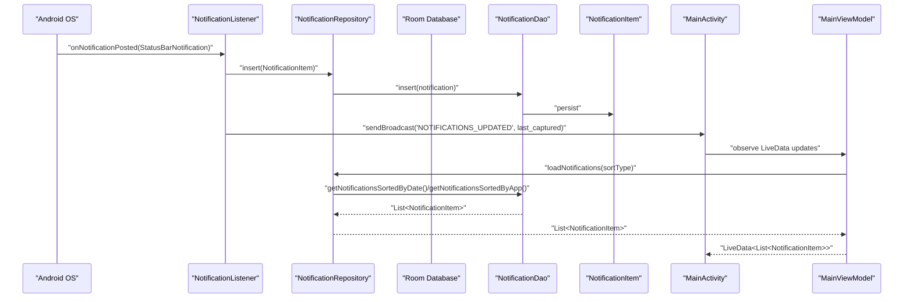
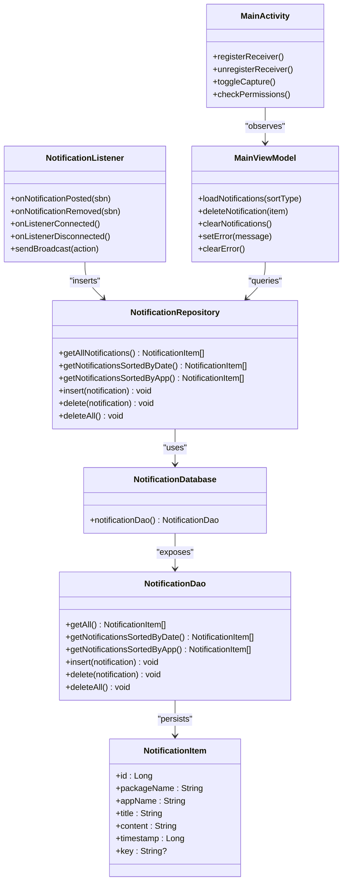

# API Reference

<cite>
**Referenced Files in This Document**
- [NotificationRepository.kt](file://app/src/main/java/com/notificationlog/repository/NotificationRepository.kt)
- [NotificationListener.kt](file://app/src/main/java/com/notificationlog/NotificationListener.kt)
- [NotificationItem.kt](file://app/src/main/java/com/notificationlog/model/NotificationItem.kt)
- [NotificationDao.kt](file://app/src/main/java/com/notificationlog/data/NotificationDao.kt)
- [NotificationDatabase.kt](file://app/src/main/java/com/notificationlog/data/NotificationDatabase.kt)
- [NotificationAdapter.kt](file://app/src/main/java/com/notificationlog/adapter/NotificationAdapter.kt)
- [MainViewModel.kt](file://app/src/main/java/com/notificationlog/MainViewModel.kt)
- [MainActivity.kt](file://app/src/main/java/com/notificationlog/MainActivity.kt)
- [NotificationApp.kt](file://app/src/main/java/com/notificationlog/NotificationApp.kt)
- [AndroidManifest.xml](file://app/src/main/AndroidManifest.xml)
- [notification_service.xml](file://app/src/main/res/xml/notification_service.xml)
</cite>

## Table of Contents
1. [Introduction](#introduction)
2. [Project Structure](#project-structure)
3. [Core Components](#core-components)
4. [Architecture Overview](#architecture-overview)
5. [Detailed Component Analysis](#detailed-component-analysis)
6. [Dependency Analysis](#dependency-analysis)
7. [Performance Considerations](#performance-considerations)
8. [Troubleshooting Guide](#troubleshooting-guide)
9. [Conclusion](#conclusion)
10. [Appendices](#appendices)

## Introduction
This document provides a comprehensive API reference for NotificationLog’s public interfaces and services. It focuses on:
- NotificationRepository API: method signatures, parameters, return values, and usage patterns
- NotificationListener service interface: broadcast communication protocols and background operation APIs
- Android manifest declarations, service registration, and permission requirements
- Configuration options, callback mechanisms, and state management patterns
- Error handling strategies and integration guidelines
- API versioning, backward compatibility, and migration considerations

## Project Structure
NotificationLog is an Android application that captures notifications via a NotificationListenerService, persists them using Room, and exposes a repository API for querying and managing stored notifications. The UI integrates with a ViewModel and RecyclerView adapter to present captured notifications.

**Diagram sources**
- [AndroidManifest.xml](file://app/src/main/AndroidManifest.xml)
- [NotificationApp.kt](file://app/src/main/java/com/notificationlog/NotificationApp.kt)
- [MainActivity.kt](file://app/src/main/java/com/notificationlog/MainActivity.kt)
- [MainViewModel.kt](file://app/src/main/java/com/notificationlog/MainViewModel.kt)
- [NotificationAdapter.kt](file://app/src/main/java/com/notificationlog/adapter/NotificationAdapter.kt)
- [NotificationListener.kt](file://app/src/main/java/com/notificationlog/NotificationListener.kt)
- [NotificationRepository.kt](file://app/src/main/java/com/notificationlog/repository/NotificationRepository.kt)
- [NotificationDatabase.kt](file://app/src/main/java/com/notificationlog/data/NotificationDatabase.kt)
- [NotificationDao.kt](file://app/src/main/java/com/notificationlog/data/NotificationDao.kt)
- [NotificationItem.kt](file://app/src/main/java/com/notificationlog/model/NotificationItem.kt)
- [notification_service.xml](file://app/src/main/res/xml/notification_service.xml)

**Section sources**
- [AndroidManifest.xml](file://app/src/main/AndroidManifest.xml)
- [NotificationApp.kt](file://app/src/main/java/com/notificationlog/NotificationApp.kt)
- [MainActivity.kt](file://app/src/main/java/com/notificationlog/MainActivity.kt)
- [MainViewModel.kt](file://app/src/main/java/com/notificationlog/MainViewModel.kt)
- [NotificationAdapter.kt](file://app/src/main/java/com/notificationlog/adapter/NotificationAdapter.kt)
- [NotificationListener.kt](file://app/src/main/java/com/notificationlog/NotificationListener.kt)
- [NotificationRepository.kt](file://app/src/main/java/com/notificationlog/repository/NotificationRepository.kt)
- [NotificationDatabase.kt](file://app/src/main/java/com/notificationlog/data/NotificationDatabase.kt)
- [NotificationDao.kt](file://app/src/main/java/com/notificationlog/data/NotificationDao.kt)
- [NotificationItem.kt](file://app/src/main/java/com/notificationlog/model/NotificationItem.kt)
- [notification_service.xml](file://app/src/main/res/xml/notification_service.xml)

## Core Components
This section documents the primary public interfaces and services used by clients integrating with NotificationLog.

- NotificationRepository
  - Purpose: Provides asynchronous CRUD operations against the local Room database for NotificationItem entities.
  - Methods:
    - getAllNotifications(): suspend fun -> returns List<NotificationItem>
    - getNotificationsSortedByDate(): suspend fun -> returns List<NotificationItem>
    - getNotificationsSortedByApp(): suspend fun -> returns List<NotificationItem>
    - insert(notification: NotificationItem): suspend fun
    - delete(notification: NotificationItem): suspend fun
    - deleteAll(): suspend fun
  - Usage patterns:
    - Callers should invoke repository methods from Dispatchers.IO or a coroutine scope configured for IO.
    - Results are returned as lists; callers should switch to the main thread if updating UI.

- NotificationListener
  - Purpose: Background service that listens to system notifications, transforms them into NotificationItem, and persists them via NotificationRepository.
  - Broadcasts:
    - com.notificationlog.NOTIFICATIONS_UPDATED: Sent after successful insert; includes extra long “last_captured” timestamp.
    - com.notificationlog.LISTENER_DISCONNECTED: Sent when the listener disconnects; indicates notification access may have been revoked.
  - Background operations:
    - Uses CoroutineScope with Dispatchers.IO and SupervisorJob for robust background processing.
    - Handles rebind requests on Android 13+ upon disconnection.
    - Creates and manages two notification channels: “Service Status” and “Permission Warnings”.

- NotificationItem
  - Purpose: Data model representing a captured notification persisted in Room.
  - Fields: id, packageName, appName, title, content, timestamp, key.

- NotificationDao
  - Purpose: Room DAO interface for NotificationItem.
  - Queries:
    - getAll(), getNotificationsSortedByDate(), getNotificationsSortedByApp()
    - insert(notification), delete(notification), deleteAll()

- NotificationDatabase
  - Purpose: Room database abstraction exposing notificationDao().
  - Version: 1

- NotificationAdapter
  - Purpose: RecyclerView adapter for displaying NotificationItem entries with click and delete actions.

- MainViewModel
  - Purpose: Exposes LiveData for service status, notification count, and notifications; provides load/delete/clear operations and error handling.

- MainActivity
  - Purpose: Hosts UI, registers broadcast receivers for listener events, toggles capture state, and manages persistent notification visibility.

- NotificationApp
  - Purpose: Application-level initialization of Room database and global repository instance.

**Section sources**
- [NotificationRepository.kt](file://app/src/main/java/com/notificationlog/repository/NotificationRepository.kt)
- [NotificationListener.kt](file://app/src/main/java/com/notificationlog/NotificationListener.kt)
- [NotificationItem.kt](file://app/src/main/java/com/notificationlog/model/NotificationItem.kt)
- [NotificationDao.kt](file://app/src/main/java/com/notificationlog/data/NotificationDao.kt)
- [NotificationDatabase.kt](file://app/src/main/java/com/notificationlog/data/NotificationDatabase.kt)
- [NotificationAdapter.kt](file://app/src/main/java/com/notificationlog/adapter/NotificationAdapter.kt)
- [MainViewModel.kt](file://app/src/main/java/com/notificationlog/MainViewModel.kt)
- [MainActivity.kt](file://app/src/main/java/com/notificationlog/MainActivity.kt)
- [NotificationApp.kt](file://app/src/main/java/com/notificationlog/NotificationApp.kt)

## Architecture Overview
The system follows a layered architecture:
- Presentation layer: MainActivity and MainViewModel manage UI state and lifecycle.
- Domain layer: NotificationRepository encapsulates data operations.
- Data layer: Room database with DAO and entity model.
- Background service: NotificationListener handles OS-level notification events and persists them.

**Diagram sources**
- [NotificationListener.kt](file://app/src/main/java/com/notificationlog/NotificationListener.kt)
- [NotificationRepository.kt](file://app/src/main/java/com/notificationlog/repository/NotificationRepository.kt)
- [NotificationDao.kt](file://app/src/main/java/com/notificationlog/data/NotificationDao.kt)
- [NotificationItem.kt](file://app/src/main/java/com/notificationlog/model/NotificationItem.kt)
- [MainActivity.kt](file://app/src/main/java/com/notificationlog/MainActivity.kt)
- [MainViewModel.kt](file://app/src/main/java/com/notificationlog/MainViewModel.kt)

## Detailed Component Analysis

### NotificationRepository API
- Class: com.notificationlog.repository.NotificationRepository
- Constructor: NotificationRepository(database: NotificationDatabase)
- Methods:
  - getAllNotifications(): suspend fun -> returns List<NotificationItem>
  - getNotificationsSortedByDate(): suspend fun -> returns List<NotificationItem>
  - getNotificationsSortedByApp(): suspend fun -> returns List<NotificationItem>
  - insert(notification: NotificationItem): suspend fun
  - delete(notification: NotificationItem): suspend fun
  - deleteAll(): suspend fun
- Notes:
  - All methods are suspend and intended for use on Dispatchers.IO.
  - Returned lists are ordered by timestamp descending; sorting by app name is also supported via the DAO.

Integration example (conceptual):
- Obtain repository from NotificationApp.repository.
- Launch a coroutine on Dispatchers.IO to call repository methods.
- Update UI on the main thread using LiveData or callbacks.

**Section sources**
- [NotificationRepository.kt](file://app/src/main/java/com/notificationlog/repository/NotificationRepository.kt)
- [NotificationApp.kt](file://app/src/main/java/com/notificationlog/NotificationApp.kt)

### NotificationListener Service
- Class: com.notificationlog.NotificationListener
- Extends: NotificationListenerService
- Lifecycle:
  - onListenerConnected(): Logs connection and cancels a previous warning notification.
  - onListenerDisconnected(): Requests rebind on Android 13+, shows a high-priority warning notification, and broadcasts LISTENER_DISCONNECTED.
  - onNotificationPosted(sbn: StatusBarNotification): Extracts title/text/package/appName/timestamp/key; checks SharedPreferences flag capture_enabled; inserts into DB; broadcasts NOTIFICATIONS_UPDATED with last_captured timestamp; logs success or errors.
  - onNotificationRemoved(sbn: StatusBarNotification): Logs removal.
  - onDestroy(): Cancels SupervisorJob.
- Broadcasts:
  - com.notificationlog.NOTIFICATIONS_UPDATED: Extra “last_captured” (long) included.
  - com.notificationlog.LISTENER_DISCONNECTED: No extras.
- Channels:
  - “Service Status”: Low importance ongoing notification for visibility.
  - “Permission Warnings”: High importance channel for access revocation warnings.

Background operation APIs:
- CoroutineScope(Dispatchers.IO + SupervisorJob) ensures robust background processing.
- Uses Room.databaseBuilder to initialize NotificationDatabase and NotificationRepository lazily.

Error handling:
- Catches exceptions during DB insertion and rebind requests; logs errors and continues.

**Section sources**
- [NotificationListener.kt](file://app/src/main/java/com/notificationlog/NotificationListener.kt)
- [AndroidManifest.xml](file://app/src/main/AndroidManifest.xml)
- [notification_service.xml](file://app/src/main/res/xml/notification_service.xml)

### NotificationItem Data Model
- Entity: notifications
- Keys and fields:
  - id: Long (auto-generated primary key)
  - packageName: String
  - appName: String
  - title: String
  - content: String
  - timestamp: Long
  - key: String? (optional)
- Parcelable: Enables passing NotificationItem across process boundaries.

**Section sources**
- [NotificationItem.kt](file://app/src/main/java/com/notificationlog/model/NotificationItem.kt)

### NotificationDao and NotificationDatabase
- DAO:
  - getAll(), getNotificationsSortedByDate(), getNotificationsSortedByApp()
  - insert(notification), delete(notification), deleteAll()
- Database:
  - Version 1
  - Exposes notificationDao()

**Section sources**
- [NotificationDao.kt](file://app/src/main/java/com/notificationlog/data/NotificationDao.kt)
- [NotificationDatabase.kt](file://app/src/main/java/com/notificationlog/data/NotificationDatabase.kt)

### MainViewModel and MainActivity Integration
- MainViewModel:
  - LiveData: serviceStatus, notificationCount, notifications, errorMessage
  - Methods: checkNotificationServiceStatus(), loadNotifications(sortType), deleteNotification(item), clearNotifications(), setError(message), clearError()
  - Uses CoroutineExceptionHandler to surface errors.
- MainActivity:
  - Registers receivers for NOTIFICATIONS_UPDATED and LISTENER_DISCONNECTED.
  - Toggles capture_enabled via SharedPreferences and updates UI state.
  - Manages persistent notification visibility based on preferences.

**Section sources**
- [MainViewModel.kt](file://app/src/main/java/com/notificationlog/MainViewModel.kt)
- [MainActivity.kt](file://app/src/main/java/com/notificationlog/MainActivity.kt)

### NotificationAdapter
- RecyclerView.Adapter for NotificationItem.
- Supports item click and delete actions.
- Uses DiffUtil for efficient list updates.

**Section sources**
- [NotificationAdapter.kt](file://app/src/main/java/com/notificationlog/adapter/NotificationAdapter.kt)

### NotificationApp
- Initializes Room database and sets a global repository instance for use across the app.

**Section sources**
- [NotificationApp.kt](file://app/src/main/java/com/notificationlog/NotificationApp.kt)

## Dependency Analysis

**Diagram sources**
- [NotificationRepository.kt](file://app/src/main/java/com/notificationlog/repository/NotificationRepository.kt)
- [NotificationDatabase.kt](file://app/src/main/java/com/notificationlog/data/NotificationDatabase.kt)
- [NotificationDao.kt](file://app/src/main/java/com/notificationlog/data/NotificationDao.kt)
- [NotificationItem.kt](file://app/src/main/java/com/notificationlog/model/NotificationItem.kt)
- [NotificationListener.kt](file://app/src/main/java/com/notificationlog/NotificationListener.kt)
- [MainActivity.kt](file://app/src/main/java/com/notificationlog/MainActivity.kt)
- [MainViewModel.kt](file://app/src/main/java/com/notificationlog/MainViewModel.kt)

**Section sources**
- [NotificationRepository.kt](file://app/src/main/java/com/notificationlog/repository/NotificationRepository.kt)
- [NotificationDatabase.kt](file://app/src/main/java/com/notificationlog/data/NotificationDatabase.kt)
- [NotificationDao.kt](file://app/src/main/java/com/notificationlog/data/NotificationDao.kt)
- [NotificationItem.kt](file://app/src/main/java/com/notificationlog/model/NotificationItem.kt)
- [NotificationListener.kt](file://app/src/main/java/com/notificationlog/NotificationListener.kt)
- [MainActivity.kt](file://app/src/main/java/com/notificationlog/MainActivity.kt)
- [MainViewModel.kt](file://app/src/main/java/com/notificationlog/MainViewModel.kt)

## Performance Considerations
- Background processing:
  - NotificationListener uses Dispatchers.IO and SupervisorJob to isolate background tasks and prevent cancellation cascading.
- Database operations:
  - All repository methods are suspend and designed for IO dispatchers; avoid blocking the main thread.
- UI updates:
  - MainViewModel switches to the main dispatcher when posting LiveData updates; ensure UI observes LiveData rather than polling.
- Sorting:
  - DAO queries return sorted results; prefer using getNotificationsSortedByApp() when grouping by app name to reduce client-side sorting overhead.
- Broadcasts:
  - Frequent broadcasts (e.g., NOTIFICATIONS_UPDATED) should be handled efficiently; MainActivity filters by action and updates only when necessary.

[No sources needed since this section provides general guidance]

## Troubleshooting Guide
Common issues and resolutions:
- Notification access revoked:
  - Listener sends LISTENER_DISCONNECTED broadcast and shows a high-priority warning notification. MainActivity displays a dialog and disables capture until re-enabled.
  - Resolution: Open Notification Access settings and re-enable the listener.
- Permission denied (Android 13+):
  - MainActivity checks POST_NOTIFICATIONS permission and requests it if missing. Without this permission, the app cannot post its own notifications.
- Rebind failures on Android 13+:
  - Listener attempts requestRebind on disconnection; failures are logged and do not crash the app.
- Insertion errors:
  - Listener catches exceptions during repository.insert and logs errors; UI remains responsive.

**Section sources**
- [NotificationListener.kt](file://app/src/main/java/com/notificationlog/NotificationListener.kt)
- [MainActivity.kt](file://app/src/main/java/com/notificationlog/MainActivity.kt)

## Conclusion
NotificationLog exposes a clean separation between background capture, persistence, and presentation. Clients can integrate by:
- Using NotificationRepository for data access
- Listening to NOTIFICATIONS_UPDATED and LISTENER_DISCONNECTED broadcasts
- Respecting permissions and Android 13+ rebind behavior
Future enhancements can focus on API versioning, schema migrations, and improved error reporting.

[No sources needed since this section summarizes without analyzing specific files]

## Appendices

### Android Manifest Declarations and Permissions
- Permissions:
  - INTERNET
  - ACCESS_NETWORK_STATE
  - POST_NOTIFICATIONS (Android 13+)
- Services:
  - NotificationListenerService registered with BIND_NOTIFICATION_LISTENER_SERVICE permission
  - Intent-filter action: android.service.notification.NotificationListenerService
  - Meta-data pointing to notification_service.xml resource
- Activities:
  - MainActivity exported with launcher intent

**Section sources**
- [AndroidManifest.xml](file://app/src/main/AndroidManifest.xml)

### Service Configuration Resource
- notification_service.xml:
  - Declares a notification-listener-service with summary text for the system settings page.

**Section sources**
- [notification_service.xml](file://app/src/main/res/xml/notification_service.xml)

### Broadcast Communication Protocols
- NOTIFICATIONS_UPDATED
  - Action: com.notificationlog.NOTIFICATIONS_UPDATED
  - Extras:
    - last_captured: long (milliseconds)
- LISTENER_DISCONNECTED
  - Action: com.notificationlog.LISTENER_DISCONNECTED
  - Extras: none

Integration tips:
- Register receivers with RECEIVER_NOT_EXPORTED on Android 13+.
- Update UI and refresh data when receiving NOTIFICATIONS_UPDATED.
- Prompt users to re-enable notification access when receiving LISTENER_DISCONNECTED.

**Section sources**
- [NotificationListener.kt](file://app/src/main/java/com/notificationlog/NotificationListener.kt)
- [MainActivity.kt](file://app/src/main/java/com/notificationlog/MainActivity.kt)

### API Versioning, Backward Compatibility, and Migration
- Current state:
  - Database version 1; DAO queries define stable ordering.
  - Android 13+ support includes rebind requests and POST_NOTIFICATIONS permission handling.
- Recommendations:
  - Increment database version on schema changes; provide migrations via Room.
  - Maintain backward compatibility by checking Build.VERSION.SDK_INT for platform-specific features.
  - Preserve broadcast action names and extras to avoid breaking integrations.

[No sources needed since this section provides general guidance]