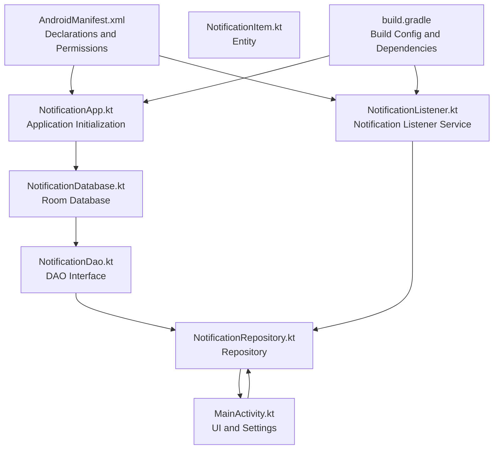
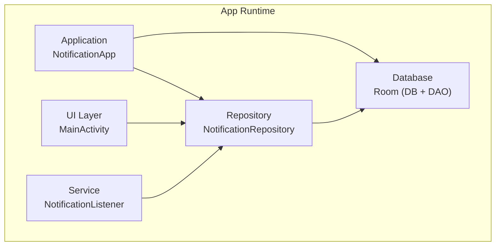
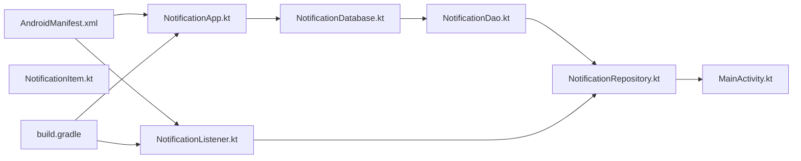

# Configuration API

<cite>
**Referenced Files in This Document**
- [AndroidManifest.xml](file://app/src/main/AndroidManifest.xml)
- [NotificationApp.kt](file://app/src/main/java/com/notificationlog/NotificationApp.kt)
- [NotificationListener.kt](file://app/src/main/java/com/notificationlog/NotificationListener.kt)
- [NotificationDatabase.kt](file://app/src/main/java/com/notificationlog/data/NotificationDatabase.kt)
- [NotificationDao.kt](file://app/src/main/java/com/notificationlog/data/NotificationDao.kt)
- [NotificationItem.kt](file://app/src/main/java/com/notificationlog/model/NotificationItem.kt)
- [NotificationRepository.kt](file://app/src/main/java/com/notificationlog/repository/NotificationRepository.kt)
- [MainActivity.kt](file://app/src/main/java/com/notificationlog/MainActivity.kt)
- [build.gradle](file://app/build.gradle)
- [themes.xml](file://app/src/main/res/values/themes.xml)
- [styles.xml](file://app/src/main/res/values/styles.xml)
- [strings.xml](file://app/src/main/res/values/strings.xml)
</cite>

## Table of Contents
1. [Introduction](#introduction)
2. [Project Structure](#project-structure)
3. [Core Components](#core-components)
4. [Architecture Overview](#architecture-overview)
5. [Detailed Component Analysis](#detailed-component-analysis)
6. [Dependency Analysis](#dependency-analysis)
7. [Performance Considerations](#performance-considerations)
8. [Troubleshooting Guide](#troubleshooting-guide)
9. [Conclusion](#conclusion)
10. [Appendices](#appendices)

## Introduction
This document explains the application configuration APIs and manifest declarations for the NotificationLog Android application. It covers AndroidManifest.xml service declarations, permission requirements, and application initialization. It details the NotificationApp class initialization process, Room database setup, and repository configuration. It also documents SharedPreferences usage for user preferences, theme configuration, and setting persistence. Security considerations around intent filters, service exports, and runtime permissions are addressed, along with examples of manifest modifications, runtime permission handling, configuration validation, build configuration options, ProGuard rules, and deployment considerations for different Android versions.

## Project Structure
The application follows a standard Android Gradle project layout with Kotlin sources under app/src/main/java and resources under app/src/main/res. The manifest declares the application class, activities, and a notification listener service with required permissions and intent filters.

**Diagram sources**
- [AndroidManifest.xml](file://app/src/main/AndroidManifest.xml)
- [NotificationApp.kt](file://app/src/main/java/com/notificationlog/NotificationApp.kt)
- [NotificationDatabase.kt](file://app/src/main/java/com/notificationlog/data/NotificationDatabase.kt)
- [NotificationDao.kt](file://app/src/main/java/com/notificationlog/data/NotificationDao.kt)
- [NotificationItem.kt](file://app/src/main/java/com/notificationlog/model/NotificationItem.kt)
- [NotificationRepository.kt](file://app/src/main/java/com/notificationlog/repository/NotificationRepository.kt)
- [NotificationListener.kt](file://app/src/main/java/com/notificationlog/NotificationListener.kt)
- [MainActivity.kt](file://app/src/main/java/com/notificationlog/MainActivity.kt)
- [build.gradle](file://app/build.gradle)

**Section sources**
- [AndroidManifest.xml](file://app/src/main/AndroidManifest.xml)
- [build.gradle](file://app/build.gradle)

## Core Components
- Application class initializes the Room database and exposes a global repository instance for the app.
- Notification listener service captures notifications, persists them via the repository, and broadcasts updates.
- Room database stores notifications with DAO queries for sorting and insertion.
- SharedPreferences persist user preferences such as dark mode, capture enablement, and whether to show a persistent notification.
- Theme and style resources define the UI appearance and overlays.
- Build configuration defines SDK versions, signing, minification, and KSP arguments for Room schema generation.

**Section sources**
- [NotificationApp.kt](file://app/src/main/java/com/notificationlog/NotificationApp.kt)
- [NotificationListener.kt](file://app/src/main/java/com/notificationlog/NotificationListener.kt)
- [NotificationDatabase.kt](file://app/src/main/java/com/notificationlog/data/NotificationDatabase.kt)
- [NotificationDao.kt](file://app/src/main/java/com/notificationlog/data/NotificationDao.kt)
- [NotificationItem.kt](file://app/src/main/java/com/notificationlog/model/NotificationItem.kt)
- [NotificationRepository.kt](file://app/src/main/java/com/notificationlog/repository/NotificationRepository.kt)
- [MainActivity.kt](file://app/src/main/java/com/notificationlog/MainActivity.kt)
- [build.gradle](file://app/build.gradle)
- [themes.xml](file://app/src/main/res/values/themes.xml)
- [styles.xml](file://app/src/main/res/values/styles.xml)
- [strings.xml](file://app/src/main/res/values/strings.xml)

## Architecture Overview
The application architecture centers on a single Application class that configures the database and repository. The UI (MainActivity) reads and writes SharedPreferences for user settings, observes LiveData from a ViewModel, and interacts with the repository. The NotificationListener service runs independently, capturing notifications and updating the database and UI via broadcasts.

**Diagram sources**
- [NotificationApp.kt](file://app/src/main/java/com/notificationlog/NotificationApp.kt)
- [MainActivity.kt](file://app/src/main/java/com/notificationlog/MainActivity.kt)
- [NotificationRepository.kt](file://app/src/main/java/com/notificationlog/repository/NotificationRepository.kt)
- [NotificationDatabase.kt](file://app/src/main/java/com/notificationlog/data/NotificationDatabase.kt)
- [NotificationDao.kt](file://app/src/main/java/com/notificationlog/data/NotificationDao.kt)
- [NotificationListener.kt](file://app/src/main/java/com/notificationlog/NotificationListener.kt)

## Detailed Component Analysis

### AndroidManifest Declarations and Permissions
- Declares INTERNET and ACCESS_NETWORK_STATE for network-related operations.
- Declares POST_NOTIFICATIONS for Android 13+ to post notifications.
- Application element sets the custom Application class, theme, RTL support, and cleartext traffic allowance.
- Activity declares exported launcher activity with main category.
- Notification Listener Service:
  - Requires BIND_NOTIFICATION_LISTENER_SERVICE permission.
  - Exported and enabled.
  - Declares action for NotificationListenerService.
  - Includes meta-data pointing to a service XML resource.

Security considerations:
- The service is exported; ensure the permission requirement prevents unauthorized binding.
- The meta-data references a service XML resource; confirm its presence in the resources.

**Section sources**
- [AndroidManifest.xml](file://app/src/main/AndroidManifest.xml)

### NotificationApp Initialization
- Initializes Room database using Room.databaseBuilder with the application context and a database name.
- Builds the database and constructs NotificationRepository with the database instance.
- Exposes a global repository via a companion object for use across the app.

Initialization flow:
- onCreate is called during process startup.
- Database is built synchronously during initialization.
- Repository is constructed and stored for later use.

**Section sources**
- [NotificationApp.kt](file://app/src/main/java/com/notificationlog/NotificationApp.kt)

### NotificationListener Service
- Extends NotificationListenerService and manages a coroutine scope for asynchronous work.
- Lazily initializes a Room database and repository per instance.
- onListenerConnected logs successful connection and cancels a warning notification.
- onListenerDisconnected:
  - Logs disconnection and attempts rebind on Android 13+.
  - Shows a high-priority warning notification.
  - Broadcasts a local broadcast to inform the UI.
- onNotificationPosted:
  - Extracts title, content, and timestamp from StatusBarNotification extras.
  - Resolves app label from package name.
  - Reads capture_enabled preference; inserts into database if enabled.
  - Broadcasts NOTIFICATIONS_UPDATED with last_captured timestamp.
- Uses PendingIntent with FLAG_IMMUTABLE and FLAG_UPDATE_CURRENT.
- Cancels notifications with a SecurityException guard.

Runtime permission handling:
- Requests rebind on API 33+ upon disconnection.
- Shows a warning notification when access is lost.

Security considerations:
- Uses RECEIVER_NOT_EXPORTED for broadcasts registered in onResume on Android 13+.
- Uses FLAG_IMMUTABLE for PendingIntent to mitigate tampering.
- Guards cancelNotification with SecurityException handling.

**Section sources**
- [NotificationListener.kt](file://app/src/main/java/com/notificationlog/NotificationListener.kt)

### Room Database and Repository
- Database definition:
  - Annotated with @Database containing NotificationItem entity and version 1.
  - Exposes notificationDao().
- DAO interface:
  - Queries for sorted lists by timestamp and by app.
  - Insert with REPLACE strategy.
  - Delete operations and deleteAll.
- Repository:
  - Provides suspend functions delegating to DAO for CRUD operations.

Data model:
- NotificationItem entity with auto-generated primary key, app identifiers, title, content, timestamp, and optional key.

**Section sources**
- [NotificationDatabase.kt](file://app/src/main/java/com/notificationlog/data/NotificationDatabase.kt)
- [NotificationDao.kt](file://app/src/main/java/com/notificationlog/data/NotificationDao.kt)
- [NotificationItem.kt](file://app/src/main/java/com/notificationlog/model/NotificationItem.kt)
- [NotificationRepository.kt](file://app/src/main/java/com/notificationlog/repository/NotificationRepository.kt)

### SharedPreferences Usage and Theme Configuration
- MainActivity reads and writes preferences:
  - capture_enabled: toggles capture on/off and persists the value.
  - dark_mode: controls day/night mode via AppCompatDelegate.
  - show_running_notif: controls whether a persistent notification is shown.
- Theme configuration:
  - styles.xml defines Theme.NotificationLog based on MaterialComponents DayNight.
  - themes.xml provides NoActionBar and Fullscreen variants.

Setting persistence:
- Preferences are stored under a private shared preferences file with keys for capture, theme, and persistent notification flag.

**Section sources**
- [MainActivity.kt](file://app/src/main/java/com/notificationlog/MainActivity.kt)
- [themes.xml](file://app/src/main/res/values/themes.xml)
- [styles.xml](file://app/src/main/res/values/styles.xml)

### Intent Filters, Service Exports, and Security
- Activity intent-filter includes MAIN action and LAUNCHER category; exported.
- NotificationListener service:
  - Action matches the system service action.
  - Requires BIND_NOTIFICATION_LISTENER_SERVICE permission.
  - Exported to allow system binding.
  - Meta-data references a service XML resource.
- Broadcast receivers:
  - Registered with RECEIVER_NOT_EXPORTED on Android 13+ to limit exposure.
  - Local broadcasts used to communicate between service and UI.

Security considerations:
- Permission-bound service binding prevents unauthorized components from binding.
- Receiver export policy reduces attack surface on newer Android versions.
- PendingIntent flags are set to immutable and update-current to prevent tampering and ensure updates.

**Section sources**
- [AndroidManifest.xml](file://app/src/main/AndroidManifest.xml)
- [NotificationListener.kt](file://app/src/main/java/com/notificationlog/NotificationListener.kt)
- [MainActivity.kt](file://app/src/main/java/com/notificationlog/MainActivity.kt)

### Build Configuration Options and Deployment
- SDK versions:
  - compileSdk 34
  - minSdk 24
  - targetSdk 34
- Signing:
  - Release signing configured via keystore properties file.
- Minification and obfuscation:
  - minifyEnabled false in release.
  - ProGuard rules included via proguard-rules.pro.
- Java/Kotlin compatibility:
  - Java 21 compatibility for source/target.
  - Kotlin JVM target 21.
- Data Binding enabled.
- KSP arguments:
  - room.schemaLocation set to projectDir/schemas.

Deployment considerations:
- Ensure keystore.properties exists for release builds.
- For production, consider enabling minifyEnabled and configuring appropriate ProGuard rules.
- Verify room.schemaLocation is present for schema validation in CI.

**Section sources**
- [build.gradle](file://app/build.gradle)

## Dependency Analysis
The following diagram shows module-level dependencies among core components:

**Diagram sources**
- [AndroidManifest.xml](file://app/src/main/AndroidManifest.xml)
- [NotificationApp.kt](file://app/src/main/java/com/notificationlog/NotificationApp.kt)
- [NotificationDatabase.kt](file://app/src/main/java/com/notificationlog/data/NotificationDatabase.kt)
- [NotificationDao.kt](file://app/src/main/java/com/notificationlog/data/NotificationDao.kt)
- [NotificationItem.kt](file://app/src/main/java/com/notificationlog/model/NotificationItem.kt)
- [NotificationRepository.kt](file://app/src/main/java/com/notificationlog/repository/NotificationRepository.kt)
- [NotificationListener.kt](file://app/src/main/java/com/notificationlog/NotificationListener.kt)
- [MainActivity.kt](file://app/src/main/java/com/notificationlog/MainActivity.kt)
- [build.gradle](file://app/build.gradle)

**Section sources**
- [build.gradle](file://app/build.gradle)

## Performance Considerations
- Database operations are performed asynchronously via suspend functions and a coroutine scope in the listener to avoid blocking the main thread.
- DAO queries use ordered selections suitable for UI presentation; consider pagination for very large datasets.
- Room schema location is configured for schema validation; ensure this path is maintained for development and CI.
- Avoid unnecessary broadcasts; only emit when data changes to reduce UI refresh overhead.

[No sources needed since this section provides general guidance]

## Troubleshooting Guide
Common issues and resolutions:
- Notification access lost:
  - The listener shows a high-priority warning notification and requests rebind on Android 13+.
  - The UI displays a dialog prompting users to re-enable notification access.
- Receiver registration:
  - On Android 13+, receivers are registered with RECEIVER_NOT_EXPORTED to prevent external broadcasts.
- PendingIntent flags:
  - Use FLAG_IMMUTABLE and FLAG_UPDATE_CURRENT to avoid tampering and ensure updates.
- Database initialization:
  - The Application class initializes the database early; ensure no race conditions occur if accessing the repository before onCreate completes.

**Section sources**
- [NotificationListener.kt](file://app/src/main/java/com/notificationlog/NotificationListener.kt)
- [MainActivity.kt](file://app/src/main/java/com/notificationlog/MainActivity.kt)

## Conclusion
The NotificationLog application integrates a Room-backed repository, a notification listener service, and a UI that persists user preferences. The manifest enforces proper permissions and service binding, while the build configuration supports modern Android development practices. By following the documented configuration patterns and security considerations, developers can maintain and extend the application reliably across Android versions.

[No sources needed since this section summarizes without analyzing specific files]

## Appendices

### Manifest Modifications Examples
- To restrict service binding further, keep the BIND_NOTIFICATION_LISTENER_SERVICE permission and ensure the service remains exported only for system binding.
- To add a custom meta-data resource for the listener, ensure the referenced XML resource exists in the resources.

**Section sources**
- [AndroidManifest.xml](file://app/src/main/AndroidManifest.xml)

### Runtime Permission Handling
- Android 13+ requires POST_NOTIFICATIONS for posting notifications.
- The UI checks and requests permission using ActivityResultContracts.
- The listener attempts rebind on disconnection to restore access.

**Section sources**
- [MainActivity.kt](file://app/src/main/java/com/notificationlog/MainActivity.kt)
- [NotificationListener.kt](file://app/src/main/java/com/notificationlog/NotificationListener.kt)

### Configuration Validation
- Build script validates Room schema location and enables data binding.
- Ensure keystore properties are present for release builds.

**Section sources**
- [build.gradle](file://app/build.gradle)

### Deployment Considerations
- For production, enable minification and configure ProGuard rules.
- Maintain room.schemaLocation for schema validation.
- Test on devices with varying Android versions to validate permission flows and service behavior.

**Section sources**
- [build.gradle](file://app/build.gradle)
- [AndroidManifest.xml](file://app/src/main/AndroidManifest.xml)