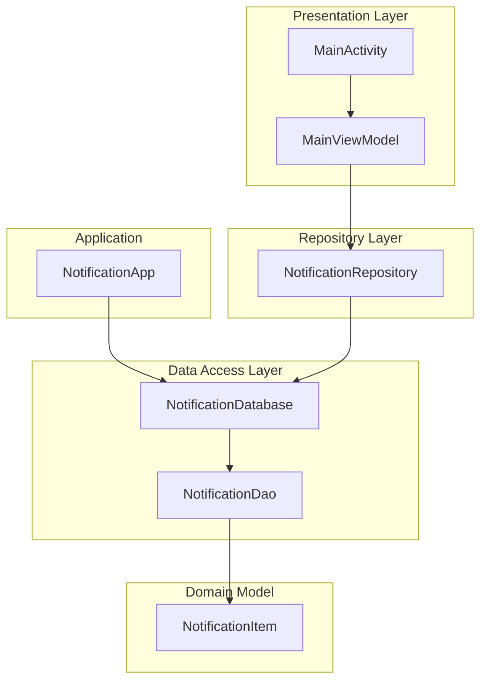
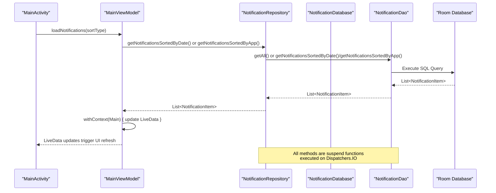
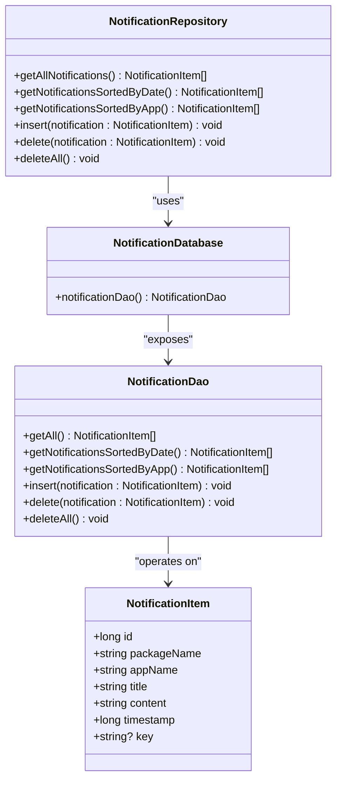
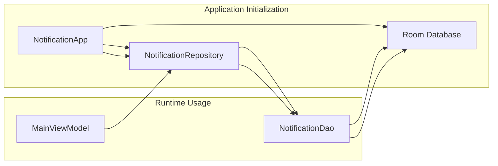

# Repository API

<cite>
**Referenced Files in This Document**
- [NotificationRepository.kt](file://app/src/main/java/com/notificationlog/repository/NotificationRepository.kt)
- [NotificationDao.kt](file://app/src/main/java/com/notificationlog/data/NotificationDao.kt)
- [NotificationDatabase.kt](file://app/src/main/java/com/notificationlog/data/NotificationDatabase.kt)
- [NotificationItem.kt](file://app/src/main/java/com/notificationlog/model/NotificationItem.kt)
- [NotificationApp.kt](file://app/src/main/java/com/notificationlog/NotificationApp.kt)
- [MainViewModel.kt](file://app/src/main/java/com/notificationlog/MainViewModel.kt)
- [MainActivity.kt](file://app/src/main/java/com/notificationlog/MainActivity.kt)
</cite>

## Table of Contents
1. [Introduction](#introduction)
2. [Project Structure](#project-structure)
3. [Core Components](#core-components)
4. [Architecture Overview](#architecture-overview)
5. [Detailed Component Analysis](#detailed-component-analysis)
6. [Dependency Analysis](#dependency-analysis)
7. [Performance Considerations](#performance-considerations)
8. [Troubleshooting Guide](#troubleshooting-guide)
9. [Conclusion](#conclusion)

## Introduction
This document provides comprehensive API documentation for the NotificationRepository class and its associated DAO methods. It covers all public methods, parameter types, return values, suspend function usage, coroutine context requirements, and practical usage patterns. The repository follows the repository pattern to abstract data access and provide a clean API surface for ViewModels and UI layers.

## Project Structure
The repository implementation resides in the data access layer with Room database integration. The structure follows Android architecture best practices with clear separation between data models, DAO interfaces, database abstraction, and repository implementation.



**Diagram sources**
- [NotificationRepository.kt:6-27](file://app/src/main/java/com/notificationlog/repository/NotificationRepository.kt#L6-L27)
- [NotificationDatabase.kt:7-9](file://app/src/main/java/com/notificationlog/data/NotificationDatabase.kt#L7-L9)
- [NotificationDao.kt:6-25](file://app/src/main/java/com/notificationlog/data/NotificationDao.kt#L6-L25)
- [NotificationItem.kt:8-19](file://app/src/main/java/com/notificationlog/model/NotificationItem.kt#L8-L19)
- [NotificationApp.kt:8-27](file://app/src/main/java/com/notificationlog/NotificationApp.kt#L8-L27)

**Section sources**
- [NotificationRepository.kt:1-28](file://app/src/main/java/com/notificationlog/repository/NotificationRepository.kt#L1-L28)
- [NotificationDao.kt:1-26](file://app/src/main/java/com/notificationlog/data/NotificationDao.kt#L1-L26)
- [NotificationDatabase.kt:1-10](file://app/src/main/java/com/notificationlog/data/NotificationDatabase.kt#L1-L10)
- [NotificationItem.kt:1-19](file://app/src/main/java/com/notificationlog/model/NotificationItem.kt#L1-L19)
- [NotificationApp.kt:1-28](file://app/src/main/java/com/notificationlog/NotificationApp.kt#L1-L28)

## Core Components
The repository layer consists of three primary components:

### NotificationRepository
The central repository class that encapsulates all data access operations for notifications. It provides a simplified interface to the underlying DAO while maintaining type safety and coroutine integration.

### NotificationDao
Room DAO interface defining all database operations with suspend functions for asynchronous execution. Methods include sorting options and CRUD operations.

### NotificationDatabase
Room database abstraction exposing the DAO interface for dependency injection.

**Section sources**
- [NotificationRepository.kt:6-27](file://app/src/main/java/com/notificationlog/repository/NotificationRepository.kt#L6-L27)
- [NotificationDao.kt:6-25](file://app/src/main/java/com/notificationlog/data/NotificationDao.kt#L6-L25)
- [NotificationDatabase.kt:7-9](file://app/src/main/java/com/notificationlog/data/NotificationDatabase.kt#L7-L9)

## Architecture Overview
The repository pattern implementation follows Android architecture guidelines with clear separation of concerns:



**Diagram sources**
- [MainViewModel.kt:59-77](file://app/src/main/java/com/notificationlog/MainViewModel.kt#L59-L77)
- [NotificationRepository.kt:8-14](file://app/src/main/java/com/notificationlog/repository/NotificationRepository.kt#L8-L14)
- [NotificationDao.kt:9-16](file://app/src/main/java/com/notificationlog/data/NotificationDao.kt#L9-L16)

## Detailed Component Analysis

### NotificationRepository API Reference

#### getAllNotifications()
**Method Signature:** `suspend fun getAllNotifications(): List<NotificationItem>`

**Description:** Retrieves all notifications from the database sorted by timestamp in descending order (most recent first).

**Parameters:** None

**Return Value:** `List<NotificationItem>` containing all stored notifications

**Coroutine Context:** Must be called from a coroutine context that supports suspension (typically Dispatchers.IO)

**Thread Safety:** Thread-safe through Room's internal threading model

**Usage Example:**
```kotlin
// In ViewModel
viewModelScope.launch(Dispatchers.IO) {
    val notifications = repository.getAllNotifications()
    // Process notifications
}
```

**Section sources**
- [NotificationRepository.kt:8](file://app/src/main/java/com/notificationlog/repository/NotificationRepository.kt#L8)
- [NotificationDao.kt:9-10](file://app/src/main/java/com/notificationlog/data/NotificationDao.kt#L9-L10)

#### getNotificationsSortedByDate()
**Method Signature:** `suspend fun getNotificationsSortedByDate(): List<NotificationItem>`

**Description:** Retrieves notifications sorted by timestamp in descending order (most recent first).

**Parameters:** None

**Return Value:** `List<NotificationItem>` sorted by timestamp

**Coroutine Context:** Must be called from a coroutine context that supports suspension

**Thread Safety:** Thread-safe through Room's internal threading model

**Usage Example:**
```kotlin
// In ViewModel
viewModelScope.launch(Dispatchers.IO) {
    val notifications = repository.getNotificationsSortedByDate()
    withContext(Dispatchers.Main) {
        _notifications.value = notifications
    }
}
```

**Section sources**
- [NotificationRepository.kt:10-11](file://app/src/main/java/com/notificationlog/repository/NotificationRepository.kt#L10-L11)
- [NotificationDao.kt:12-13](file://app/src/main/java/com/notificationlog/data/NotificationDao.kt#L12-L13)

#### getNotificationsSortedByApp()
**Method Signature:** `suspend fun getNotificationsSortedByApp(): List<NotificationItem>`

**Description:** Retrieves notifications sorted by application name (ascending) and then by timestamp (descending).

**Parameters:** None

**Return Value:** `List<NotificationItem>` sorted by app name, then by timestamp

**Coroutine Context:** Must be called from a coroutine context that supports suspension

**Thread Safety:** Thread-safe through Room's internal threading model

**Usage Example:**
```kotlin
// In ViewModel
viewModelScope.launch(Dispatchers.IO) {
    val notifications = repository.getNotificationsSortedByApp()
    withContext(Dispatchers.Main) {
        _notifications.value = notifications
    }
}
```

**Section sources**
- [NotificationRepository.kt:13-14](file://app/src/main/java/com/notificationlog/repository/NotificationRepository.kt#L13-L14)
- [NotificationDao.kt:15-16](file://app/src/main/java/com/notificationlog/data/NotificationDao.kt#L15-L16)

#### insert()
**Method Signature:** `suspend fun insert(notification: NotificationItem): Unit`

**Description:** Inserts a new notification into the database. Uses REPLACE conflict strategy to handle duplicates.

**Parameters:**
- `notification: NotificationItem` - The notification to insert

**Return Value:** `Unit` (no return value)

**Coroutine Context:** Must be called from a coroutine context that supports suspension

**Thread Safety:** Thread-safe through Room's internal threading model

**Usage Example:**
```kotlin
// In ViewModel
viewModelScope.launch(Dispatchers.IO) {
    repository.insert(newNotification)
    loadNotifications(currentSort) // Refresh list
}
```

**Section sources**
- [NotificationRepository.kt:16-18](file://app/src/main/java/com/notificationlog/repository/NotificationRepository.kt#L16-L18)
- [NotificationDao.kt:18-19](file://app/src/main/java/com/notificationlog/data/NotificationDao.kt#L18-L19)

#### delete()
**Method Signature:** `suspend fun delete(notification: NotificationItem): Unit`

**Description:** Deletes a specific notification from the database.

**Parameters:**
- `notification: NotificationItem` - The notification to delete

**Return Value:** `Unit` (no return value)

**Coroutine Context:** Must be called from a coroutine context that supports suspension

**Thread Safety:** Thread-safe through Room's internal threading model

**Usage Example:**
```kotlin
// In ViewModel
viewModelScope.launch(Dispatchers.IO) {
    repository.delete(selectedNotification)
    loadNotifications(currentSort) // Refresh list
}
```

**Section sources**
- [NotificationRepository.kt:20-22](file://app/src/main/java/com/notificationlog/repository/NotificationRepository.kt#L20-L22)
- [NotificationDao.kt:21-22](file://app/src/main/java/com/notificationlog/data/NotificationDao.kt#L21-L22)

#### deleteAll()
**Method Signature:** `suspend fun deleteAll(): Unit`

**Description:** Clears all notifications from the database.

**Parameters:** None

**Return Value:** `Unit` (no return value)

**Coroutine Context:** Must be called from a coroutine context that supports suspension

**Thread Safety:** Thread-safe through Room's internal threading model

**Usage Example:**
```kotlin
// In ViewModel
viewModelScope.launch(Dispatchers.IO) {
    repository.deleteAll()
    withContext(Dispatchers.Main) {
        _notifications.value = emptyList()
        _notificationCount.value = 0
    }
}
```

**Section sources**
- [NotificationRepository.kt:24-26](file://app/src/main/java/com/notificationlog/repository/NotificationRepository.kt#L24-L26)
- [NotificationDao.kt:24-25](file://app/src/main/java/com/notificationlog/data/NotificationDao.kt#L24-L25)

### Data Model: NotificationItem
The NotificationItem entity defines the structure of notification records stored in the database:



**Diagram sources**
- [NotificationItem.kt:10-19](file://app/src/main/java/com/notificationlog/model/NotificationItem.kt#L10-L19)
- [NotificationDao.kt:6-25](file://app/src/main/java/com/notificationlog/data/NotificationDao.kt#L6-L25)
- [NotificationRepository.kt:6-27](file://app/src/main/java/com/notificationlog/repository/NotificationRepository.kt#L6-L27)

**Section sources**
- [NotificationItem.kt:8-19](file://app/src/main/java/com/notificationlog/model/NotificationItem.kt#L8-L19)

## Dependency Analysis
The dependency injection setup uses a singleton pattern through the application class:



**Diagram sources**
- [NotificationApp.kt:15-27](file://app/src/main/java/com/notificationlog/NotificationApp.kt#L15-L27)
- [MainViewModel.kt:62](file://app/src/main/java/com/notificationlog/MainViewModel.kt#L62)

**Section sources**
- [NotificationApp.kt:8-27](file://app/src/main/java/com/notificationlog/NotificationApp.kt#L8-L27)
- [MainViewModel.kt:62](file://app/src/main/java/com/notificationlog/MainViewModel.kt#L62)

## Performance Considerations

### Coroutine Context Management
- All repository methods are suspend functions designed for asynchronous execution
- Recommended context: `Dispatchers.IO` for database operations
- UI updates should occur on `Dispatchers.Main` using `withContext(Dispatchers.Main)`

### Database Optimization
- Queries are optimized with appropriate ORDER BY clauses
- Room handles connection pooling internally
- Consider pagination for large datasets if performance becomes an issue

### Memory Management
- Repository returns immutable lists from DAO
- ViewModel observes LiveData for automatic UI updates
- Proper lifecycle management prevents memory leaks

### Concurrency Patterns
- Repository methods are thread-safe through Room's internal threading
- No explicit synchronization required in the repository layer
- ViewModelScope ensures proper coroutine lifecycle management

## Troubleshooting Guide

### Common Error Scenarios

#### Database Operation Failures
```kotlin
// ViewModel error handling pattern
viewModelScope.launch(Dispatchers.IO + handler) {
    try {
        repository.deleteAll()
        // Success handling
    } catch (e: Exception) {
        withContext(Dispatchers.Main) {
            _errorMessage.value = "Error clearing notifications: ${e.message}"
        }
    }
}
```

#### Repository Method Usage Errors
- **Issue:** Calling repository methods from main thread
- **Solution:** Always launch with `Dispatchers.IO` or appropriate coroutine context
- **Issue:** Not handling exceptions properly
- **Solution:** Use CoroutineExceptionHandler or try-catch blocks

#### Integration Issues
- **Issue:** Repository not initialized
- **Solution:** Ensure NotificationApp.onCreate() executes before accessing repository
- **Issue:** LiveData not updating
- **Solution:** Verify ViewModel is observing the correct LiveData instances

**Section sources**
- [MainViewModel.kt:29-31](file://app/src/main/java/com/notificationlog/MainViewModel.kt#L29-L31)
- [MainViewModel.kt:71-76](file://app/src/main/java/com/notificationlog/MainViewModel.kt#L71-L76)
- [NotificationApp.kt:15-27](file://app/src/main/java/com/notificationlog/NotificationApp.kt#L15-L27)

## Conclusion
The NotificationRepository provides a clean, thread-safe abstraction over the Room database layer with comprehensive CRUD operations and flexible sorting capabilities. The implementation follows Android architecture best practices with proper coroutine integration, error handling, and dependency injection patterns. The repository's suspend function design ensures efficient asynchronous database operations while maintaining type safety and clear separation of concerns.

Key benefits of this implementation:
- Clean separation between presentation and data layers
- Thread-safe database operations through Room
- Comprehensive error handling with coroutine contexts
- Flexible sorting options for different UI requirements
- Singleton pattern for efficient resource management
- Proper lifecycle-aware coroutine usage in ViewModels

The API is production-ready with clear contracts, proper error handling, and optimal performance characteristics for mobile applications.