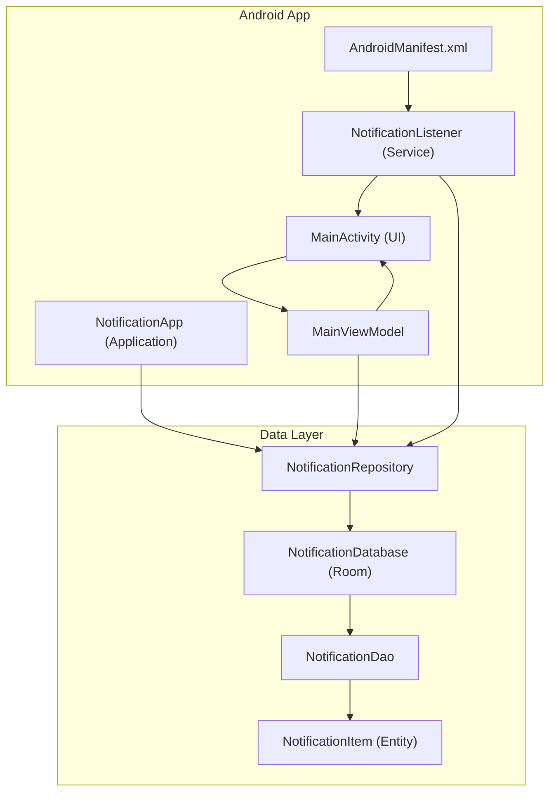
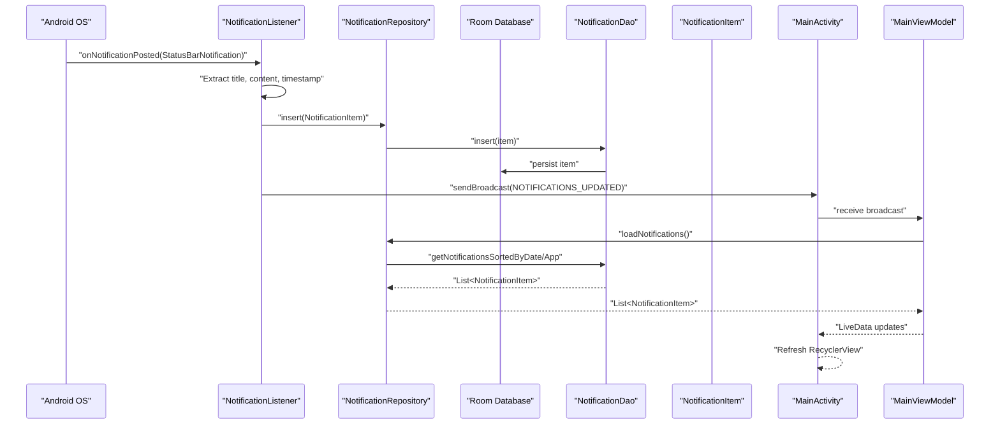
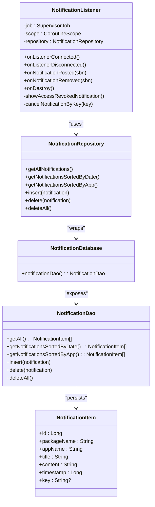
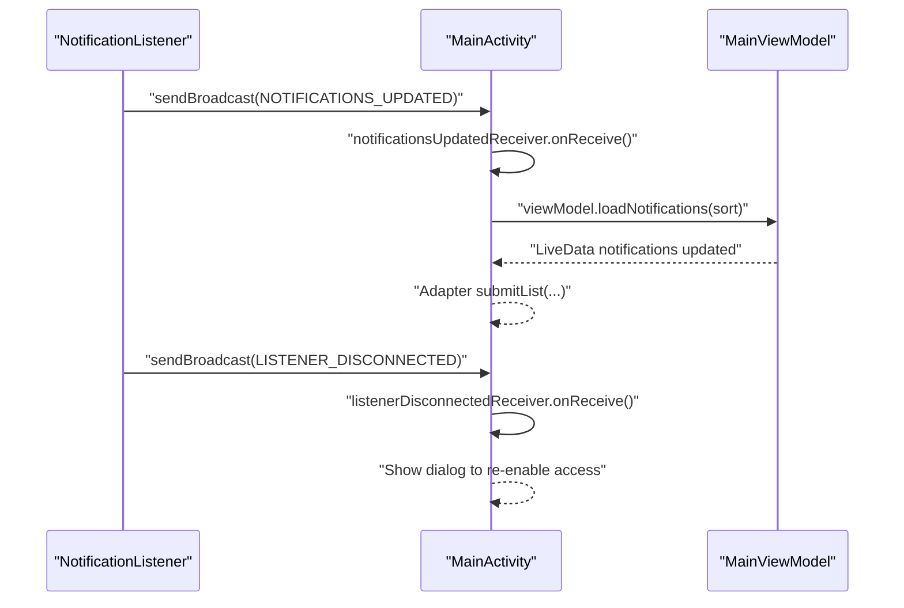
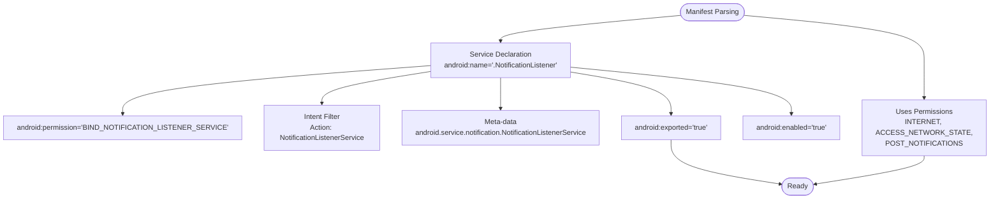
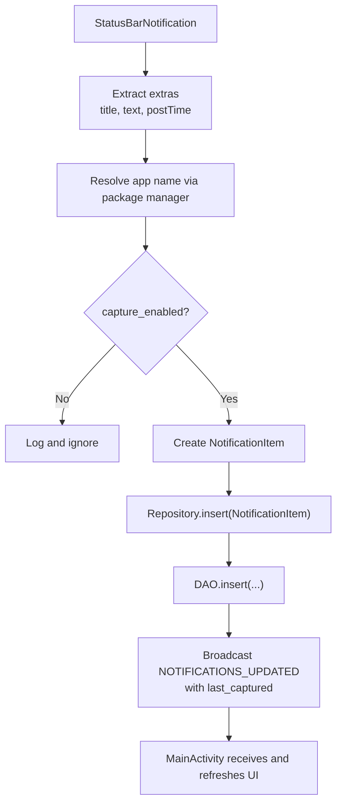
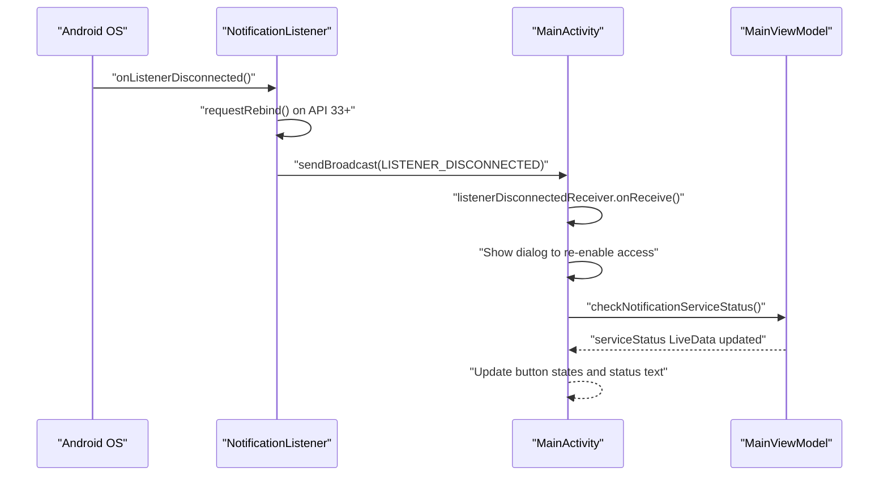
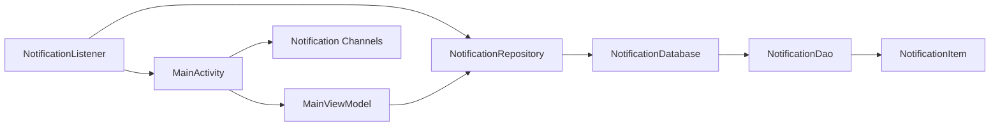

# Service API

<cite>
**Referenced Files in This Document**
- [NotificationListener.kt](file://app/src/main/java/com/notificationlog/NotificationListener.kt)
- [AndroidManifest.xml](file://app/src/main/AndroidManifest.xml)
- [MainActivity.kt](file://app/src/main/java/com/notificationlog/MainActivity.kt)
- [MainViewModel.kt](file://app/src/main/java/com/notificationlog/MainViewModel.kt)
- [NotificationApp.kt](file://app/src/main/java/com/notificationlog/NotificationApp.kt)
- [NotificationRepository.kt](file://app/src/main/java/com/notificationlog/repository/NotificationRepository.kt)
- [NotificationDatabase.kt](file://app/src/main/java/com/notificationlog/data/NotificationDatabase.kt)
- [NotificationDao.kt](file://app/src/main/java/com/notificationlog/data/NotificationDao.kt)
- [NotificationItem.kt](file://app/src/main/java/com/notificationlog/model/NotificationItem.kt)
- [notification_service.xml](file://app/src/main/res/xml/notification_service.xml)
</cite>

## Table of Contents
1. [Introduction](#introduction)
2. [Project Structure](#project-structure)
3. [Core Components](#core-components)
4. [Architecture Overview](#architecture-overview)
5. [Detailed Component Analysis](#detailed-component-analysis)
6. [Dependency Analysis](#dependency-analysis)
7. [Performance Considerations](#performance-considerations)
8. [Troubleshooting Guide](#troubleshooting-guide)
9. [Conclusion](#conclusion)

## Introduction
This document provides comprehensive API documentation for the NotificationListener service and related background operation interfaces. It covers the service lifecycle, notification capture mechanisms, broadcast communication protocols, service registration in AndroidManifest.xml, intent filters, permissions, notification processing pipeline, data transformation methods, background execution constraints, and practical examples for binding, event handling, and state management. It also addresses service restart scenarios, memory management, and battery optimization considerations.

## Project Structure
The project follows a modular Android architecture with a foreground-aware NotificationListener service, a Room database for persistence, and a UI layer built with Activities and ViewModels. The service integrates with the Android notification listener framework and communicates with the UI via local broadcasts.

**Diagram sources**
- [AndroidManifest.xml:29-43](file://app/src/main/AndroidManifest.xml#L29-L43)
- [NotificationApp.kt:8-27](file://app/src/main/java/com/notificationlog/NotificationApp.kt#L8-L27)
- [NotificationRepository.kt:6-27](file://app/src/main/java/com/notificationlog/repository/NotificationRepository.kt#L6-L27)
- [NotificationDatabase.kt:7-10](file://app/src/main/java/com/notificationlog/data/NotificationDatabase.kt#L7-L10)
- [NotificationDao.kt:6-26](file://app/src/main/java/com/notificationlog/data/NotificationDao.kt#L6-L26)
- [NotificationItem.kt:8-19](file://app/src/main/java/com/notificationlog/model/NotificationItem.kt#L8-L19)
- [MainActivity.kt:43-108](file://app/src/main/java/com/notificationlog/MainActivity.kt#L43-L108)
- [MainViewModel.kt:15-48](file://app/src/main/java/com/notificationlog/MainViewModel.kt#L15-L48)
- [NotificationListener.kt:23-173](file://app/src/main/java/com/notificationlog/NotificationListener.kt#L23-L173)

**Section sources**
- [AndroidManifest.xml:1-45](file://app/src/main/AndroidManifest.xml#L1-L45)
- [NotificationApp.kt:1-28](file://app/src/main/java/com/notificationlog/NotificationApp.kt#L1-L28)
- [NotificationRepository.kt:1-28](file://app/src/main/java/com/notificationlog/repository/NotificationRepository.kt#L1-L28)
- [NotificationDatabase.kt:1-10](file://app/src/main/java/com/notificationlog/data/NotificationDatabase.kt#L1-L10)
- [NotificationDao.kt:1-26](file://app/src/main/java/com/notificationlog/data/NotificationDao.kt#L1-L26)
- [NotificationItem.kt:1-19](file://app/src/main/java/com/notificationlog/model/NotificationItem.kt#L1-L19)
- [MainActivity.kt:1-717](file://app/src/main/java/com/notificationlog/MainActivity.kt#L1-L717)
- [MainViewModel.kt:1-121](file://app/src/main/java/com/notificationlog/MainViewModel.kt#L1-L121)
- [NotificationListener.kt:1-173](file://app/src/main/java/com/notificationlog/NotificationListener.kt#L1-L173)

## Core Components
- NotificationListener: Android NotificationListenerService subclass responsible for capturing notifications, persisting them, and broadcasting updates to the UI.
- MainActivity: UI controller that registers broadcast receivers, manages permissions, toggles capture state, and displays captured notifications.
- MainViewModel: AndroidViewModel that observes service status, loads notifications from the repository, and exposes LiveData to the UI.
- NotificationRepository: Repository layer coordinating Room DAO operations for CRUD on NotificationItem entities.
- NotificationDatabase and NotificationDao: Room database and DAO for persistent storage of notifications.
- NotificationItem: Parcelable Room entity representing a captured notification.
- NotificationApp: Application class initializing the Room database and exposing a global repository instance.

Key responsibilities:
- Service lifecycle: onListenerConnected, onListenerDisconnected, onNotificationPosted, onNotificationRemoved, onDestroy.
- Broadcast protocol: NOTIFICATIONS_UPDATED and LISTENER_DISCONNECTED for inter-process communication.
- Persistence: Room database integration for storing notifications.
- UI integration: Local broadcasts to refresh UI and show warnings when access is revoked.

**Section sources**
- [NotificationListener.kt:23-173](file://app/src/main/java/com/notificationlog/NotificationListener.kt#L23-L173)
- [MainActivity.kt:43-144](file://app/src/main/java/com/notificationlog/MainActivity.kt#L43-L144)
- [MainViewModel.kt:15-115](file://app/src/main/java/com/notificationlog/MainViewModel.kt#L15-L115)
- [NotificationRepository.kt:6-27](file://app/src/main/java/com/notificationlog/repository/NotificationRepository.kt#L6-L27)
- [NotificationDatabase.kt:7-10](file://app/src/main/java/com/notificationlog/data/NotificationDatabase.kt#L7-L10)
- [NotificationDao.kt:6-26](file://app/src/main/java/com/notificationlog/data/NotificationDao.kt#L6-L26)
- [NotificationItem.kt:8-19](file://app/src/main/java/com/notificationlog/model/NotificationItem.kt#L8-L19)
- [NotificationApp.kt:8-27](file://app/src/main/java/com/notificationlog/NotificationApp.kt#L8-L27)

## Architecture Overview
The system uses Android’s NotificationListenerService to capture notifications in real-time. The service transforms StatusBarNotification into NotificationItem entities, persists them via Room, and broadcasts updates to MainActivity. MainActivity registers receivers to receive these broadcasts and refreshes its UI accordingly. The ViewModel mediates between UI and repository, providing LiveData streams for reactive updates.

**Diagram sources**
- [NotificationListener.kt:109-153](file://app/src/main/java/com/notificationlog/NotificationListener.kt#L109-L153)
- [NotificationRepository.kt:16-18](file://app/src/main/java/com/notificationlog/repository/NotificationRepository.kt#L16-L18)
- [NotificationDao.kt:18-19](file://app/src/main/java/com/notificationlog/data/NotificationDao.kt#L18-L19)
- [MainActivity.kt:57-66](file://app/src/main/java/com/notificationlog/MainActivity.kt#L57-L66)
- [MainViewModel.kt:59-77](file://app/src/main/java/com/notificationlog/MainViewModel.kt#L59-L77)

## Detailed Component Analysis

### NotificationListener Service
The NotificationListener service extends NotificationListenerService and implements:
- Lifecycle callbacks: onListenerConnected, onListenerDisconnected, onNotificationPosted, onNotificationRemoved, onDestroy.
- Notification capture: Extracts title, content, timestamp, and app name; checks captureEnabled preference; persists via repository; broadcasts updates.
- Reconnection handling: Requests rebind on API 33+ and shows a high-priority warning notification when access is lost.
- Broadcast communication: Emits NOTIFICATIONS_UPDATED and LISTENER_DISCONNECTED with package-scoped intents.

Implementation highlights:
- Background execution: Uses CoroutineScope with Dispatchers.IO and SupervisorJob for non-cancellable background tasks.
- Persistence: Initializes Room database and repository lazily; inserts NotificationItem asynchronously.
- Safety: Catches exceptions during insertion and logs errors; cancels a warning notification on successful connection.
- Restart scenario: Calls requestRebind on API 33+ to recover from disconnection.

**Diagram sources**
- [NotificationListener.kt:23-173](file://app/src/main/java/com/notificationlog/NotificationListener.kt#L23-L173)
- [NotificationRepository.kt:6-27](file://app/src/main/java/com/notificationlog/repository/NotificationRepository.kt#L6-L27)
- [NotificationDatabase.kt:7-10](file://app/src/main/java/com/notificationlog/data/NotificationDatabase.kt#L7-L10)
- [NotificationDao.kt:6-26](file://app/src/main/java/com/notificationlog/data/NotificationDao.kt#L6-L26)
- [NotificationItem.kt:8-19](file://app/src/main/java/com/notificationlog/model/NotificationItem.kt#L8-L19)

**Section sources**
- [NotificationListener.kt:23-173](file://app/src/main/java/com/notificationlog/NotificationListener.kt#L23-L173)

### MainActivity and Broadcast Communication
MainActivity registers two local broadcast receivers:
- NOTIFICATIONS_UPDATED: Refreshes the notification list and updates the last captured timestamp label.
- LISTENER_DISCONNECTED: Shows a dialog prompting the user to re-enable notification access.

Lifecycle integration:
- Registers receivers in onResume with RECEIVER_NOT_EXPORTED on API 33+ and standard registration otherwise.
- Unregisters receivers in onPause to prevent leaks.
- Observes service status LiveData from MainViewModel to update UI state and buttons.

**Diagram sources**
- [MainActivity.kt:51-66](file://app/src/main/java/com/notificationlog/MainActivity.kt#L51-L66)
- [MainActivity.kt:110-144](file://app/src/main/java/com/notificationlog/MainActivity.kt#L110-L144)
- [NotificationListener.kt:62-65](file://app/src/main/java/com/notificationlog/NotificationListener.kt#L62-L65)
- [NotificationListener.kt:142-144](file://app/src/main/java/com/notificationlog/NotificationListener.kt#L142-L144)

**Section sources**
- [MainActivity.kt:43-144](file://app/src/main/java/com/notificationlog/MainActivity.kt#L43-L144)
- [NotificationListener.kt:62-65](file://app/src/main/java/com/notificationlog/NotificationListener.kt#L62-L65)
- [NotificationListener.kt:142-144](file://app/src/main/java/com/notificationlog/NotificationListener.kt#L142-L144)

### Service Registration and Permissions
Service registration in AndroidManifest.xml:
- Declares the NotificationListener service with BIND permission and action filter.
- Includes meta-data pointing to notification_service.xml resource.
- Exports the service and enables it.

Permissions:
- INTERNET and ACCESS_NETWORK_STATE for network-related operations.
- POST_NOTIFICATIONS for Android 13+ to post notifications.

Intent filters and meta-data:
- Action android.service.notification.NotificationListenerService.
- Meta-data resource for notification listener summary.

**Diagram sources**
- [AndroidManifest.xml:29-43](file://app/src/main/AndroidManifest.xml#L29-L43)
- [AndroidManifest.xml:5-7](file://app/src/main/AndroidManifest.xml#L5-L7)

**Section sources**
- [AndroidManifest.xml:1-45](file://app/src/main/AndroidManifest.xml#L1-L45)
- [notification_service.xml:1-5](file://app/src/main/res/xml/notification_service.xml#L1-L5)

### Notification Processing Pipeline and Data Transformation
Pipeline stages:
- Capture: onNotificationPosted extracts title, content, timestamp, and app name from StatusBarNotification extras.
- Preference gate: Reads capture_enabled from SharedPreferences; skips processing if disabled.
- Model creation: Constructs NotificationItem with extracted fields.
- Persistence: Inserts NotificationItem asynchronously via repository and DAO.
- Broadcast: Emits NOTIFICATIONS_UPDATED with last_captured timestamp extra.
- UI refresh: MainActivity receives broadcast and reloads notifications.

Data transformation:
- App name resolution via PackageManager.getApplicationLabel.
- Timestamp preservation from StatusBarNotification.postTime.
- Key preservation for potential future cancellation.

**Diagram sources**
- [NotificationListener.kt:109-153](file://app/src/main/java/com/notificationlog/NotificationListener.kt#L109-L153)
- [NotificationRepository.kt:16-18](file://app/src/main/java/com/notificationlog/repository/NotificationRepository.kt#L16-L18)
- [NotificationDao.kt:18-19](file://app/src/main/java/com/notificationlog/data/NotificationDao.kt#L18-L19)
- [MainActivity.kt:57-66](file://app/src/main/java/com/notificationlog/MainActivity.kt#L57-L66)

**Section sources**
- [NotificationListener.kt:109-153](file://app/src/main/java/com/notificationlog/NotificationListener.kt#L109-L153)
- [NotificationRepository.kt:16-18](file://app/src/main/java/com/notificationlog/repository/NotificationRepository.kt#L16-L18)
- [NotificationDao.kt:18-19](file://app/src/main/java/com/notificationlog/data/NotificationDao.kt#L18-L19)
- [MainActivity.kt:57-66](file://app/src/main/java/com/notificationlog/MainActivity.kt#L57-L66)

### Service Binding, Restart Scenarios, and State Management
Service binding:
- The service does not expose an IBinder interface; binding is handled by the Android system for notification listener services.
- The UI checks service status via Settings.Secure.getString("enabled_notification_listeners").

Restart scenarios:
- onListenerDisconnected triggers rebind request on API 33+ and shows a high-priority warning notification.
- The UI listens for LISTENER_DISCONNECTED and prompts the user to re-enable access.

State management:
- SharedPreferences stores capture_enabled, dark_mode, show_running_notif.
- MainViewModel exposes LiveData for service status and notification count.
- MainActivity updates UI state based on service status and preferences.

**Diagram sources**
- [NotificationListener.kt:44-65](file://app/src/main/java/com/notificationlog/NotificationListener.kt#L44-L65)
- [MainActivity.kt:51-66](file://app/src/main/java/com/notificationlog/MainActivity.kt#L51-L66)
- [MainActivity.kt:324-332](file://app/src/main/java/com/notificationlog/MainActivity.kt#L324-L332)
- [MainViewModel.kt:37-48](file://app/src/main/java/com/notificationlog/MainViewModel.kt#L37-L48)

**Section sources**
- [NotificationListener.kt:44-65](file://app/src/main/java/com/notificationlog/NotificationListener.kt#L44-L65)
- [MainActivity.kt:51-66](file://app/src/main/java/com/notificationlog/MainActivity.kt#L51-L66)
- [MainActivity.kt:324-332](file://app/src/main/java/com/notificationlog/MainActivity.kt#L324-L332)
- [MainViewModel.kt:37-48](file://app/src/main/java/com/notificationlog/MainViewModel.kt#L37-L48)

## Dependency Analysis
The service depends on:
- Room database for persistence.
- Repository for DAO abstraction.
- SharedPreferences for runtime configuration.
- Notification channels for user feedback.

MainActivity depends on:
- MainViewModel for reactive state.
- SharedPreferences for user preferences.
- Notification channels for persistent status notification.

**Diagram sources**
- [NotificationListener.kt:23-34](file://app/src/main/java/com/notificationlog/NotificationListener.kt#L23-L34)
- [NotificationRepository.kt:6-27](file://app/src/main/java/com/notificationlog/repository/NotificationRepository.kt#L6-L27)
- [NotificationDatabase.kt:7-10](file://app/src/main/java/com/notificationlog/data/NotificationDatabase.kt#L7-L10)
- [NotificationDao.kt:6-26](file://app/src/main/java/com/notificationlog/data/NotificationDao.kt#L6-L26)
- [NotificationItem.kt:8-19](file://app/src/main/java/com/notificationlog/model/NotificationItem.kt#L8-L19)
- [MainActivity.kt:43-108](file://app/src/main/java/com/notificationlog/MainActivity.kt#L43-L108)
- [MainViewModel.kt:15-48](file://app/src/main/java/com/notificationlog/MainViewModel.kt#L15-L48)

**Section sources**
- [NotificationListener.kt:23-34](file://app/src/main/java/com/notificationlog/NotificationListener.kt#L23-L34)
- [NotificationRepository.kt:6-27](file://app/src/main/java/com/notificationlog/repository/NotificationRepository.kt#L6-L27)
- [NotificationDatabase.kt:7-10](file://app/src/main/java/com/notificationlog/data/NotificationDatabase.kt#L7-L10)
- [NotificationDao.kt:6-26](file://app/src/main/java/com/notificationlog/data/NotificationDao.kt#L6-L26)
- [NotificationItem.kt:8-19](file://app/src/main/java/com/notificationlog/model/NotificationItem.kt#L8-L19)
- [MainActivity.kt:43-108](file://app/src/main/java/com/notificationlog/MainActivity.kt#L43-L108)
- [MainViewModel.kt:15-48](file://app/src/main/java/com/notificationlog/MainViewModel.kt#L15-L48)

## Performance Considerations
- Background threading: Uses Dispatchers.IO and SupervisorJob to avoid blocking the main thread during database writes.
- Asynchronous processing: Repository and DAO operations are suspend functions executed on IO dispatcher.
- Broadcast efficiency: Single broadcast per insertion to minimize UI refresh overhead.
- Memory management: Cancels background job in onDestroy to prevent leaks.
- Battery optimization: Avoids wake locks; relies on OS notification delivery. Persistent notification is optional and controlled by user preference.

[No sources needed since this section provides general guidance]

## Troubleshooting Guide
Common issues and resolutions:
- Notification access revoked: The service shows a high-priority warning notification and broadcasts LISTENER_DISCONNECTED. MainActivity displays a dialog and opens system settings for re-enabling.
- No notifications captured: Verify capture_enabled preference and ensure notification access is granted. Check that the service is registered and exported in the manifest.
- UI not updating: Confirm receivers are registered in onResume and unregistered in onPause. Ensure broadcasts are sent with the correct action and package scope.
- Database errors: Repository catches exceptions during insert and logs errors; verify Room initialization and DAO queries.

**Section sources**
- [NotificationListener.kt:44-65](file://app/src/main/java/com/notificationlog/NotificationListener.kt#L44-L65)
- [NotificationListener.kt:146-148](file://app/src/main/java/com/notificationlog/NotificationListener.kt#L146-L148)
- [MainActivity.kt:645-661](file://app/src/main/java/com/notificationlog/MainActivity.kt#L645-L661)
- [MainActivity.kt:110-144](file://app/src/main/java/com/notificationlog/MainActivity.kt#L110-L144)

## Conclusion
The NotificationListener service provides a robust foundation for capturing, persisting, and displaying Android notifications. Its integration with Room ensures reliable data storage, while local broadcasts enable responsive UI updates. Proper service registration, permissions, and lifecycle management are essential for consistent behavior across Android versions. The architecture supports restart scenarios gracefully and offers clear pathways for diagnostics and user intervention.