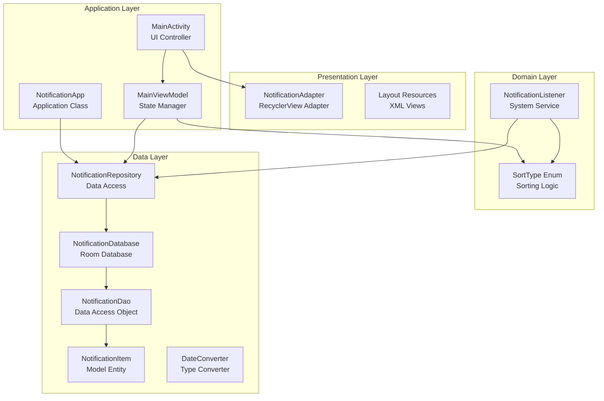
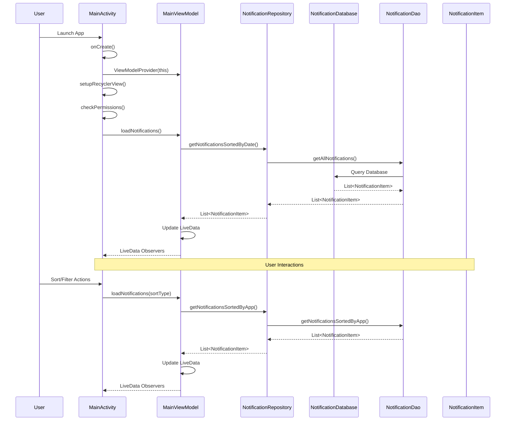
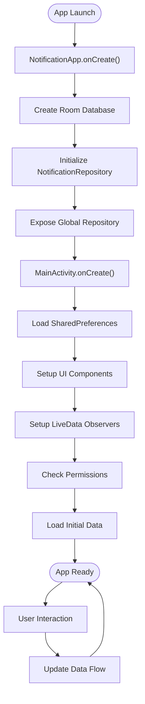
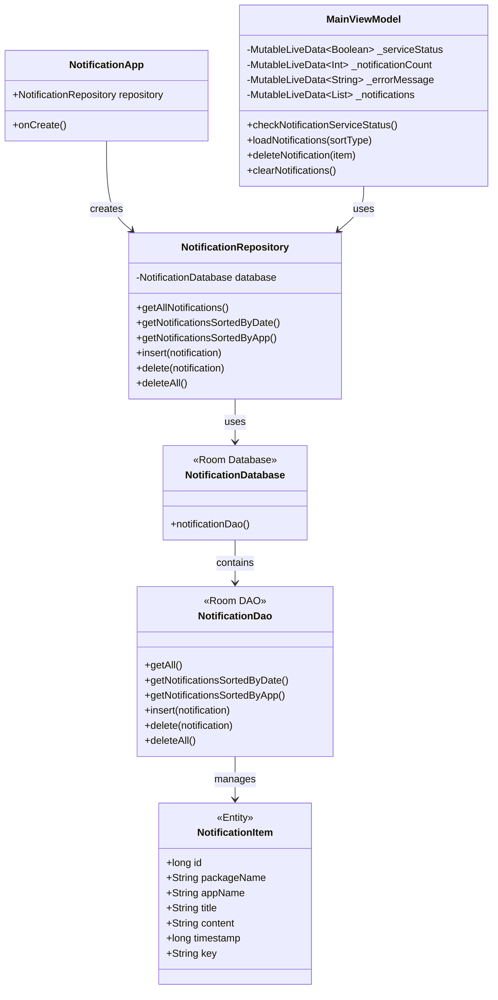
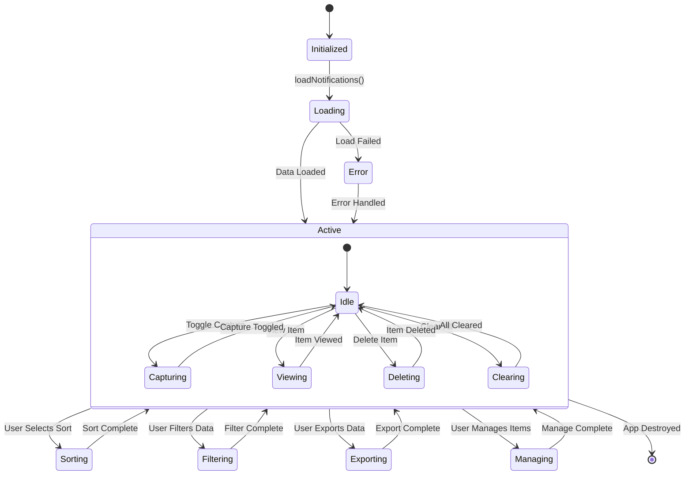
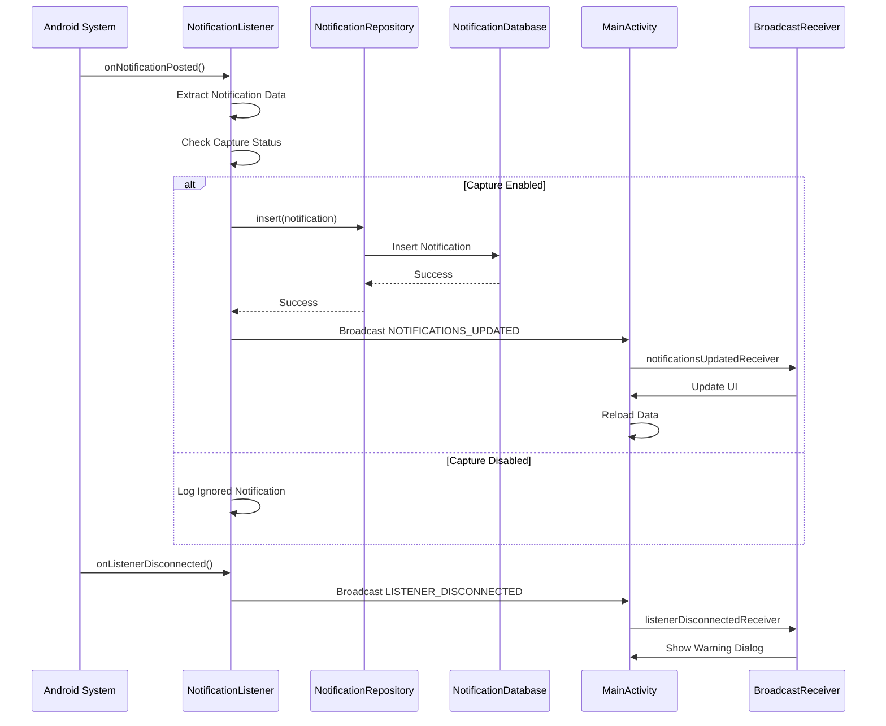
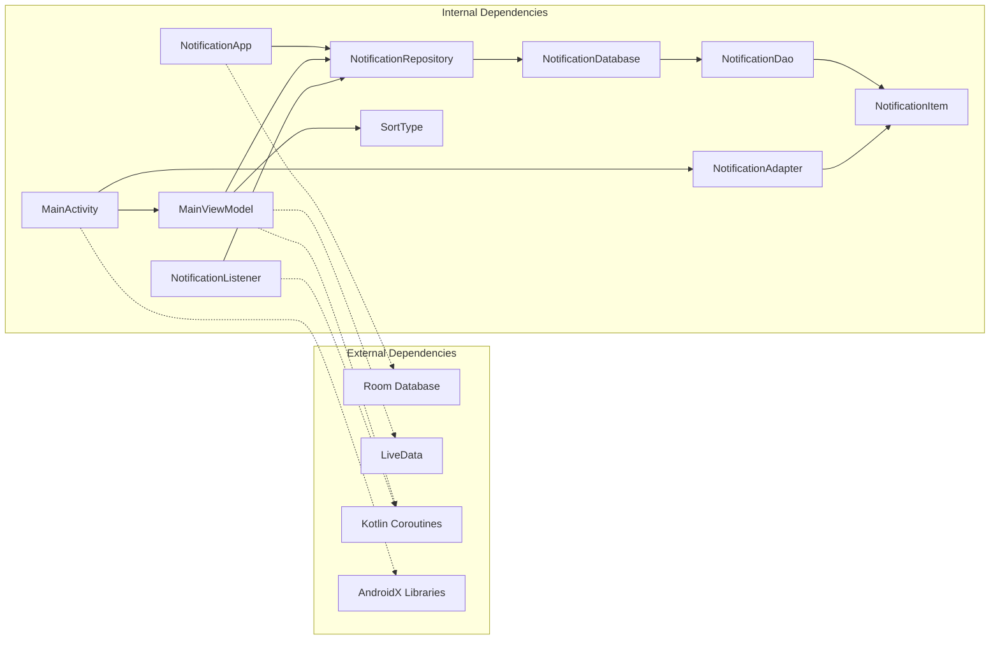

# Application Layer

<cite>
**Referenced Files in This Document**
- [NotificationApp.kt](file://app/src/main/java/com/notificationlog/NotificationApp.kt)
- [MainActivity.kt](file://app/src/main/java/com/notificationlog/MainActivity.kt)
- [MainViewModel.kt](file://app/src/main/java/com/notificationlog/MainViewModel.kt)
- [NotificationRepository.kt](file://app/src/main/java/com/notificationlog/repository/NotificationRepository.kt)
- [NotificationDatabase.kt](file://app/src/main/java/com/notificationlog/data/NotificationDatabase.kt)
- [NotificationDao.kt](file://app/src/main/java/com/notificationlog/data/NotificationDao.kt)
- [NotificationItem.kt](file://app/src/main/java/com/notificationlog/model/NotificationItem.kt)
- [NotificationAdapter.kt](file://app/src/main/java/com/notificationlog/adapter/NotificationAdapter.kt)
- [NotificationListener.kt](file://app/src/main/java/com/notificationlog/NotificationListener.kt)
- [DateConverter.kt](file://app/src/main/java/com/notificationlog/DateConverter.kt)
- [AndroidManifest.xml](file://app/src/main/AndroidManifest.xml)
</cite>

## Table of Contents
1. [Introduction](#introduction)
2. [Project Structure](#project-structure)
3. [Core Components](#core-components)
4. [Architecture Overview](#architecture-overview)
5. [Detailed Component Analysis](#detailed-component-analysis)
6. [Dependency Analysis](#dependency-analysis)
7. [Performance Considerations](#performance-considerations)
8. [Troubleshooting Guide](#troubleshooting-guide)
9. [Conclusion](#conclusion)

## Introduction

The NotificationLog application is a sophisticated Android notification capture and management system. This documentation focuses on the application layer components that form the core functionality of the notification logging system. The application follows modern Android development patterns with MVVM architecture, Room database persistence, and reactive programming with LiveData and coroutines.

The system captures Android system notifications, stores them in a local database, and provides a user interface for viewing, managing, and exporting notification data. It includes advanced features such as persistent notification capture, real-time updates, and comprehensive data export capabilities.

## Project Structure

The application follows a clean, layered architecture with clear separation of concerns:

**Diagram sources**
- [NotificationApp.kt:1-28](file://app/src/main/java/com/notificationlog/NotificationApp.kt#L1-L28)
- [MainActivity.kt:43-108](file://app/src/main/java/com/notificationlog/MainActivity.kt#L43-L108)
- [MainViewModel.kt:15-35](file://app/src/main/java/com/notificationlog/MainViewModel.kt#L15-L35)

**Section sources**
- [AndroidManifest.xml:9-45](file://app/src/main/AndroidManifest.xml#L9-L45)

## Core Components

### NotificationApp - Application Initialization

The `NotificationApp` class serves as the central application initialization point. It extends Android's Application class and establishes the global repository instance used throughout the application.

Key initialization responsibilities:
- Room database creation and configuration
- Global repository instantiation and exposure
- Application-wide dependency setup

The application uses a companion object pattern to expose the repository globally, enabling direct access from both the UI layer and background services.

**Section sources**
- [NotificationApp.kt:8-27](file://app/src/main/java/com/notificationlog/NotificationApp.kt#L8-L27)

### MainActivity - User Interface Lifecycle

The `MainActivity` implements the complete user interface lifecycle with comprehensive state management and user interaction handling. It manages multiple complex responsibilities including:

- **Lifecycle Management**: Proper handling of onCreate, onResume, onPause, and configuration changes
- **UI State Management**: Dynamic button states, toolbar configuration, and theme switching
- **Permission Management**: Runtime permission handling for Android 13+ and notification access settings
- **Real-time Updates**: Broadcast receiver integration for live notification updates
- **Data Export**: Screenshot capture and text log export functionality
- **Persistent Notification**: Background service status notification management

The activity implements a sophisticated menu system with popup menus and standard action bar menus, providing comprehensive user control over application behavior.

**Section sources**
- [MainActivity.kt:78-108](file://app/src/main/java/com/notificationlog/MainActivity.kt#L78-L108)
- [MainActivity.kt:110-144](file://app/src/main/java/com/notificationlog/MainActivity.kt#L110-L144)

### MainViewModel - State Management and Business Logic

The `MainViewModel` coordinates all business logic and state management for the application. It extends AndroidViewModel to access application context and implements a comprehensive state management pattern using LiveData.

Core responsibilities:
- **Service Status Monitoring**: Real-time monitoring of notification access permissions
- **Data Loading**: Asynchronous loading of notifications with sorting capabilities
- **CRUD Operations**: Delete and clear operations with proper error handling
- **Error Management**: Centralized error handling with user feedback
- **Coroutine Integration**: Proper coroutine scope management for async operations

The ViewModel exposes observable state through LiveData properties, enabling reactive UI updates without tight coupling between components.

**Section sources**
- [MainViewModel.kt:15-35](file://app/src/main/java/com/notificationlog/MainViewModel.kt#L15-L35)
- [MainViewModel.kt:59-77](file://app/src/main/java/com/notificationlog/MainViewModel.kt#L59-L77)

## Architecture Overview

The application follows a clean MVVM architecture with clear separation of concerns:

**Diagram sources**
- [MainActivity.kt:96-107](file://app/src/main/java/com/notificationlog/MainActivity.kt#L96-L107)
- [MainViewModel.kt:59-77](file://app/src/main/java/com/notificationlog/MainViewModel.kt#L59-L77)
- [NotificationRepository.kt:8-14](file://app/src/main/java/com/notificationlog/repository/NotificationRepository.kt#L8-L14)

The architecture demonstrates proper separation of concerns:
- **View Layer**: MainActivity handles UI lifecycle and user interactions
- **ViewModel Layer**: MainViewModel manages state and business logic
- **Repository Layer**: NotificationRepository abstracts data access
- **Data Layer**: Room database with DAO pattern for persistence

## Detailed Component Analysis

### Application Initialization Flow

The application initialization follows a specific sequence to ensure proper setup:

**Diagram sources**
- [NotificationApp.kt:15-27](file://app/src/main/java/com/notificationlog/NotificationApp.kt#L15-L27)
- [MainActivity.kt:78-108](file://app/src/main/java/com/notificationlog/MainActivity.kt#L78-L108)

**Section sources**
- [NotificationApp.kt:15-27](file://app/src/main/java/com/notificationlog/NotificationApp.kt#L15-L27)

### Data Flow Architecture

The data flow demonstrates the reactive pattern used throughout the application:

**Diagram sources**
- [NotificationApp.kt:10-13](file://app/src/main/java/com/notificationlog/NotificationApp.kt#L10-L13)
- [MainViewModel.kt:15-27](file://app/src/main/java/com/notificationlog/MainViewModel.kt#L15-L27)
- [NotificationRepository.kt:6-27](file://app/src/main/java/com/notificationlog/repository/NotificationRepository.kt#L6-L27)

**Section sources**
- [MainViewModel.kt:15-115](file://app/src/main/java/com/notificationlog/MainViewModel.kt#L15-L115)

### User Interface Component Implementation

The MainActivity implements a comprehensive UI system with multiple interaction patterns:

**Diagram sources**
- [MainActivity.kt:146-153](file://app/src/main/java/com/notificationlog/MainActivity.kt#L146-L153)
- [MainActivity.kt:324-343](file://app/src/main/java/com/notificationlog/MainActivity.kt#L324-L343)

**Section sources**
- [MainActivity.kt:146-343](file://app/src/main/java/com/notificationlog/MainActivity.kt#L146-L343)

### Background Service Integration

The NotificationListener service provides continuous notification capture:

**Diagram sources**
- [NotificationListener.kt:109-153](file://app/src/main/java/com/notificationlog/NotificationListener.kt#L109-L153)
- [MainActivity.kt:51-66](file://app/src/main/java/com/notificationlog/MainActivity.kt#L51-L66)

**Section sources**
- [NotificationListener.kt:109-153](file://app/src/main/java/com/notificationlog/NotificationListener.kt#L109-L153)

## Dependency Analysis

The application exhibits excellent dependency management with clear inversion of control:

**Diagram sources**
- [NotificationApp.kt:6-6](file://app/src/main/java/com/notificationlog/NotificationApp.kt#L6-L6)
- [MainViewModel.kt:3-13](file://app/src/main/java/com/notificationlog/MainViewModel.kt#L3-L13)
- [MainActivity.kt:32-35](file://app/src/main/java/com/notificationlog/MainActivity.kt#L32-L35)

**Section sources**
- [NotificationRepository.kt:3-4](file://app/src/main/java/com/notificationlog/repository/NotificationRepository.kt#L3-L4)

### Component Coupling Analysis

The application demonstrates low coupling and high cohesion:

- **NotificationApp**: Single responsibility for global initialization
- **MainActivity**: UI controller with clear boundaries
- **MainViewModel**: Business logic coordinator with proper encapsulation
- **NotificationRepository**: Data access abstraction layer
- **NotificationListener**: Background service with minimal UI coupling

## Performance Considerations

### Memory Management

The application implements several memory optimization strategies:

- **Lazy Initialization**: Repository in NotificationListener uses lazy initialization
- **Proper Lifecycle Management**: Activities and services properly manage resources
- **Background Threading**: All database operations occur on IO dispatcher
- **LiveData Observers**: Automatic cleanup prevents memory leaks

### Database Performance

- **Efficient Queries**: Room generates optimized SQL queries
- **Pagination Support**: Future enhancement possibility for large datasets
- **Indexing Strategy**: Timestamp field optimized for sorting operations
- **Connection Pooling**: Room manages database connections efficiently

### UI Performance

- **RecyclerView Optimization**: DiffUtil for efficient list updates
- **ViewHolder Pattern**: Implemented for efficient view recycling
- **Asynchronous Loading**: UI remains responsive during data operations
- **Image Processing**: Screenshot capture optimized for memory usage

## Troubleshooting Guide

### Common Issues and Solutions

**Notification Access Not Working**
- Verify notification access is enabled in system settings
- Check if the app appears in notification access list
- Restart the app after enabling access
- Review logs for permission-related errors

**Database Connection Issues**
- Ensure Room database migration is handled properly
- Check for concurrent database access conflicts
- Verify database file permissions
- Monitor for disk space availability

**UI State Synchronization Problems**
- Verify LiveData observers are properly registered
- Check for lifecycle-aware component usage
- Ensure proper ViewModelProvider initialization
- Validate state restoration after configuration changes

**Background Service Issues**
- Confirm notification listener service is properly declared
- Check service binding permissions
- Verify broadcast receiver registration
- Monitor service lifecycle and resource management

**Section sources**
- [MainActivity.kt:375-414](file://app/src/main/java/com/notificationlog/MainActivity.kt#L375-L414)
- [NotificationListener.kt:44-65](file://app/src/main/java/com/notificationlog/NotificationListener.kt#L44-L65)

## Conclusion

The NotificationLog application demonstrates excellent implementation of modern Android development practices. The application layer components work together seamlessly to provide a robust notification capture and management system.

Key strengths of the implementation include:

- **Clean Architecture**: Clear separation of concerns with proper dependency inversion
- **Reactive Programming**: Effective use of LiveData and coroutines for asynchronous operations
- **Comprehensive State Management**: Proper lifecycle handling and UI state synchronization
- **Robust Error Handling**: Centralized error management with user feedback
- **Performance Optimization**: Efficient database operations and UI responsiveness

The application serves as an excellent example of how to structure complex Android applications while maintaining code quality, performance, and user experience. The modular design allows for easy maintenance and future enhancements while providing a solid foundation for notification management functionality.