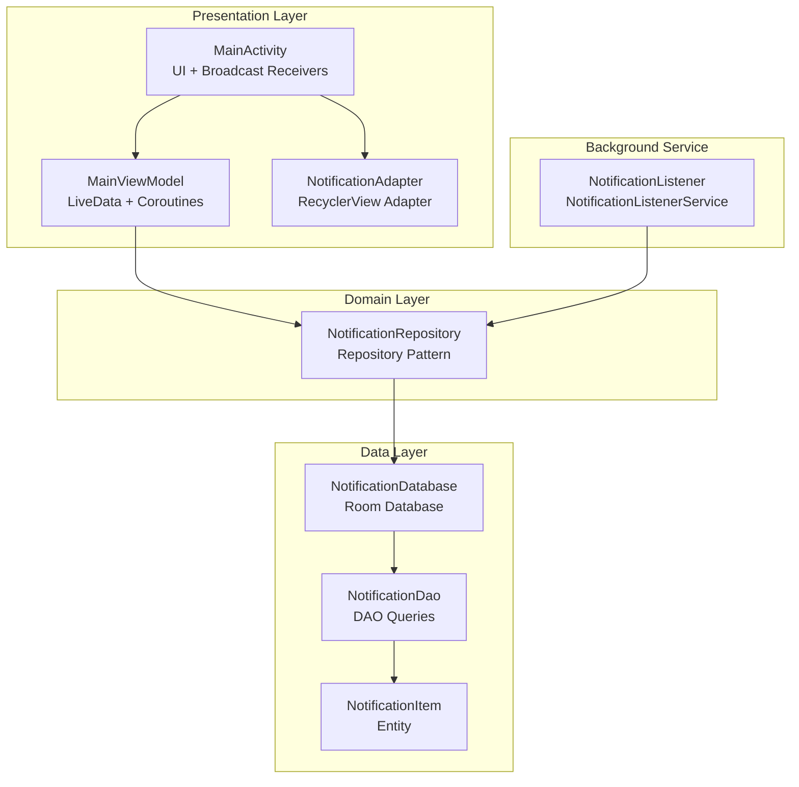
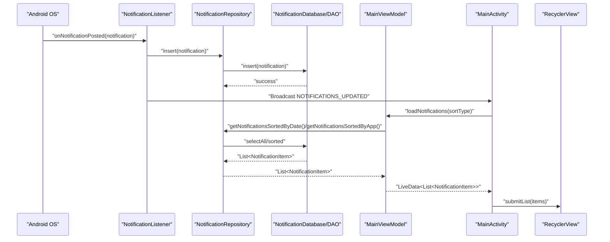
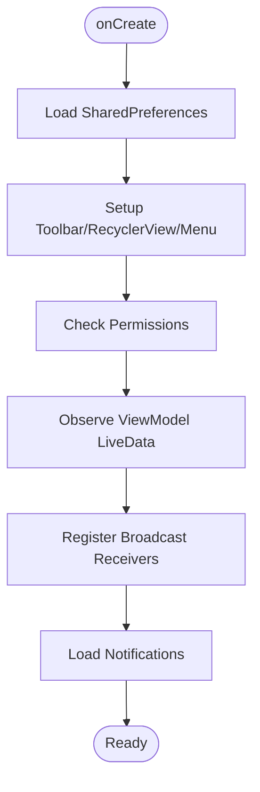
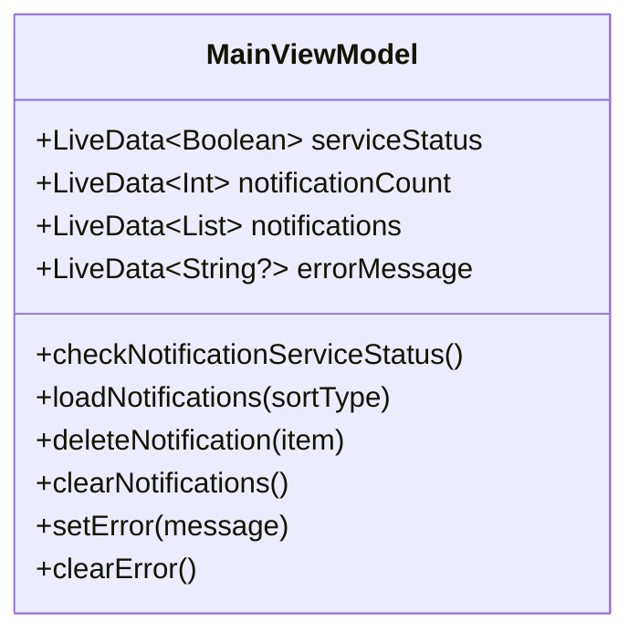
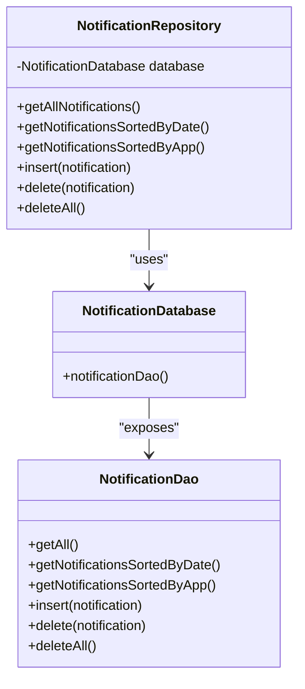
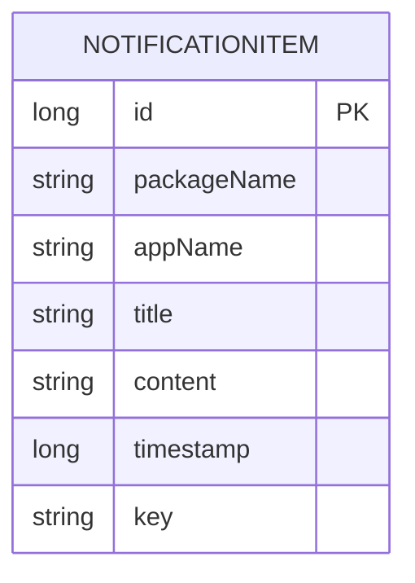
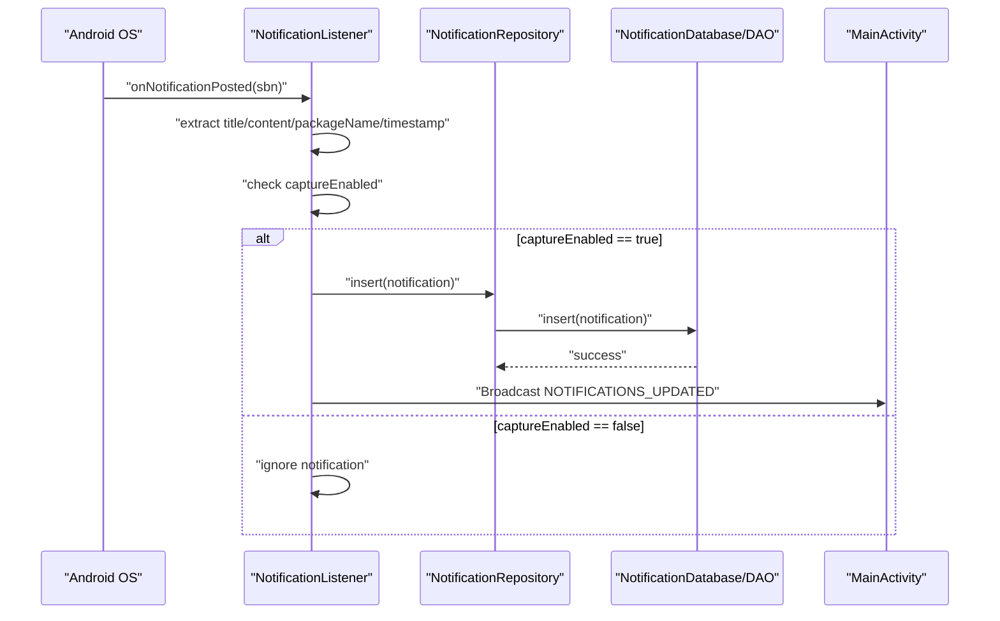
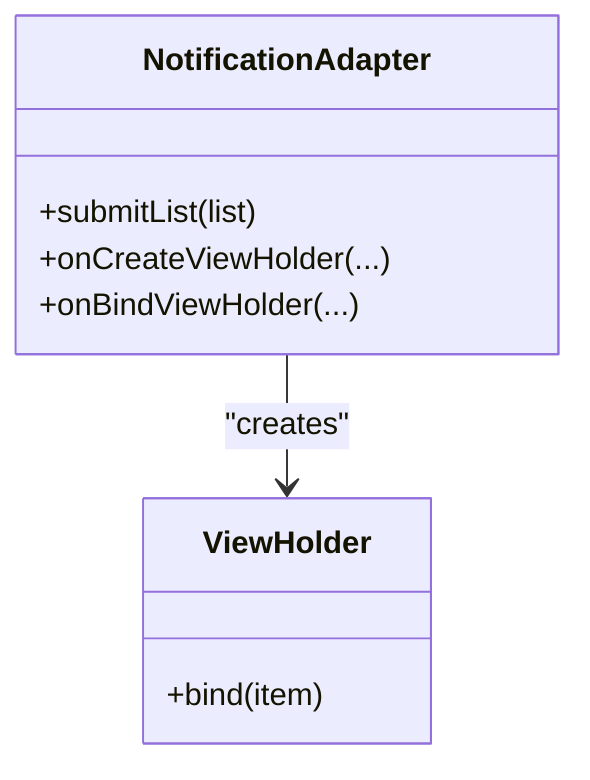
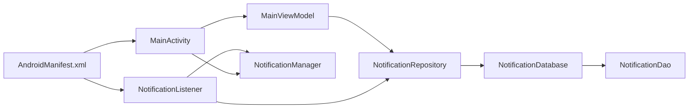

# Architecture Overview

<cite>
**Referenced Files in This Document**
- [MainActivity.kt](file://app/src/main/java/com/notificationlog/MainActivity.kt)
- [MainViewModel.kt](file://app/src/main/java/com/notificationlog/MainViewModel.kt)
- [NotificationRepository.kt](file://app/src/main/java/com/notificationlog/repository/NotificationRepository.kt)
- [NotificationDao.kt](file://app/src/main/java/com/notificationlog/data/NotificationDao.kt)
- [NotificationDatabase.kt](file://app/src/main/java/com/notificationlog/data/NotificationDatabase.kt)
- [NotificationItem.kt](file://app/src/main/java/com/notificationlog/model/NotificationItem.kt)
- [NotificationApp.kt](file://app/src/main/java/com/notificationlog/NotificationApp.kt)
- [NotificationListener.kt](file://app/src/main/java/com/notificationlog/NotificationListener.kt)
- [NotificationAdapter.kt](file://app/src/main/java/com/notificationlog/adapter/NotificationAdapter.kt)
- [AndroidManifest.xml](file://app/src/main/AndroidManifest.xml)
- [notification_service.xml](file://app/src/main/res/xml/notification_service.xml)
- [build.gradle](file://app/build.gradle)
</cite>

## Table of Contents
1. [Introduction](#introduction)
2. [Project Structure](#project-structure)
3. [Core Components](#core-components)
4. [Architecture Overview](#architecture-overview)
5. [Detailed Component Analysis](#detailed-component-analysis)
6. [Dependency Analysis](#dependency-analysis)
7. [Performance Considerations](#performance-considerations)
8. [Troubleshooting Guide](#troubleshooting-guide)
9. [Conclusion](#conclusion)

## Introduction
This document describes the architecture of NotificationLog, an Android application built on MVVM principles with a Repository pattern and Android Architecture Components. The system captures notifications via a foreground NotificationListenerService, persists them using Room, and presents them through a RecyclerView with a ViewModel-driven UI. It integrates with Android's notification system and provides real-time updates through LiveData and broadcasts.

## Project Structure
The application follows a layered structure:
- Presentation layer: Activity and ViewModel
- Domain layer: Repository
- Data layer: Room DAO and Database
- Background service: NotificationListenerService
- Model: Entity definition
- UI adapter: RecyclerView adapter

**Diagram sources**
- [MainActivity.kt:43-108](file://app/src/main/java/com/notificationlog/MainActivity.kt#L43-L108)
- [MainViewModel.kt:15-115](file://app/src/main/java/com/notificationlog/MainViewModel.kt#L15-L115)
- [NotificationRepository.kt:6-27](file://app/src/main/java/com/notificationlog/repository/NotificationRepository.kt#L6-L27)
- [NotificationDatabase.kt:7-10](file://app/src/main/java/com/notificationlog/data/NotificationDatabase.kt#L7-L10)
- [NotificationDao.kt:6-26](file://app/src/main/java/com/notificationlog/data/NotificationDao.kt#L6-L26)
- [NotificationItem.kt:8-19](file://app/src/main/java/com/notificationlog/model/NotificationItem.kt#L8-L19)
- [NotificationListener.kt:23-173](file://app/src/main/java/com/notificationlog/NotificationListener.kt#L23-L173)
- [NotificationAdapter.kt:13-59](file://app/src/main/java/com/notificationlog/adapter/NotificationAdapter.kt#L13-L59)

**Section sources**
- [MainActivity.kt:43-108](file://app/src/main/java/com/notificationlog/MainActivity.kt#L43-L108)
- [MainViewModel.kt:15-115](file://app/src/main/java/com/notificationlog/MainViewModel.kt#L15-L115)
- [NotificationRepository.kt:6-27](file://app/src/main/java/com/notificationlog/repository/NotificationRepository.kt#L6-L27)
- [NotificationDatabase.kt:7-10](file://app/src/main/java/com/notificationlog/data/NotificationDatabase.kt#L7-L10)
- [NotificationDao.kt:6-26](file://app/src/main/java/com/notificationlog/data/NotificationDao.kt#L6-L26)
- [NotificationItem.kt:8-19](file://app/src/main/java/com/notificationlog/model/NotificationItem.kt#L8-L19)
- [NotificationListener.kt:23-173](file://app/src/main/java/com/notificationlog/NotificationListener.kt#L23-L173)
- [NotificationAdapter.kt:13-59](file://app/src/main/java/com/notificationlog/adapter/NotificationAdapter.kt#L13-L59)

## Core Components
- MainActivity: Orchestrates UI, permissions, broadcast receivers, persistent notification, and user actions. Observes ViewModel LiveData and triggers repository operations.
- MainViewModel: Manages UI state (service status, notifications, counts, errors) using LiveData and coroutines. Delegates data operations to the repository.
- NotificationRepository: Encapsulates data access logic for notifications, exposing suspend functions for Room operations.
- NotificationDatabase and NotificationDao: Define the Room database and DAO queries for CRUD operations and sorting.
- NotificationItem: Room entity representing a notification record.
- NotificationListener: Foreground service that listens to system notifications, filters by user preference, inserts into the database, and notifies UI via broadcasts.
- NotificationAdapter: RecyclerView adapter with DiffUtil for efficient list updates.

**Section sources**
- [MainActivity.kt:43-108](file://app/src/main/java/com/notificationlog/MainActivity.kt#L43-L108)
- [MainViewModel.kt:15-115](file://app/src/main/java/com/notificationlog/MainViewModel.kt#L15-L115)
- [NotificationRepository.kt:6-27](file://app/src/main/java/com/notificationlog/repository/NotificationRepository.kt#L6-L27)
- [NotificationDatabase.kt:7-10](file://app/src/main/java/com/notificationlog/data/NotificationDatabase.kt#L7-L10)
- [NotificationDao.kt:6-26](file://app/src/main/java/com/notificationlog/data/NotificationDao.kt#L6-L26)
- [NotificationItem.kt:8-19](file://app/src/main/java/com/notificationlog/model/NotificationItem.kt#L8-L19)
- [NotificationListener.kt:23-173](file://app/src/main/java/com/notificationlog/NotificationListener.kt#L23-L173)
- [NotificationAdapter.kt:13-59](file://app/src/main/java/com/notificationlog/adapter/NotificationAdapter.kt#L13-L59)

## Architecture Overview
The system adheres to MVVM with Repository pattern and Android Architecture Components:
- Model-View-ViewModel separation: UI (Activity) observes LiveData from ViewModel; ViewModel interacts with Repository; Repository uses Room DAO.
- Repository pattern: Centralized data access abstraction over DAO.
- Android Architecture Components: LiveData for reactive UI, ViewModel for lifecycle-aware state, Room for persistence, and coroutines for concurrency.
- Real-time processing: Background service captures notifications and broadcasts updates; UI receives updates and refreshes lists.

**Diagram sources**
- [NotificationListener.kt:109-153](file://app/src/main/java/com/notificationlog/NotificationListener.kt#L109-L153)
- [NotificationRepository.kt:16-26](file://app/src/main/java/com/notificationlog/repository/NotificationRepository.kt#L16-L26)
- [NotificationDao.kt:18-25](file://app/src/main/java/com/notificationlog/data/NotificationDao.kt#L18-L25)
- [MainViewModel.kt:59-77](file://app/src/main/java/com/notificationlog/MainViewModel.kt#L59-L77)
- [MainActivity.kt:57-66](file://app/src/main/java/com/notificationlog/MainActivity.kt#L57-L66)
- [NotificationAdapter.kt:13-59](file://app/src/main/java/com/notificationlog/adapter/NotificationAdapter.kt#L13-L59)

## Detailed Component Analysis

### MainActivity
Responsibilities:
- Initializes ViewModel and RecyclerView adapter.
- Handles user interactions (menu, buttons, dialogs).
- Registers broadcast receivers for service status and notification updates.
- Checks permissions and manages persistent notification visibility.
- Saves screenshots and text logs.

Key interactions:
- Subscribes to ViewModel LiveData for service status, notification count, and list updates.
- Triggers ViewModel operations for loading, deleting, and clearing notifications.
- Updates UI state based on preferences and service status.

**Diagram sources**
- [MainActivity.kt:78-108](file://app/src/main/java/com/notificationlog/MainActivity.kt#L78-L108)
- [MainActivity.kt:324-343](file://app/src/main/java/com/notificationlog/MainActivity.kt#L324-L343)

**Section sources**
- [MainActivity.kt:43-108](file://app/src/main/java/com/notificationlog/MainActivity.kt#L43-L108)
- [MainActivity.kt:324-343](file://app/src/main/java/com/notificationlog/MainActivity.kt#L324-L343)

### MainViewModel
Responsibilities:
- Exposes LiveData for service status, notification count, notifications, and error messages.
- Uses viewModelScope for coroutine execution and Dispatchers.IO for database operations.
- Delegates repository calls and handles exceptions via CoroutineExceptionHandler.

Processing logic:
- Loads notifications based on sort type (date or app).
- Deletes individual notifications and clears all notifications.
- Checks notification service status via Settings.

**Diagram sources**
- [MainViewModel.kt:15-115](file://app/src/main/java/com/notificationlog/MainViewModel.kt#L15-L115)

**Section sources**
- [MainViewModel.kt:15-115](file://app/src/main/java/com/notificationlog/MainViewModel.kt#L15-L115)

### NotificationRepository
Responsibilities:
- Provides suspend functions to access DAO operations.
- Exposes methods for sorted and unsorted retrieval, insertion, deletion, and bulk deletion.

**Diagram sources**
- [NotificationRepository.kt:6-27](file://app/src/main/java/com/notificationlog/repository/NotificationRepository.kt#L6-L27)
- [NotificationDatabase.kt:7-10](file://app/src/main/java/com/notificationlog/data/NotificationDatabase.kt#L7-L10)
- [NotificationDao.kt:6-26](file://app/src/main/java/com/notificationlog/data/NotificationDao.kt#L6-L26)

**Section sources**
- [NotificationRepository.kt:6-27](file://app/src/main/java/com/notificationlog/repository/NotificationRepository.kt#L6-L27)
- [NotificationDatabase.kt:7-10](file://app/src/main/java/com/notificationlog/data/NotificationDatabase.kt#L7-L10)
- [NotificationDao.kt:6-26](file://app/src/main/java/com/notificationlog/data/NotificationDao.kt#L6-L26)

### NotificationDatabase and NotificationDao
Responsibilities:
- Define the Room database and DAO interface.
- Provide queries for retrieving notifications sorted by date or app, and for CRUD operations.

**Diagram sources**
- [NotificationItem.kt:8-19](file://app/src/main/java/com/notificationlog/model/NotificationItem.kt#L8-L19)
- [NotificationDatabase.kt:7-10](file://app/src/main/java/com/notificationlog/data/NotificationDatabase.kt#L7-L10)
- [NotificationDao.kt:6-26](file://app/src/main/java/com/notificationlog/data/NotificationDao.kt#L6-L26)

**Section sources**
- [NotificationItem.kt:8-19](file://app/src/main/java/com/notificationlog/model/NotificationItem.kt#L8-L19)
- [NotificationDatabase.kt:7-10](file://app/src/main/java/com/notificationlog/data/NotificationDatabase.kt#L7-L10)
- [NotificationDao.kt:6-26](file://app/src/main/java/com/notificationlog/data/NotificationDao.kt#L6-L26)

### NotificationListener
Responsibilities:
- Extends NotificationListenerService to receive system notifications.
- Filters by user preference (captureEnabled).
- Inserts notifications into the database and broadcasts updates.
- Handles listener disconnects by requesting rebind and showing a warning notification.

**Diagram sources**
- [NotificationListener.kt:109-153](file://app/src/main/java/com/notificationlog/NotificationListener.kt#L109-L153)
- [NotificationRepository.kt:16-18](file://app/src/main/java/com/notificationlog/repository/NotificationRepository.kt#L16-L18)
- [NotificationDao.kt:18-19](file://app/src/main/java/com/notificationlog/data/NotificationDao.kt#L18-L19)
- [MainActivity.kt:57-66](file://app/src/main/java/com/notificationlog/MainActivity.kt#L57-L66)

**Section sources**
- [NotificationListener.kt:23-173](file://app/src/main/java/com/notificationlog/NotificationListener.kt#L23-L173)

### NotificationAdapter
Responsibilities:
- Binds NotificationItem data to RecyclerView rows.
- Uses DiffUtil to compute efficient list updates.

**Diagram sources**
- [NotificationAdapter.kt:13-59](file://app/src/main/java/com/notificationlog/adapter/NotificationAdapter.kt#L13-L59)

**Section sources**
- [NotificationAdapter.kt:13-59](file://app/src/main/java/com/notificationlog/adapter/NotificationAdapter.kt#L13-L59)

## Dependency Analysis
External dependencies and integration points:
- AndroidX Room: Database ORM for local persistence.
- AndroidX Lifecycle: ViewModel, LiveData, and Activity/Fragment KTX.
- AndroidX Preference: SharedPreferences for app settings.
- Android NotificationListenerService: System integration for capturing notifications.
- Android Notification channels: For persistent and warning notifications.

**Diagram sources**
- [MainActivity.kt:43-108](file://app/src/main/java/com/notificationlog/MainActivity.kt#L43-L108)
- [MainViewModel.kt:59-77](file://app/src/main/java/com/notificationlog/MainViewModel.kt#L59-L77)
- [NotificationRepository.kt:6-27](file://app/src/main/java/com/notificationlog/repository/NotificationRepository.kt#L6-L27)
- [NotificationDatabase.kt:7-10](file://app/src/main/java/com/notificationlog/data/NotificationDatabase.kt#L7-L10)
- [NotificationDao.kt:6-26](file://app/src/main/java/com/notificationlog/data/NotificationDao.kt#L6-L26)
- [NotificationListener.kt:23-173](file://app/src/main/java/com/notificationlog/NotificationListener.kt#L23-L173)
- [AndroidManifest.xml:9-44](file://app/src/main/AndroidManifest.xml#L9-L44)

**Section sources**
- [build.gradle:72-94](file://app/build.gradle#L72-L94)
- [AndroidManifest.xml:9-44](file://app/src/main/AndroidManifest.xml#L9-L44)

## Performance Considerations
- Concurrency: Repository operations run on Dispatchers.IO; UI updates occur on Dispatchers.Main via withContext.
- UI updates: RecyclerView adapter uses DiffUtil to minimize list recomputation.
- Background processing: NotificationListener runs on IO dispatcher with SupervisorJob to isolate failures.
- Persistence: Room database operations are suspend functions; consider pagination for large datasets.
- Broadcast updates: Efficiently notify UI of changes without polling.

[No sources needed since this section provides general guidance]

## Troubleshooting Guide
Common issues and remedies:
- Notification access revoked: The service detects disconnection, requests rebind (Android 13+), shows a warning notification, and broadcasts LISTENER_DISCONNECTED. MainActivity displays a dialog and updates UI state.
- Permission denied: MainActivity prompts for POST_NOTIFICATIONS permission on Android 13+ and shows guidance dialogs.
- Service status: ViewModel checks Settings for enabled notification listeners; UI reflects status via button colors and labels.
- Error handling: ViewModel posts error messages to LiveData; UI can display messages to the user.

**Section sources**
- [NotificationListener.kt:44-65](file://app/src/main/java/com/notificationlog/NotificationListener.kt#L44-L65)
- [MainActivity.kt:51-66](file://app/src/main/java/com/notificationlog/MainActivity.kt#L51-L66)
- [MainActivity.kt:313-414](file://app/src/main/java/com/notificationlog/MainActivity.kt#L313-L414)
- [MainViewModel.kt:29-31](file://app/src/main/java/com/notificationlog/MainViewModel.kt#L29-L31)

## Conclusion
NotificationLog demonstrates a clean MVVM architecture with a Repository pattern and Android Architecture Components. The background service integrates tightly with Android’s notification system, while Room ensures reliable persistence. LiveData and broadcasts support real-time UI updates, and the design balances modularity, testability, and user experience. Scalability can be enhanced with pagination, caching strategies, and background work managers for heavy loads.