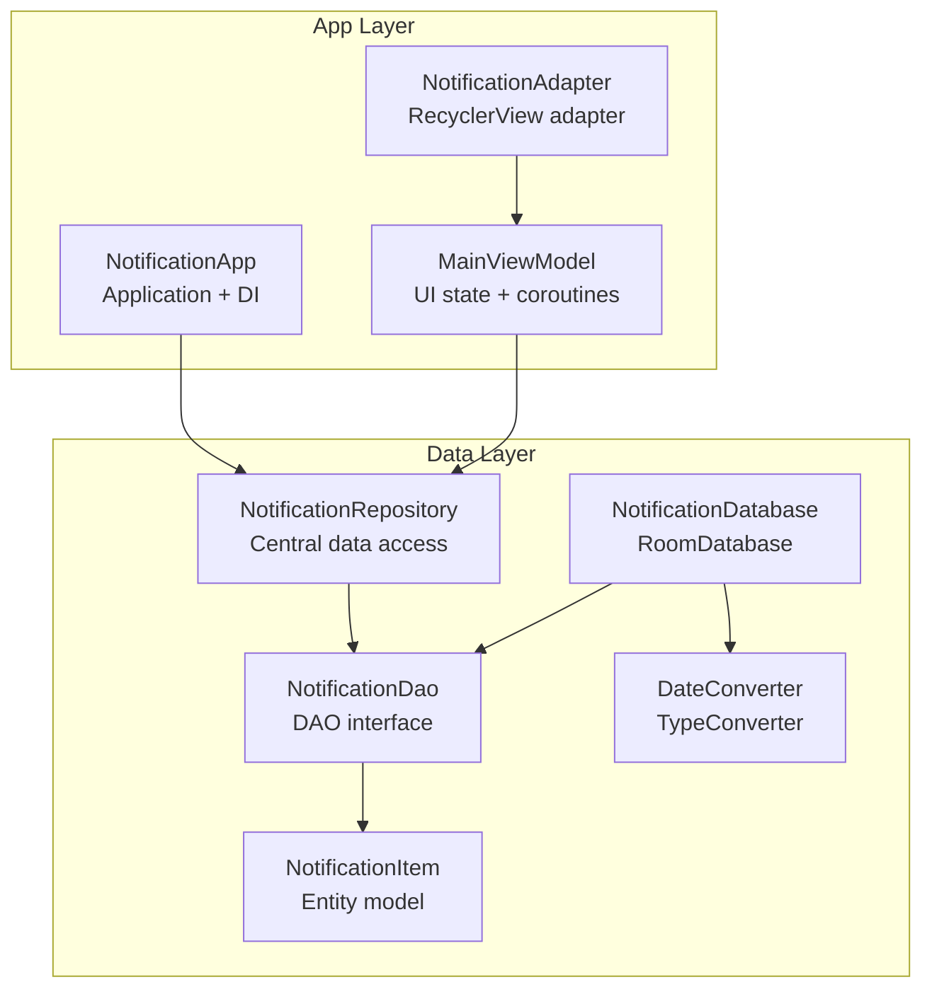
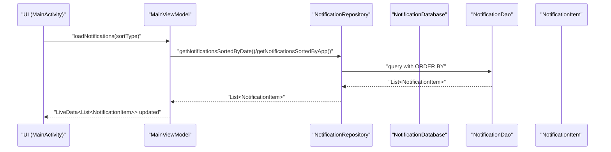
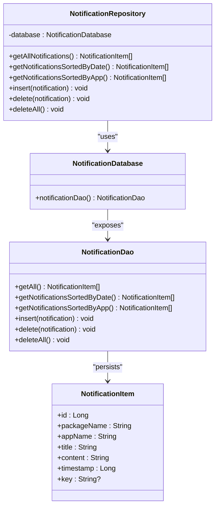
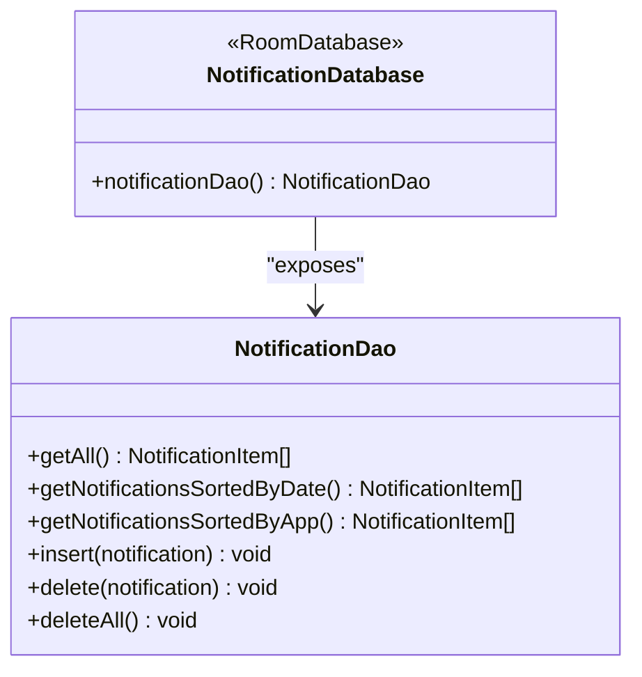
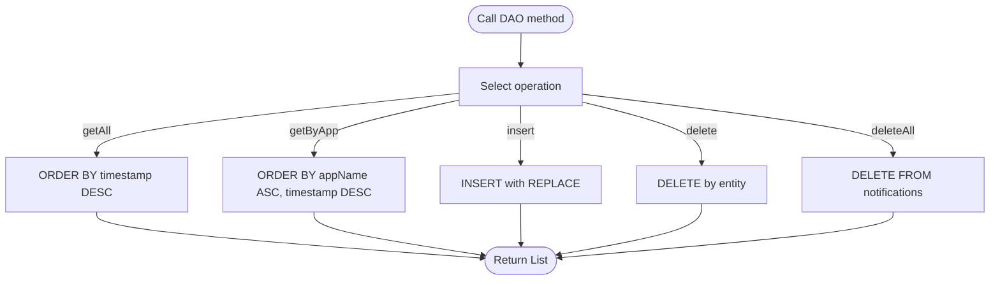
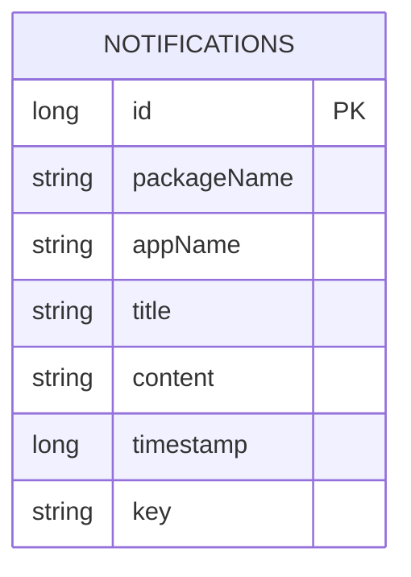
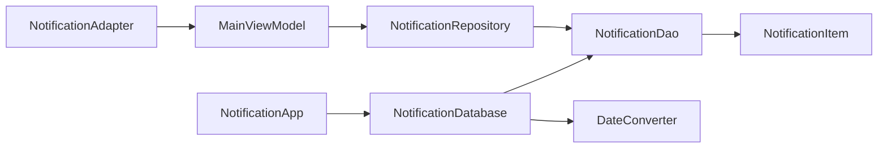

# Data Layer

<cite>
**Referenced Files in This Document**
- [NotificationRepository.kt](file://app/src/main/java/com/notificationlog/repository/NotificationRepository.kt)
- [NotificationDao.kt](file://app/src/main/java/com/notificationlog/data/NotificationDao.kt)
- [NotificationDatabase.kt](file://app/src/main/java/com/notificationlog/data/NotificationDatabase.kt)
- [NotificationItem.kt](file://app/src/main/java/com/notificationlog/model/NotificationItem.kt)
- [DateConverter.kt](file://app/src/main/java/com/notificationlog/DateConverter.kt)
- [NotificationApp.kt](file://app/src/main/java/com/notificationlog/NotificationApp.kt)
- [MainViewModel.kt](file://app/src/main/java/com/notificationlog/MainViewModel.kt)
- [NotificationAdapter.kt](file://app/src/main/java/com/notificationlog/adapter/NotificationAdapter.kt)
- [build.gradle](file://app/build.gradle)
- [AndroidManifest.xml](file://app/src/main/AndroidManifest.xml)
</cite>

## Table of Contents
1. [Introduction](#introduction)
2. [Project Structure](#project-structure)
3. [Core Components](#core-components)
4. [Architecture Overview](#architecture-overview)
5. [Detailed Component Analysis](#detailed-component-analysis)
6. [Dependency Analysis](#dependency-analysis)
7. [Performance Considerations](#performance-considerations)
8. [Troubleshooting Guide](#troubleshooting-guide)
9. [Conclusion](#conclusion)

## Introduction
This document explains the data layer architecture that implements the Repository pattern with Room database. It focuses on the NotificationRepository class as the central data access abstraction, detailing its CRUD operations and query methods. It also documents the NotificationDatabase configuration, entity definitions, DAO interface, and the NotificationItem model. Additional topics include database schema design, migration strategies, performance optimization techniques, data access patterns, query optimization, and error handling strategies.

## Project Structure
The data layer is organized around Room’s entity-DAO-database pattern with a thin Repository layer for data access abstraction. Supporting components include type converters, application initialization, and ViewModel-driven UI updates.

**Diagram sources**
- [NotificationRepository.kt:6-27](file://app/src/main/java/com/notificationlog/repository/NotificationRepository.kt#L6-L27)
- [NotificationDatabase.kt:7-10](file://app/src/main/java/com/notificationlog/data/NotificationDatabase.kt#L7-L10)
- [NotificationDao.kt:6-26](file://app/src/main/java/com/notificationlog/data/NotificationDao.kt#L6-L26)
- [NotificationItem.kt:8-19](file://app/src/main/java/com/notificationlog/model/NotificationItem.kt#L8-L19)
- [DateConverter.kt:6-16](file://app/src/main/java/com/notificationlog/DateConverter.kt#L6-L16)
- [NotificationApp.kt:8-27](file://app/src/main/java/com/notificationlog/NotificationApp.kt#L8-L27)
- [MainViewModel.kt:15-121](file://app/src/main/java/com/notificationlog/MainViewModel.kt#L15-L121)
- [NotificationAdapter.kt:13-59](file://app/src/main/java/com/notificationlog/adapter/NotificationAdapter.kt#L13-L59)

**Section sources**
- [NotificationRepository.kt:6-27](file://app/src/main/java/com/notificationlog/repository/NotificationRepository.kt#L6-L27)
- [NotificationDatabase.kt:7-10](file://app/src/main/java/com/notificationlog/data/NotificationDatabase.kt#L7-L10)
- [NotificationDao.kt:6-26](file://app/src/main/java/com/notificationlog/data/NotificationDao.kt#L6-L26)
- [NotificationItem.kt:8-19](file://app/src/main/java/com/notificationlog/model/NotificationItem.kt#L8-L19)
- [DateConverter.kt:6-16](file://app/src/main/java/com/notificationlog/DateConverter.kt#L6-L16)
- [NotificationApp.kt:8-27](file://app/src/main/java/com/notificationlog/NotificationApp.kt#L8-L27)
- [MainViewModel.kt:15-121](file://app/src/main/java/com/notificationlog/MainViewModel.kt#L15-L121)
- [NotificationAdapter.kt:13-59](file://app/src/main/java/com/notificationlog/adapter/NotificationAdapter.kt#L13-L59)

## Core Components
- NotificationRepository: Provides a clean abstraction over data access operations. It delegates to NotificationDatabase.notificationDao() and exposes suspend functions for retrieving and mutating notifications.
- NotificationDatabase: Declares the Room database with NotificationItem as the sole entity and exposes a DAO accessor.
- NotificationDao: Defines typed queries for listing, sorting, inserting, deleting, and clearing notifications.
- NotificationItem: The Room entity representing a persisted notification record with primary key and fields.
- DateConverter: Type converter for mapping between Long timestamps and Date objects.
- NotificationApp: Initializes the Room database and exposes a singleton repository instance for the app.
- MainViewModel: Orchestrates data loading and error handling using coroutine scopes and LiveData.
- NotificationAdapter: Binds NotificationItem instances to RecyclerView rows with diffing.

**Section sources**
- [NotificationRepository.kt:6-27](file://app/src/main/java/com/notificationlog/repository/NotificationRepository.kt#L6-L27)
- [NotificationDatabase.kt:7-10](file://app/src/main/java/com/notificationlog/data/NotificationDatabase.kt#L7-L10)
- [NotificationDao.kt:6-26](file://app/src/main/java/com/notificationlog/data/NotificationDao.kt#L6-L26)
- [NotificationItem.kt:8-19](file://app/src/main/java/com/notificationlog/model/NotificationItem.kt#L8-L19)
- [DateConverter.kt:6-16](file://app/src/main/java/com/notificationlog/DateConverter.kt#L6-L16)
- [NotificationApp.kt:8-27](file://app/src/main/java/com/notificationlog/NotificationApp.kt#L8-L27)
- [MainViewModel.kt:15-121](file://app/src/main/java/com/notificationlog/MainViewModel.kt#L15-L121)
- [NotificationAdapter.kt:13-59](file://app/src/main/java/com/notificationlog/adapter/NotificationAdapter.kt#L13-L59)

## Architecture Overview
The data layer follows a layered architecture:
- Presentation layer: MainViewModel and NotificationAdapter manage UI state and rendering.
- Domain/Data access layer: NotificationRepository encapsulates data operations.
- Persistence layer: Room database with NotificationDatabase, NotificationDao, and NotificationItem.

**Diagram sources**
- [MainViewModel.kt:59-77](file://app/src/main/java/com/notificationlog/MainViewModel.kt#L59-L77)
- [NotificationRepository.kt:8-14](file://app/src/main/java/com/notificationlog/repository/NotificationRepository.kt#L8-L14)
- [NotificationDao.kt:9-16](file://app/src/main/java/com/notificationlog/data/NotificationDao.kt#L9-L16)

## Detailed Component Analysis

### NotificationRepository
Responsibilities:
- Delegates to NotificationDatabase.notificationDao() for all data operations.
- Exposes suspend functions for:
  - Retrieving all notifications sorted by timestamp descending.
  - Retrieving notifications sorted by app name ascending, then timestamp descending.
  - Inserting a notification with conflict replacement.
  - Deleting a specific notification.
  - Deleting all notifications.

Implementation notes:
- Methods are thin wrappers that forward to DAO operations, preserving suspend signatures for asynchronous execution.
- No caching or transformation logic is implemented here; all heavy lifting occurs in DAO and database.

**Diagram sources**
- [NotificationRepository.kt:6-27](file://app/src/main/java/com/notificationlog/repository/NotificationRepository.kt#L6-L27)
- [NotificationDatabase.kt:7-10](file://app/src/main/java/com/notificationlog/data/NotificationDatabase.kt#L7-L10)
- [NotificationDao.kt:6-26](file://app/src/main/java/com/notificationlog/data/NotificationDao.kt#L6-L26)
- [NotificationItem.kt:8-19](file://app/src/main/java/com/notificationlog/model/NotificationItem.kt#L8-L19)

**Section sources**
- [NotificationRepository.kt:6-27](file://app/src/main/java/com/notificationlog/repository/NotificationRepository.kt#L6-L27)

### NotificationDatabase
Configuration:
- Declares NotificationItem as the single entity.
- Version is set to 1.
- Schema export is disabled to reduce APK size and avoid unnecessary files.
- Exposes an abstract method to access the DAO.

Initialization:
- Created in NotificationApp using Room.databaseBuilder with a database name.

**Diagram sources**
- [NotificationDatabase.kt:7-10](file://app/src/main/java/com/notificationlog/data/NotificationDatabase.kt#L7-L10)
- [NotificationDao.kt:6-26](file://app/src/main/java/com/notificationlog/data/NotificationDao.kt#L6-L26)

**Section sources**
- [NotificationDatabase.kt:7-10](file://app/src/main/java/com/notificationlog/data/NotificationDatabase.kt#L7-L10)
- [NotificationApp.kt:15-27](file://app/src/main/java/com/notificationlog/NotificationApp.kt#L15-L27)

### NotificationDao
Queries and operations:
- getAll/getNotificationsSortedByDate: Return notifications ordered by timestamp descending.
- getNotificationsSortedByApp: Return notifications ordered by appName ascending, then timestamp descending.
- insert: Uses REPLACE conflict strategy to handle duplicates.
- delete: Removes a specific notification.
- deleteAll: Clears the entire table.

SQL considerations:
- Queries use explicit ORDER BY clauses to ensure deterministic ordering.
- REPLACE strategy prevents duplicate primary keys and simplifies upsert-like behavior.

**Diagram sources**
- [NotificationDao.kt:9-25](file://app/src/main/java/com/notificationlog/data/NotificationDao.kt#L9-L25)

**Section sources**
- [NotificationDao.kt:6-26](file://app/src/main/java/com/notificationlog/data/NotificationDao.kt#L6-L26)

### NotificationItem Entity Model
Fields and annotations:
- @Entity(tableName = "notifications"): Declares the table name.
- @PrimaryKey(autoGenerate = true): Auto-incremented identifier.
- Parcelable via @Parcelize: Enables serialization for inter-process communication and UI binding.
- Fields include packageName, appName, title, content, timestamp, and optional key.

Data types:
- id: Long
- packageName, appName, title, content: String
- timestamp: Long (epoch milliseconds)
- key: String?

Constraints:
- Primary key ensures uniqueness.
- No foreign keys are defined; this is a standalone entity.

**Diagram sources**
- [NotificationItem.kt:8-19](file://app/src/main/java/com/notificationlog/model/NotificationItem.kt#L8-L19)

**Section sources**
- [NotificationItem.kt:8-19](file://app/src/main/java/com/notificationlog/model/NotificationItem.kt#L8-L19)

### DateConverter
Purpose:
- Converts between Long timestamps and Date objects for Room persistence.

Behavior:
- fromTimestamp(Long?) -> Date?: Maps epoch milliseconds to Date.
- dateToTimestamp(Date?) -> Long?: Maps Date to epoch milliseconds.

Integration:
- Applied automatically by Room when fields require Date conversion.

**Section sources**
- [DateConverter.kt:6-16](file://app/src/main/java/com/notificationlog/DateConverter.kt#L6-L16)

### NotificationApp Initialization
- Creates a Room database instance using Room.databaseBuilder.
- Names the database file and builds it synchronously during application startup.
- Exposes a global repository instance for use across the app.

**Section sources**
- [NotificationApp.kt:15-27](file://app/src/main/java/com/notificationlog/NotificationApp.kt#L15-L27)

### MainViewModel Data Access Patterns
- Uses viewModelScope with CoroutineExceptionHandler to centralize error handling.
- Loads notifications by delegating to NotificationRepository with sort selection.
- Updates LiveData for notifications and counts on the main thread after IO operations.
- Supports deletion and clearing with refresh logic.

**Section sources**
- [MainViewModel.kt:15-121](file://app/src/main/java/com/notificationlog/MainViewModel.kt#L15-L121)

### NotificationAdapter
- Extends ListAdapter with DiffUtil.ItemCallback for efficient list updates.
- Binds NotificationItem to views and formats timestamp for display.
- Invokes click handlers for item and delete actions.

**Section sources**
- [NotificationAdapter.kt:13-59](file://app/src/main/java/com/notificationlog/adapter/NotificationAdapter.kt#L13-L59)

## Dependency Analysis
Key dependencies and relationships:
- NotificationRepository depends on NotificationDatabase and NotificationDao.
- NotificationDatabase depends on NotificationItem and DateConverter.
- NotificationApp initializes NotificationDatabase and exposes NotificationRepository.
- MainViewModel depends on NotificationRepository and UI components.
- NotificationAdapter depends on NotificationItem and UI bindings.

**Diagram sources**
- [NotificationApp.kt:8-27](file://app/src/main/java/com/notificationlog/NotificationApp.kt#L8-L27)
- [NotificationDatabase.kt:7-10](file://app/src/main/java/com/notificationlog/data/NotificationDatabase.kt#L7-L10)
- [NotificationRepository.kt:6-27](file://app/src/main/java/com/notificationlog/repository/NotificationRepository.kt#L6-L27)
- [NotificationDao.kt:6-26](file://app/src/main/java/com/notificationlog/data/NotificationDao.kt#L6-L26)
- [NotificationItem.kt:8-19](file://app/src/main/java/com/notificationlog/model/NotificationItem.kt#L8-L19)
- [DateConverter.kt:6-16](file://app/src/main/java/com/notificationlog/DateConverter.kt#L6-L16)
- [MainViewModel.kt:15-121](file://app/src/main/java/com/notificationlog/MainViewModel.kt#L15-L121)
- [NotificationAdapter.kt:13-59](file://app/src/main/java/com/notificationlog/adapter/NotificationAdapter.kt#L13-L59)

**Section sources**
- [NotificationApp.kt:8-27](file://app/src/main/java/com/notificationlog/NotificationApp.kt#L8-L27)
- [NotificationRepository.kt:6-27](file://app/src/main/java/com/notificationlog/repository/NotificationRepository.kt#L6-L27)
- [NotificationDatabase.kt:7-10](file://app/src/main/java/com/notificationlog/data/NotificationDatabase.kt#L7-L10)
- [NotificationDao.kt:6-26](file://app/src/main/java/com/notificationlog/data/NotificationDao.kt#L6-L26)
- [NotificationItem.kt:8-19](file://app/src/main/java/com/notificationlog/model/NotificationItem.kt#L8-L19)
- [DateConverter.kt:6-16](file://app/src/main/java/com/notificationlog/DateConverter.kt#L6-L16)
- [MainViewModel.kt:15-121](file://app/src/main/java/com/notificationlog/MainViewModel.kt#L15-L121)
- [NotificationAdapter.kt:13-59](file://app/src/main/java/com/notificationlog/adapter/NotificationAdapter.kt#L13-L59)

## Performance Considerations
- Asynchronous operations: All DAO methods are suspend functions, enabling non-blocking database access.
- Ordering in queries: Queries include explicit ORDER BY clauses to avoid client-side sorting overhead.
- Conflict resolution: INSERT uses REPLACE to simplify deduplication and reduce manual checks.
- Type conversion: DateConverter avoids repeated conversions and keeps timestamp storage compact.
- Diffing in UI: NotificationAdapter uses DiffUtil to minimize RecyclerView updates.
- Schema export disabled: Reduces APK size and build artifacts.
- Room compiler via KSP: Ensures compile-time verification and efficient SQL generation.

[No sources needed since this section provides general guidance]

## Troubleshooting Guide
Common issues and strategies:
- Database initialization errors: Verify Room.databaseBuilder configuration and database name in NotificationApp.
- Query failures: Confirm SQL in NotificationDao matches entity field names and types.
- Timestamp handling: Ensure DateConverter is registered if Date fields are used; otherwise, keep timestamp as Long.
- Error propagation: MainViewModel uses CoroutineExceptionHandler to post error messages to LiveData; observe errorMessage in UI.
- Migration scenarios: Current version is 1; future migrations should increment version and provide MIGRATION steps in NotificationApp initialization.

**Section sources**
- [NotificationApp.kt:15-27](file://app/src/main/java/com/notificationlog/NotificationApp.kt#L15-L27)
- [NotificationDao.kt:9-25](file://app/src/main/java/com/notificationlog/data/NotificationDao.kt#L9-L25)
- [MainViewModel.kt:29-31](file://app/src/main/java/com/notificationlog/MainViewModel.kt#L29-L31)

## Conclusion
The data layer employs a clean Repository pattern with Room, providing a robust foundation for notification persistence. NotificationRepository centralizes data access, NotificationDatabase defines the schema, NotificationDao encapsulates queries, and NotificationItem models the persisted records. Supporting components like DateConverter, NotificationApp initialization, and MainViewModel ensure reliable asynchronous operations and error handling. The design is extensible for future migrations and performance enhancements while maintaining simplicity and clarity.