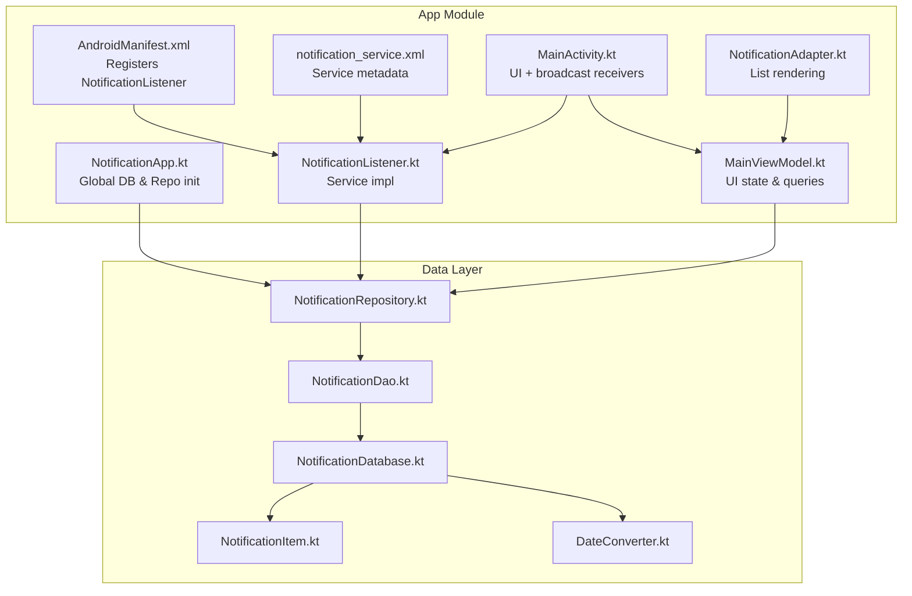
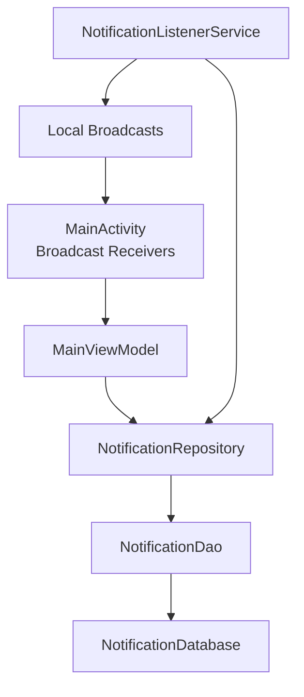
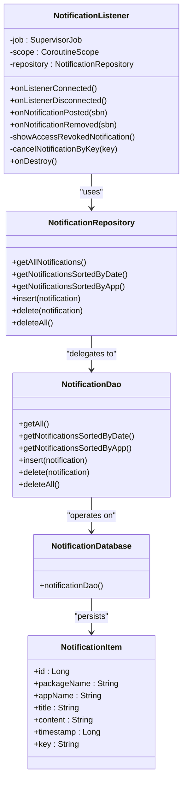
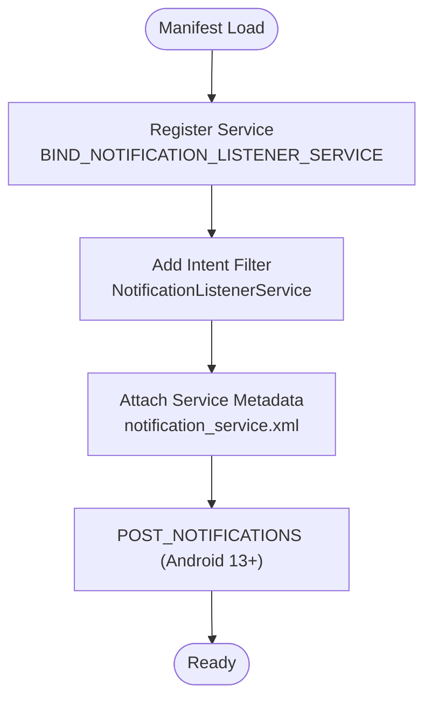
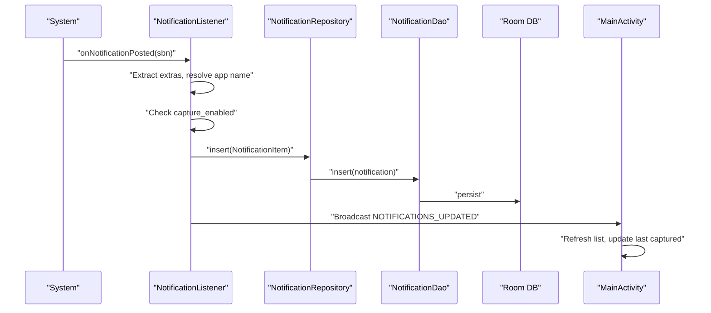
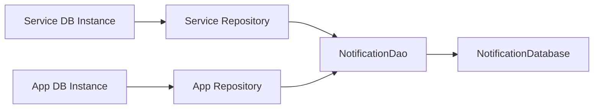
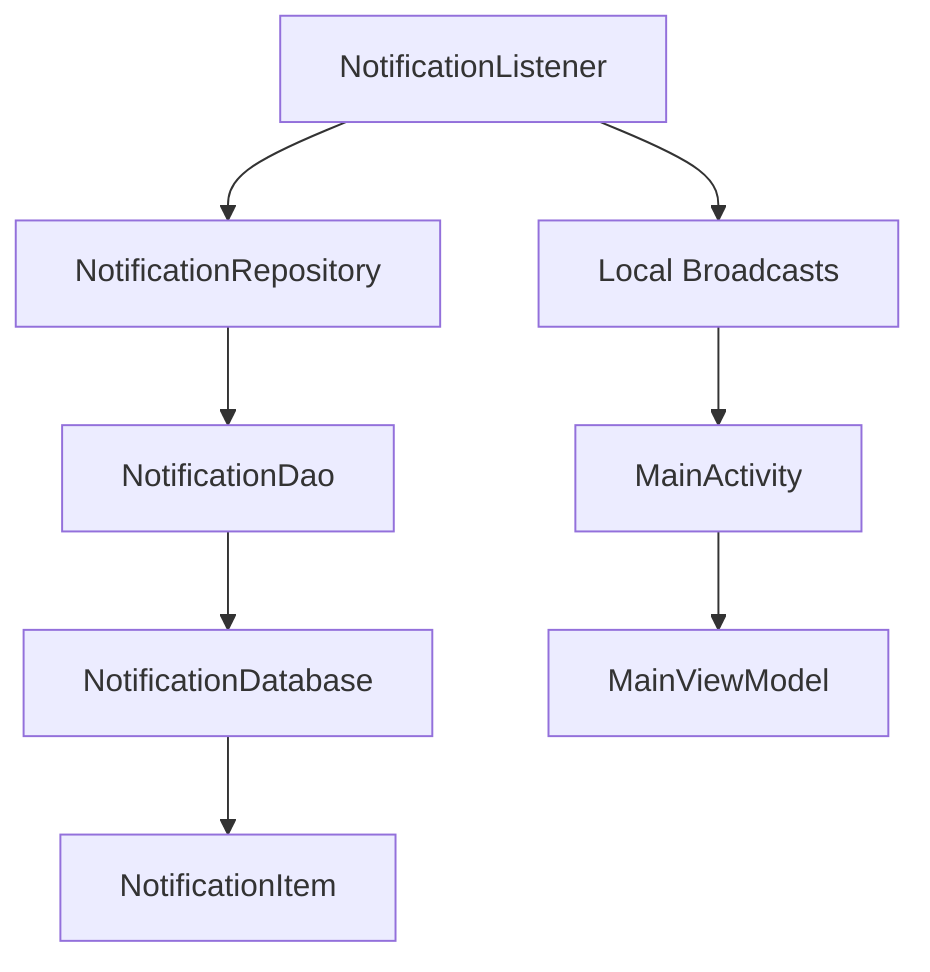

# Service Layer

<cite>
**Referenced Files in This Document**
- [NotificationListener.kt](file://app/src/main/java/com/notificationlog/NotificationListener.kt)
- [AndroidManifest.xml](file://app/src/main/AndroidManifest.xml)
- [notification_service.xml](file://app/src/main/res/xml/notification_service.xml)
- [NotificationRepository.kt](file://app/src/main/java/com/notificationlog/repository/NotificationRepository.kt)
- [NotificationDao.kt](file://app/src/main/java/com/notificationlog/data/NotificationDao.kt)
- [NotificationDatabase.kt](file://app/src/main/java/com/notificationlog/data/NotificationDatabase.kt)
- [NotificationItem.kt](file://app/src/main/java/com/notificationlog/model/NotificationItem.kt)
- [NotificationApp.kt](file://app/src/main/java/com/notificationlog/NotificationApp.kt)
- [MainActivity.kt](file://app/src/main/java/com/notificationlog/MainActivity.kt)
- [MainViewModel.kt](file://app/src/main/java/com/notificationlog/MainViewModel.kt)
- [NotificationAdapter.kt](file://app/src/main/java/com/notificationlog/adapter/NotificationAdapter.kt)
- [DateConverter.kt](file://app/src/main/java/com/notificationlog/DateConverter.kt)
- [build.gradle](file://build.gradle)
</cite>

## Table of Contents
1. [Introduction](#introduction)
2. [Project Structure](#project-structure)
3. [Core Components](#core-components)
4. [Architecture Overview](#architecture-overview)
5. [Detailed Component Analysis](#detailed-component-analysis)
6. [Dependency Analysis](#dependency-analysis)
7. [Performance Considerations](#performance-considerations)
8. [Troubleshooting Guide](#troubleshooting-guide)
9. [Conclusion](#conclusion)
10. [Appendices](#appendices)

## Introduction
This document provides comprehensive documentation for the service layer focused on the NotificationListenerService implementation. It explains the background service architecture, Android service lifecycle management, and notification capture mechanisms. It also documents service registration in AndroidManifest.xml, permission requirements, and the security model for accessing system notifications. The document covers the service’s role in real-time notification processing, data transformation, and communication with the repository layer. Additionally, it outlines service startup/shutdown procedures, background execution constraints, and battery optimization considerations, along with examples of service configuration, error handling, and integration with the main application components.

## Project Structure
The service layer centers around a NotificationListenerService subclass that integrates with Room persistence, a repository pattern, and UI components. The manifest registers the service with appropriate permissions and metadata, while the application initializes the database and repository globally.

**Diagram sources**
- [AndroidManifest.xml:29-43](file://app/src/main/AndroidManifest.xml#L29-L43)
- [notification_service.xml:1-5](file://app/src/main/res/xml/notification_service.xml#L1-L5)
- [NotificationApp.kt:8-27](file://app/src/main/java/com/notificationlog/NotificationApp.kt#L8-L27)
- [NotificationListener.kt:23-172](file://app/src/main/java/com/notificationlog/NotificationListener.kt#L23-L172)
- [MainViewModel.kt:15-115](file://app/src/main/java/com/notificationlog/MainViewModel.kt#L15-L115)
- [MainActivity.kt:43-144](file://app/src/main/java/com/notificationlog/MainActivity.kt#L43-L144)
- [NotificationAdapter.kt:13-59](file://app/src/main/java/com/notificationlog/adapter/NotificationAdapter.kt#L13-L59)
- [NotificationRepository.kt:6-27](file://app/src/main/java/com/notificationlog/repository/NotificationRepository.kt#L6-L27)
- [NotificationDao.kt:6-26](file://app/src/main/java/com/notificationlog/data/NotificationDao.kt#L6-L26)
- [NotificationDatabase.kt:7-10](file://app/src/main/java/com/notificationlog/data/NotificationDatabase.kt#L7-L10)
- [NotificationItem.kt:8-19](file://app/src/main/java/com/notificationlog/model/NotificationItem.kt#L8-L19)
- [DateConverter.kt:6-16](file://app/src/main/java/com/notificationlog/DateConverter.kt#L6-L16)

**Section sources**
- [AndroidManifest.xml:1-45](file://app/src/main/AndroidManifest.xml#L1-L45)
- [notification_service.xml:1-5](file://app/src/main/res/xml/notification_service.xml#L1-L5)
- [NotificationApp.kt:8-27](file://app/src/main/java/com/notificationlog/NotificationApp.kt#L8-L27)

## Core Components
- NotificationListenerService subclass: Implements onNotificationPosted, onListenerConnected, onListenerDisconnected, and lifecycle cleanup. It persists notifications via a coroutine-scoped IO dispatcher and communicates updates to the UI through broadcasts.
- Repository and DAO: Encapsulate data access and persistence using Room, exposing suspend functions for asynchronous operations.
- Database and Entity: Define the Room database, DAO, and entity model for notifications, including a type converter for timestamps.
- Application initialization: Provides a global repository instance initialized at app startup.
- UI integration: MainActivity registers broadcast receivers to update UI on service disconnection and new captures, and toggles persistent notification visibility.

**Section sources**
- [NotificationListener.kt:23-172](file://app/src/main/java/com/notificationlog/NotificationListener.kt#L23-L172)
- [NotificationRepository.kt:6-27](file://app/src/main/java/com/notificationlog/repository/NotificationRepository.kt#L6-L27)
- [NotificationDao.kt:6-26](file://app/src/main/java/com/notificationlog/data/NotificationDao.kt#L6-L26)
- [NotificationDatabase.kt:7-10](file://app/src/main/java/com/notificationlog/data/NotificationDatabase.kt#L7-L10)
- [NotificationItem.kt:8-19](file://app/src/main/java/com/notificationlog/model/NotificationItem.kt#L8-L19)
- [NotificationApp.kt:8-27](file://app/src/main/java/com/notificationlog/NotificationApp.kt#L8-L27)
- [MainActivity.kt:43-144](file://app/src/main/java/com/notificationlog/MainActivity.kt#L43-L144)

## Architecture Overview
The service layer follows a layered architecture:
- Presentation: MainActivity and MainViewModel manage UI state and user interactions.
- Service: NotificationListenerService captures notifications and persists them.
- Repository: NotificationRepository abstracts DAO operations.
- Data: Room database with DAO and entity model.

**Diagram sources**
- [MainActivity.kt:43-144](file://app/src/main/java/com/notificationlog/MainActivity.kt#L43-L144)
- [MainViewModel.kt:15-115](file://app/src/main/java/com/notificationlog/MainViewModel.kt#L15-L115)
- [NotificationRepository.kt:6-27](file://app/src/main/java/com/notificationlog/repository/NotificationRepository.kt#L6-L27)
- [NotificationDao.kt:6-26](file://app/src/main/java/com/notificationlog/data/NotificationDao.kt#L6-L26)
- [NotificationDatabase.kt:7-10](file://app/src/main/java/com/notificationlog/data/NotificationDatabase.kt#L7-L10)
- [NotificationListener.kt:23-172](file://app/src/main/java/com/notificationlog/NotificationListener.kt#L23-L172)

## Detailed Component Analysis

### NotificationListenerService Implementation
The service extends NotificationListenerService and implements:
- Lifecycle callbacks: onListenerConnected and onListenerDisconnected handle connection state changes.
- Notification capture: onNotificationPosted extracts notification metadata, applies user preferences, and persists asynchronously.
- Communication: Broadcasts local intents to inform UI of updates and disconnections.
- Persistence: Uses a coroutine-scoped IO dispatcher to insert notifications into Room and logs errors.
- Cleanup: Cancels background job on destroy.

**Diagram sources**
- [NotificationListener.kt:23-172](file://app/src/main/java/com/notificationlog/NotificationListener.kt#L23-L172)
- [NotificationRepository.kt:6-27](file://app/src/main/java/com/notificationlog/repository/NotificationRepository.kt#L6-L27)
- [NotificationDao.kt:6-26](file://app/src/main/java/com/notificationlog/data/NotificationDao.kt#L6-L26)
- [NotificationDatabase.kt:7-10](file://app/src/main/java/com/notificationlog/data/NotificationDatabase.kt#L7-L10)
- [NotificationItem.kt:8-19](file://app/src/main/java/com/notificationlog/model/NotificationItem.kt#L8-L19)

**Section sources**
- [NotificationListener.kt:23-172](file://app/src/main/java/com/notificationlog/NotificationListener.kt#L23-L172)

### Service Registration and Permissions
The service is declared in the manifest with:
- android.permission.BIND_NOTIFICATION_LISTENER_SERVICE as the required permission.
- An intent-filter for android.service.notification.NotificationListenerService.
- A meta-data reference to notification_service.xml.

Required runtime permissions include POST_NOTIFICATIONS for Android 13+.

**Diagram sources**
- [AndroidManifest.xml:29-43](file://app/src/main/AndroidManifest.xml#L29-L43)
- [notification_service.xml:1-5](file://app/src/main/res/xml/notification_service.xml#L1-L5)

**Section sources**
- [AndroidManifest.xml:5-43](file://app/src/main/AndroidManifest.xml#L5-L43)
- [notification_service.xml:1-5](file://app/src/main/res/xml/notification_service.xml#L1-L5)

### Real-Time Notification Processing and Data Transformation
On receiving a notification:
- Extract package name, title, content, and post time.
- Resolve app label via package manager.
- Check user preference for capture enablement.
- Transform into NotificationItem and persist asynchronously.
- Broadcast updates to UI with the last captured timestamp.

**Diagram sources**
- [NotificationListener.kt:109-153](file://app/src/main/java/com/notificationlog/NotificationListener.kt#L109-L153)
- [NotificationRepository.kt:16-18](file://app/src/main/java/com/notificationlog/repository/NotificationRepository.kt#L16-L18)
- [NotificationDao.kt:18-19](file://app/src/main/java/com/notificationlog/data/NotificationDao.kt#L18-L19)
- [MainActivity.kt:57-66](file://app/src/main/java/com/notificationlog/MainActivity.kt#L57-L66)

**Section sources**
- [NotificationListener.kt:109-153](file://app/src/main/java/com/notificationlog/NotificationListener.kt#L109-L153)
- [MainActivity.kt:57-66](file://app/src/main/java/com/notificationlog/MainActivity.kt#L57-L66)

### Background Execution Constraints and Battery Optimization
- The service runs in the background and relies on Android’s notification listener framework.
- To maintain connectivity, the service requests rebind on API 33+ upon disconnection.
- The UI can show a persistent notification indicating capture is active, controlled by user preferences.
- Users can disable capture via a shared preference toggle, causing the service to skip inserts.

**Section sources**
- [NotificationListener.kt:44-65](file://app/src/main/java/com/notificationlog/NotificationListener.kt#L44-L65)
- [MainActivity.kt:686-715](file://app/src/main/java/com/notificationlog/MainActivity.kt#L686-L715)
- [NotificationListener.kt:126-152](file://app/src/main/java/com/notificationlog/NotificationListener.kt#L126-L152)

### Integration with Repository Layer
- The service constructs a local Room database instance and repository for per-run persistence.
- The application-level NotificationApp initializes a singleton repository for UI queries.
- Both paths share the same DAO and database schema.

**Diagram sources**
- [NotificationListener.kt:27-34](file://app/src/main/java/com/notificationlog/NotificationListener.kt#L27-L34)
- [NotificationApp.kt:18-27](file://app/src/main/java/com/notificationlog/NotificationApp.kt#L18-L27)
- [NotificationRepository.kt:6-27](file://app/src/main/java/com/notificationlog/repository/NotificationRepository.kt#L6-L27)
- [NotificationDao.kt:6-26](file://app/src/main/java/com/notificationlog/data/NotificationDao.kt#L6-L26)
- [NotificationDatabase.kt:7-10](file://app/src/main/java/com/notificationlog/data/NotificationDatabase.kt#L7-L10)

**Section sources**
- [NotificationListener.kt:27-34](file://app/src/main/java/com/notificationlog/NotificationListener.kt#L27-L34)
- [NotificationApp.kt:18-27](file://app/src/main/java/com/notificationlog/NotificationApp.kt#L18-L27)

### Error Handling and Robustness
- Service lifecycle: onListenerDisconnected handles disconnection, attempts rebind on newer APIs, shows a high-priority warning notification, and broadcasts disconnection to the UI.
- Persistence: Errors during insertion are caught and logged; UI remains responsive.
- UI: MainActivity registers receivers conditionally based on API level and displays dialogs when access is revoked.

**Section sources**
- [NotificationListener.kt:44-65](file://app/src/main/java/com/notificationlog/NotificationListener.kt#L44-L65)
- [NotificationListener.kt:146-148](file://app/src/main/java/com/notificationlog/NotificationListener.kt#L146-L148)
- [MainActivity.kt:51-55](file://app/src/main/java/com/notificationlog/MainActivity.kt#L51-L55)
- [MainActivity.kt:112-132](file://app/src/main/java/com/notificationlog/MainActivity.kt#L112-L132)
- [MainActivity.kt:645-661](file://app/src/main/java/com/notificationlog/MainActivity.kt#L645-L661)

## Dependency Analysis
The service depends on:
- AndroidX Room for persistence.
- Repository and DAO abstractions.
- UI components for broadcasting and UI updates.

**Diagram sources**
- [NotificationListener.kt:23-172](file://app/src/main/java/com/notificationlog/NotificationListener.kt#L23-L172)
- [NotificationRepository.kt:6-27](file://app/src/main/java/com/notificationlog/repository/NotificationRepository.kt#L6-L27)
- [NotificationDao.kt:6-26](file://app/src/main/java/com/notificationlog/data/NotificationDao.kt#L6-L26)
- [NotificationDatabase.kt:7-10](file://app/src/main/java/com/notificationlog/data/NotificationDatabase.kt#L7-L10)
- [NotificationItem.kt:8-19](file://app/src/main/java/com/notificationlog/model/NotificationItem.kt#L8-L19)
- [MainActivity.kt:43-144](file://app/src/main/java/com/notificationlog/MainActivity.kt#L43-L144)

**Section sources**
- [NotificationListener.kt:23-172](file://app/src/main/java/com/notificationlog/NotificationListener.kt#L23-L172)
- [NotificationRepository.kt:6-27](file://app/src/main/java/com/notificationlog/repository/NotificationRepository.kt#L6-L27)
- [NotificationDao.kt:6-26](file://app/src/main/java/com/notificationlog/data/NotificationDao.kt#L6-L26)
- [NotificationDatabase.kt:7-10](file://app/src/main/java/com/notificationlog/data/NotificationDatabase.kt#L7-L10)
- [NotificationItem.kt:8-19](file://app/src/main/java/com/notificationlog/model/NotificationItem.kt#L8-L19)
- [MainActivity.kt:43-144](file://app/src/main/java/com/notificationlog/MainActivity.kt#L43-L144)

## Performance Considerations
- Asynchronous persistence: Inserts occur on Dispatchers.IO within a coroutine scope to avoid blocking the service thread.
- Batch-friendly design: Frequent notifications are persisted individually; batching is not implemented.
- UI responsiveness: UI updates are triggered via broadcasts and LiveData, minimizing main-thread work.
- Memory and lifecycle: The service cancels its SupervisorJob on destroy to prevent leaks.

[No sources needed since this section provides general guidance]

## Troubleshooting Guide
Common scenarios and resolutions:
- Notification access revoked: The service shows a high-priority warning notification and broadcasts disconnection. The UI displays a dialog prompting users to re-enable access.
- Rebind failures on Android 13+: The service attempts to request rebind; failures are logged.
- Capture disabled: A shared preference toggle prevents new notifications from being inserted.
- Persistent notification visibility: Controlled by a user preference; enabling it shows a low-priority ongoing notification.

**Section sources**
- [NotificationListener.kt:44-65](file://app/src/main/java/com/notificationlog/NotificationListener.kt#L44-L65)
- [NotificationListener.kt:126-152](file://app/src/main/java/com/notificationlog/NotificationListener.kt#L126-L152)
- [MainActivity.kt:686-715](file://app/src/main/java/com/notificationlog/MainActivity.kt#L686-L715)
- [MainActivity.kt:645-661](file://app/src/main/java/com/notificationlog/MainActivity.kt#L645-L661)

## Conclusion
The NotificationListenerService provides a robust foundation for capturing and persisting Android notifications. It integrates cleanly with Room and the repository pattern, supports dynamic user controls, and maintains resilience against disconnections. The UI remains informed through targeted broadcasts and LiveData, ensuring a responsive and transparent user experience. Proper configuration of manifest permissions and runtime permissions is essential for reliable operation.

[No sources needed since this section summarizes without analyzing specific files]

## Appendices

### Service Configuration Examples
- Manifest registration: Declares the service with required permission and meta-data.
- Service meta-data: Provides summary text for the notification listener service entry.
- Application initialization: Initializes Room and a global repository instance.

**Section sources**
- [AndroidManifest.xml:29-43](file://app/src/main/AndroidManifest.xml#L29-L43)
- [notification_service.xml:1-5](file://app/src/main/res/xml/notification_service.xml#L1-L5)
- [NotificationApp.kt:18-27](file://app/src/main/java/com/notificationlog/NotificationApp.kt#L18-L27)

### Data Model and Type Converters
- Entity definition: Includes primary key, identifiers, and timestamp.
- Type converters: Handle conversion between Date and timestamp for Room.

**Section sources**
- [NotificationItem.kt:8-19](file://app/src/main/java/com/notificationlog/model/NotificationItem.kt#L8-L19)
- [DateConverter.kt:6-16](file://app/src/main/java/com/notificationlog/DateConverter.kt#L6-L16)

### Build and Tooling Context
- Gradle plugin versions and top-level build configuration.

**Section sources**
- [build.gradle:1-16](file://build.gradle#L1-L16)