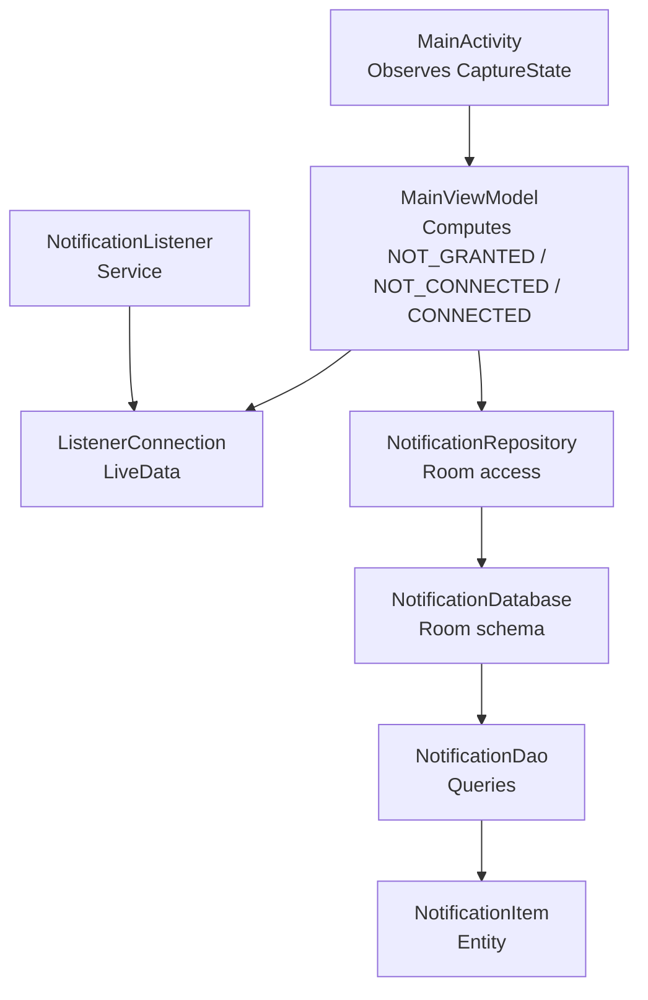
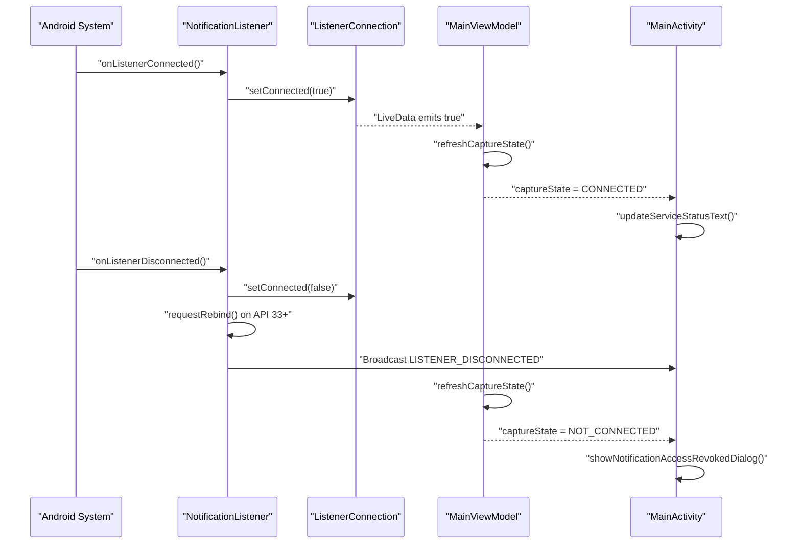
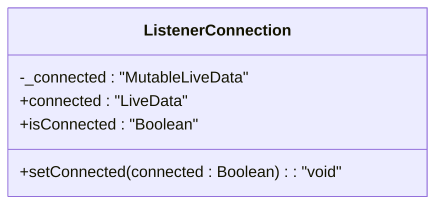
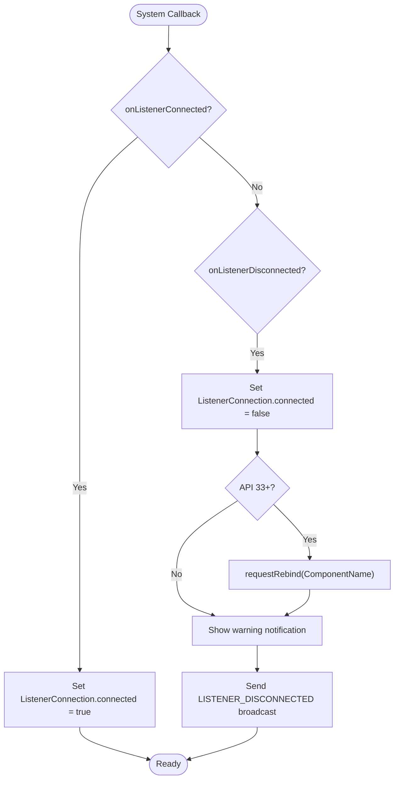
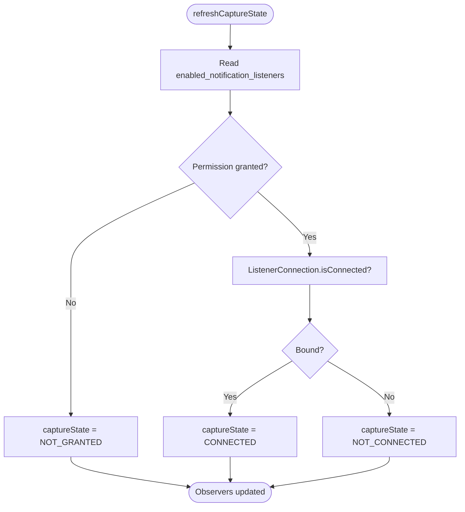
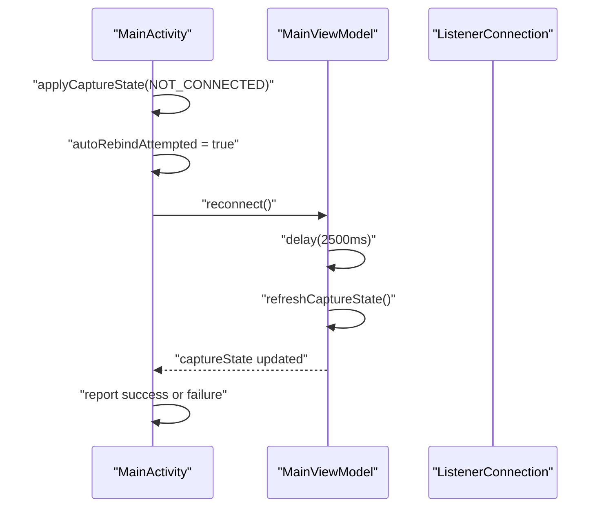
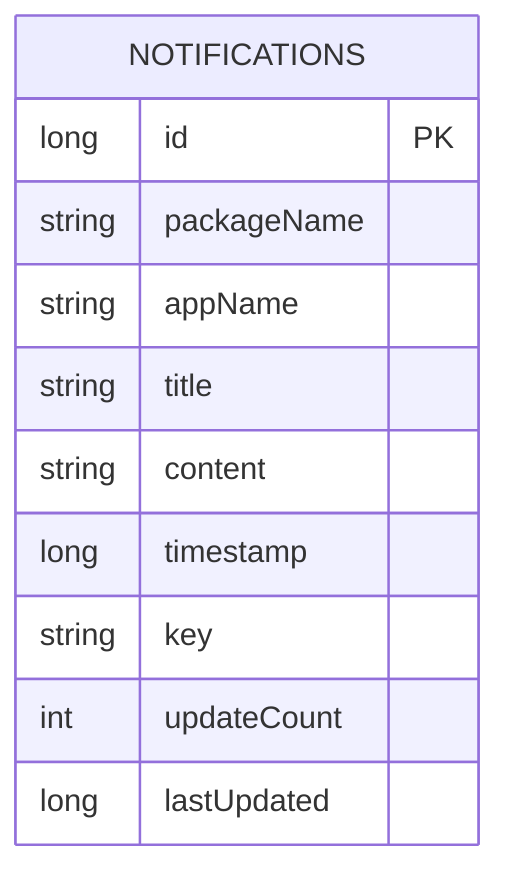
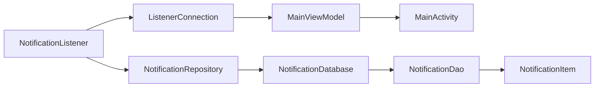

# Connection State Management

<cite>
**Referenced Files in This Document**
- [ListenerConnection.kt](file://app/src/main/java/com/notificationlog/ListenerConnection.kt)
- [MainViewModel.kt](file://app/src/main/java/com/notificationlog/MainViewModel.kt)
- [MainActivity.kt](file://app/src/main/java/com/notificationlog/MainActivity.kt)
- [NotificationListener.kt](file://app/src/main/java/com/notificationlog/NotificationListener.kt)
- [NotificationApp.kt](file://app/src/main/java/com/notificationlog/NotificationApp.kt)
- [NotificationDatabase.kt](file://app/src/main/java/com/notificationlog/data/NotificationDatabase.kt)
- [NotificationDao.kt](file://app/src/main/java/com/notificationlog/data/NotificationDao.kt)
- [NotificationItem.kt](file://app/src/main/java/com/notificationlog/model/NotificationItem.kt)
- [NotificationRepository.kt](file://app/src/main/java/com/notificationlog/repository/NotificationRepository.kt)
</cite>

## Table of Contents
1. [Introduction](#introduction)
2. [Project Structure](#project-structure)
3. [Core Components](#core-components)
4. [Architecture Overview](#architecture-overview)
5. [Detailed Component Analysis](#detailed-component-analysis)
6. [Dependency Analysis](#dependency-analysis)
7. [Performance Considerations](#performance-considerations)
8. [Troubleshooting Guide](#troubleshooting-guide)
9. [Conclusion](#conclusion)

## Introduction
This document explains how the application manages connection state for Android’s notification capture system. The core problem is that a user can grant Notification Access while the system still refuses to bind the app’s listener, especially on some OEM platforms after installation. To avoid silently claiming capture is running when nothing is recorded, the app tracks three distinct states:

- Not granted: Notification Access was never enabled or has been revoked.
- Not connected: Notification Access is granted, but the listener service is not bound.
- Connected: Notification Access is granted and the listener service is bound.

The implementation spans a shared connection state holder, a background listener service, a view model that computes the final state, and an activity that observes and exposes it to the user.

## Project Structure
The connection-state logic lives primarily in four files:

| Area | Responsibility |
|---|---|
| Shared state | Holds whether the listener is currently bound. |
| Listener service | Updates the shared state when the system binds or disconnects. |
| View model | Combines permission state with the live bind state into a single `CaptureState`. |
| Activity | Observes the computed state and lets the user retry binding. |

**Diagram sources**
- [MainActivity.kt:578-645](file://app/src/main/java/com/notificationlog/MainActivity.kt#L578-L645)
- [MainViewModel.kt:19-76](file://app/src/main/java/com/notificationlog/MainViewModel.kt#L19-L76)
- [ListenerConnection.kt:18-30](file://app/src/main/java/com/notificationlog/ListenerConnection.kt#L18-L30)
- [NotificationListener.kt:46-77](file://app/src/main/java/com/notificationlog/NotificationListener.kt#L46-L77)
- [NotificationRepository.kt:8-30](file://app/src/main/java/com/notificationlog/repository/NotificationRepository.kt#L8-L30)
- [NotificationDatabase.kt:9-11](file://app/src/main/java/com/notificationlog/data/NotificationDatabase.kt#L9-L11)
- [NotificationDao.kt:6-18](file://app/src/main/java/com/notificationlog/data/NotificationDao.kt#L6-L18)
- [NotificationItem.kt:18-34](file://app/src/main/java/com/notificationlog/model/NotificationItem.kt#L18-L34)

**Section sources**
- [ListenerConnection.kt:1-32](file://app/src/main/java/com/notificationlog/ListenerConnection.kt#L1-L32)
- [MainViewModel.kt:1-76](file://app/src/main/java/com/notificationlog/MainViewModel.kt#L1-L76)
- [MainActivity.kt:56-167](file://app/src/main/java/com/notificationlog/MainActivity.kt#L56-L167)
- [NotificationListener.kt:23-77](file://app/src/main/java/com/notificationlog/NotificationListener.kt#L23-L77)

## Core Components
The connection-state subsystem consists of five cooperating pieces:

1. **Shared connection flag**: A singleton exposing a thread-safe boolean LiveData.
2. **Listener service lifecycle hooks**: Sets the flag true on bind and false on disconnect or destroy.
3. **View model state computation**: Reads the system permission setting and combines it with the live bind flag.
4. **Activity observation and retry flow**: Shows the correct status text, enables retry, and handles failure dialogs.
5. **Background persistence layer**: Room database, DAO, repository, and entity used by the listener and view model.

Key responsibilities:

| Component | Connection-State Role |
|---|---|
| `ListenerConnection` | Single source of truth for whether the listener is bound. |
| `NotificationListener` | Updates the bound state from the system callback. |
| `MainViewModel` | Derives `CaptureState` from permission + bound state. |
| `MainActivity` | Displays state, triggers rebind, and shows recovery UX. |
| Repository / DAO / Database / Entity | Persist captured notifications; not directly part of state derivation but required for the full capture pipeline. |

**Section sources**
- [ListenerConnection.kt:6-30](file://app/src/main/java/com/notificationlog/ListenerConnection.kt#L6-L30)
- [NotificationListener.kt:46-77](file://app/src/main/java/com/notificationlog/NotificationListener.kt#L46-L77)
- [MainViewModel.kt:21-30](file://app/src/main/java/com/notificationlog/MainViewModel.kt#L21-L30)
- [MainActivity.kt:433-483](file://app/src/main/java/com/notificationlog/MainActivity.kt#L433-L483)

## Architecture Overview
The connection-state architecture separates concerns between system callbacks, process-wide state, UI state, and data persistence.

**Diagram sources**
- [NotificationListener.kt:46-77](file://app/src/main/java/com/notificationlog/NotificationListener.kt#L46-L77)
- [ListenerConnection.kt:20-30](file://app/src/main/java/com/notificationlog/ListenerConnection.kt#L20-L30)
- [MainViewModel.kt:65-99](file://app/src/main/java/com/notificationlog/MainViewModel.kt#L65-L99)
- [MainActivity.kt:72-87](file://app/src/main/java/com/notificationlog/MainActivity.kt#L72-L87)
- [MainActivity.kt:578-595](file://app/src/main/java/com/notificationlog/MainActivity.kt#L578-L595)

## Detailed Component Analysis

### ListenerConnection: Process-Wide Bind Flag
`ListenerConnection` is a Kotlin object holding a `MutableLiveData<Boolean>` representing whether the system has actually bound the notification listener. It is intentionally separate from the permission check because the two are not equivalent.

Important behaviors:

- The default value is disconnected.
- `isConnected` reads the current boolean safely.
- `setConnected` posts updates through `postValue`, which is necessary because the listener runs on a background thread while observers run on the main thread.
- The comments explain why this matters: some OEM systems keep the permission setting enabled even when they refuse the actual bind.

**Diagram sources**
- [ListenerConnection.kt:18-30](file://app/src/main/java/com/notificationlog/ListenerConnection.kt#L18-L30)

**Section sources**
- [ListenerConnection.kt:6-30](file://app/src/main/java/com/notificationlog/ListenerConnection.kt#L6-L30)

### NotificationListener: Lifecycle and Capture Pipeline
`NotificationListener` extends `NotificationListenerService`. Its connection-state responsibilities are:

- Set the shared connection flag to true in `onListenerConnected`.
- Set it to false in `onListenerDisconnected` and `onDestroy`.
- Attempt a programmatic rebind on Android 13+ after disconnect.
- Show a high-priority warning notification when access is lost.
- Broadcast a private intent so the activity can show a dialog if it is visible.

The capture pipeline also uses the repository to insert or update logged notifications, but that path is separate from the bind-state path.

**Diagram sources**
- [NotificationListener.kt:46-77](file://app/src/main/java/com/notificationlog/NotificationListener.kt#L46-L77)

**Section sources**
- [NotificationListener.kt:23-77](file://app/src/main/java/com/notificationlog/NotificationListener.kt#L23-L77)
- [NotificationListener.kt:205-209](file://app/src/main/java/com/notificationlog/NotificationListener.kt#L205-L209)

### MainViewModel: Computing CaptureState
`MainViewModel` is where the three-state decision happens. It does not treat “permission granted” as enough evidence that capture is working. Instead, it computes:

- `NOT_GRANTED`: Permission is not enabled.
- `CONNECTED`: Permission is enabled and `ListenerConnection.isConnected` is true.
- `NOT_CONNECTED`: Permission is enabled but the listener is not bound.

It also provides `reconnect`, which calls `NotificationListenerService.requestRebind`, waits briefly, and then refreshes the state.

**Diagram sources**
- [MainViewModel.kt:82-99](file://app/src/main/java/com/notificationlog/MainViewModel.kt#L82-L99)

**Section sources**
- [MainViewModel.kt:19-76](file://app/src/main/java/com/notificationlog/MainViewModel.kt#L19-L76)
- [MainViewModel.kt:101-122](file://app/src/main/java/com/notificationlog/MainViewModel.kt#L101-L122)
- [MainViewModel.kt:275-284](file://app/src/main/java/com/notificationlog/MainViewModel.kt#L275-L284)

### MainActivity: User-Facing State and Retry Flow
`MainActivity` observes both `serviceStatus` and `captureState`. Its most important connection-state behavior is rendering `NOT_CONNECTED` as a clickable status line that attempts a reconnect.

Key flows:

- On resume, if the state is `NOT_CONNECTED`, it performs one automatic reconnect attempt.
- When the user taps the status line, it requests a reconnect and reports success or failure after a delay.
- If reconnect fails, it offers to open app settings or retry.
- It also reacts to the `LISTENER_DISCONNECTED` broadcast by showing a dialog.

**Diagram sources**
- [MainActivity.kt:433-483](file://app/src/main/java/com/notificationlog/MainActivity.kt#L433-L483)
- [MainActivity.kt:213-223](file://app/src/main/java/com/notificationlog/MainActivity.kt#L213-L223)
- [MainViewModel.kt:108-122](file://app/src/main/java/com/notificationlog/MainViewModel.kt#L108-L122)

**Section sources**
- [MainActivity.kt:197-231](file://app/src/main/java/com/notificationlog/MainActivity.kt#L197-L231)
- [MainActivity.kt:433-501](file://app/src/main/java/com/notificationlog/MainActivity.kt#L433-L501)
- [MainActivity.kt:578-645](file://app/src/main/java/com/notificationlog/MainActivity.kt#L578-L645)

### Data Layer: Persistence Supporting the Capture Pipeline
Although the data layer does not compute connection state, it is essential to understanding why the listener needs to be bound: without a bound listener, no new notifications reach the repository, so the list cannot grow.

Components:

| File | Purpose |
|---|---|
| `NotificationItem` | Room entity storing package, app name, title, content, timestamps, key, update count, and last updated time. |
| `NotificationDatabase` | Room database with migration adding de-duplication fields and indexes. |
| `NotificationDao` | Queries for sorting, searching, latest-by-key, insertion, bumping update counts, and bulk deletion. |
| `NotificationRepository` | Wraps DAO calls and implements duplicate compaction using a temporary table. |
| `NotificationApp` | Application-level holder for the single Room instance and repository. |

**Diagram sources**
- [NotificationItem.kt:18-34](file://app/src/main/java/com/notificationlog/model/NotificationItem.kt#L18-L34)
- [NotificationDatabase.kt:9-40](file://app/src/main/java/com/notificationlog/data/NotificationDatabase.kt#L9-L40)
- [NotificationDao.kt:6-66](file://app/src/main/java/com/notificationlog/data/NotificationDao.kt#L6-L66)
- [NotificationRepository.kt:8-91](file://app/src/main/java/com/notificationlog/repository/NotificationRepository.kt#L8-L91)
- [NotificationApp.kt:9-38](file://app/src/main/java/com/notificationlog/NotificationApp.kt#L9-L38)

**Section sources**
- [NotificationItem.kt:9-34](file://app/src/main/java/com/notificationlog/model/NotificationItem.kt#L9-L34)
- [NotificationDatabase.kt:13-40](file://app/src/main/java/com/notificationlog/data/NotificationDatabase.kt#L13-L40)
- [NotificationDao.kt:20-43](file://app/src/main/java/com/notificationlog/data/NotificationDao.kt#L20-L43)
- [NotificationRepository.kt:44-85](file://app/src/main/java/com/notificationlog/repository/NotificationRepository.kt#L44-L85)
- [NotificationApp.kt:28-37](file://app/src/main/java/com/notificationlog/NotificationApp.kt#L28-L37)

## Dependency Analysis
The connection-state dependencies form a clear chain:

- `NotificationListener` writes to `ListenerConnection`.
- `MainViewModel` observes `ListenerConnection` and derives `CaptureState`.
- `MainActivity` observes `MainViewModel` and drives user actions.
- The repository and database are downstream consumers of the listener’s capture output.

**Diagram sources**
- [NotificationListener.kt:46-77](file://app/src/main/java/com/notificationlog/NotificationListener.kt#L46-L77)
- [ListenerConnection.kt:18-30](file://app/src/main/java/com/notificationlog/ListenerConnection.kt#L18-L30)
- [MainViewModel.kt:65-99](file://app/src/main/java/com/notificationlog/MainViewModel.kt#L65-L99)
- [MainActivity.kt:578-595](file://app/src/main/java/com/notificationlog/MainActivity.kt#L578-L595)
- [NotificationRepository.kt:8-30](file://app/src/main/java/com/notificationlog/repository/NotificationRepository.kt#L8-L30)
- [NotificationDatabase.kt:9-11](file://app/src/main/java/com/notificationlog/data/NotificationDatabase.kt#L9-L11)
- [NotificationDao.kt:6-18](file://app/src/main/java/com/notificationlog/data/NotificationDao.kt#L6-L18)
- [NotificationItem.kt:18-34](file://app/src/main/java/com/notificationlog/model/NotificationItem.kt#L18-L34)

**Section sources**
- [MainViewModel.kt:65-76](file://app/src/main/java/com/notificationlog/MainViewModel.kt#L65-L76)
- [MainActivity.kt:578-645](file://app/src/main/java/com/notificationlog/MainActivity.kt#L578-L645)

## Performance Considerations
Connection-state handling is lightweight, but several design choices affect responsiveness and correctness:

- `ListenerConnection.setConnected` uses `postValue` instead of direct assignment because the listener runs off the main thread.
- `MainViewModel.refreshCaptureState` runs permission checks on `Dispatchers.IO` and updates LiveData on the appropriate thread.
- `MainViewModel.reconnect` waits before rechecking state because the bind is asynchronous.
- The listener uses a coroutine scope with a supervisor job and a mutex around insert/update logic to reduce contention and avoid race conditions during rapid notification bursts.
- The repository’s duplicate-compaction operation uses a temporary table to avoid expensive correlated subqueries over large logs.

[No sources needed since this section provides general guidance]

## Troubleshooting Guide
Common connection-state symptoms and their likely causes:

| Symptom | Likely Cause | Recommended Action |
|---|---|---|
| Status says “not connected” even though Notification Access appears enabled. | The system granted permission but refused to bind the listener. | Tap the status line to request rebind; if it fails again, open app settings and verify autostart or background restrictions. |
| Status flips to “not connected” after returning from Autostart settings. | The listener was disconnected and did not automatically rebind. | Let the automatic reconnect attempt run; otherwise tap the status line manually. |
| No new rows appear in the log despite capture being enabled. | Listener is not bound or capture is disabled in preferences. | Confirm `CaptureState.CONNECTED`; check the capture toggle and the listener’s warning notification. |
| Reconnect dialog appears repeatedly. | The system continues refusing the bind. | Open app details settings and allow autostart/background execution; then retry. |
| Error messages disappear silently. | Errors were previously posted to LiveData without observers. | Ensure `errorMessage` is observed in the activity; recent code displays them via toast and clears them after display. |

**Section sources**
- [MainActivity.kt:470-501](file://app/src/main/java/com/notificationlog/MainActivity.kt#L470-L501)
- [MainActivity.kt:578-622](file://app/src/main/java/com/notificationlog/MainActivity.kt#L578-L622)
- [NotificationListener.kt:55-77](file://app/src/main/java/com/notificationlog/NotificationListener.kt#L55-L77)
- [MainViewModel.kt:61-63](file://app/src/main/java/com/notificationlog/MainViewModel.kt#L61-L63)

## Conclusion
The application’s connection-state management solves a real-world Android edge case: permission granted does not guarantee a working listener. By separating the permission check from the live bind state, exposing that state through `ListenerConnection`, computing a three-way `CaptureState` in the view model, and giving users a retryable UI, the app avoids falsely reporting capture as active. The result is clearer diagnostics, better recovery paths, and a more reliable notification logging experience.

[No sources needed since this section summarizes without analyzing specific files]