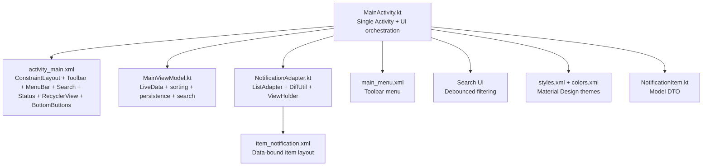
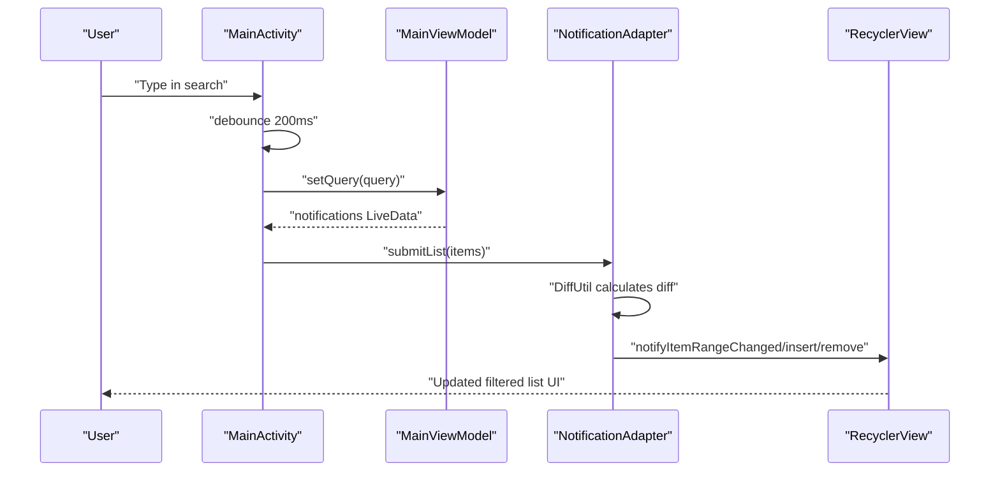
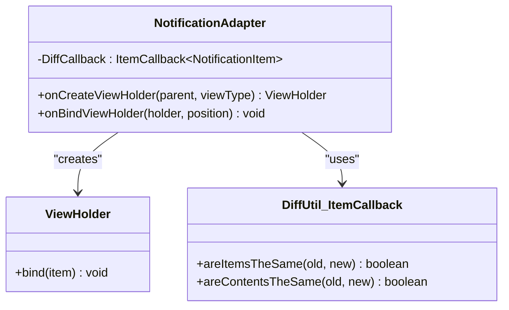
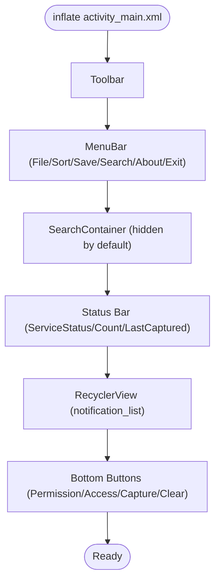
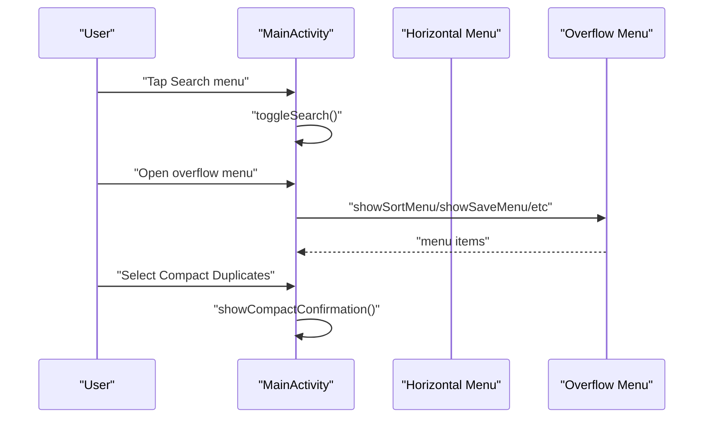
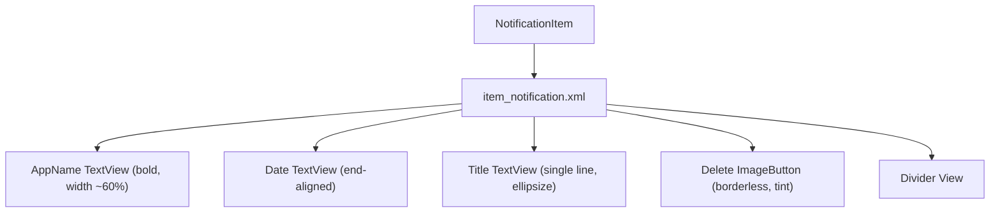
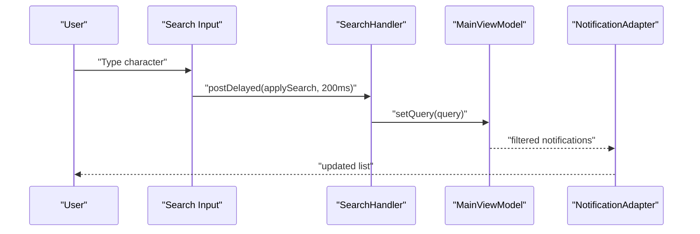
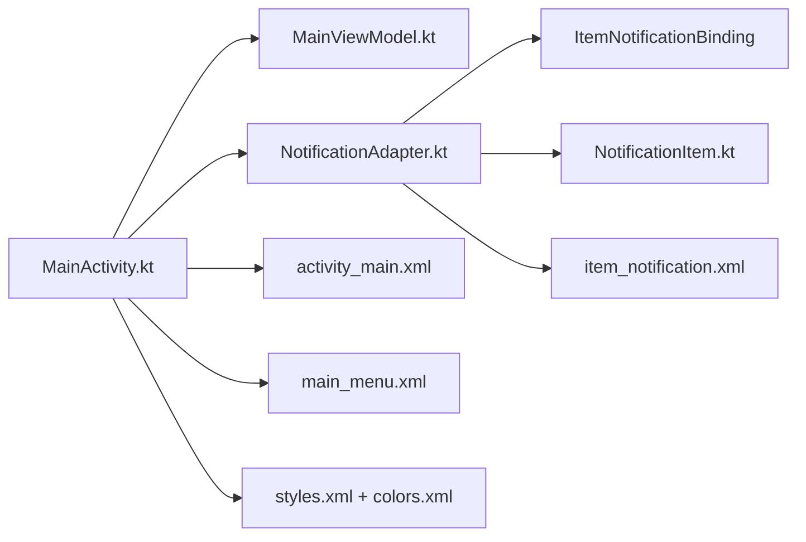

# UI Components

<cite>
**Referenced Files in This Document**
- [NotificationAdapter.kt](file://app/src/main/java/com/notificationlog/adapter/NotificationAdapter.kt)
- [MainActivity.kt](file://app/src/main/java/com/notificationlog/MainActivity.kt)
- [MainViewModel.kt](file://app/src/main/java/com/notificationlog/MainViewModel.kt)
- [NotificationItem.kt](file://app/src/main/java/com/notificationlog/model/NotificationItem.kt)
- [activity_main.xml](file://app/src/main/res/layout/activity_main.xml)
- [item_notification.xml](file://app/src/main/res/layout/item_notification.xml)
- [main_menu.xml](file://app/src/main/res/menu/main_menu.xml)
- [styles.xml](file://app/src/main/res/values/styles.xml)
- [colors.xml](file://app/src/main/res/values/colors.xml)
- [strings.xml](file://app/src/main/res/values/strings.xml)
</cite>

## Update Summary
**Changes Made**
- Updated component references to reflect removed legacy layouts (content_main.xml, dialog_notification_detail.xml)
- Added comprehensive search functionality with debounced filtering
- Simplified architecture from fragment-based to single activity layout
- Enhanced menu system with new search, compact duplicates, and improved status management
- Updated UI components to use modern Material Design patterns

## Table of Contents
1. [Introduction](#introduction)
2. [Project Structure](#project-structure)
3. [Core Components](#core-components)
4. [Architecture Overview](#architecture-overview)
5. [Detailed Component Analysis](#detailed-component-analysis)
6. [Search Functionality](#search-functionality)
7. [Dependency Analysis](#dependency-analysis)
8. [Performance Considerations](#performance-considerations)
9. [Troubleshooting Guide](#troubleshooting-guide)
10. [Conclusion](#conclusion)
11. [Appendices](#appendices)

## Introduction
This document describes the user interface components and layout structure of the Notification Log application. The application has been modernized with a simplified single-activity architecture, comprehensive search capabilities, and enhanced Material Design integration. It focuses on the RecyclerView adapter pattern, DiffUtil usage, ViewHolder implementation, main activity layout, menu systems, notification item layouts, interactive elements, accessibility features, responsive design, theme integration, and performance optimization for large notification lists.

## Project Structure
The UI layer is organized around:
- A single MainActivity that hosts the complete interface and orchestrates all functionality
- A RecyclerView adapter implementing the ViewHolder pattern with DiffUtil for efficient updates
- XML layouts for the main screen and item rendering only (no separate content or dialog layouts)
- Menu resources for toolbar and contextual actions
- Material Design themes and styles integrated via values resources
- Comprehensive search functionality with debounced filtering

**Diagram sources**
- [MainActivity.kt:56-167](file://app/src/main/java/com/notificationlog/MainActivity.kt#L56-L167)
- [activity_main.xml:6-309](file://app/src/main/res/layout/activity_main.xml#L6-L309)
- [NotificationAdapter.kt:13-59](file://app/src/main/java/com/notificationlog/adapter/NotificationAdapter.kt#L13-L59)
- [item_notification.xml:1-74](file://app/src/main/res/layout/item_notification.xml#L1-L74)
- [main_menu.xml:1-50](file://app/src/main/res/menu/main_menu.xml#L1-L50)
- [NotificationItem.kt:18-35](file://app/src/main/java/com/notificationlog/model/NotificationItem.kt#L18-L35)

**Section sources**
- [MainActivity.kt:56-167](file://app/src/main/java/com/notificationlog/MainActivity.kt#L56-L167)
- [activity_main.xml:6-309](file://app/src/main/res/layout/activity_main.xml#L6-L309)

## Core Components
- **RecyclerView Adapter**: Implements the RecyclerView adapter pattern with a ViewHolder and uses DiffUtil for efficient list updates
- **Main Activity Layout**: ConstraintLayout-based main screen with a Toolbar, horizontal menu bar, search functionality, status bar, RecyclerView, and bottom action buttons
- **Menu System**: Horizontal menu bar with File, Sort, Save, Search, About, and Exit options, plus overflow menu for additional actions
- **Search Functionality**: Debounced text search with real-time filtering, clear button, and bulk delete capability
- **Item Layout**: Data-bound item layout for notification rows with app name, title, date, and delete button
- **Theme and Styles**: MaterialComponents DayNight theme with overlays for app bars and popups

**Section sources**
- [NotificationAdapter.kt:13-59](file://app/src/main/java/com/notificationlog/adapter/NotificationAdapter.kt#L13-L59)
- [MainActivity.kt:250-316](file://app/src/main/java/com/notificationlog/MainActivity.kt#L250-L316)
- [activity_main.xml:11-309](file://app/src/main/res/layout/activity_main.xml#L11-L309)
- [item_notification.xml:1-74](file://app/src/main/res/layout/item_notification.xml#L1-L74)
- [styles.xml:4-22](file://app/src/main/res/values/styles.xml#L4-L22)

## Architecture Overview
The UI follows a simplified single-activity pattern:
- MainActivity binds views, sets up RecyclerView, menus, search, and observes ViewModel LiveData
- MainViewModel exposes LiveData streams for notifications, counts, service status, and search queries
- NotificationAdapter renders NotificationItem instances efficiently using DiffUtil

**Diagram sources**
- [MainActivity.kt:279-298](file://app/src/main/java/com/notificationlog/MainActivity.kt#L279-L298)
- [MainActivity.kt:602-613](file://app/src/main/java/com/notificationlog/MainActivity.kt#L602-L613)
- [NotificationAdapter.kt:18-28](file://app/src/main/java/com/notificationlog/adapter/NotificationAdapter.kt#L18-L28)

## Detailed Component Analysis

### NotificationAdapter Implementation
- **Pattern**: Extends ListAdapter with DiffUtil.ItemCallback for efficient updates
- **ViewHolder**: Uses View Binding via generated ItemNotificationBinding to inflate and bind item views
- **Interaction**: Exposes click lambdas for item click and delete click to MainActivity
- **DiffUtil**: Compares item identity by id and content equality for same items

**Diagram sources**
- [NotificationAdapter.kt:13-59](file://app/src/main/java/com/notificationlog/adapter/NotificationAdapter.kt#L13-L59)

**Section sources**
- [NotificationAdapter.kt:13-59](file://app/src/main/java/com/notificationlog/adapter/NotificationAdapter.kt#L13-L59)

### Main Activity Layout Structure
- **Root**: ConstraintLayout with background color from theme attributes
- **Toolbar**: App bar with popup theme overlays
- **Menu Bar**: Horizontal LinearLayout of clickable TextView entries wired to PopupMenus
- **Search Container**: Collapsible search row with EditText, clear button, and delete matching button
- **Status Bar**: Blue container with service status, notification count, and last-captured timestamp
- **RecyclerView**: Center area displaying notification items
- **Bottom Buttons**: Four horizontally arranged ImageButton groups with tooltips and dynamic tinting

**Diagram sources**
- [activity_main.xml:6-309](file://app/src/main/res/layout/activity_main.xml#L6-L309)

**Section sources**
- [activity_main.xml:6-309](file://app/src/main/res/layout/activity_main.xml#L6-L309)
- [MainActivity.kt:250-316](file://app/src/main/java/com/notificationlog/MainActivity.kt#L250-L316)

### Menu System
- **Horizontal Menu Bar**: File, Sort, Save, Search, About, and Exit options implemented as clickable TextViews
- **Overflow Menu**: Defined in main_menu.xml with sort options, refresh, save screenshot, save text log, about, toggle dark mode, toggle running notification, compact duplicates, and exit
- **MainActivity wiring**: setupMenuBar() handles horizontal menu clicks; showFileMenu(), showSortMenu(), showSaveMenu() handle PopupMenus

**Diagram sources**
- [main_menu.xml:1-50](file://app/src/main/res/menu/main_menu.xml#L1-L50)
- [MainActivity.kt:259-398](file://app/src/main/java/com/notificationlog/MainActivity.kt#L259-L398)

**Section sources**
- [main_menu.xml:1-50](file://app/src/main/res/menu/main_menu.xml#L1-L50)
- [MainActivity.kt:259-398](file://app/src/main/java/com/notificationlog/MainActivity.kt#L259-L398)

### Notification Item Layout Design and Styling
- **Data Binding**: item_notification.xml defines a data variable bound to NotificationItem
- **Material Design**: Uses ConstraintLayout with selectable backgrounds and theme-aware colors
- **Typography and Layout**: App name bold, title truncated with ellipsis, date aligned to the end, delete button with borderless background and tint
- **Accessibility**: Content descriptions on interactive elements (buttons, images)

**Diagram sources**
- [item_notification.xml:1-74](file://app/src/main/res/layout/item_notification.xml#L1-L74)
- [NotificationItem.kt:18-35](file://app/src/main/java/com/notificationlog/model/NotificationItem.kt#L18-L35)

**Section sources**
- [item_notification.xml:1-74](file://app/src/main/res/layout/item_notification.xml#L1-L74)
- [NotificationItem.kt:18-35](file://app/src/main/java/com/notificationlog/model/NotificationItem.kt#L18-L35)

### Accessibility Features
- **Content Descriptions**: Buttons and ImageButtons include contentDescription for screen readers
- **Tooltips**: TooltipCompat applied to bottom buttons for contextual hints
- **Focusable Elements**: TextViews and buttons are focusable by default; ensure logical tab order via layout

**Section sources**
- [activity_main.xml:101-135](file://app/src/main/res/layout/activity_main.xml#L101-L135)
- [MainActivity.kt:400-431](file://app/src/main/java/com/notificationlog/MainActivity.kt#L400-L431)

### Responsive Design and Theme Integration
- **ConstraintLayout**: Ensures adaptive sizing across devices
- **MaterialComponents Theme**: Theme.MaterialComponents.DayNight.NoActionBar with primary/secondary palettes and status bar color set from theme attributes
- **Overlays**: AppBarOverlay and PopupOverlay tailor appearance for app bars and popups
- **Dynamic Tints**: Bottom buttons change tint based on state (enabled/disabled)

**Section sources**
- [styles.xml:4-22](file://app/src/main/res/values/styles.xml#L4-L22)
- [colors.xml:1-12](file://app/src/main/res/values/colors.xml#L1-L12)
- [activity_main.xml:11-19](file://app/src/main/res/layout/activity_main.xml#L11-L19)

## Search Functionality

### Search UI Implementation
The application includes a comprehensive search feature with the following components:

- **Search Container**: A collapsible LinearLayout containing an EditText for input, a clear button, and a delete matching button
- **Debounced Filtering**: Uses a Handler with 200ms delay to prevent excessive database queries during typing
- **Real-time Updates**: Automatically filters the notification list as the user types
- **Bulk Operations**: Allows deletion of all matching notifications when a search query exists

**Diagram sources**
- [MainActivity.kt:279-298](file://app/src/main/java/com/notificationlog/MainActivity.kt#L279-L298)

### Search Features
- **Toggle Visibility**: Search container can be shown/hidden via the Search menu item
- **Auto-focus**: When search is opened, the input field receives focus and keyboard appears
- **Clear Functionality**: Clear button resets the search input and removes focus
- **Delete Matching**: Delete button appears only when there's a search query, allowing bulk deletion
- **Back Navigation**: Pressing back closes the search rather than exiting the app

**Section sources**
- [MainActivity.kt:267-321](file://app/src/main/java/com/notificationlog/MainActivity.kt#L267-L321)
- [activity_main.xml:87-135](file://app/src/main/res/layout/activity_main.xml#L87-L135)

### Performance Optimization
- **Debouncing**: Prevents excessive database queries by waiting 200ms after the last keystroke
- **Efficient Filtering**: ViewModel handles filtering logic, keeping UI responsive
- **Visibility Management**: Search container remains hidden until needed, saving vertical space

**Section sources**
- [MainActivity.kt:243-244](file://app/src/main/java/com/notificationlog/MainActivity.kt#L243-L244)
- [MainActivity.kt:279-298](file://app/src/main/java/com/notificationlog/MainActivity.kt#L279-L298)

## Dependency Analysis
- **MainActivity depends on**:
  - ActivityMainBinding for view binding
  - MainViewModel for LiveData streams
  - NotificationAdapter for RecyclerView population
- **NotificationAdapter depends on**:
  - ItemNotificationBinding for item inflation
  - NotificationItem for data
- **Layouts depend on**:
  - Data-binding expressions referencing NotificationItem
  - Theme attributes for colors and backgrounds

**Diagram sources**
- [MainActivity.kt:58-60](file://app/src/main/java/com/notificationlog/MainActivity.kt#L58-L60)
- [NotificationAdapter.kt:8-11](file://app/src/main/java/com/notificationlog/adapter/NotificationAdapter.kt#L8-L11)
- [NotificationItem.kt:18-35](file://app/src/main/java/com/notificationlog/model/NotificationItem.kt#L18-L35)
- [activity_main.xml:1-310](file://app/src/main/res/layout/activity_main.xml#L1-L310)
- [item_notification.xml:1-74](file://app/src/main/res/layout/item_notification.xml#L1-L74)
- [main_menu.xml:1-50](file://app/src/main/res/menu/main_menu.xml#L1-L50)
- [styles.xml:1-23](file://app/src/main/res/values/styles.xml#L1-L23)
- [colors.xml:1-12](file://app/src/main/res/values/colors.xml#L1-L12)

**Section sources**
- [MainActivity.kt:58-60](file://app/src/main/java/com/notificationlog/MainActivity.kt#L58-L60)
- [NotificationAdapter.kt:8-11](file://app/src/main/java/com/notificationlog/adapter/NotificationAdapter.kt#L8-L11)
- [NotificationItem.kt:18-35](file://app/src/main/java/com/notificationlog/model/NotificationItem.kt#L18-L35)

## Performance Considerations
- **ListAdapter with DiffUtil**: Efficient updates for large datasets without full list rebuilds
- **View Binding**: Eliminates findViewById overhead and improves type safety
- **Flat Layouts**: Simple ConstraintLayout hierarchies reduce measure/layout cost
- **Debounced Search**: Prevents excessive database queries during rapid typing
- **ViewModel State**: Survives configuration changes, reducing unnecessary reinitialization
- **Reused Adapters**: Single adapter instance avoids recreation overhead

## Troubleshooting Guide
- **Permissions and Access**:
  - If notification access is disabled, MainActivity shows a dialog guiding the user to system settings
  - On Android 13+, POST_NOTIFICATIONS permission is requested dynamically
- **Service Status**:
  - Bottom buttons reflect service and permission status via tint and tooltip updates
  - Three-state service indicator: Connected, Not Connected (reconnectable), Not Granted
- **Error Handling**:
  - ViewModel posts error messages via LiveData; UI surfaces these to users via Toast
- **Search Issues**:
  - If search doesn't work, check that ViewModel.setQuery is being called
  - Verify debounce timing isn't too aggressive for your device
- **Dialogs**:
  - Detail and confirmation dialogs are used for delete and clear actions

**Section sources**
- [MainActivity.kt:567-737](file://app/src/main/java/com/notificationlog/MainActivity.kt#L567-L737)
- [MainActivity.kt:617-622](file://app/src/main/java/com/notificationlog/MainActivity.kt#L617-L622)

## Conclusion
The UI layer combines modern Android patterns with Material Design in a simplified single-activity architecture:
- **RecyclerView adapter with DiffUtil** ensures efficient updates for large notification lists
- **ConstraintLayout-based main screen** integrates menus, search, status, and action buttons
- **Data-binding item layouts** provide concise, maintainable row rendering
- **Comprehensive search functionality** offers real-time filtering with debounced performance
- **Horizontal menu system** provides intuitive navigation and actions
- **Themes and overlays** deliver consistent day/night styling
- **Enhanced service management** provides better feedback on connection states

The removal of legacy layouts (content_main.xml, dialog_notification_detail.xml) and adoption of a single-activity approach has simplified the architecture while adding powerful search capabilities and improved user experience.

## Appendices
- **Strings and Resources**: Centralized in strings.xml for localization and reuse
- **Material Design Integration**: Consistent theming across all components

**Section sources**
- [strings.xml:1-79](file://app/src/main/res/values/strings.xml#L1-L79)