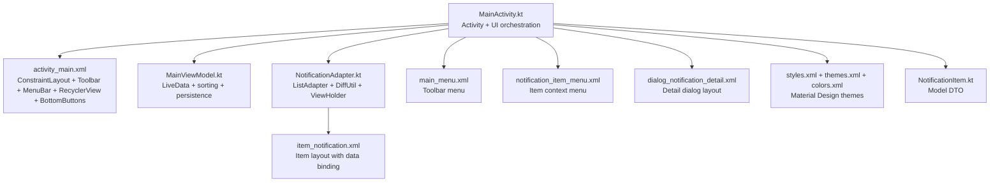
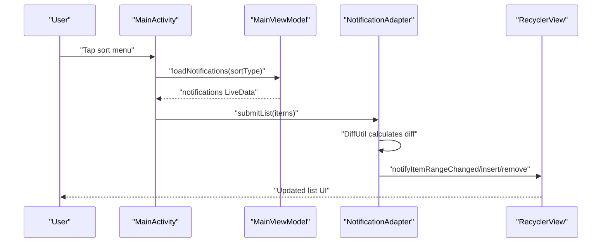
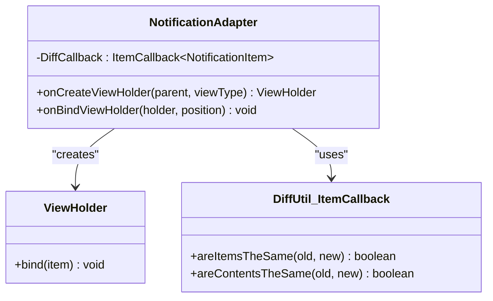
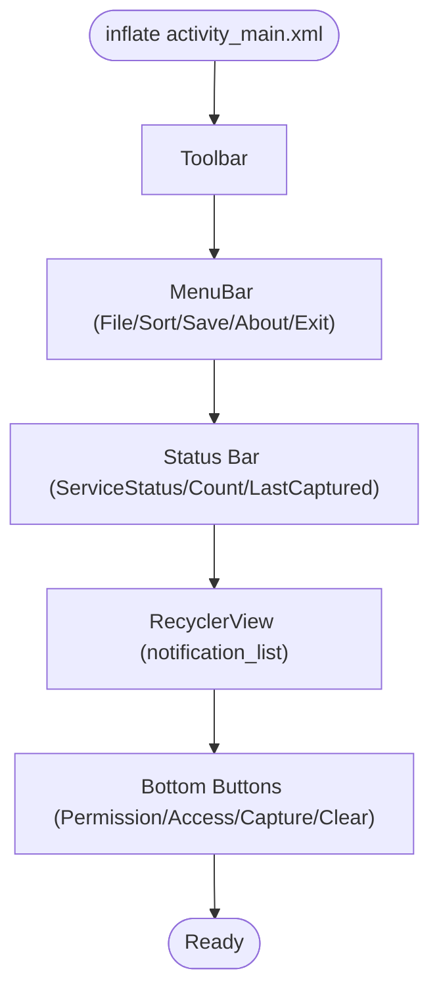
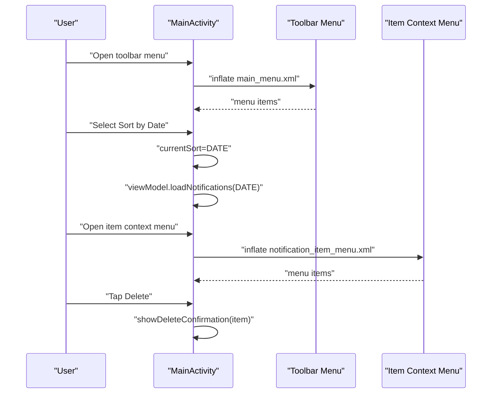
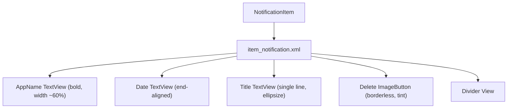
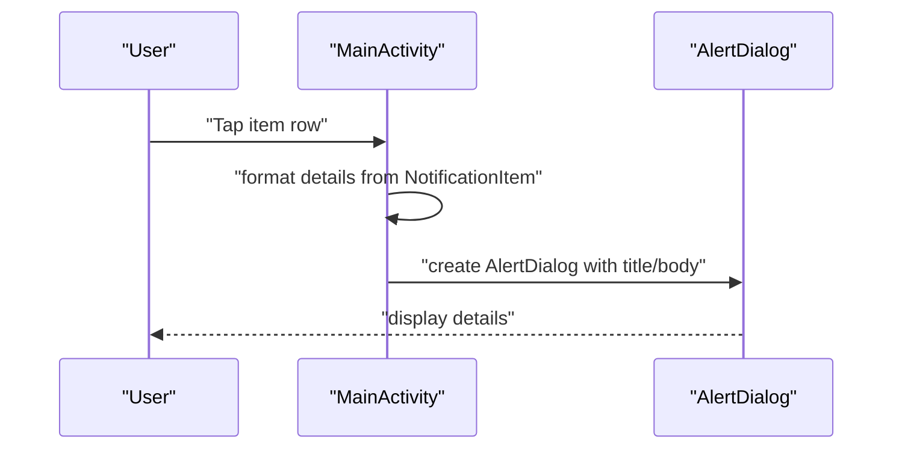
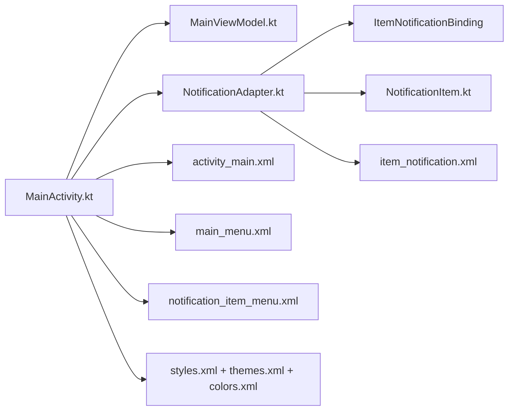

# UI Components

<cite>
**Referenced Files in This Document**
- [NotificationAdapter.kt](file://app/src/main/java/com/notificationlog/adapter/NotificationAdapter.kt)
- [MainActivity.kt](file://app/src/main/java/com/notificationlog/MainActivity.kt)
- [MainViewModel.kt](file://app/src/main/java/com/notificationlog/MainViewModel.kt)
- [NotificationItem.kt](file://app/src/main/java/com/notificationlog/model/NotificationItem.kt)
- [activity_main.xml](file://app/src/main/res/layout/activity_main.xml)
- [content_main.xml](file://app/src/main/res/layout/content_main.xml)
- [item_notification.xml](file://app/src/main/res/layout/item_notification.xml)
- [notification_item.xml](file://app/src/main/res/layout/notification_item.xml)
- [dialog_notification_detail.xml](file://app/src/main/res/layout/dialog_notification_detail.xml)
- [main_menu.xml](file://app/src/main/res/menu/main_menu.xml)
- [notification_item_menu.xml](file://app/src/main/res/menu/notification_item_menu.xml)
- [styles.xml](file://app/src/main/res/values/styles.xml)
- [themes.xml](file://app/src/main/res/values/themes.xml)
- [colors.xml](file://app/src/main/res/values/colors.xml)
- [strings.xml](file://app/src/main/res/values/strings.xml)
</cite>

## Table of Contents
1. [Introduction](#introduction)
2. [Project Structure](#project-structure)
3. [Core Components](#core-components)
4. [Architecture Overview](#architecture-overview)
5. [Detailed Component Analysis](#detailed-component-analysis)
6. [Dependency Analysis](#dependency-analysis)
7. [Performance Considerations](#performance-considerations)
8. [Troubleshooting Guide](#troubleshooting-guide)
9. [Conclusion](#conclusion)
10. [Appendices](#appendices)

## Introduction
This document describes the user interface components and layout structure of the Notification Log application. It focuses on the RecyclerView adapter pattern, DiffUtil usage, ViewHolder implementation, main activity layout, fragment integration considerations, menu systems, notification item layouts, Material Design styling, interactive elements, notification detail dialogs, accessibility features, responsive design, theme integration, and performance optimization for large notification lists.

## Project Structure
The UI layer is organized around:
- An Activity that hosts the main layout and orchestrates menus, buttons, and RecyclerView.
- A RecyclerView adapter implementing the ViewHolder pattern with DiffUtil for efficient updates.
- XML layouts for the main screen, item rendering, and dialogs.
- Menu resources for toolbar and contextual actions.
- Material Design themes and styles integrated via values resources.

**Diagram sources**
- [MainActivity.kt:1-717](file://app/src/main/java/com/notificationlog/MainActivity.kt#L1-L717)
- [activity_main.xml:1-240](file://app/src/main/res/layout/activity_main.xml#L1-L240)
- [MainViewModel.kt:1-121](file://app/src/main/java/com/notificationlog/MainViewModel.kt#L1-L121)
- [NotificationAdapter.kt:1-59](file://app/src/main/java/com/notificationlog/adapter/NotificationAdapter.kt#L1-L59)
- [item_notification.xml:1-74](file://app/src/main/res/layout/item_notification.xml#L1-L74)
- [main_menu.xml:1-45](file://app/src/main/res/menu/main_menu.xml#L1-L45)
- [notification_item_menu.xml:1-9](file://app/src/main/res/menu/notification_item_menu.xml#L1-L9)
- [dialog_notification_detail.xml:1-23](file://app/src/main/res/layout/dialog_notification_detail.xml#L1-L23)
- [styles.xml:1-23](file://app/src/main/res/values/styles.xml#L1-L23)
- [themes.xml:1-16](file://app/src/main/res/values/themes.xml#L1-L16)
- [colors.xml:1-12](file://app/src/main/res/values/colors.xml#L1-L12)
- [NotificationItem.kt:1-19](file://app/src/main/java/com/notificationlog/model/NotificationItem.kt#L1-L19)

**Section sources**
- [MainActivity.kt:78-108](file://app/src/main/java/com/notificationlog/MainActivity.kt#L78-L108)
- [activity_main.xml:6-240](file://app/src/main/res/layout/activity_main.xml#L6-L240)

## Core Components
- RecyclerView Adapter: Implements the RecyclerView adapter pattern with a ViewHolder and uses DiffUtil for efficient list updates.
- Main Activity Layout: ConstraintLayout-based main screen with a Toolbar, horizontal menu bar, status bar, RecyclerView, and bottom action buttons.
- Menus: Toolbar menu and item context menu for sorting, refresh, save, about, dark mode toggle, and delete.
- Item Layout: Data-bound item layout for notification rows with app name, title, date, and delete button.
- Dialog Layout: Simple linear layout for notification detail dialog.
- Theme and Styles: MaterialComponents DayNight theme with overlays for app bars and popups.

**Section sources**
- [NotificationAdapter.kt:13-59](file://app/src/main/java/com/notificationlog/adapter/NotificationAdapter.kt#L13-L59)
- [MainActivity.kt:146-153](file://app/src/main/java/com/notificationlog/MainActivity.kt#L146-L153)
- [activity_main.xml:11-238](file://app/src/main/res/layout/activity_main.xml#L11-L238)
- [item_notification.xml:1-74](file://app/src/main/res/layout/item_notification.xml#L1-L74)
- [dialog_notification_detail.xml:1-23](file://app/src/main/res/layout/dialog_notification_detail.xml#L1-L23)
- [styles.xml:4-22](file://app/src/main/res/values/styles.xml#L4-L22)

## Architecture Overview
The UI follows a clean separation:
- MainActivity binds views, sets up RecyclerView, menus, and observes ViewModel LiveData.
- MainViewModel exposes LiveData streams for notifications, counts, and service status.
- NotificationAdapter renders NotificationItem instances efficiently using DiffUtil.

**Diagram sources**
- [MainActivity.kt:496-519](file://app/src/main/java/com/notificationlog/MainActivity.kt#L496-L519)
- [MainViewModel.kt:59-77](file://app/src/main/java/com/notificationlog/MainViewModel.kt#L59-L77)
- [NotificationAdapter.kt:18-28](file://app/src/main/java/com/notificationlog/adapter/NotificationAdapter.kt#L18-L28)

## Detailed Component Analysis

### NotificationAdapter Implementation
- Pattern: Extends ListAdapter with DiffUtil.ItemCallback for efficient updates.
- ViewHolder: Uses View Binding via generated ItemNotificationBinding to inflate and bind item views.
- Interaction: Exposes click lambdas for item click and delete click to MainActivity.
- DiffUtil: Compares item identity by id and content equality for same items.

**Diagram sources**
- [NotificationAdapter.kt:13-59](file://app/src/main/java/com/notificationlog/adapter/NotificationAdapter.kt#L13-L59)

**Section sources**
- [NotificationAdapter.kt:13-59](file://app/src/main/java/com/notificationlog/adapter/NotificationAdapter.kt#L13-L59)

### Main Activity Layout Structure
- Root: ConstraintLayout with background color from theme attributes.
- Toolbar: App bar with popup theme overlays.
- Menu Bar: Horizontal LinearLayout of clickable TextView entries wired to PopupMenus.
- Status Bar: Blue container with service status, notification count, and last-captured timestamp.
- RecyclerView: Center area displaying notification items.
- Bottom Buttons: Four horizontally arranged ImageButton groups with tooltips and dynamic tinting.

**Diagram sources**
- [activity_main.xml:6-238](file://app/src/main/res/layout/activity_main.xml#L6-L238)

**Section sources**
- [activity_main.xml:6-238](file://app/src/main/res/layout/activity_main.xml#L6-L238)
- [MainActivity.kt:155-240](file://app/src/main/java/com/notificationlog/MainActivity.kt#L155-L240)

### Fragment Integration
- The project includes an example fragment layout using CardView. While not currently integrated into MainActivity, it demonstrates a reusable fragment container pattern suitable for future expansion (e.g., detail panes, settings, or tabs).

**Section sources**
- [example_fragment.xml:1-15](file://app/src/main/res/layout/example_fragment.xml#L1-L15)

### Menu System
- Toolbar Menu: Defined in main_menu.xml with sort options, refresh, save screenshot, save text log, about, toggle dark mode, toggle running notification, and exit.
- Item Context Menu: Defined in notification_item_menu.xml with view details and delete.
- MainActivity wiring: onCreateOptionsMenu inflates toolbar menu; onOptionsItemSelected handles selections; PopupMenus handle horizontal menu bar actions.

**Diagram sources**
- [main_menu.xml:1-45](file://app/src/main/res/menu/main_menu.xml#L1-L45)
- [notification_item_menu.xml:1-9](file://app/src/main/res/menu/notification_item_menu.xml#L1-L9)
- [MainActivity.kt:461-519](file://app/src/main/java/com/notificationlog/MainActivity.kt#L461-L519)

**Section sources**
- [main_menu.xml:1-45](file://app/src/main/res/menu/main_menu.xml#L1-L45)
- [notification_item_menu.xml:1-9](file://app/src/main/res/menu/notification_item_menu.xml#L1-L9)
- [MainActivity.kt:461-519](file://app/src/main/java/com/notificationlog/MainActivity.kt#L461-L519)

### Notification Item Layout Design and Styling
- Data Binding: item_notification.xml defines a data variable bound to NotificationItem.
- Material Design: Uses ConstraintLayout with selectable backgrounds and theme-aware colors.
- Typography and Layout: App name bold, title truncated with ellipsis, date aligned to the end, delete button with borderless background and tint.
- Accessibility: Content descriptions on interactive elements (buttons, images).

**Diagram sources**
- [item_notification.xml:1-74](file://app/src/main/res/layout/item_notification.xml#L1-L74)
- [NotificationItem.kt:10-19](file://app/src/main/java/com/notificationlog/model/NotificationItem.kt#L10-L19)

**Section sources**
- [item_notification.xml:1-74](file://app/src/main/res/layout/item_notification.xml#L1-L74)
- [NotificationItem.kt:10-19](file://app/src/main/java/com/notificationlog/model/NotificationItem.kt#L10-L19)

### Notification Detail Dialog
- Layout: dialog_notification_detail.xml is a simple vertical LinearLayout with title and body TextViews.
- Interaction: MainActivity constructs and shows an AlertDialog with formatted details derived from NotificationItem.

**Diagram sources**
- [dialog_notification_detail.xml:1-23](file://app/src/main/res/layout/dialog_notification_detail.xml#L1-L23)
- [MainActivity.kt:416-436](file://app/src/main/java/com/notificationlog/MainActivity.kt#L416-L436)

**Section sources**
- [dialog_notification_detail.xml:1-23](file://app/src/main/res/layout/dialog_notification_detail.xml#L1-L23)
- [MainActivity.kt:416-436](file://app/src/main/java/com/notificationlog/MainActivity.kt#L416-L436)

### Accessibility Features
- Content Descriptions: Buttons and ImageButtons include contentDescription for screen readers.
- Tooltips: TooltipCompat applied to bottom buttons for contextual hints.
- Focusable Elements: TextViews and buttons are focusable by default; ensure logical tab order via layout.

**Section sources**
- [activity_main.xml:140-226](file://app/src/main/res/layout/activity_main.xml#L140-L226)
- [MainActivity.kt:217-240](file://app/src/main/java/com/notificationlog/MainActivity.kt#L217-L240)

### Responsive Design and Theme Integration
- ConstraintLayout: Ensures adaptive sizing across devices.
- MaterialComponents Theme: Theme.MaterialComponents.DayNight.NoActionBar with primary/secondary palettes and status bar color set from theme attributes.
- Overlays: AppBarOverlay and PopupOverlay tailor appearance for app bars and popups.
- Dynamic Tints: Bottom buttons change tint based on state (enabled/disabled).

**Section sources**
- [styles.xml:4-22](file://app/src/main/res/values/styles.xml#L4-L22)
- [themes.xml:1-16](file://app/src/main/res/values/themes.xml#L1-L16)
- [colors.xml:1-12](file://app/src/main/res/values/colors.xml#L1-L12)
- [activity_main.xml:11-19](file://app/src/main/res/layout/activity_main.xml#L11-L19)

### UI Customization Examples
- Dark/Light Mode Toggle: Toolbar menu item toggles night mode via AppCompatDelegate and persists preference.
- Running Notification Toggle: Checkbox menu item controls persistent notification visibility.
- Save Options: Screenshots and text logs saved to MediaStore or public documents directory with appropriate permissions.

**Section sources**
- [MainActivity.kt:471-519](file://app/src/main/java/com/notificationlog/MainActivity.kt#L471-L519)
- [MainActivity.kt:535-628](file://app/src/main/java/com/notificationlog/MainActivity.kt#L535-L628)

### Animation Handling
- No explicit animations are present in the UI code. Consider adding item enter animations via RecyclerView.ItemAnimator or shared element transitions if integrating fragments later.

[No sources needed since this section provides general guidance]

### Performance Optimization for Large Lists
- Efficient Updates: NotificationAdapter extends ListAdapter with DiffUtil to minimize UI work during updates.
- Submit List: MainActivity submits the entire list to the adapter, which computes diffs internally.
- Binding Optimization: ViewHolder executes pending bindings after setting data to reduce redundant work.

**Section sources**
- [NotificationAdapter.kt:13-59](file://app/src/main/java/com/notificationlog/adapter/NotificationAdapter.kt#L13-L59)
- [MainActivity.kt:339-342](file://app/src/main/java/com/notificationlog/MainActivity.kt#L339-L342)

## Dependency Analysis
- MainActivity depends on:
  - ActivityMainBinding for view binding.
  - MainViewModel for LiveData streams.
  - NotificationAdapter for RecyclerView population.
- NotificationAdapter depends on:
  - ItemNotificationBinding for item inflation.
  - NotificationItem for data.
- Layouts depend on:
  - Data-binding expressions referencing NotificationItem.
  - Theme attributes for colors and backgrounds.

**Diagram sources**
- [MainActivity.kt:34-46](file://app/src/main/java/com/notificationlog/MainActivity.kt#L34-L46)
- [NotificationAdapter.kt:8-11](file://app/src/main/java/com/notificationlog/adapter/NotificationAdapter.kt#L8-L11)
- [NotificationItem.kt:10-19](file://app/src/main/java/com/notificationlog/model/NotificationItem.kt#L10-L19)
- [activity_main.xml:1-240](file://app/src/main/res/layout/activity_main.xml#L1-L240)
- [item_notification.xml:1-74](file://app/src/main/res/layout/item_notification.xml#L1-L74)
- [main_menu.xml:1-45](file://app/src/main/res/menu/main_menu.xml#L1-L45)
- [notification_item_menu.xml:1-9](file://app/src/main/res/menu/notification_item_menu.xml#L1-L9)
- [styles.xml:1-23](file://app/src/main/res/values/styles.xml#L1-L23)
- [themes.xml:1-16](file://app/src/main/res/values/themes.xml#L1-L16)
- [colors.xml:1-12](file://app/src/main/res/values/colors.xml#L1-L12)

**Section sources**
- [MainActivity.kt:34-46](file://app/src/main/java/com/notificationlog/MainActivity.kt#L34-L46)
- [NotificationAdapter.kt:8-11](file://app/src/main/java/com/notificationlog/adapter/NotificationAdapter.kt#L8-L11)
- [NotificationItem.kt:10-19](file://app/src/main/java/com/notificationlog/model/NotificationItem.kt#L10-L19)

## Performance Considerations
- Prefer ListAdapter with DiffUtil for large datasets to avoid full list rebuilds.
- Use View Binding to eliminate findViewById overhead and improve type safety.
- Keep item layouts flat and avoid deep nesting to reduce measure/layout cost.
- Defer expensive operations off the main thread (already handled by ViewModel coroutines).
- Reuse adapters and avoid recreating them unnecessarily.

[No sources needed since this section provides general guidance]

## Troubleshooting Guide
- Permissions and Access:
  - If notification access is disabled, MainActivity shows a dialog guiding the user to system settings.
  - On Android 13+, POST_NOTIFICATIONS permission is requested dynamically.
- Service Status:
  - Bottom buttons reflect service and permission status via tint and tooltip updates.
- Error Handling:
  - ViewModel posts error messages via LiveData; UI can surface these to users.
- Dialogs:
  - Detail and confirmation dialogs are used for delete and clear actions.

**Section sources**
- [MainActivity.kt:313-414](file://app/src/main/java/com/notificationlog/MainActivity.kt#L313-L414)
- [MainViewModel.kt:29-31](file://app/src/main/java/com/notificationlog/MainViewModel.kt#L29-L31)

## Conclusion
The UI layer combines modern Android patterns with Material Design:
- RecyclerView adapter with DiffUtil ensures efficient updates.
- ConstraintLayout-based main screen integrates menus, status, and action buttons.
- Data-binding item layouts provide concise, maintainable row rendering.
- Menus and dialogs support user workflows for viewing, sorting, saving, and managing notifications.
- Themes and overlays deliver consistent day/night styling.
Future enhancements could include fragment-based navigation, item animations, and expanded accessibility features.

## Appendices
- Strings and Resources: Centralized in strings.xml for localization and reuse.
- Example Fragment: Ready-to-use CardView fragment layout for modular UI expansion.

**Section sources**
- [strings.xml:1-21](file://app/src/main/res/values/strings.xml#L1-L21)
- [example_fragment.xml:1-15](file://app/src/main/res/layout/example_fragment.xml#L1-L15)