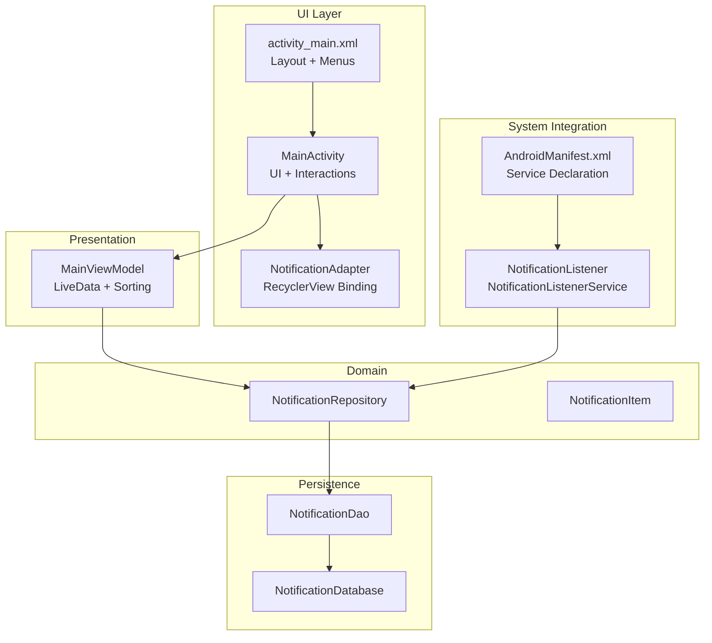
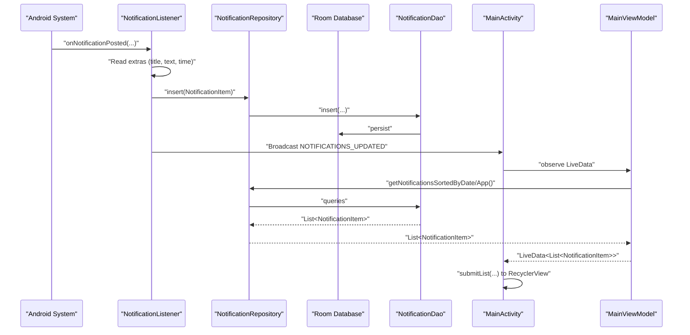
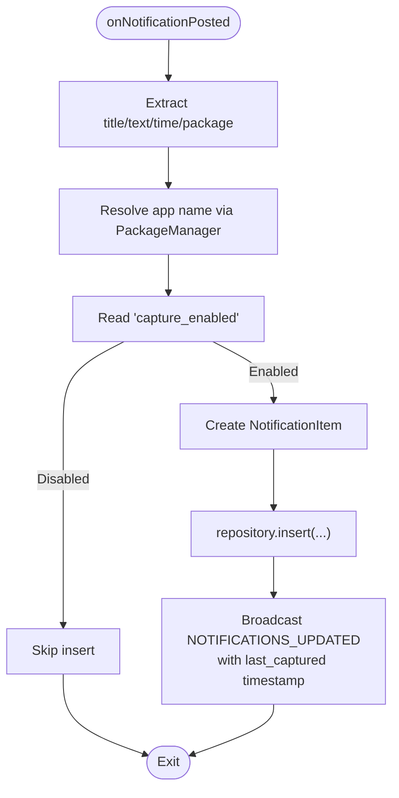
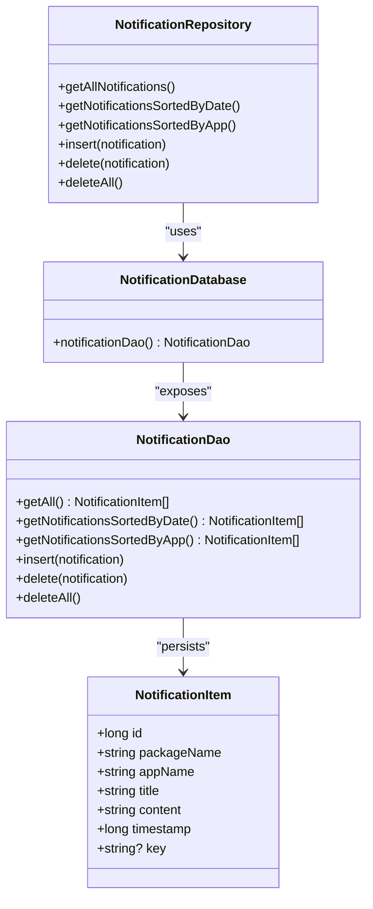
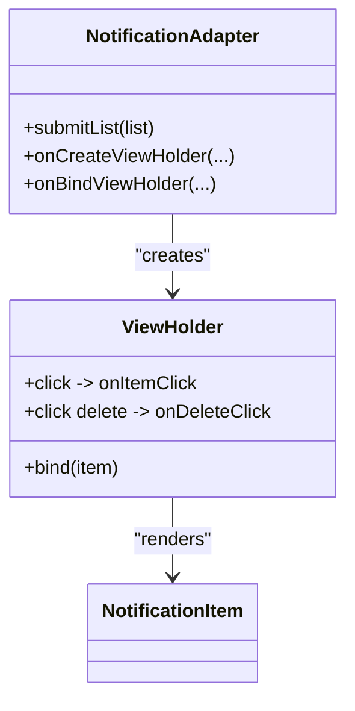
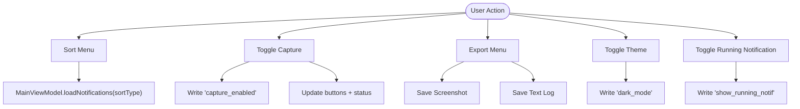
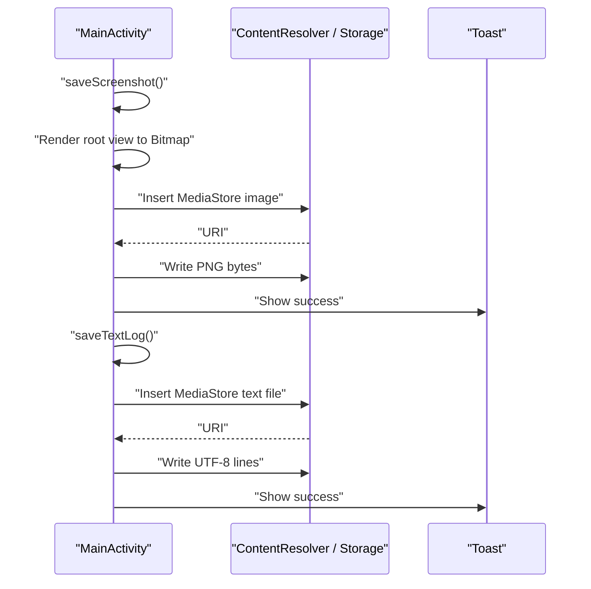
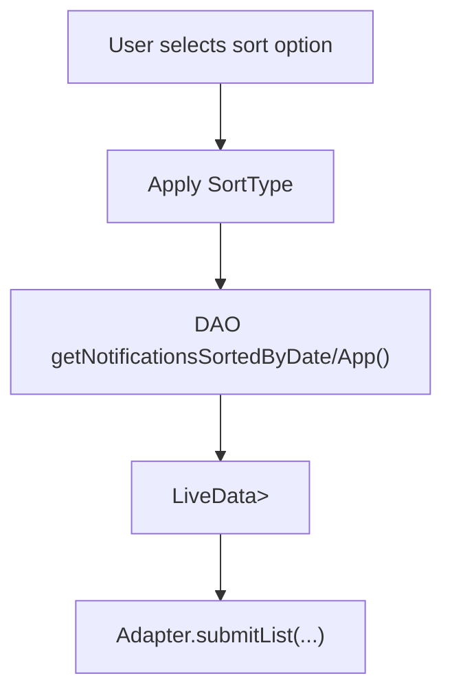
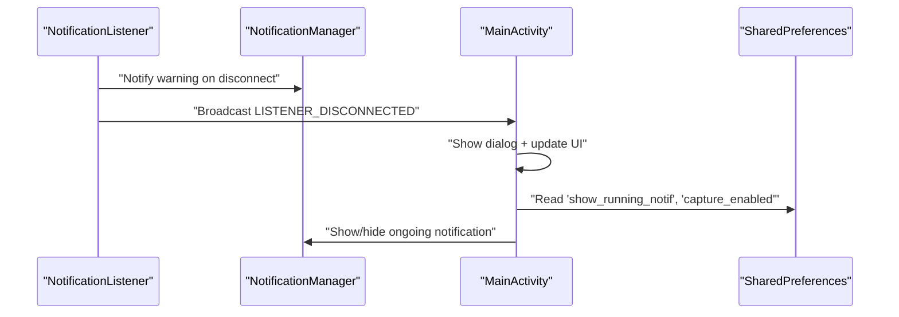
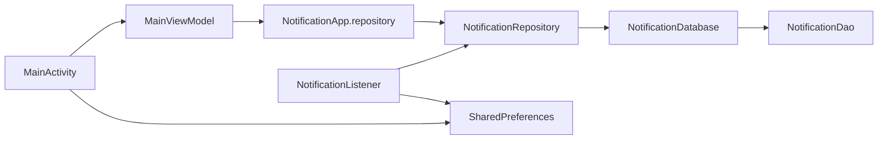

# Core Features

<cite>
**Referenced Files in This Document**
- [MainActivity.kt](file://app/src/main/java/com/notificationlog/MainActivity.kt)
- [MainViewModel.kt](file://app/src/main/java/com/notificationlog/MainViewModel.kt)
- [NotificationListener.kt](file://app/src/main/java/com/notificationlog/NotificationListener.kt)
- [NotificationDatabase.kt](file://app/src/main/java/com/notificationlog/data/NotificationDatabase.kt)
- [NotificationDao.kt](file://app/src/main/java/com/notificationlog/data/NotificationDao.kt)
- [NotificationRepository.kt](file://app/src/main/java/com/notificationlog/repository/NotificationRepository.kt)
- [NotificationItem.kt](file://app/src/main/java/com/notificationlog/model/NotificationItem.kt)
- [NotificationAdapter.kt](file://app/src/main/java/com/notificationlog/adapter/NotificationAdapter.kt)
- [NotificationApp.kt](file://app/src/main/java/com/notificationlog/NotificationApp.kt)
- [AndroidManifest.xml](file://app/src/main/AndroidManifest.xml)
- [activity_main.xml](file://app/src/main/res/layout/activity_main.xml)
- [main_menu.xml](file://app/src/main/res/menu/main_menu.xml)
- [strings.xml](file://app/src/main/res/values/strings.xml)
</cite>

## Table of Contents
1. [Introduction](#introduction)
2. [Project Structure](#project-structure)
3. [Core Components](#core-components)
4. [Architecture Overview](#architecture-overview)
5. [Detailed Component Analysis](#detailed-component-analysis)
6. [Dependency Analysis](#dependency-analysis)
7. [Performance Considerations](#performance-considerations)
8. [Troubleshooting Guide](#troubleshooting-guide)
9. [Conclusion](#conclusion)
10. [Appendices](#appendices)

## Introduction
This document explains NotificationLog’s core features with a focus on real-time notification capture via NotificationListenerService, local storage using Room, display of notifications with RecyclerView, user interactions, export capabilities (screenshot and text log), sorting and filtering, theme switching, and background operation management. It also covers configuration options, integration with Android system services, and practical user workflows.

## Project Structure
NotificationLog is organized around a clean separation of concerns:
- UI and orchestration: MainActivity and MainViewModel
- Data layer: Room database, DAO, and Repository
- Background capture: NotificationListenerService
- UI rendering: RecyclerView with NotificationAdapter
- Application bootstrap: NotificationApp initializes Room and exposes a global repository

**Diagram sources**
- [MainActivity.kt:43-108](file://app/src/main/java/com/notificationlog/MainActivity.kt#L43-L108)
- [MainViewModel.kt:15-77](file://app/src/main/java/com/notificationlog/MainViewModel.kt#L15-L77)
- [NotificationRepository.kt:6-27](file://app/src/main/java/com/notificationlog/repository/NotificationRepository.kt#L6-L27)
- [NotificationDao.kt:6-26](file://app/src/main/java/com/notificationlog/data/NotificationDao.kt#L6-L26)
- [NotificationDatabase.kt:7-10](file://app/src/main/java/com/notificationlog/data/NotificationDatabase.kt#L7-L10)
- [NotificationAdapter.kt:13-59](file://app/src/main/java/com/notificationlog/adapter/NotificationAdapter.kt#L13-L59)
- [activity_main.xml:1-240](file://app/src/main/res/layout/activity_main.xml#L1-L240)
- [AndroidManifest.xml:29-43](file://app/src/main/AndroidManifest.xml#L29-L43)
- [NotificationListener.kt:23-65](file://app/src/main/java/com/notificationlog/NotificationListener.kt#L23-L65)

**Section sources**
- [MainActivity.kt:43-108](file://app/src/main/java/com/notificationlog/MainActivity.kt#L43-L108)
- [AndroidManifest.xml:29-43](file://app/src/main/AndroidManifest.xml#L29-L43)

## Core Components
- Real-time capture via NotificationListenerService: Receives notifications, filters by user preference, persists to Room, and notifies UI updates.
- Local storage with Room: Entities, DAO queries, and Repository encapsulate persistence.
- Notification list display with RecyclerView: Adapter binds items, supports click and delete actions.
- User interactions: Sorting (by date/app), toggling capture, exporting screenshots/logs, theme switching, and persistent notification control.
- Background operation management: Persistent notification toggle, reconnection on disconnect, and broadcast signaling.

**Section sources**
- [NotificationListener.kt:109-153](file://app/src/main/java/com/notificationlog/NotificationListener.kt#L109-L153)
- [NotificationRepository.kt:6-27](file://app/src/main/java/com/notificationlog/repository/NotificationRepository.kt#L6-L27)
- [NotificationAdapter.kt:13-59](file://app/src/main/java/com/notificationlog/adapter/NotificationAdapter.kt#L13-L59)
- [MainActivity.kt:175-215](file://app/src/main/java/com/notificationlog/MainActivity.kt#L175-L215)

## Architecture Overview
The system integrates Android’s NotificationListenerService with a Room-backed MVVM architecture. The listener captures notifications, persists them, and broadcasts updates. The UI observes LiveData to refresh the RecyclerView and manage controls.

**Diagram sources**
- [NotificationListener.kt:109-153](file://app/src/main/java/com/notificationlog/NotificationListener.kt#L109-L153)
- [NotificationRepository.kt:16-18](file://app/src/main/java/com/notificationlog/repository/NotificationRepository.kt#L16-L18)
- [NotificationDao.kt:18-19](file://app/src/main/java/com/notificationlog/data/NotificationDao.kt#L18-L19)
- [MainActivity.kt:57-66](file://app/src/main/java/com/notificationlog/MainActivity.kt#L57-L66)
- [MainViewModel.kt:59-77](file://app/src/main/java/com/notificationlog/MainViewModel.kt#L59-L77)

## Detailed Component Analysis

### Real-time Notification Capture with NotificationListenerService
- Receives posted notifications and extracts title, text, package name, and timestamp.
- Resolves app label via PackageManager.
- Respects user capture toggle stored in SharedPreferences.
- Inserts into Room and broadcasts an update with the latest timestamp.
- Handles disconnection by requesting rebind (Android 13+) and posting a high-priority warning notification.

**Diagram sources**
- [NotificationListener.kt:109-153](file://app/src/main/java/com/notificationlog/NotificationListener.kt#L109-L153)

**Section sources**
- [NotificationListener.kt:36-65](file://app/src/main/java/com/notificationlog/NotificationListener.kt#L36-L65)
- [NotificationListener.kt:109-153](file://app/src/main/java/com/notificationlog/NotificationListener.kt#L109-L153)
- [AndroidManifest.xml:29-43](file://app/src/main/AndroidManifest.xml#L29-L43)

### Local Database Storage with Room
- Entity: NotificationItem with primary key, app identifiers, title, content, timestamp, and optional key.
- DAO: Queries for full list, sorted by date, and sorted by app; insert, delete, deleteAll.
- Repository: Encapsulates DAO operations for ViewModel.
- Database: Single Room database exposing NotificationDao.

**Diagram sources**
- [NotificationItem.kt:10-19](file://app/src/main/java/com/notificationlog/model/NotificationItem.kt#L10-L19)
- [NotificationDao.kt:6-26](file://app/src/main/java/com/notificationlog/data/NotificationDao.kt#L6-L26)
- [NotificationDatabase.kt:7-10](file://app/src/main/java/com/notificationlog/data/NotificationDatabase.kt#L7-L10)
- [NotificationRepository.kt:6-27](file://app/src/main/java/com/notificationlog/repository/NotificationRepository.kt#L6-L27)

**Section sources**
- [NotificationItem.kt:8-19](file://app/src/main/java/com/notificationlog/model/NotificationItem.kt#L8-L19)
- [NotificationDao.kt:9-26](file://app/src/main/java/com/notificationlog/data/NotificationDao.kt#L9-L26)
- [NotificationRepository.kt:6-27](file://app/src/main/java/com/notificationlog/repository/NotificationRepository.kt#L6-L27)
- [NotificationDatabase.kt:7-10](file://app/src/main/java/com/notificationlog/data/NotificationDatabase.kt#L7-L10)

### Notification List Display with RecyclerView
- Adapter extends ListAdapter with DiffUtil for efficient updates.
- Binds app name, formatted timestamp, title, and content.
- Click opens a detail dialog; Delete triggers confirmation and removal.

**Diagram sources**
- [NotificationAdapter.kt:13-59](file://app/src/main/java/com/notificationlog/adapter/NotificationAdapter.kt#L13-L59)

**Section sources**
- [NotificationAdapter.kt:13-59](file://app/src/main/java/com/notificationlog/adapter/NotificationAdapter.kt#L13-L59)
- [activity_main.xml:114-120](file://app/src/main/res/layout/activity_main.xml#L114-L120)

### User Interaction Capabilities
- Sorting: By date (default) or by app name, persisted in MainActivity and applied in ViewModel.
- Toggle capture: Starts/stops capture; updates UI and persistent notification visibility.
- Export: Save screenshot of current screen and save text log to external storage or MediaStore.
- Theme switching: Toggle dark/light mode and persist preference.
- Persistent notification: Optional ongoing notification indicating capture is active.

**Diagram sources**
- [MainActivity.kt:175-215](file://app/src/main/java/com/notificationlog/MainActivity.kt#L175-L215)
- [MainActivity.kt:471-519](file://app/src/main/java/com/notificationlog/MainActivity.kt#L471-L519)
- [MainActivity.kt:686-715](file://app/src/main/java/com/notificationlog/MainActivity.kt#L686-L715)
- [MainViewModel.kt:59-77](file://app/src/main/java/com/notificationlog/MainViewModel.kt#L59-L77)

**Section sources**
- [MainActivity.kt:175-215](file://app/src/main/java/com/notificationlog/MainActivity.kt#L175-L215)
- [MainActivity.kt:471-519](file://app/src/main/java/com/notificationlog/MainActivity.kt#L471-L519)
- [MainActivity.kt:686-715](file://app/src/main/java/com/notificationlog/MainActivity.kt#L686-L715)
- [MainViewModel.kt:59-77](file://app/src/main/java/com/notificationlog/MainViewModel.kt#L59-L77)

### Export Functionality
- Screenshot capture: Renders current root view to bitmap and writes to MediaStore (Android 10+) or legacy Documents directory.
- Text log generation: Writes a timestamped file containing entries in “[timestamp] App (pkg): Title - Content” format.

**Diagram sources**
- [MainActivity.kt:535-628](file://app/src/main/java/com/notificationlog/MainActivity.kt#L535-L628)

**Section sources**
- [MainActivity.kt:535-628](file://app/src/main/java/com/notificationlog/MainActivity.kt#L535-L628)

### Sorting and Filtering Mechanisms
- Sorting: Enum SortType drives DAO queries for date or app order.
- Filtering: Capture toggle filters incoming notifications before insertion.
- UI feedback: Last-captured timestamp broadcast updates the UI.

**Diagram sources**
- [MainViewModel.kt:59-77](file://app/src/main/java/com/notificationlog/MainViewModel.kt#L59-L77)
- [NotificationDao.kt:12-16](file://app/src/main/java/com/notificationlog/data/NotificationDao.kt#L12-L16)
- [MainActivity.kt:57-66](file://app/src/main/java/com/notificationlog/MainActivity.kt#L57-L66)

**Section sources**
- [MainViewModel.kt:117-121](file://app/src/main/java/com/notificationlog/MainViewModel.kt#L117-L121)
- [NotificationDao.kt:12-16](file://app/src/main/java/com/notificationlog/data/NotificationDao.kt#L12-L16)

### Theme Switching Between Light/Dark Modes
- Preference persisted under “dark_mode”; applies immediately via AppCompatDelegate.
- UI recreates to reflect theme change.

**Section sources**
- [MainActivity.kt:471-487](file://app/src/main/java/com/notificationlog/MainActivity.kt#L471-L487)

### Background Operation Management
- Persistent notification: Controlled by “show_running_notif”; shown while capture is active and service is enabled.
- Reconnection: On disconnect, requests rebind (Android 13+) and posts a high-priority warning notification.
- Broadcast signaling: UI listens for updates and revocation events.

**Diagram sources**
- [NotificationListener.kt:44-65](file://app/src/main/java/com/notificationlog/NotificationListener.kt#L44-L65)
- [MainActivity.kt:686-715](file://app/src/main/java/com/notificationlog/MainActivity.kt#L686-L715)

**Section sources**
- [NotificationListener.kt:44-65](file://app/src/main/java/com/notificationlog/NotificationListener.kt#L44-L65)
- [MainActivity.kt:686-715](file://app/src/main/java/com/notificationlog/MainActivity.kt#L686-L715)

## Dependency Analysis
- MainActivity depends on MainViewModel for state and on SharedPreferences for preferences.
- MainViewModel depends on NotificationApp.repository for persistence operations.
- NotificationListener depends on NotificationRepository and SharedPreferences.
- NotificationApp initializes Room and exposes a singleton repository.

**Diagram sources**
- [MainActivity.kt:96-107](file://app/src/main/java/com/notificationlog/MainActivity.kt#L96-L107)
- [MainViewModel.kt:62-66](file://app/src/main/java/com/notificationlog/MainViewModel.kt#L62-L66)
- [NotificationApp.kt:10-27](file://app/src/main/java/com/notificationlog/NotificationApp.kt#L10-L27)
- [NotificationRepository.kt:6-27](file://app/src/main/java/com/notificationlog/repository/NotificationRepository.kt#L6-L27)
- [NotificationDatabase.kt:7-10](file://app/src/main/java/com/notificationlog/data/NotificationDatabase.kt#L7-L10)
- [NotificationListener.kt:27-34](file://app/src/main/java/com/notificationlog/NotificationListener.kt#L27-L34)

**Section sources**
- [MainActivity.kt:96-107](file://app/src/main/java/com/notificationlog/MainActivity.kt#L96-L107)
- [MainViewModel.kt:62-66](file://app/src/main/java/com/notificationlog/MainViewModel.kt#L62-L66)
- [NotificationApp.kt:10-27](file://app/src/main/java/com/notificationlog/NotificationApp.kt#L10-L27)

## Performance Considerations
- Asynchronous operations: Room queries and inserts run on IO dispatcher; UI updates on main thread via LiveData.
- Efficient UI updates: DiffUtil in RecyclerView minimizes redraw overhead.
- Background work: NotificationListener uses CoroutineScope with SupervisorJob to isolate failures.
- Storage: MediaStore writes avoid blocking the main thread; legacy fallback uses streams safely.
- Battery impact: Persistent notification toggle allows users to minimize foreground presence.

[No sources needed since this section provides general guidance]

## Troubleshooting Guide
- Notification access disabled: Dialog prompts to open settings; service status text and button colors reflect state.
- Permission denied (Android 13+): Requests POST_NOTIFICATIONS permission; toast indicates outcome.
- Listener disconnected: Warning notification posted; broadcast triggers UI dialog and disables capture visuals.
- No notifications to export: Toast informs when attempting to save logs or screenshots with empty lists.
- Clearing notifications: Confirmation dialog precedes destructive action.

**Section sources**
- [MainActivity.kt:375-414](file://app/src/main/java/com/notificationlog/MainActivity.kt#L375-L414)
- [MainActivity.kt:645-661](file://app/src/main/java/com/notificationlog/MainActivity.kt#L645-L661)
- [MainActivity.kt:449-459](file://app/src/main/java/com/notificationlog/MainActivity.kt#L449-L459)
- [MainActivity.kt:573-578](file://app/src/main/java/com/notificationlog/MainActivity.kt#L573-L578)

## Conclusion
NotificationLog combines Android’s NotificationListenerService with a Room-backed MVVM architecture to deliver real-time, persistent notification capture. Users benefit from flexible sorting, export options, theme switching, and robust background management. The modular design ensures maintainability and scalability.

[No sources needed since this section summarizes without analyzing specific files]

## Appendices

### Configuration Options
- Preferences keys:
  - “capture_enabled”: boolean controlling capture on/off
  - “dark_mode”: boolean toggling night mode
  - “show_running_notif”: boolean controlling persistent notification
- Menus:
  - Sort by Date/App
  - Refresh
  - Save Screenshot
  - Save Text Log
  - Toggle Dark Mode
  - Toggle Running Notification
  - About and Exit

**Section sources**
- [MainActivity.kt:81-90](file://app/src/main/java/com/notificationlog/MainActivity.kt#L81-L90)
- [MainActivity.kt:471-519](file://app/src/main/java/com/notificationlog/MainActivity.kt#L471-L519)
- [main_menu.xml:1-45](file://app/src/main/res/menu/main_menu.xml#L1-L45)

### User Workflow Patterns
- Enable notification access and grant permission if required.
- Start capture; observe status and last-captured timestamp.
- Browse notifications, sort by date or app, and tap items for details.
- Export screenshots or text logs for sharing or archiving.
- Toggle dark mode or persistent notification per preference.
- Stop capture and exit cleanly; persistent notification stops automatically.

**Section sources**
- [MainActivity.kt:110-138](file://app/src/main/java/com/notificationlog/MainActivity.kt#L110-L138)
- [MainActivity.kt:175-215](file://app/src/main/java/com/notificationlog/MainActivity.kt#L175-L215)
- [MainActivity.kt:471-519](file://app/src/main/java/com/notificationlog/MainActivity.kt#L471-L519)