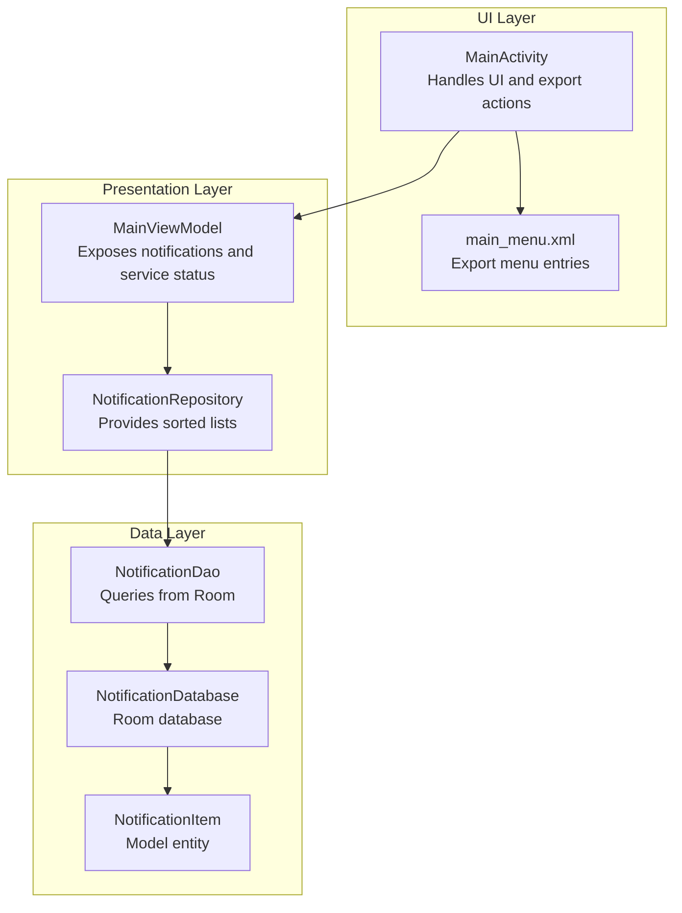
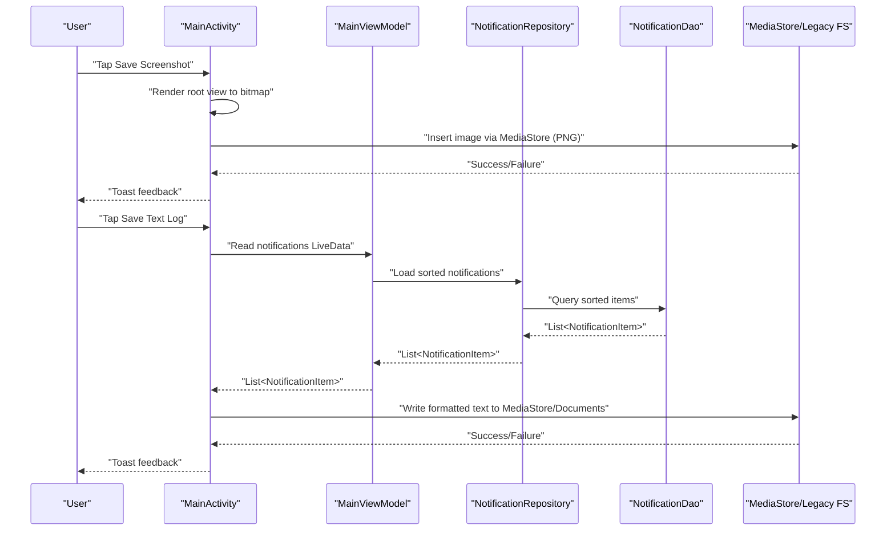
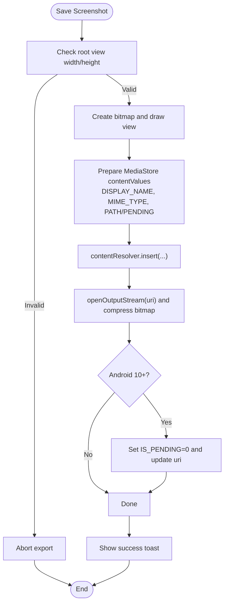
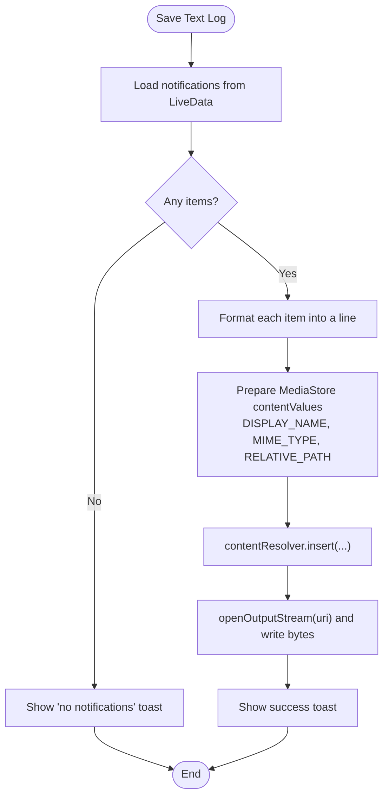
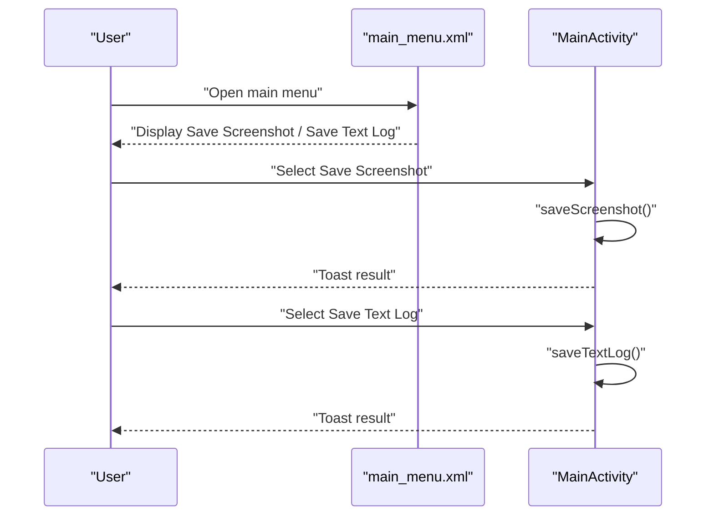
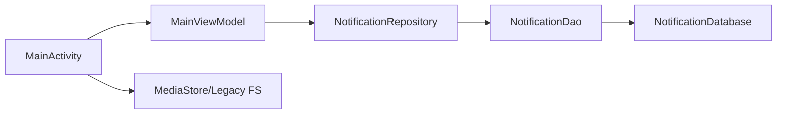

# Export and Sharing Capabilities

<cite>
**Referenced Files in This Document**
- [MainActivity.kt](file://app/src/main/java/com/notificationlog/MainActivity.kt)
- [MainViewModel.kt](file://app/src/main/java/com/notificationlog/MainViewModel.kt)
- [NotificationRepository.kt](file://app/src/main/java/com/notificationlog/repository/NotificationRepository.kt)
- [NotificationDao.kt](file://app/src/main/java/com/notificationlog/data/NotificationDao.kt)
- [NotificationDatabase.kt](file://app/src/main/java/com/notificationlog/data/NotificationDatabase.kt)
- [NotificationItem.kt](file://app/src/main/java/com/notificationlog/model/NotificationItem.kt)
- [main_menu.xml](file://app/src/main/res/menu/main_menu.xml)
- [AndroidManifest.xml](file://app/src/main/AndroidManifest.xml)
</cite>

## Table of Contents
1. [Introduction](#introduction)
2. [Project Structure](#project-structure)
3. [Core Components](#core-components)
4. [Architecture Overview](#architecture-overview)
5. [Detailed Component Analysis](#detailed-component-analysis)
6. [Dependency Analysis](#dependency-analysis)
7. [Performance Considerations](#performance-considerations)
8. [Troubleshooting Guide](#troubleshooting-guide)
9. [Conclusion](#conclusion)

## Introduction
This document explains the export and sharing capabilities of the Notification Log application. It covers the screenshot capture mechanism, text log generation, and file export workflows. It also documents MediaStore integration, file naming conventions, storage location management, export dialog implementation, supported file formats, data formatting for logs, image capture quality settings, and export progress tracking. Finally, it provides examples of programmatic exports, batch operations, custom export configurations, file permissions, storage access framework usage, and external sharing integrations.

## Project Structure
The export and sharing features are implemented primarily in the main activity and integrated with the view model and persistence layer. The menu resources define the user-facing export actions. Permissions and service declarations are configured in the manifest.

**Diagram sources**
- [MainActivity.kt:1-717](file://app/src/main/java/com/notificationlog/MainActivity.kt#L1-L717)
- [MainViewModel.kt:1-121](file://app/src/main/java/com/notificationlog/MainViewModel.kt#L1-L121)
- [NotificationRepository.kt:1-28](file://app/src/main/java/com/notificationlog/repository/NotificationRepository.kt#L1-L28)
- [NotificationDao.kt:1-26](file://app/src/main/java/com/notificationlog/data/NotificationDao.kt#L1-L26)
- [NotificationDatabase.kt:1-10](file://app/src/main/java/com/notificationlog/data/NotificationDatabase.kt#L1-L10)
- [NotificationItem.kt:1-19](file://app/src/main/java/com/notificationlog/model/NotificationItem.kt#L1-L19)
- [main_menu.xml:1-45](file://app/src/main/res/menu/main_menu.xml#L1-L45)

**Section sources**
- [MainActivity.kt:1-717](file://app/src/main/java/com/notificationlog/MainActivity.kt#L1-L717)
- [main_menu.xml:1-45](file://app/src/main/res/menu/main_menu.xml#L1-L45)
- [AndroidManifest.xml:1-45](file://app/src/main/AndroidManifest.xml#L1-L45)

## Core Components
- Screenshot capture and save:
  - Captures the root view as a bitmap, compresses to PNG, and writes via MediaStore on Android 10+ or legacy Documents directory on older versions.
  - Uses MediaStore.Images.Media for images and MediaStore.Files for text logs.
- Text log generation and save:
  - Formats each notification into a single line with timestamp, app name, package, title, and content.
  - Writes to MediaStore on Android 10+ or legacy file system on older versions.
- Export menu integration:
  - Provides Save Screenshot and Save Text Log menu items in the main menu.
- Storage location management:
  - Android 10+: Relative paths under Pictures/NotificationLog for images and Documents/NotificationLog for text logs.
  - Pre-Android 10: Legacy Documents directory with app-specific subfolder.
- Permissions and service:
  - Requires notification access and optional POST_NOTIFICATIONS permission on Android 13+.
  - Notification listener service declared in the manifest.

**Section sources**
- [MainActivity.kt:535-628](file://app/src/main/java/com/notificationlog/MainActivity.kt#L535-L628)
- [main_menu.xml:17-23](file://app/src/main/res/menu/main_menu.xml#L17-L23)
- [AndroidManifest.xml:5-7](file://app/src/main/AndroidManifest.xml#L5-L7)
- [AndroidManifest.xml:29-43](file://app/src/main/AndroidManifest.xml#L29-L43)

## Architecture Overview
The export pipeline flows from UI actions to the view model, persistence layer, and finally to the storage system. The screenshot path uses the view’s drawing capabilities and MediaStore APIs. The text log path formats data and writes to MediaStore or legacy storage.

**Diagram sources**
- [MainActivity.kt:535-628](file://app/src/main/java/com/notificationlog/MainActivity.kt#L535-L628)
- [MainViewModel.kt:59-77](file://app/src/main/java/com/notificationlog/MainViewModel.kt#L59-L77)
- [NotificationRepository.kt:10-14](file://app/src/main/java/com/notificationlog/repository/NotificationRepository.kt#L10-L14)
- [NotificationDao.kt:9-16](file://app/src/main/java/com/notificationlog/data/NotificationDao.kt#L9-L16)

## Detailed Component Analysis

### Screenshot Capture Mechanism
- View rendering:
  - Creates a bitmap sized to the root view and draws the view hierarchy onto a canvas.
- Image compression:
  - Compresses the bitmap to PNG with maximum quality.
- MediaStore integration:
  - Inserts a new image record with display name and MIME type.
  - On Android 10+, sets IS_PENDING flag during write and clears it afterward to atomically publish.
  - On Android 10+, specifies RELATIVE_PATH under Pictures/NotificationLog.
- Legacy fallback:
  - On pre-Android 10, writes to Documents/NotificationLog subdirectory.

**Diagram sources**
- [MainActivity.kt:535-571](file://app/src/main/java/com/notificationlog/MainActivity.kt#L535-L571)

**Section sources**
- [MainActivity.kt:535-571](file://app/src/main/java/com/notificationlog/MainActivity.kt#L535-L571)

### Text Log Generation Process
- Data retrieval:
  - Reads current notifications from the view model’s LiveData.
- Formatting:
  - Uses a fixed timestamp format and concatenates app name, package, title, and content into a single line per notification.
- Writing:
  - On Android 10+, inserts a text file record via MediaStore.Files and writes via content resolver.
  - On pre-Android 10, writes to a legacy file in Documents/NotificationLog.

**Diagram sources**
- [MainActivity.kt:573-628](file://app/src/main/java/com/notificationlog/MainActivity.kt#L573-L628)
- [MainViewModel.kt:26-27](file://app/src/main/java/com/notificationlog/MainViewModel.kt#L26-L27)

**Section sources**
- [MainActivity.kt:573-628](file://app/src/main/java/com/notificationlog/MainActivity.kt#L573-L628)
- [MainViewModel.kt:26-27](file://app/src/main/java/com/notificationlog/MainViewModel.kt#L26-L27)

### Export Dialog Implementation
- Menu entries:
  - Save Screenshot and Save Text Log are provided in the main menu resource.
- Action handling:
  - MainActivity routes menu selections to dedicated save methods.
- Additional UI affordances:
  - Bottom bar buttons and toolbar menu items provide quick access to capture, clear, and sort operations.

**Diagram sources**
- [main_menu.xml:17-23](file://app/src/main/res/menu/main_menu.xml#L17-L23)
- [MainActivity.kt:510-511](file://app/src/main/java/com/notificationlog/MainActivity.kt#L510-L511)

**Section sources**
- [main_menu.xml:17-23](file://app/src/main/res/menu/main_menu.xml#L17-L23)
- [MainActivity.kt:510-511](file://app/src/main/java/com/notificationlog/MainActivity.kt#L510-L511)

### Supported File Formats and Naming Conventions
- Screenshot:
  - Format: PNG
  - Name pattern: notification_log_<yyyyMMdd_HHmmss>.png
  - Location:
    - Android 10+: Pictures/NotificationLog
    - Pre-Android 10: Documents/NotificationLog/<filename>
- Text Log:
  - Format: text/plain
  - Name pattern: notification_log_<yyyyMMdd_HHmmss>.txt
  - Location:
    - Android 10+: Documents/NotificationLog
    - Pre-Android 10: Documents/NotificationLog/<filename>

**Section sources**
- [MainActivity.kt:543-544](file://app/src/main/java/com/notificationlog/MainActivity.kt#L543-L544)
- [MainActivity.kt:580-581](file://app/src/main/java/com/notificationlog/MainActivity.kt#L580-L581)
- [MainActivity.kt:549-550](file://app/src/main/java/com/notificationlog/MainActivity.kt#L549-L550)
- [MainActivity.kt:587-588](file://app/src/main/java/com/notificationlog/MainActivity.kt#L587-L588)

### Data Formatting for Logs
- Timestamp format: yyyy-MM-dd HH:mm:ss
- Line format: "[timestamp] app_name (package): title - content"
- Encoding: Uses platform default byte encoding when writing to streams.

**Section sources**
- [MainActivity.kt:622-627](file://app/src/main/java/com/notificationlog/MainActivity.kt#L622-L627)

### Image Capture Quality Settings
- Bitmap config: ARGB_8888
- Compression: PNG with quality 100
- No scaling or DPI adjustments are applied.

**Section sources**
- [MainActivity.kt:539-541](file://app/src/main/java/com/notificationlog/MainActivity.kt#L539-L541)
- [MainActivity.kt:559](file://app/src/main/java/com/notificationlog/MainActivity.kt#L559)

### Export Progress Tracking
- Immediate feedback:
  - Success and error toasts are shown after each operation.
- No explicit progress dialogs or callbacks are implemented.

**Section sources**
- [MainActivity.kt:566-569](file://app/src/main/java/com/notificationlog/MainActivity.kt#L566-L569)
- [MainActivity.kt:592-594](file://app/src/main/java/com/notificationlog/MainActivity.kt#L592-L594)
- [MainActivity.kt:616-618](file://app/src/main/java/com/notificationlog/MainActivity.kt#L616-L618)

### Programmatic Exports and Batch Operations
- Programmatic export:
  - Call saveScreenshot() or saveTextLog() from any context that has access to MainActivity or equivalent UI context.
- Batch operations:
  - The current implementation saves all loaded notifications in a single operation.
  - To implement partial batches, filter the LiveData list before passing to the writer.

**Section sources**
- [MainActivity.kt:535-628](file://app/src/main/java/com/notificationlog/MainActivity.kt#L535-L628)
- [MainViewModel.kt:26-27](file://app/src/main/java/com/notificationlog/MainViewModel.kt#L26-L27)

### Custom Export Configurations
- Customizable aspects:
  - File naming convention: adjust timestamp pattern and extension.
  - Storage path: change RELATIVE_PATH for Android 10+ or target directory for legacy.
  - Format: modify the text formatter and MIME type for alternate formats.
- Implementation notes:
  - Ensure proper MIME type and file extension alignment.
  - For Android 10+, maintain IS_PENDING semantics during writes.

**Section sources**
- [MainActivity.kt:546-553](file://app/src/main/java/com/notificationlog/MainActivity.kt#L546-L553)
- [MainActivity.kt:584-589](file://app/src/main/java/com/notificationlog/MainActivity.kt#L584-L589)

### File Permissions and Storage Access Framework Usage
- Permissions:
  - POST_NOTIFICATIONS on Android 13+ (declared in manifest).
  - Notification access is required for capturing notifications; the app checks and guides users to settings.
- Storage access framework:
  - Uses MediaStore.Images.Media for screenshots and MediaStore.Files for text logs on Android 10+.
  - Sets IS_PENDING during write and updates to publish on Android 10+.
  - Uses legacy file paths on pre-Android 10 devices.

**Section sources**
- [AndroidManifest.xml:5-7](file://app/src/main/AndroidManifest.xml#L5-L7)
- [MainActivity.kt:345-351](file://app/src/main/java/com/notificationlog/MainActivity.kt#L345-L351)
- [MainActivity.kt:549-553](file://app/src/main/java/com/notificationlog/MainActivity.kt#L549-L553)
- [MainActivity.kt:587-589](file://app/src/main/java/com/notificationlog/MainActivity.kt#L587-L589)

### External Sharing Integrations
- Current behavior:
  - Exports are written to MediaStore or legacy directories; no explicit share intent is generated.
- Extensibility:
  - To support sharing, create a share intent with ACTION_SEND, set type to the appropriate MIME, and attach the URI returned by MediaStore insert.
  - For legacy files, use FileProvider to grant temporary access.

[No sources needed since this section provides general guidance]

## Dependency Analysis
The export features depend on the UI layer invoking the view model, which queries the repository and DAO backed by Room. MediaStore or legacy file I/O completes the export.

**Diagram sources**
- [MainActivity.kt:1-717](file://app/src/main/java/com/notificationlog/MainActivity.kt#L1-L717)
- [MainViewModel.kt:1-121](file://app/src/main/java/com/notificationlog/MainViewModel.kt#L1-L121)
- [NotificationRepository.kt:1-28](file://app/src/main/java/com/notificationlog/repository/NotificationRepository.kt#L1-L28)
- [NotificationDao.kt:1-26](file://app/src/main/java/com/notificationlog/data/NotificationDao.kt#L1-L26)
- [NotificationDatabase.kt:1-10](file://app/src/main/java/com/notificationlog/data/NotificationDatabase.kt#L1-L10)

**Section sources**
- [MainActivity.kt:1-717](file://app/src/main/java/com/notificationlog/MainActivity.kt#L1-L717)
- [MainViewModel.kt:1-121](file://app/src/main/java/com/notificationlog/MainViewModel.kt#L1-L121)
- [NotificationRepository.kt:1-28](file://app/src/main/java/com/notificationlog/repository/NotificationRepository.kt#L1-L28)
- [NotificationDao.kt:1-26](file://app/src/main/java/com/notificationlog/data/NotificationDao.kt#L1-L26)
- [NotificationDatabase.kt:1-10](file://app/src/main/java/com/notificationlog/data/NotificationDatabase.kt#L1-L10)

## Performance Considerations
- Screenshot rendering:
  - Rendering the entire view hierarchy can be expensive on large or complex layouts. Consider capturing visible viewport only if performance becomes an issue.
- Text log writing:
  - Single-pass streaming to output stream minimizes memory overhead.
- MediaStore writes:
  - Android 10+ pending writes avoid premature visibility and reduce race conditions.

[No sources needed since this section provides general guidance]

## Troubleshooting Guide
- Screenshot fails to save:
  - Verify the root view has non-zero dimensions before capture.
  - On Android 10+, ensure the IS_PENDING flag is cleared after writing.
- Text log fails to save:
  - Confirm notifications exist in LiveData before exporting.
  - On Android 10+, ensure the file insertion succeeds and the output stream is writable.
- Storage access issues:
  - On pre-Android 10, confirm the Documents directory exists and is writable.
- Permission errors:
  - Ensure notification access is granted and POST_NOTIFICATIONS is granted on Android 13+.

**Section sources**
- [MainActivity.kt:537-538](file://app/src/main/java/com/notificationlog/MainActivity.kt#L537-L538)
- [MainActivity.kt:561-565](file://app/src/main/java/com/notificationlog/MainActivity.kt#L561-L565)
- [MainActivity.kt:575-578](file://app/src/main/java/com/notificationlog/MainActivity.kt#L575-L578)
- [MainActivity.kt:595-608](file://app/src/main/java/com/notificationlog/MainActivity.kt#L595-L608)
- [MainActivity.kt:345-362](file://app/src/main/java/com/notificationlog/MainActivity.kt#L345-L362)

## Conclusion
The export and sharing capabilities are centered around two primary workflows: screenshot capture and text log export. Both leverage MediaStore on Android 10+ and fall back to legacy storage on older platforms. The implementation is straightforward, robust, and user-friendly with immediate feedback. Extending the system to support additional formats, sharing intents, or batch filtering requires minimal changes to the existing data formatting and storage pathways.