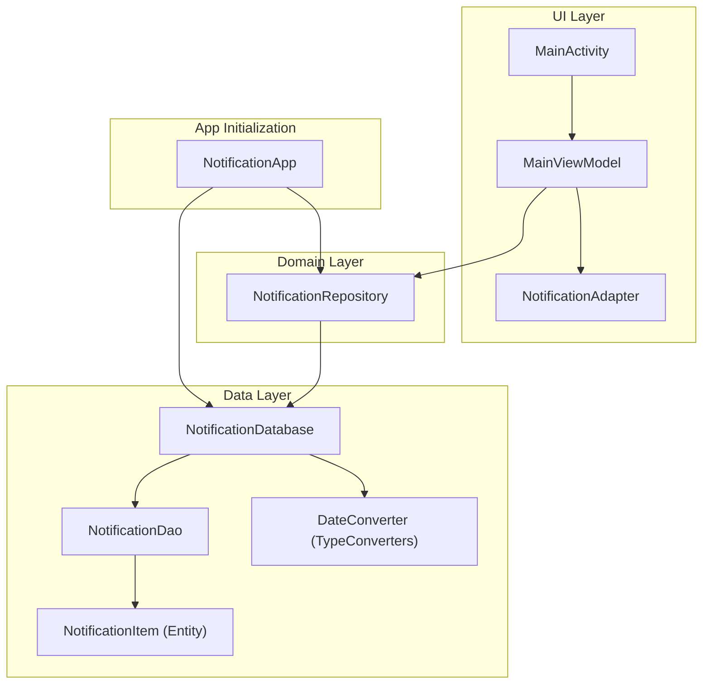
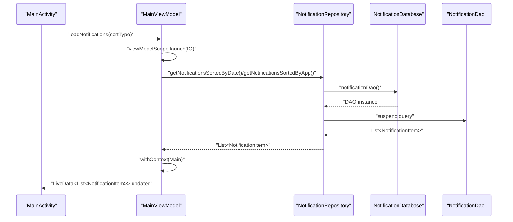
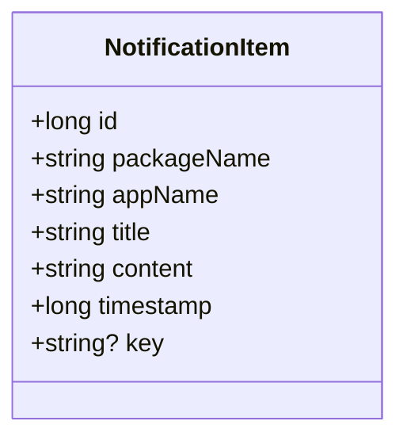
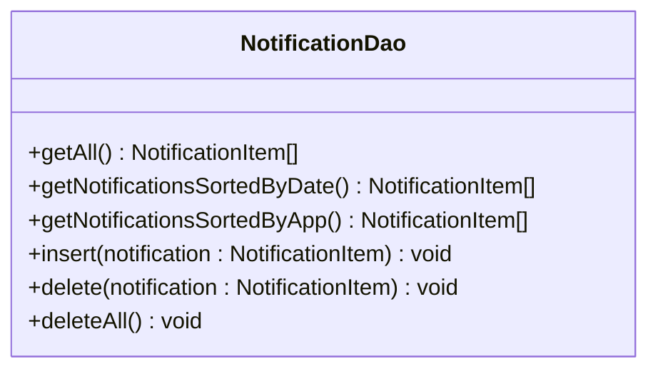
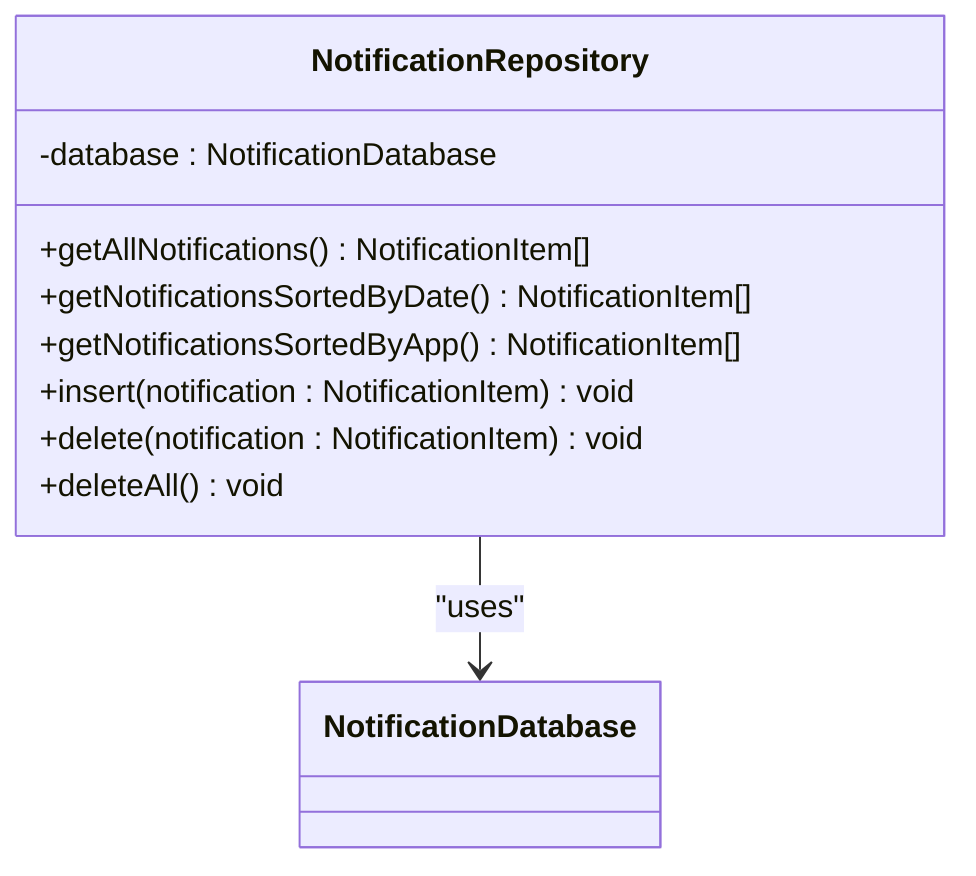
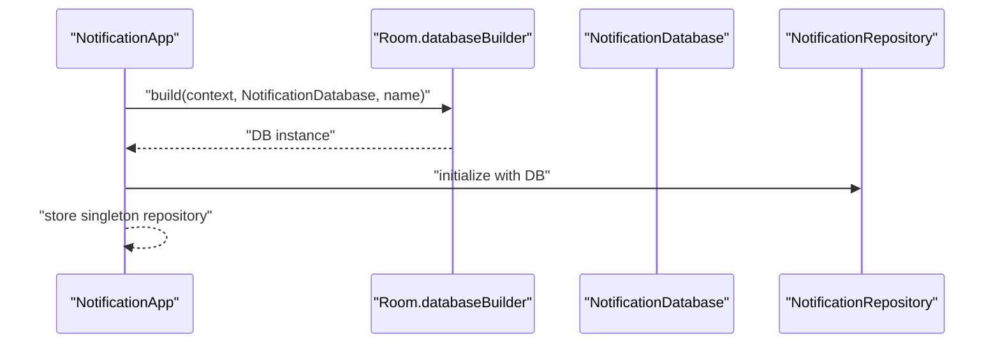
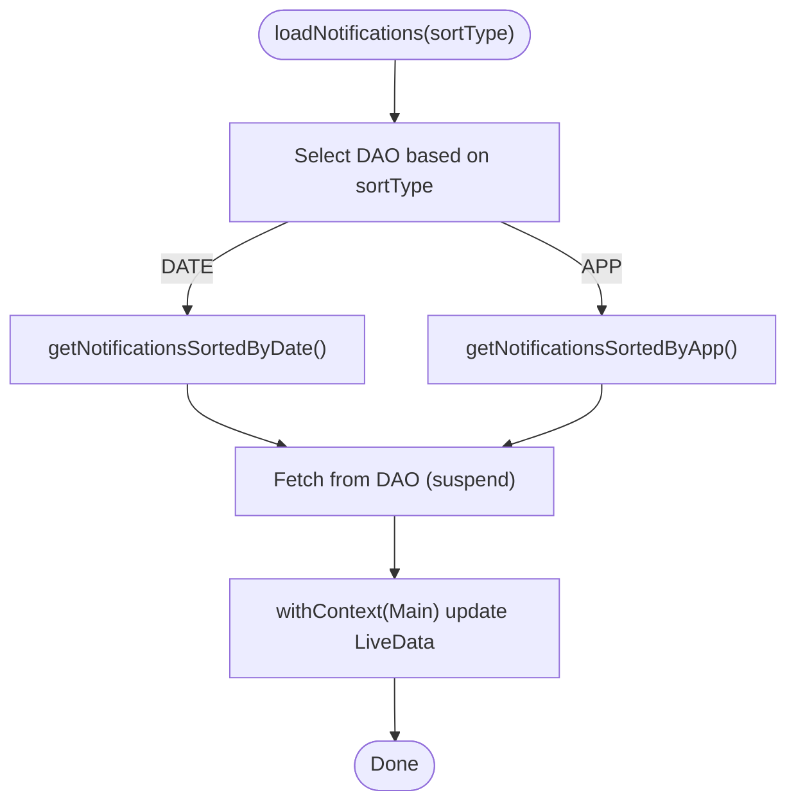
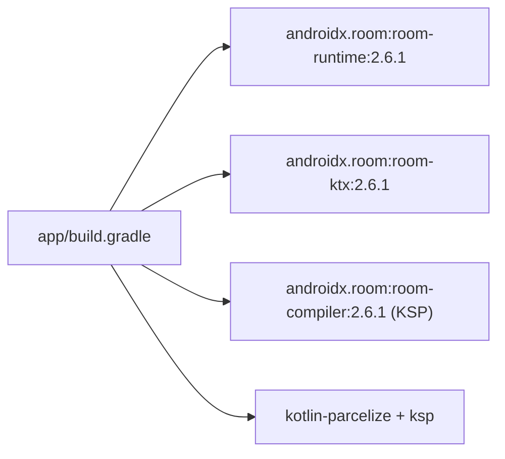
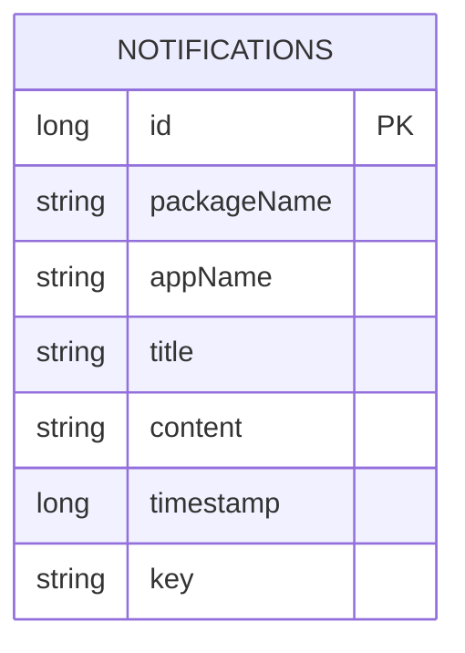

# Local Data Management

<cite>
**Referenced Files in This Document**
- [NotificationItem.kt](file://app/src/main/java/com/notificationlog/model/NotificationItem.kt)
- [NotificationDao.kt](file://app/src/main/java/com/notificationlog/data/NotificationDao.kt)
- [NotificationDatabase.kt](file://app/src/main/java/com/notificationlog/data/NotificationDatabase.kt)
- [NotificationRepository.kt](file://app/src/main/java/com/notificationlog/repository/NotificationRepository.kt)
- [NotificationApp.kt](file://app/src/main/java/com/notificationlog/NotificationApp.kt)
- [MainViewModel.kt](file://app/src/main/java/com/notificationlog/MainViewModel.kt)
- [MainActivity.kt](file://app/src/main/java/com/notificationlog/MainActivity.kt)
- [NotificationAdapter.kt](file://app/src/main/java/com/notificationlog/adapter/NotificationAdapter.kt)
- [DateConverter.kt](file://app/src/main/java/com/notificationlog/DateConverter.kt)
- [AndroidManifest.xml](file://app/src/main/AndroidManifest.xml)
- [build.gradle](file://app/build.gradle)
</cite>

## Table of Contents
1. [Introduction](#introduction)
2. [Project Structure](#project-structure)
3. [Core Components](#core-components)
4. [Architecture Overview](#architecture-overview)
5. [Detailed Component Analysis](#detailed-component-analysis)
6. [Dependency Analysis](#dependency-analysis)
7. [Performance Considerations](#performance-considerations)
8. [Troubleshooting Guide](#troubleshooting-guide)
9. [Conclusion](#conclusion)
10. [Appendices](#appendices)

## Introduction
This document explains the local data management system built with Room database. It covers the repository pattern implementation, database schema design, and entity relationships. It documents the NotificationItem model, NotificationDao interface methods, and Room configuration. It also describes CRUD operations, coroutine-based async operations, error handling, and query patterns. Finally, it outlines data lifecycle management, backup strategies, and maintenance procedures.

## Project Structure
The data layer follows a layered architecture:
- Model: Defines the persistent entity.
- DAO: Declares typed queries and mutations.
- Database: Aggregates entities and exposes DAOs.
- Repository: Encapsulates data access and exposes suspend-friendly APIs.
- Application: Initializes the Room database and provides a global repository instance.
- ViewModel: Orchestrates coroutines and exposes LiveData to the UI.
- UI: Observes LiveData and triggers actions.

**Diagram sources**
- [NotificationApp.kt:15-27](file://app/src/main/java/com/notificationlog/NotificationApp.kt#L15-L27)
- [NotificationRepository.kt:6-27](file://app/src/main/java/com/notificationlog/repository/NotificationRepository.kt#L6-L27)
- [NotificationDatabase.kt:7-10](file://app/src/main/java/com/notificationlog/data/NotificationDatabase.kt#L7-L10)
- [NotificationDao.kt:6-26](file://app/src/main/java/com/notificationlog/data/NotificationDao.kt#L6-L26)
- [NotificationItem.kt:8-19](file://app/src/main/java/com/notificationlog/model/NotificationItem.kt#L8-L19)
- [DateConverter.kt:6-16](file://app/src/main/java/com/notificationlog/DateConverter.kt#L6-L16)
- [MainActivity.kt:96-107](file://app/src/main/java/com/notificationlog/MainActivity.kt#L96-L107)
- [MainViewModel.kt:59-76](file://app/src/main/java/com/notificationlog/MainViewModel.kt#L59-L76)
- [NotificationAdapter.kt:13-59](file://app/src/main/java/com/notificationlog/adapter/NotificationAdapter.kt#L13-L59)

**Section sources**
- [NotificationApp.kt:15-27](file://app/src/main/java/com/notificationlog/NotificationApp.kt#L15-L27)
- [NotificationRepository.kt:6-27](file://app/src/main/java/com/notificationlog/repository/NotificationRepository.kt#L6-L27)
- [NotificationDatabase.kt:7-10](file://app/src/main/java/com/notificationlog/data/NotificationDatabase.kt#L7-L10)
- [NotificationDao.kt:6-26](file://app/src/main/java/com/notificationlog/data/NotificationDao.kt#L6-L26)
- [NotificationItem.kt:8-19](file://app/src/main/java/com/notificationlog/model/NotificationItem.kt#L8-L19)
- [DateConverter.kt:6-16](file://app/src/main/java/com/notificationlog/DateConverter.kt#L6-L16)
- [MainActivity.kt:96-107](file://app/src/main/java/com/notificationlog/MainActivity.kt#L96-L107)
- [MainViewModel.kt:59-76](file://app/src/main/java/com/notificationlog/MainViewModel.kt#L59-L76)
- [NotificationAdapter.kt:13-59](file://app/src/main/java/com/notificationlog/adapter/NotificationAdapter.kt#L13-L59)

## Core Components
- Entity: NotificationItem defines the persisted record with a primary key and fields for package/app metadata, title, content, timestamp, and optional key.
- DAO: Provides suspend functions for retrieving all notifications sorted by date and by app, inserting, deleting single items, and clearing all records.
- Database: Declares the Room database with the entity and exposes the DAO.
- Repository: Wraps DAO calls behind suspend functions for use in ViewModels.
- Application: Initializes Room database and exposes a singleton repository via a static field.
- ViewModel: Uses coroutine scopes to perform IO-bound work and updates LiveData for UI observation.
- Adapter: Binds NotificationItem instances to RecyclerView rows with diffing.

**Section sources**
- [NotificationItem.kt:8-19](file://app/src/main/java/com/notificationlog/model/NotificationItem.kt#L8-L19)
- [NotificationDao.kt:6-26](file://app/src/main/java/com/notificationlog/data/NotificationDao.kt#L6-L26)
- [NotificationDatabase.kt:7-10](file://app/src/main/java/com/notificationlog/data/NotificationDatabase.kt#L7-L10)
- [NotificationRepository.kt:6-27](file://app/src/main/java/com/notificationlog/repository/NotificationRepository.kt#L6-L27)
- [NotificationApp.kt:15-27](file://app/src/main/java/com/notificationlog/NotificationApp.kt#L15-L27)
- [MainViewModel.kt:59-76](file://app/src/main/java/com/notificationlog/MainViewModel.kt#L59-L76)
- [NotificationAdapter.kt:13-59](file://app/src/main/java/com/notificationlog/adapter/NotificationAdapter.kt#L13-L59)

## Architecture Overview
The system adheres to the repository pattern:
- UI triggers actions in ViewModel.
- ViewModel delegates to Repository.
- Repository executes DAO suspend functions.
- DAO queries are executed asynchronously by Room.
- LiveData updates propagate changes to UI.

**Diagram sources**
- [MainActivity.kt:96-107](file://app/src/main/java/com/notificationlog/MainActivity.kt#L96-L107)
- [MainViewModel.kt:59-76](file://app/src/main/java/com/notificationlog/MainViewModel.kt#L59-L76)
- [NotificationRepository.kt:8-14](file://app/src/main/java/com/notificationlog/repository/NotificationRepository.kt#L8-L14)
- [NotificationDatabase.kt:9](file://app/src/main/java/com/notificationlog/data/NotificationDatabase.kt#L9)
- [NotificationDao.kt:9-16](file://app/src/main/java/com/notificationlog/data/NotificationDao.kt#L9-L16)

## Detailed Component Analysis

### Entity: NotificationItem
- Table: notifications
- Primary key: auto-generated Long id
- Fields: packageName, appName, title, content, timestamp, key
- Parcelable support via @Parcelize enables passing NotificationItem across process boundaries if needed.

**Diagram sources**
- [NotificationItem.kt:10-19](file://app/src/main/java/com/notificationlog/model/NotificationItem.kt#L10-L19)

**Section sources**
- [NotificationItem.kt:8-19](file://app/src/main/java/com/notificationlog/model/NotificationItem.kt#L8-L19)

### DAO: NotificationDao
- Queries:
  - Retrieve all notifications ordered by timestamp descending.
  - Retrieve all notifications ordered by appName ascending, then timestamp descending.
- Mutations:
  - Insert a NotificationItem with REPLACE conflict strategy.
  - Delete a single NotificationItem.
  - Delete all records.

**Diagram sources**
- [NotificationDao.kt:6-26](file://app/src/main/java/com/notificationlog/data/NotificationDao.kt#L6-L26)

**Section sources**
- [NotificationDao.kt:6-26](file://app/src/main/java/com/notificationlog/data/NotificationDao.kt#L6-L26)

### Database: NotificationDatabase
- Version: 1
- Entities: [NotificationItem]
- Exposes: notificationDao()

Room schema export is disabled; a schema directory is configured via KSP arguments in Gradle.

**Section sources**
- [NotificationDatabase.kt:7-10](file://app/src/main/java/com/notificationlog/data/NotificationDatabase.kt#L7-L10)
- [build.gradle:66-68](file://app/build.gradle#L66-L68)

### Repository: NotificationRepository
- Delegates suspend DAO calls to maintain separation of concerns.
- Provides suspend wrappers for:
  - Get all
  - Get sorted by date
  - Get sorted by app
  - Insert
  - Delete
  - Delete all

**Diagram sources**
- [NotificationRepository.kt:6-27](file://app/src/main/java/com/notificationlog/repository/NotificationRepository.kt#L6-L27)
- [NotificationDatabase.kt:9](file://app/src/main/java/com/notificationlog/data/NotificationDatabase.kt#L9)

**Section sources**
- [NotificationRepository.kt:6-27](file://app/src/main/java/com/notificationlog/repository/NotificationRepository.kt#L6-L27)

### Application: NotificationApp
- Initializes Room database with a fixed database name.
- Builds the database using Room.databaseBuilder.
- Creates a singleton repository and stores it in a companion object for global access.

**Diagram sources**
- [NotificationApp.kt:15-27](file://app/src/main/java/com/notificationlog/NotificationApp.kt#L15-L27)

**Section sources**
- [NotificationApp.kt:15-27](file://app/src/main/java/com/notificationlog/NotificationApp.kt#L15-L27)

### ViewModel: MainViewModel
- Exposes LiveData for service status, notification count, error messages, and notifications.
- Uses CoroutineExceptionHandler to centralize error handling.
- Loads notifications with two sort modes:
  - By date (timestamp desc)
  - By app (appName asc, timestamp desc)
- Performs CRUD operations via repository and refreshes UI on Main thread after IO work.

**Diagram sources**
- [MainViewModel.kt:59-76](file://app/src/main/java/com/notificationlog/MainViewModel.kt#L59-L76)
- [NotificationRepository.kt:10-14](file://app/src/main/java/com/notificationlog/repository/NotificationRepository.kt#L10-L14)
- [NotificationDao.kt:9-16](file://app/src/main/java/com/notificationlog/data/NotificationDao.kt#L9-L16)

**Section sources**
- [MainViewModel.kt:29-31](file://app/src/main/java/com/notificationlog/MainViewModel.kt#L29-L31)
- [MainViewModel.kt:59-76](file://app/src/main/java/com/notificationlog/MainViewModel.kt#L59-L76)
- [NotificationRepository.kt:8-14](file://app/src/main/java/com/notificationlog/repository/NotificationRepository.kt#L8-L14)
- [NotificationDao.kt:9-16](file://app/src/main/java/com/notificationlog/data/NotificationDao.kt#L9-L16)

### UI: MainActivity and NotificationAdapter
- MainActivity observes LiveData and triggers ViewModel actions.
- NotificationAdapter binds NotificationItem to views and uses DiffUtil for efficient updates.

**Section sources**
- [MainActivity.kt:324-343](file://app/src/main/java/com/notificationlog/MainActivity.kt#L324-L343)
- [NotificationAdapter.kt:13-59](file://app/src/main/java/com/notificationlog/adapter/NotificationAdapter.kt#L13-L59)

### Type Converters: DateConverter
- Converts Long timestamps to Date and back.
- Enables storing dates as epoch milliseconds in the database while working with Date objects in Kotlin.

**Section sources**
- [DateConverter.kt:6-16](file://app/src/main/java/com/notificationlog/DateConverter.kt#L6-L16)

## Dependency Analysis
- Room version: 2.6.1
- KSP plugin applied for annotation processing.
- Schema location configured under projectDir/schemas via KSP arguments.
- Room runtime, KTX extensions, and compiler included.

**Diagram sources**
- [build.gradle:79-84](file://app/build.gradle#L79-L84)
- [build.gradle:66-68](file://app/build.gradle#L66-L68)

**Section sources**
- [build.gradle:79-84](file://app/build.gradle#L79-L84)
- [build.gradle:66-68](file://app/build.gradle#L66-L68)

## Performance Considerations
- Sorting:
  - Queries sort by timestamp descending and by appName ascending with timestamp tie-breaker. These patterns minimize UI work and leverage database ordering.
- Concurrency:
  - DAO methods are suspend and executed on IO dispatcher in ViewModel, preventing main-thread blocking.
- Memory:
  - LiveData updates trigger UI refresh; adapter uses DiffUtil to reduce unnecessary view updates.
- Storage:
  - Single-table schema with indexed primary key supports fast retrieval and deletion.
- Migration:
  - Current schema version is 1; no migrations present. Future schema changes should introduce Room migrations to preserve data integrity.

[No sources needed since this section provides general guidance]

## Troubleshooting Guide
- Error handling:
  - CoroutineExceptionHandler posts error messages to LiveData for UI display.
  - Try/catch blocks in ViewModel handle exceptions during service checks, loads, deletes, and clears.
- Permissions:
  - Manifest declares INTERNET, ACCESS_NETWORK_STATE, and POST_NOTIFICATIONS permissions.
  - MainActivity checks notification listener settings and runtime permission for Android 13+.
- Database initialization:
  - NotificationApp initializes Room once per app lifecycle and stores a singleton repository reference.

**Section sources**
- [MainViewModel.kt:29-31](file://app/src/main/java/com/notificationlog/MainViewModel.kt#L29-L31)
- [MainViewModel.kt:37-47](file://app/src/main/java/com/notificationlog/MainViewModel.kt#L37-L47)
- [MainViewModel.kt:79-89](file://app/src/main/java/com/notificationlog/MainViewModel.kt#L79-L89)
- [MainViewModel.kt:92-105](file://app/src/main/java/com/notificationlog/MainViewModel.kt#L92-L105)
- [AndroidManifest.xml:5-7](file://app/src/main/AndroidManifest.xml#L5-L7)
- [MainActivity.kt:345-362](file://app/src/main/java/com/notificationlog/MainActivity.kt#L345-L362)
- [NotificationApp.kt:15-27](file://app/src/main/java/com/notificationlog/NotificationApp.kt#L15-L27)

## Conclusion
The Room-based local data management system cleanly separates concerns with the repository pattern, uses suspend DAO methods for asynchronous operations, and exposes data via LiveData for reactive UI updates. The schema is minimal and optimized for the app’s sorting needs. Error handling is centralized, and the application initializes the database once for global access. For future enhancements, consider adding migrations, pagination for large datasets, and explicit indexing for frequently filtered columns.

[No sources needed since this section summarizes without analyzing specific files]

## Appendices

### Database Schema Design and Relationships
- Single entity: NotificationItem mapped to the notifications table.
- Primary key: Auto-generated Long id.
- Relationships: No foreign keys; self-contained entity suitable for a log-like dataset.

**Diagram sources**
- [NotificationItem.kt:10-19](file://app/src/main/java/com/notificationlog/model/NotificationItem.kt#L10-L19)

### CRUD Operations and Query Patterns
- Create: Insert via DAO with REPLACE strategy.
- Read: Two ordered queries (by date, by app).
- Update: Not exposed in DAO; replace via insert with same id if needed.
- Delete: Single item or all records.

**Section sources**
- [NotificationDao.kt:18-26](file://app/src/main/java/com/notificationlog/data/NotificationDao.kt#L18-L26)

### Data Persistence Patterns
- Singleton database initialized in Application.
- Repository as a façade for DAO access.
- ViewModel orchestrates coroutines and updates UI state.

**Section sources**
- [NotificationApp.kt:15-27](file://app/src/main/java/com/notificationlog/NotificationApp.kt#L15-L27)
- [NotificationRepository.kt:6-27](file://app/src/main/java/com/notificationlog/repository/NotificationRepository.kt#L6-L27)
- [MainViewModel.kt:59-76](file://app/src/main/java/com/notificationlog/MainViewModel.kt#L59-L76)

### Migration Strategies
- Current version: 1.
- No migrations present.
- To evolve schema:
  - Increment version.
  - Add Room migration(s) to handle schema changes.
  - Export and commit Room schema for auditing.

**Section sources**
- [NotificationDatabase.kt:7](file://app/src/main/java/com/notificationlog/data/NotificationDatabase.kt#L7)
- [build.gradle:66-68](file://app/build.gradle#L66-L68)

### Data Lifecycle Management
- Insertion: DAO insert with REPLACE on conflict.
- Retrieval: Sorted queries tailored for UI needs.
- Deletion: Per-item delete and bulk clear.
- Backup strategies:
  - Export logs to external storage via MediaStore or legacy directories.
  - Consider Room database backup via adb or cloud sync if applicable.
- Maintenance:
  - Periodic cleanup of older entries if retention policies are introduced.
  - Monitor disk usage and consider pagination or limits for large datasets.

**Section sources**
- [NotificationDao.kt:18-26](file://app/src/main/java/com/notificationlog/data/NotificationDao.kt#L18-L26)
- [MainActivity.kt:573-628](file://app/src/main/java/com/notificationlog/MainActivity.kt#L573-L628)