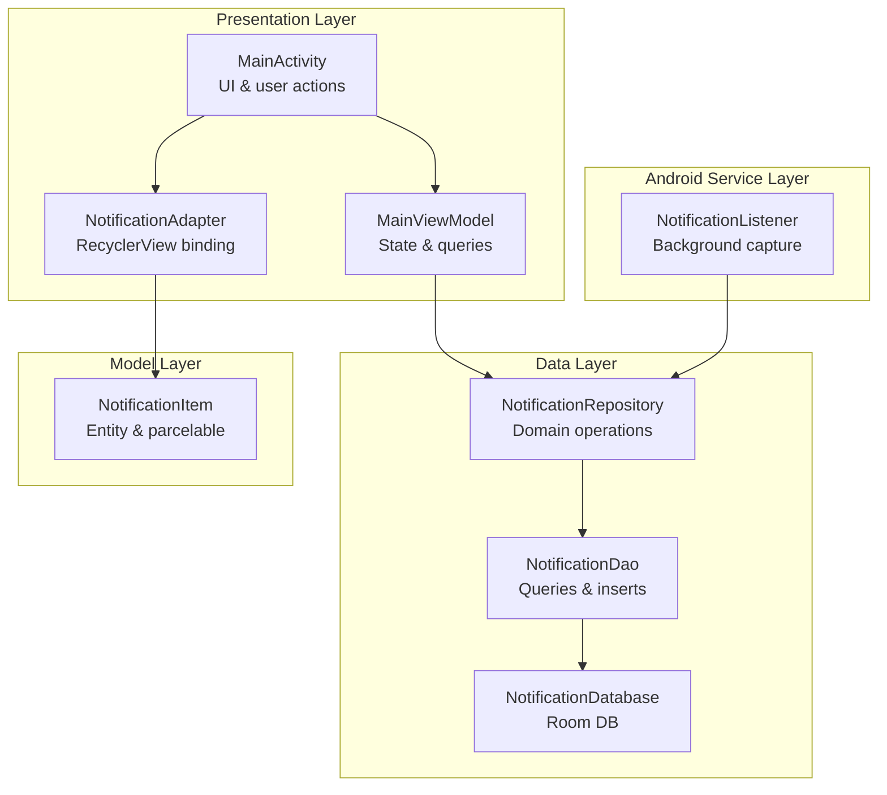
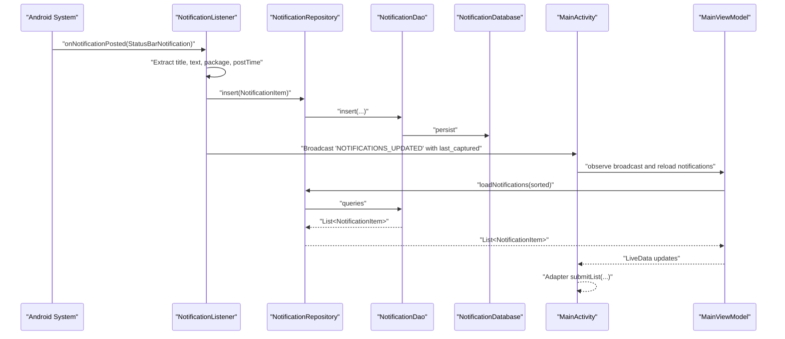
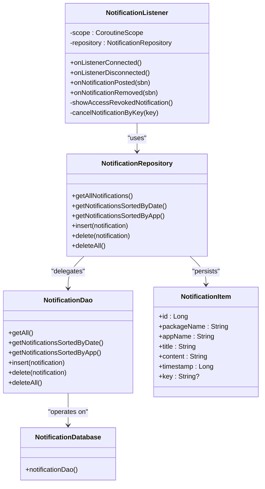
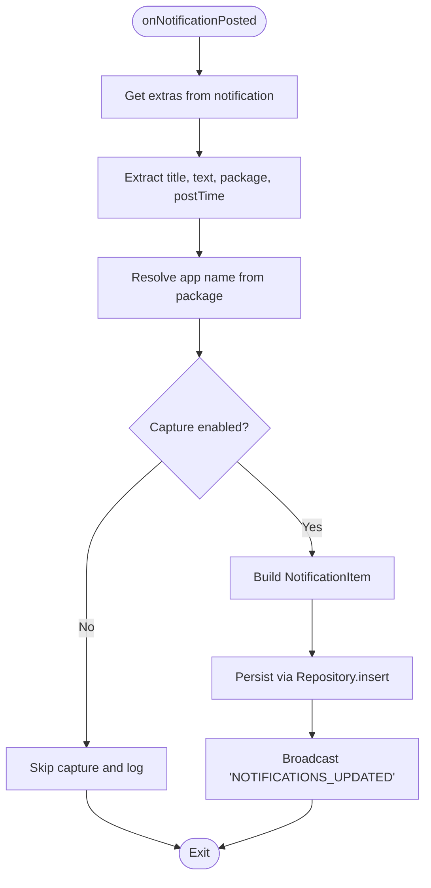
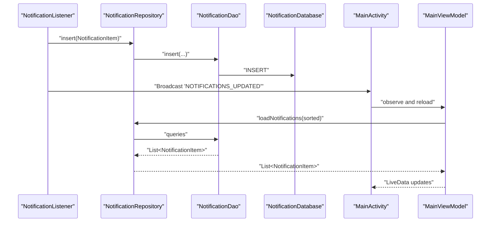
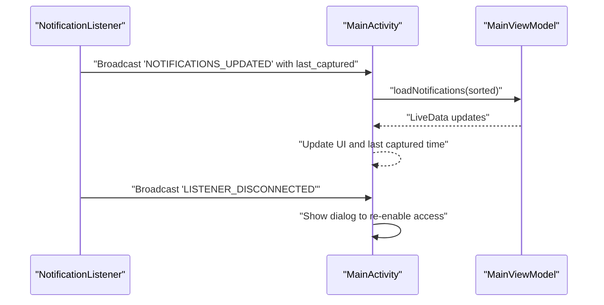
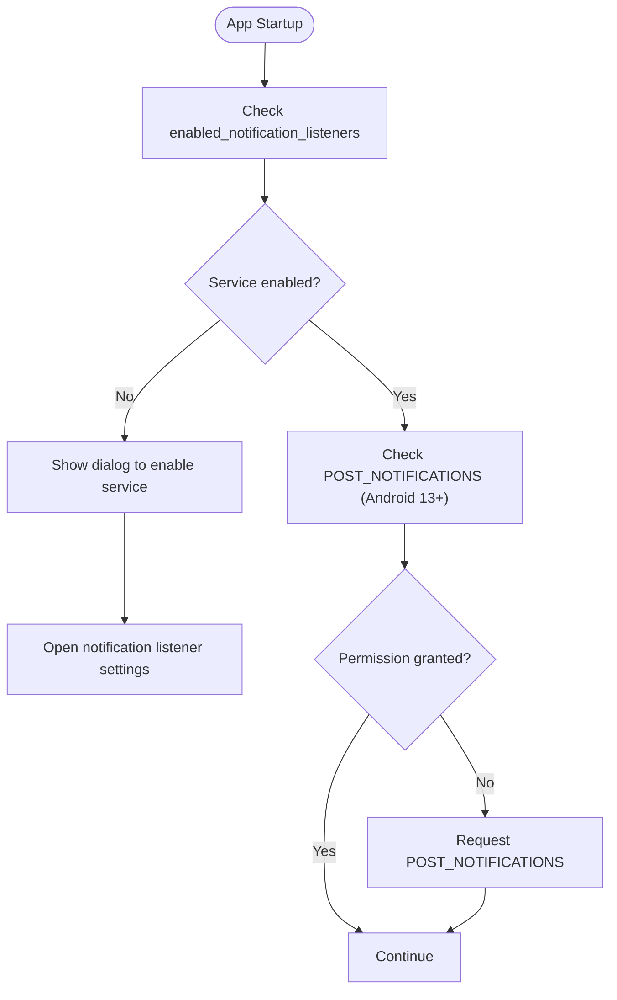
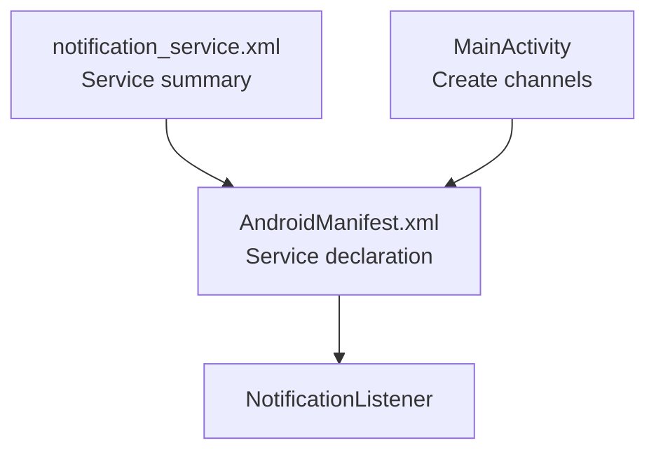
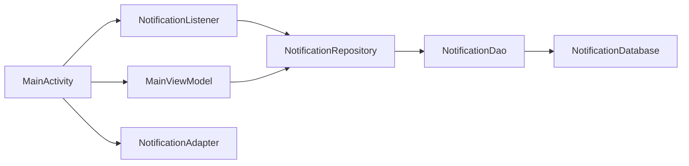

# Real-time Notification Capture

<cite>
**Referenced Files in This Document**
- [NotificationListener.kt](file://app/src/main/java/com/notificationlog/NotificationListener.kt)
- [MainActivity.kt](file://app/src/main/java/com/notificationlog/MainActivity.kt)
- [MainViewModel.kt](file://app/src/main/java/com/notificationlog/MainViewModel.kt)
- [NotificationRepository.kt](file://app/src/main/java/com/notificationlog/repository/NotificationRepository.kt)
- [NotificationDao.kt](file://app/src/main/java/com/notificationlog/data/NotificationDao.kt)
- [NotificationDatabase.kt](file://app/src/main/java/com/notificationlog/data/NotificationDatabase.kt)
- [NotificationItem.kt](file://app/src/main/java/com/notificationlog/model/NotificationItem.kt)
- [NotificationAdapter.kt](file://app/src/main/java/com/notificationlog/adapter/NotificationAdapter.kt)
- [NotificationApp.kt](file://app/src/main/java/com/notificationlog/NotificationApp.kt)
- [AndroidManifest.xml](file://app/src/main/AndroidManifest.xml)
- [notification_service.xml](file://app/src/main/res/xml/notification_service.xml)
</cite>

## Table of Contents
1. [Introduction](#introduction)
2. [Project Structure](#project-structure)
3. [Core Components](#core-components)
4. [Architecture Overview](#architecture-overview)
5. [Detailed Component Analysis](#detailed-component-analysis)
6. [Dependency Analysis](#dependency-analysis)
7. [Performance Considerations](#performance-considerations)
8. [Troubleshooting Guide](#troubleshooting-guide)
9. [Conclusion](#conclusion)

## Introduction
This document explains the real-time notification capture feature implemented in the application. It covers the NotificationListenerService background operation, Android notification system integration, the onNotificationPosted lifecycle, notification extraction and transformation pipeline, permissions and consent flow, coroutine-based asynchronous processing, Room database insertion, and broadcast communication with the main activity. It also includes troubleshooting guidance and performance considerations.

## Project Structure
The notification capture feature spans several layers:
- Android Service layer: NotificationListenerService subclass handles background notification events.
- Presentation layer: MainActivity and MainViewModel manage UI, user actions, and state.
- Data layer: Room database with DAO and Repository encapsulate persistence and queries.
- Model layer: NotificationItem defines the persisted entity.
- Adapter layer: RecyclerView adapter renders captured notifications.

**Diagram sources**
- [NotificationListener.kt:23-173](file://app/src/main/java/com/notificationlog/NotificationListener.kt#L23-L173)
- [MainActivity.kt:43-717](file://app/src/main/java/com/notificationlog/MainActivity.kt#L43-L717)
- [MainViewModel.kt:15-121](file://app/src/main/java/com/notificationlog/MainViewModel.kt#L15-L121)
- [NotificationRepository.kt:6-27](file://app/src/main/java/com/notificationlog/repository/NotificationRepository.kt#L6-L27)
- [NotificationDao.kt:6-26](file://app/src/main/java/com/notificationlog/data/NotificationDao.kt#L6-L26)
- [NotificationDatabase.kt:7-10](file://app/src/main/java/com/notificationlog/data/NotificationDatabase.kt#L7-L10)
- [NotificationItem.kt:8-19](file://app/src/main/java/com/notificationlog/model/NotificationItem.kt#L8-L19)
- [NotificationAdapter.kt:13-59](file://app/src/main/java/com/notificationlog/adapter/NotificationAdapter.kt#L13-L59)

**Section sources**
- [AndroidManifest.xml:29-43](file://app/src/main/AndroidManifest.xml#L29-L43)
- [notification_service.xml:1-5](file://app/src/main/res/xml/notification_service.xml#L1-L5)

## Core Components
- NotificationListener: Background service that receives notifications via onNotificationPosted, transforms them, persists asynchronously, and notifies the UI.
- MainActivity: Orchestrates permissions, service status, persistent notification, and UI updates via broadcasts.
- MainViewModel: Manages service status checks, loads notifications, and exposes LiveData to the UI.
- NotificationRepository: Encapsulates DAO operations for Room.
- NotificationDao: Defines queries and insert/delete operations.
- NotificationDatabase: Room database definition.
- NotificationItem: Entity stored in Room.
- NotificationAdapter: RecyclerView adapter for displaying notifications.

**Section sources**
- [NotificationListener.kt:23-173](file://app/src/main/java/com/notificationlog/NotificationListener.kt#L23-L173)
- [MainActivity.kt:43-717](file://app/src/main/java/com/notificationlog/MainActivity.kt#L43-L717)
- [MainViewModel.kt:15-121](file://app/src/main/java/com/notificationlog/MainViewModel.kt#L15-L121)
- [NotificationRepository.kt:6-27](file://app/src/main/java/com/notificationlog/repository/NotificationRepository.kt#L6-L27)
- [NotificationDao.kt:6-26](file://app/src/main/java/com/notificationlog/data/NotificationDao.kt#L6-L26)
- [NotificationDatabase.kt:7-10](file://app/src/main/java/com/notificationlog/data/NotificationDatabase.kt#L7-L10)
- [NotificationItem.kt:8-19](file://app/src/main/java/com/notificationlog/model/NotificationItem.kt#L8-L19)
- [NotificationAdapter.kt:13-59](file://app/src/main/java/com/notificationlog/adapter/NotificationAdapter.kt#L13-L59)

## Architecture Overview
The system integrates Android’s NotificationListenerService with Room persistence and a reactive UI. The service runs in the background, captures notifications, and dispatches broadcasts to inform the UI. The UI listens for these broadcasts and refreshes the list.

**Diagram sources**
- [NotificationListener.kt:109-153](file://app/src/main/java/com/notificationlog/NotificationListener.kt#L109-L153)
- [NotificationRepository.kt:16-18](file://app/src/main/java/com/notificationlog/repository/NotificationRepository.kt#L16-L18)
- [NotificationDao.kt:18-19](file://app/src/main/java/com/notificationlog/data/NotificationDao.kt#L18-L19)
- [MainActivity.kt:51-66](file://app/src/main/java/com/notificationlog/MainActivity.kt#L51-L66)
- [MainViewModel.kt:59-77](file://app/src/main/java/com/notificationlog/MainViewModel.kt#L59-L77)

## Detailed Component Analysis

### NotificationListener Service
Responsibilities:
- Receives notifications via onNotificationPosted.
- Extracts metadata (title, text, package, post time).
- Resolves app label from package manager.
- Checks user preference to capture or ignore.
- Inserts into Room using a coroutine on IO dispatcher.
- Broadcasts updates to MainActivity.
- Handles connection/disconnection and shows a warning notification when access is revoked.

Key behaviors:
- onListenerConnected: Cancels a previous warning notification.
- onListenerDisconnected: Requests rebind on Android 13+, shows a high-priority warning notification, and broadcasts a disconnection event.
- onNotificationPosted: Builds NotificationItem, launches coroutine to persist, and broadcasts completion.
- onNotificationRemoved: Logs removal events.
- cancelNotificationByKey: Safely cancels a notification with SecurityException handling.

**Diagram sources**
- [NotificationListener.kt:23-173](file://app/src/main/java/com/notificationlog/NotificationListener.kt#L23-L173)
- [NotificationRepository.kt:6-27](file://app/src/main/java/com/notificationlog/repository/NotificationRepository.kt#L6-L27)
- [NotificationDao.kt:6-26](file://app/src/main/java/com/notificationlog/data/NotificationDao.kt#L6-L26)
- [NotificationDatabase.kt:7-10](file://app/src/main/java/com/notificationlog/data/NotificationDatabase.kt#L7-L10)
- [NotificationItem.kt:8-19](file://app/src/main/java/com/notificationlog/model/NotificationItem.kt#L8-L19)

**Section sources**
- [NotificationListener.kt:36-65](file://app/src/main/java/com/notificationlog/NotificationListener.kt#L36-L65)
- [NotificationListener.kt:109-153](file://app/src/main/java/com/notificationlog/NotificationListener.kt#L109-L153)
- [NotificationListener.kt:160-166](file://app/src/main/java/com/notificationlog/NotificationListener.kt#L160-L166)

### Notification Extraction and Transformation Pipeline
Extraction steps:
- Retrieve package name and extras from StatusBarNotification.
- Extract title and text from extras.
- Use postTime as timestamp.
- Resolve app name from package manager; fallback to package name on failure.
- Read user preference flag to decide whether to capture.

Transformation:
- Construct NotificationItem with extracted fields.
- Persist via repository.insert.

**Diagram sources**
- [NotificationListener.kt:109-153](file://app/src/main/java/com/notificationlog/NotificationListener.kt#L109-L153)

**Section sources**
- [NotificationListener.kt:114-137](file://app/src/main/java/com/notificationlog/NotificationListener.kt#L114-L137)

### Database Insertion Workflow
- Repository delegates DAO insert.
- DAO uses REPLACE conflict strategy to handle duplicates.
- MainViewModel loads notifications on UI thread after receiving broadcast.

**Diagram sources**
- [NotificationRepository.kt:16-18](file://app/src/main/java/com/notificationlog/repository/NotificationRepository.kt#L16-L18)
- [NotificationDao.kt:18-19](file://app/src/main/java/com/notificationlog/data/NotificationDao.kt#L18-L19)
- [MainViewModel.kt:59-77](file://app/src/main/java/com/notificationlog/MainViewModel.kt#L59-L77)

**Section sources**
- [NotificationRepository.kt:16-18](file://app/src/main/java/com/notificationlog/repository/NotificationRepository.kt#L16-L18)
- [NotificationDao.kt:18-19](file://app/src/main/java/com/notificationlog/data/NotificationDao.kt#L18-L19)
- [MainViewModel.kt:59-77](file://app/src/main/java/com/notificationlog/MainViewModel.kt#L59-L77)

### Broadcast Communication with MainActivity
- NotificationListener sends two broadcasts:
  - "NOTIFICATIONS_UPDATED" with last_captured timestamp extra.
  - "LISTENER_DISCONNECTED" when access is revoked.
- MainActivity registers receivers in onResume and unregisters in onPause.
- Receivers trigger UI updates and dialogs.

**Diagram sources**
- [NotificationListener.kt:62-65](file://app/src/main/java/com/notificationlog/NotificationListener.kt#L62-L65)
- [NotificationListener.kt:142-144](file://app/src/main/java/com/notificationlog/NotificationListener.kt#L142-L144)
- [MainActivity.kt:51-66](file://app/src/main/java/com/notificationlog/MainActivity.kt#L51-L66)

**Section sources**
- [NotificationListener.kt:62-65](file://app/src/main/java/com/notificationlog/NotificationListener.kt#L62-L65)
- [NotificationListener.kt:142-144](file://app/src/main/java/com/notificationlog/NotificationListener.kt#L142-L144)
- [MainActivity.kt:51-66](file://app/src/main/java/com/notificationlog/MainActivity.kt#L51-L66)

### Permission Requirements and Consent Flow
- Notification Access Setting: MainActivity checks Settings.Secure for enabled listeners and prompts the user to enable it if missing.
- Android 13+ Permission: POST_NOTIFICATIONS is declared in manifest and requested at runtime.
- Consent flow:
  - On startup, MainActivity checks service status and permission.
  - If service is disabled, a dialog opens Settings.ACTION_NOTIFICATION_LISTENER_SETTINGS.
  - If permission is missing on Android 13+, requests POST_NOTIFICATIONS.
  - MainActivity maintains a persistent notification when enabled by user preference.

**Diagram sources**
- [MainActivity.kt:345-362](file://app/src/main/java/com/notificationlog/MainActivity.kt#L345-L362)
- [MainActivity.kt:364-373](file://app/src/main/java/com/notificationlog/MainActivity.kt#L364-L373)
- [AndroidManifest.xml:7](file://app/src/main/AndroidManifest.xml#L7)

**Section sources**
- [MainActivity.kt:313-322](file://app/src/main/java/com/notificationlog/MainActivity.kt#L313-L322)
- [MainActivity.kt:345-362](file://app/src/main/java/com/notificationlog/MainActivity.kt#L345-L362)
- [MainActivity.kt:364-373](file://app/src/main/java/com/notificationlog/MainActivity.kt#L364-L373)
- [AndroidManifest.xml:7](file://app/src/main/AndroidManifest.xml#L7)

### Android Notification System Integration
- Service declaration in AndroidManifest with BIND_NOTIFICATION_LISTENER_SERVICE permission and meta-data pointing to notification_service.xml.
- notification_service.xml defines the service summary shown in system settings.
- MainActivity creates channels for service status and warnings.

**Diagram sources**
- [AndroidManifest.xml:29-43](file://app/src/main/AndroidManifest.xml#L29-L43)
- [notification_service.xml:1-5](file://app/src/main/res/xml/notification_service.xml#L1-L5)
- [MainActivity.kt:630-643](file://app/src/main/java/com/notificationlog/MainActivity.kt#L630-L643)

**Section sources**
- [AndroidManifest.xml:29-43](file://app/src/main/AndroidManifest.xml#L29-L43)
- [notification_service.xml:1-5](file://app/src/main/res/xml/notification_service.xml#L1-L5)
- [MainActivity.kt:630-643](file://app/src/main/java/com/notificationlog/MainActivity.kt#L630-L643)

## Dependency Analysis
- NotificationListener depends on:
  - Room database initialized lazily.
  - NotificationRepository for persistence.
  - Android NotificationManager for warning notifications.
  - SharedPreferences for capture flag.
- MainActivity depends on:
  - MainViewModel for state and queries.
  - NotificationAdapter for UI rendering.
  - Settings for service status checks.
- MainViewModel depends on:
  - NotificationApp.repository for DAO operations.
  - Settings for service status checks.
- NotificationRepository depends on:
  - NotificationDatabase for DAO access.

**Diagram sources**
- [NotificationListener.kt:27-34](file://app/src/main/java/com/notificationlog/NotificationListener.kt#L27-L34)
- [NotificationRepository.kt:6-27](file://app/src/main/java/com/notificationlog/repository/NotificationRepository.kt#L6-L27)
- [NotificationDao.kt:6-26](file://app/src/main/java/com/notificationlog/data/NotificationDao.kt#L6-L26)
- [NotificationDatabase.kt:7-10](file://app/src/main/java/com/notificationlog/data/NotificationDatabase.kt#L7-L10)
- [MainActivity.kt:96](file://app/src/main/java/com/notificationlog/MainActivity.kt#L96)
- [MainViewModel.kt:62](file://app/src/main/java/com/notificationlog/MainViewModel.kt#L62)
- [NotificationAdapter.kt:13-59](file://app/src/main/java/com/notificationlog/adapter/NotificationAdapter.kt#L13-L59)

**Section sources**
- [NotificationListener.kt:27-34](file://app/src/main/java/com/notificationlog/NotificationListener.kt#L27-L34)
- [NotificationRepository.kt:6-27](file://app/src/main/java/com/notificationlog/repository/NotificationRepository.kt#L6-L27)
- [NotificationDao.kt:6-26](file://app/src/main/java/com/notificationlog/data/NotificationDao.kt#L6-L26)
- [NotificationDatabase.kt:7-10](file://app/src/main/java/com/notificationlog/data/NotificationDatabase.kt#L7-L10)
- [MainActivity.kt:96](file://app/src/main/java/com/notificationlog/MainActivity.kt#L96)
- [MainViewModel.kt:62](file://app/src/main/java/com/notificationlog/MainViewModel.kt#L62)
- [NotificationAdapter.kt:13-59](file://app/src/main/java/com/notificationlog/adapter/NotificationAdapter.kt#L13-L59)

## Performance Considerations
- Asynchronous processing: Repository insertions occur on Dispatchers.IO within a SupervisorJob-scoped CoroutineScope to prevent cancellation propagation and reduce overhead.
- UI responsiveness: MainViewModel loads notifications on IO and posts results to Main thread via withContext.
- Memory management: RecyclerView uses DiffUtil to minimize UI churn; adapter binds efficiently with data binding.
- Battery optimization:
  - Avoid unnecessary wake-ups; rely on system callbacks.
  - Use minimal logging and only when needed.
  - Cancel ongoing persistent notification when capture is disabled or not requested by user.
- Storage efficiency: Room uses REPLACE on conflict to avoid duplicates; consider pruning older entries if the dataset grows large.

[No sources needed since this section provides general guidance]

## Troubleshooting Guide
Common issues and resolutions:
- Permission revocation:
  - Symptoms: Service stops capturing; a high-priority warning notification appears; MainActivity shows a dialog.
  - Resolution: Re-enable notification access in system settings; the service attempts rebind on Android 13+.
- Service disconnection:
  - Symptoms: LISTENER_DISCONNECTED broadcast received; UI indicates access lost.
  - Resolution: Confirm service is enabled; restart the app if necessary.
- Notification filtering:
  - Symptom: Notifications not captured despite service running.
  - Cause: capture_enabled flag is false.
  - Resolution: Toggle capture on/off via UI; verify SharedPreferences state.
- Database errors:
  - Symptoms: Exceptions during insert or query.
  - Resolution: Verify Room initialization and DAO operations; ensure database is built before use.
- UI not updating:
  - Symptoms: New notifications not reflected.
  - Resolution: Ensure broadcast receivers are registered in onResume and unregistered in onPause; verify MainViewModel loads notifications after broadcast.

**Section sources**
- [NotificationListener.kt:44-65](file://app/src/main/java/com/notificationlog/NotificationListener.kt#L44-L65)
- [NotificationListener.kt:139-149](file://app/src/main/java/com/notificationlog/NotificationListener.kt#L139-L149)
- [MainActivity.kt:51-66](file://app/src/main/java/com/notificationlog/MainActivity.kt#L51-L66)
- [MainActivity.kt:313-322](file://app/src/main/java/com/notificationlog/MainActivity.kt#L313-L322)

## Conclusion
The real-time notification capture feature integrates Android’s NotificationListenerService with Room persistence and a reactive UI. It provides robust background operation, user-controlled capture toggling, and clear feedback mechanisms for permission and service status. By leveraging coroutines and broadcasts, it balances responsiveness and reliability while offering straightforward troubleshooting pathways.