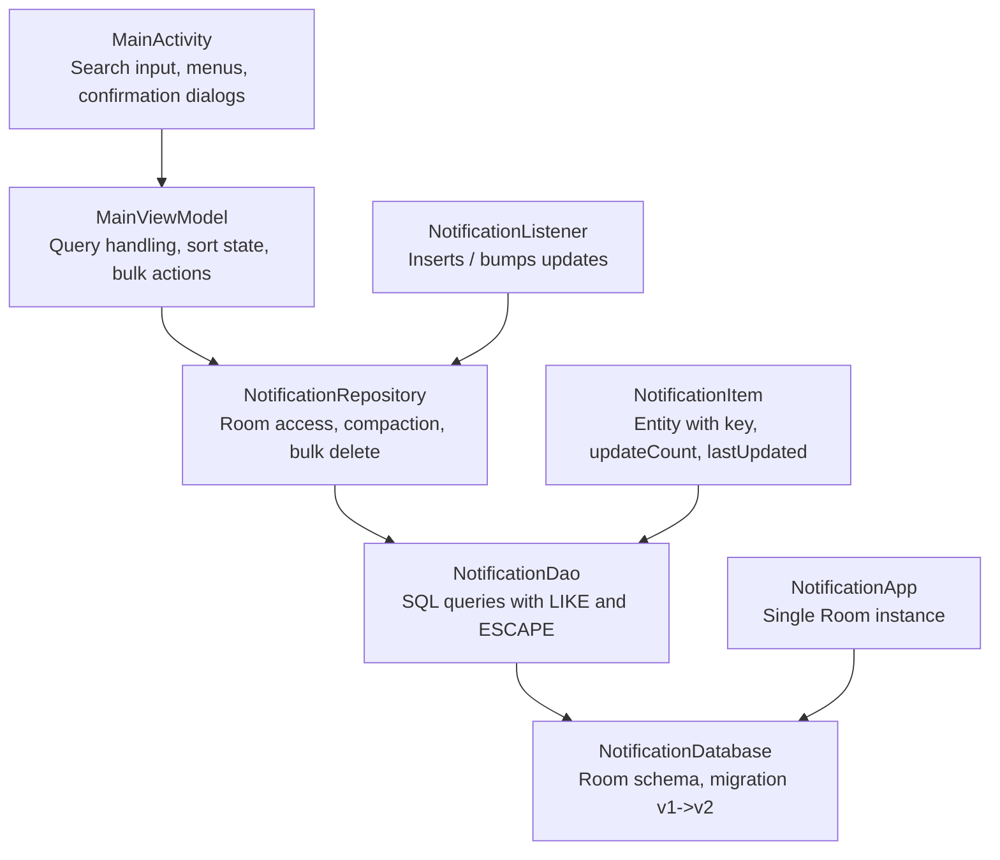
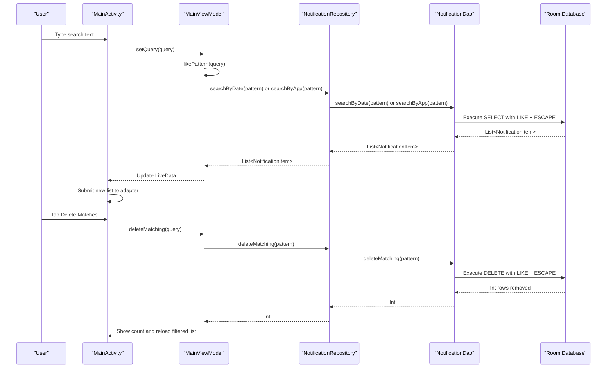
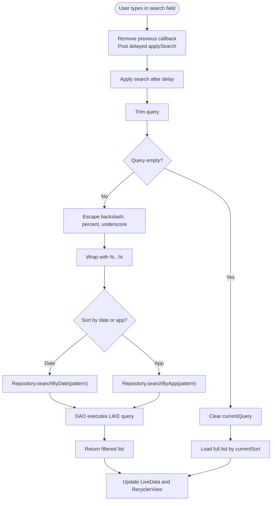
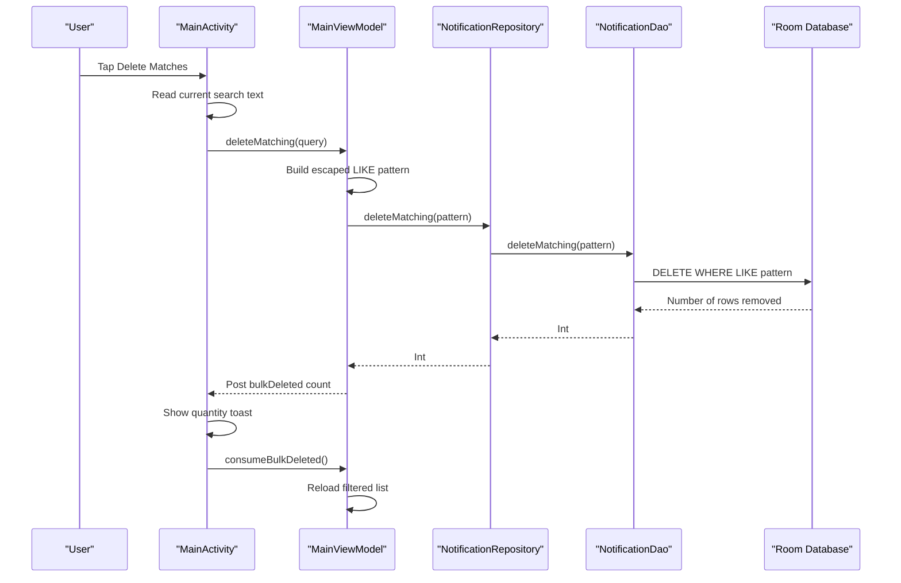
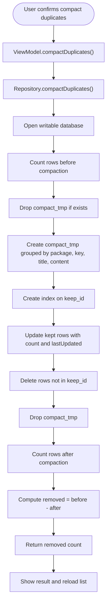
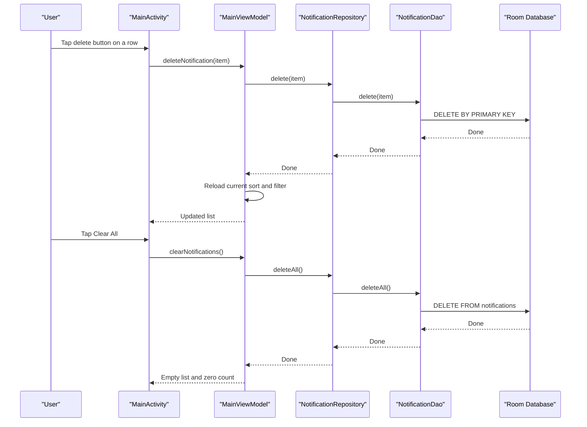
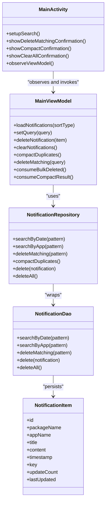
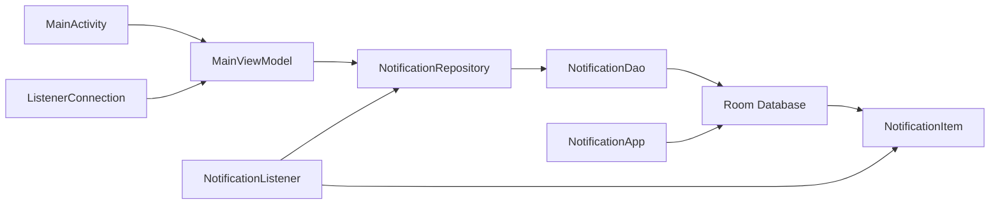

# Search and Bulk Operations

<cite>
**Referenced Files in This Document**
- [README.md](file://README.md)
- [MainActivity.kt](file://app/src/main/java/com/notificationlog/MainActivity.kt)
- [MainViewModel.kt](file://app/src/main/java/com/notificationlog/MainViewModel.kt)
- [NotificationDao.kt](file://app/src/main/java/com/notificationlog/data/NotificationDao.kt)
- [NotificationDatabase.kt](file://app/src/main/java/com/notificationlog/data/NotificationDatabase.kt)
- [NotificationItem.kt](file://app/src/main/java/com/notificationlog/model/NotificationItem.kt)
- [NotificationRepository.kt](file://app/src/main/java/com/notificationlog/repository/NotificationRepository.kt)
- [NotificationAdapter.kt](file://app/src/main/java/com/notificationlog/adapter/NotificationAdapter.kt)
- [NotificationListener.kt](file://app/src/main/java/com/notificationlog/NotificationListener.kt)
- [ListenerConnection.kt](file://app/src/main/java/com/notificationlog/ListenerConnection.kt)
- [NotificationApp.kt](file://app/src/main/java/com/notificationlog/NotificationApp.kt)
</cite>

## Table of Contents
1. [Introduction](#introduction)
2. [Project Structure](#project-structure)
3. [Core Components](#core-components)
4. [Architecture Overview](#architecture-overview)
5. [Detailed Component Analysis](#detailed-component-analysis)
6. [Dependency Analysis](#dependency-analysis)
7. [Performance Considerations](#performance-considerations)
8. [Troubleshooting Guide](#troubleshooting-guide)
9. [Conclusion](#conclusion)

## Introduction
This document explains how search and bulk operations work in the Notification Log Android application. The app captures system notifications, stores them in a local Room database, and exposes a user interface for sorting, filtering, exporting, compacting duplicates, and bulk deletion.

The current codebase implements:
- Free-text search across app name, title, content, and package name.
- Sorting by date or by app.
- Deletion of one notification, all notifications, or only the rows matching the active filter.
- Compaction of duplicate notifications that share the same key and content.

The README explicitly notes that search was historically missing; the implementation analyzed here adds text-based filtering and bulk actions on top of the existing list and export features.

**Section sources**
- [README.md:1-104](file://README.md#L1-L104)

## Project Structure
The search and bulk operation flow spans the UI layer, ViewModel, repository, DAO, and Room model.

**Diagram sources**
- [MainActivity.kt:267-316](file://app/src/main/java/com/notificationlog/MainActivity.kt#L267-L316)
- [MainViewModel.kt:133-181](file://app/src/main/java/com/notificationlog/MainViewModel.kt#L133-L181)
- [NotificationRepository.kt:40-85](file://app/src/main/java/com/notificationlog/repository/NotificationRepository.kt#L40-L85)
- [NotificationDao.kt:20-39](file://app/src/main/java/com/notificationlog/data/NotificationDao.kt#L20-L39)
- [NotificationDatabase.kt:9-40](file://app/src/main/java/com/notificationlog/data/NotificationDatabase.kt#L9-L40)
- [NotificationItem.kt:18-34](file://app/src/main/java/com/notificationlog/model/NotificationItem.kt#L18-L34)
- [NotificationListener.kt:155-189](file://app/src/main/java/com/notificationlog/NotificationListener.kt#L155-L189)
- [NotificationApp.kt:28-37](file://app/src/main/java/com/notificationlog/NotificationApp.kt#L28-L37)

**Section sources**
- [MainActivity.kt:56-167](file://app/src/main/java/com/notificationlog/MainActivity.kt#L56-L167)
- [MainViewModel.kt:19-76](file://app/src/main/java/com/notificationlog/MainViewModel.kt#L19-L76)
- [NotificationRepository.kt:8-42](file://app/src/main/java/com/notificationlog/repository/NotificationRepository.kt#L8-L42)
- [NotificationDao.kt:6-67](file://app/src/main/java/com/notificationlog/data/NotificationDao.kt#L6-L67)
- [NotificationDatabase.kt:9-40](file://app/src/main/java/com/notificationlog/data/NotificationDatabase.kt#L9-L40)
- [NotificationItem.kt:18-34](file://app/src/main/java/com/notificationlog/model/NotificationItem.kt#L18-L34)
- [NotificationListener.kt:23-44](file://app/src/main/java/com/notificationlog/NotificationListener.kt#L23-L44)
- [NotificationApp.kt:9-38](file://app/src/main/java/com/notificationlog/NotificationApp.kt#L9-L38)

## Core Components
This section focuses on the components directly involved in search and bulk operations.

### User Interface Layer
- MainActivity sets up the search input, debounces keystrokes, toggles the search row, clears the query, and triggers bulk delete for the current filter.
- It also provides confirmation dialogs for compacting duplicates, deleting matches, clearing all, and single-item deletion.
- The adapter renders each notification and forwards click and delete events to the ViewModel.

Key responsibilities:
- Debounced search input.
- Showing/hiding the search UI.
- Triggering ViewModel methods for load, delete, clear, and compact.
- Observing LiveData for results and errors.

**Section sources**
- [MainActivity.kt:267-316](file://app/src/main/java/com/notificationlog/MainActivity.kt#L267-L316)
- [MainActivity.kt:343-356](file://app/src/main/java/com/notificationlog/MainActivity.kt#L343-L356)
- [MainActivity.kt:772-790](file://app/src/main/java/com/notificationlog/MainActivity.kt#L772-L790)
- [MainActivity.kt:792-800](file://app/src/main/java/com/notificationlog/MainActivity.kt#L792-L800)
- [NotificationAdapter.kt:13-59](file://app/src/main/java/com/notificationlog/adapter/NotificationAdapter.kt#L13-L59)

### ViewModel Layer
- MainViewModel holds the current sort type and current query.
- It converts user input into a SQL-like pattern, escapes wildcards, and calls repository methods for loading, searching, deleting, and compacting.
- It exposes LiveData for notifications, counts, errors, compact results, and bulk-deleted counts.

Key responsibilities:
- Maintaining `currentSort` and `currentQuery`.
- Building safe `LIKE` patterns.
- Loading data by date or app, with or without a filter.
- Coordinating background work through `viewModelScope`.

**Section sources**
- [MainViewModel.kt:48-59](file://app/src/main/java/com/notificationlog/MainViewModel.kt#L48-L59)
- [MainViewModel.kt:133-181](file://app/src/main/java/com/notificationlog/MainViewModel.kt#L133-L181)
- [MainViewModel.kt:183-267](file://app/src/main/java/com/notificationlog/MainViewModel.kt#L183-L267)

### Repository Layer
- NotificationRepository wraps DAO calls and adds higher-level operations such as bulk delete by pattern and duplicate compaction.
- Compaction uses a temporary table to group identical postings and avoid slow correlated subqueries over large logs.

Key responsibilities:
- Exposing search, insert, bump, delete, clear, and compact APIs.
- Performing transactional compaction safely.

**Section sources**
- [NotificationRepository.kt:8-42](file://app/src/main/java/com/notificationlog/repository/NotificationRepository.kt#L8-L42)
- [NotificationRepository.kt:44-85](file://app/src/main/java/com/notificationlog/repository/NotificationRepository.kt#L44-L85)

### Data Access Layer
- NotificationDao defines Room queries for full list retrieval, sorting, free-text search, latest-by-key lookup, insertion, updating, deletion, and bulk deletion.
- Queries use `LIKE` with an explicit escape character so literal percent signs and underscores can be searched.

Key responsibilities:
- Providing stable ordering using timestamp and id.
- Supporting both date-first and app-first search results.
- Returning affected-row counts for bulk operations.

**Section sources**
- [NotificationDao.kt:9-18](file://app/src/main/java/com/notificationlog/data/NotificationDao.kt#L9-L18)
- [NotificationDao.kt:20-39](file://app/src/main/java/com/notificationlog/data/NotificationDao.kt#L20-L39)
- [NotificationDao.kt:41-66](file://app/src/main/java/com/notificationlog/data/NotificationDao.kt#L41-L66)

### Data Model and Database
- NotificationItem is the Room entity representing a logged notification.
- It includes fields for deduplication: `key`, `updateCount`, and `lastUpdated`.
- NotificationDatabase declares version 2 and a migration adding deduplication columns and indexes.

Key responsibilities:
- Storing notification metadata and deduplication state.
- Ensuring index-backed lookups for performance.

**Section sources**
- [NotificationItem.kt:9-34](file://app/src/main/java/com/notificationlog/model/NotificationItem.kt#L9-L34)
- [NotificationDatabase.kt:9-40](file://app/src/main/java/com/notificationlog/data/NotificationDatabase.kt#L9-L40)

## Architecture Overview
The search and bulk operation architecture follows Activity → ViewModel → Repository → DAO → Room.

**Diagram sources**
- [MainActivity.kt:279-297](file://app/src/main/java/com/notificationlog/MainActivity.kt#L279-L297)
- [MainActivity.kt:776-790](file://app/src/main/java/com/notificationlog/MainActivity.kt#L776-L790)
- [MainViewModel.kt:163-181](file://app/src/main/java/com/notificationlog/MainViewModel.kt#L163-L181)
- [MainViewModel.kt:244-259](file://app/src/main/java/com/notificationlog/MainViewModel.kt#L244-L259)
- [NotificationRepository.kt:18-20](file://app/src/main/java/com/notificationlog/repository/NotificationRepository.kt#L18-L20)
- [NotificationRepository.kt:40-42](file://app/src/main/java/com/notificationlog/repository/NotificationRepository.kt#L40-L42)
- [NotificationDao.kt:25-39](file://app/src/main/java/com/notificationlog/data/NotificationDao.kt#L25-L39)
- [NotificationDao.kt:58-63](file://app/src/main/java/com/notificationlog/data/NotificationDao.kt#L58-L63)

## Detailed Component Analysis

### Search Flow
The search flow starts in the UI and ends with a filtered list from Room.

**Diagram sources**
- [MainActivity.kt:279-297](file://app/src/main/java/com/notificationlog/MainActivity.kt#L279-L297)
- [MainViewModel.kt:163-181](file://app/src/main/java/com/notificationlog/MainViewModel.kt#L163-L181)
- [MainViewModel.kt:133-161](file://app/src/main/java/com/notificationlog/MainViewModel.kt#L133-L161)
- [NotificationRepository.kt:18-20](file://app/src/main/java/com/notificationlog/repository/NotificationRepository.kt#L18-L20)
- [NotificationDao.kt:25-39](file://app/src/main/java/com/notificationlog/data/NotificationDao.kt#L25-L39)

**Section sources**
- [MainActivity.kt:267-316](file://app/src/main/java/com/notificationlog/MainActivity.kt#L267-L316)
- [MainViewModel.kt:133-181](file://app/src/main/java/com/notificationlog/MainViewModel.kt#L133-L181)
- [NotificationDao.kt:20-39](file://app/src/main/java/com/notificationlog/data/NotificationDao.kt#L20-L39)

### Bulk Delete Matching Filter
Bulk delete removes exactly the rows that the current search would return.

**Diagram sources**
- [MainActivity.kt:772-790](file://app/src/main/java/com/notificationlog/MainActivity.kt#L772-L790)
- [MainViewModel.kt:240-263](file://app/src/main/java/com/notificationlog/MainViewModel.kt#L240-L263)
- [NotificationRepository.kt:40-42](file://app/src/main/java/com/notificationlog/repository/NotificationRepository.kt#L40-L42)
- [NotificationDao.kt:54-63](file://app/src/main/java/com/notificationlog/data/NotificationDao.kt#L54-L63)

**Section sources**
- [MainActivity.kt:772-790](file://app/src/main/java/com/notificationlog/MainActivity.kt#L772-L790)
- [MainViewModel.kt:240-263](file://app/src/main/java/com/notificationlog/MainViewModel.kt#L240-L263)
- [NotificationRepository.kt:40-42](file://app/src/main/java/com/notificationlog/repository/NotificationRepository.kt#L40-L42)
- [NotificationDao.kt:54-63](file://app/src/main/java/com/notificationlog/data/NotificationDao.kt#L54-L63)

### Compact Duplicates
Compacting duplicates merges repeated postings of the same notification key and content into one row while preserving the newest content and counting occurrences.

**Diagram sources**
- [MainActivity.kt:343-356](file://app/src/main/java/com/notificationlog/MainActivity.kt#L343-L356)
- [MainViewModel.kt:216-238](file://app/src/main/java/com/notificationlog/MainViewModel.kt#L216-L238)
- [NotificationRepository.kt:44-85](file://app/src/main/java/com/notificationlog/repository/NotificationRepository.kt#L44-L85)

**Section sources**
- [MainActivity.kt:343-356](file://app/src/main/java/com/notificationlog/MainActivity.kt#L343-L356)
- [MainViewModel.kt:216-238](file://app/src/main/java/com/notificationlog/MainViewModel.kt#L216-L238)
- [NotificationRepository.kt:44-85](file://app/src/main/java/com/notificationlog/repository/NotificationRepository.kt#L44-L85)

### Single Delete and Clear All
- Single delete removes one item and reloads the current sorted view.
- Clear all deletes every row and resets the displayed list and count.

**Diagram sources**
- [MainActivity.kt:761-770](file://app/src/main/java/com/notificationlog/MainActivity.kt#L761-L770)
- [MainActivity.kt:792-800](file://app/src/main/java/com/notificationlog/MainActivity.kt#L792-L800)
- [MainViewModel.kt:183-210](file://app/src/main/java/com/notificationlog/MainViewModel.kt#L183-L210)
- [NotificationRepository.kt:32-38](file://app/src/main/java/com/notificationlog/repository/NotificationRepository.kt#L32-L38)
- [NotificationDao.kt:51-66](file://app/src/main/java/com/notificationlog/data/NotificationDao.kt#L51-L66)

**Section sources**
- [MainActivity.kt:761-800](file://app/src/main/java/com/notificationlog/MainActivity.kt#L761-L800)
- [MainViewModel.kt:183-210](file://app/src/main/java/com/notificationlog/MainViewModel.kt#L183-L210)
- [NotificationRepository.kt:32-38](file://app/src/main/java/com/notificationlog/repository/NotificationRepository.kt#L32-L38)
- [NotificationDao.kt:51-66](file://app/src/main/java/com/notificationlog/data/NotificationDao.kt#L51-L66)

### Class Relationships
The following diagram shows the main classes involved in search and bulk operations.

**Diagram sources**
- [MainActivity.kt:267-316](file://app/src/main/java/com/notificationlog/MainActivity.kt#L267-L316)
- [MainViewModel.kt:133-267](file://app/src/main/java/com/notificationlog/MainViewModel.kt#L133-L267)
- [NotificationRepository.kt:8-85](file://app/src/main/java/com/notificationlog/repository/NotificationRepository.kt#L8-L85)
- [NotificationDao.kt:6-67](file://app/src/main/java/com/notificationlog/data/NotificationDao.kt#L6-L67)
- [NotificationItem.kt:18-34](file://app/src/main/java/com/notificationlog/model/NotificationItem.kt#L18-L34)

## Dependency Analysis
Search and bulk operations depend on several layers and cross-cutting concerns.

**Diagram sources**
- [MainActivity.kt:56-167](file://app/src/main/java/com/notificationlog/MainActivity.kt#L56-L167)
- [MainViewModel.kt:19-76](file://app/src/main/java/com/notificationlog/MainViewModel.kt#L19-L76)
- [NotificationRepository.kt:8-42](file://app/src/main/java/com/notificationlog/repository/NotificationRepository.kt#L8-L42)
- [NotificationDao.kt:6-67](file://app/src/main/java/com/notificationlog/data/NotificationDao.kt#L6-L67)
- [NotificationDatabase.kt:9-40](file://app/src/main/java/com/notificationlog/data/NotificationDatabase.kt#L9-L40)
- [NotificationItem.kt:18-34](file://app/src/main/java/com/notificationlog/model/NotificationItem.kt#L18-L34)
- [NotificationListener.kt:23-44](file://app/src/main/java/com/notificationlog/NotificationListener.kt#L23-L44)
- [NotificationApp.kt:28-37](file://app/src/main/java/com/notificationlog/NotificationApp.kt#L28-L37)
- [ListenerConnection.kt:18-30](file://app/src/main/java/com/notificationlog/ListenerConnection.kt#L18-L30)

**Section sources**
- [MainActivity.kt:56-167](file://app/src/main/java/com/notificationlog/MainActivity.kt#L56-L167)
- [MainViewModel.kt:19-76](file://app/src/main/java/com/notificationlog/MainViewModel.kt#L19-L76)
- [NotificationRepository.kt:8-42](file://app/src/main/java/com/notificationlog/repository/NotificationRepository.kt#L8-L42)
- [NotificationDao.kt:6-67](file://app/src/main/java/com/notificationlog/data/NotificationDao.kt#L6-L67)
- [NotificationDatabase.kt:9-40](file://app/src/main/java/com/notificationlog/data/NotificationDatabase.kt#L9-L40)
- [NotificationItem.kt:18-34](file://app/src/main/java/com/notificationlog/model/NotificationItem.kt#L18-L34)
- [NotificationListener.kt:23-44](file://app/src/main/java/com/notificationlog/NotificationListener.kt#L23-L44)
- [NotificationApp.kt:28-37](file://app/src/main/java/com/notificationlog/NotificationApp.kt#L28-L37)
- [ListenerConnection.kt:18-30](file://app/src/main/java/com/notificationlog/ListenerConnection.kt#L18-L30)

## Performance Considerations
- **Debounced search**: MainActivity delays applying the query to avoid issuing a database query per keystroke.
- **Escaped LIKE patterns**: The ViewModel escapes backslashes, percent signs, and underscores so special characters are treated literally.
- **Stable ordering**: DAO queries order by timestamp and id to reduce shuffling when multiple notifications have the same timestamp.
- **Indexes**: The database migration adds indexes on `key` and `timestamp`, improving lookups and sorting.
- **Compaction optimization**: Repository compaction uses a temporary table and indexes instead of correlated subqueries, which is important for large logs.
- **Background execution**: ViewModel and listener operations run on IO dispatchers or coroutines to avoid blocking the UI thread.

[No sources needed since this section provides general guidance]

## Troubleshooting Guide
Common issues and their likely causes:

- **Search returns no results**:
  - The query may contain special characters that were not intended as wildcards.
  - The filter is still applied after rotation because the ViewModel preserves `currentQuery`; verify whether the search row is visible.
  - Check that the correct sort mode is selected.

- **Bulk delete removes unexpected rows**:
  - Bulk delete uses the same LIKE pattern as search. If the query is broad, more rows may match than expected.
  - Confirm the exact query before confirming the dialog.

- **Compaction does not merge some rows**:
  - Compaction groups by package name, key, title, and content. Different titles or content create separate rows even if the key is the same.
  - Compaction is a repair action; it does not retroactively change future inserts beyond bumping update counts for identical content.

- **Errors appear silently**:
  - The ViewModel posts error messages through LiveData, and MainActivity displays them as toasts.
  - If no toast appears, check whether the observer is active and whether the error message has already been consumed.

**Section sources**
- [MainActivity.kt:279-297](file://app/src/main/java/com/notificationlog/MainActivity.kt#L279-L297)
- [MainActivity.kt:615-644](file://app/src/main/java/com/notificationlog/MainActivity.kt#L615-L644)
- [MainViewModel.kt:163-181](file://app/src/main/java/com/notificationlog/MainViewModel.kt#L163-L181)
- [MainViewModel.kt:216-267](file://app/src/main/java/com/notificationlog/MainViewModel.kt#L216-L267)
- [NotificationRepository.kt:44-85](file://app/src/main/java/com/notificationlog/repository/NotificationRepository.kt#L44-L85)

## Conclusion
The Notification Log application implements search and bulk operations through a layered architecture:
- The UI handles user input, confirmation, and feedback.
- The ViewModel manages query state, escaping, sorting, and coroutine-scoped work.
- The repository abstracts Room operations and adds optimized bulk logic.
- The DAO expresses search and deletion as parameterized SQL queries.
- The model and database support deduplication and efficient indexing.

For users, the most important behaviors are:
- Search filters by app, title, content, and package name.
- Bulk delete removes only the rows matching the current filter.
- Compacting duplicates merges repeated identical postings while preserving history.
- Errors and results are surfaced through toasts and LiveData.

For developers, the recommended next steps are:
- Add tests for search escaping, bulk delete, and compaction.
- Consider exposing advanced search options such as case-insensitive matching and app-only filtering.
- Monitor performance on very large logs, especially during compaction and broad searches.

[No sources needed since this section summarizes without analyzing specific files]