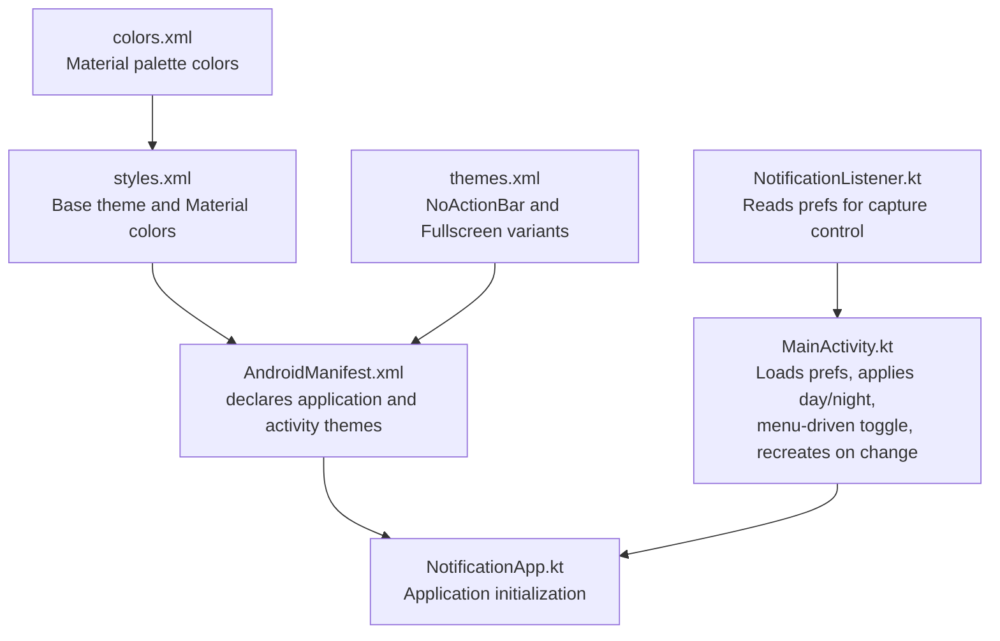
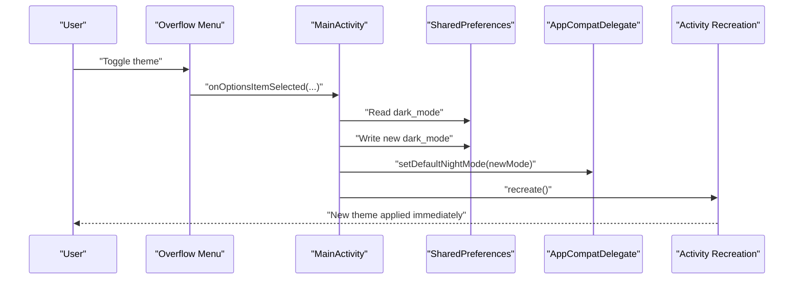
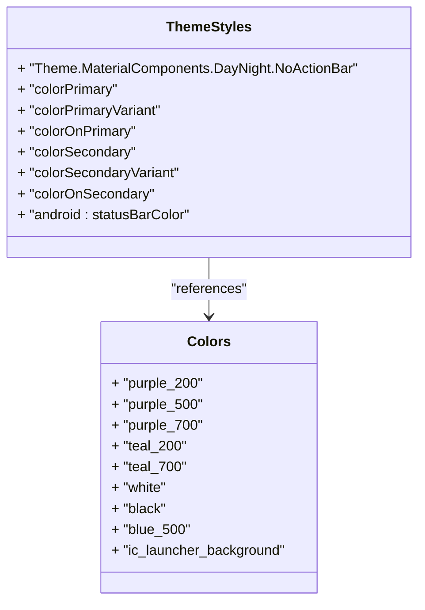
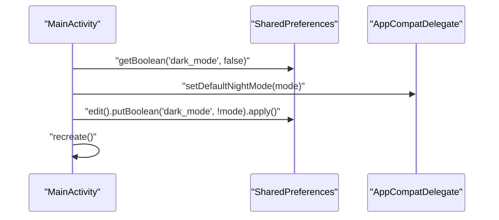
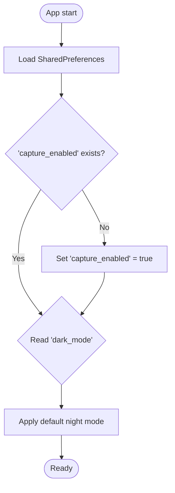
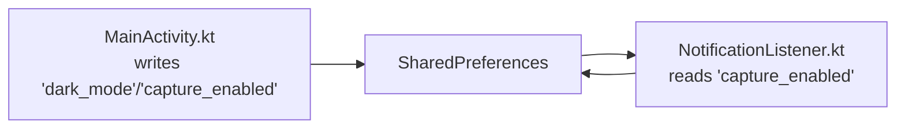
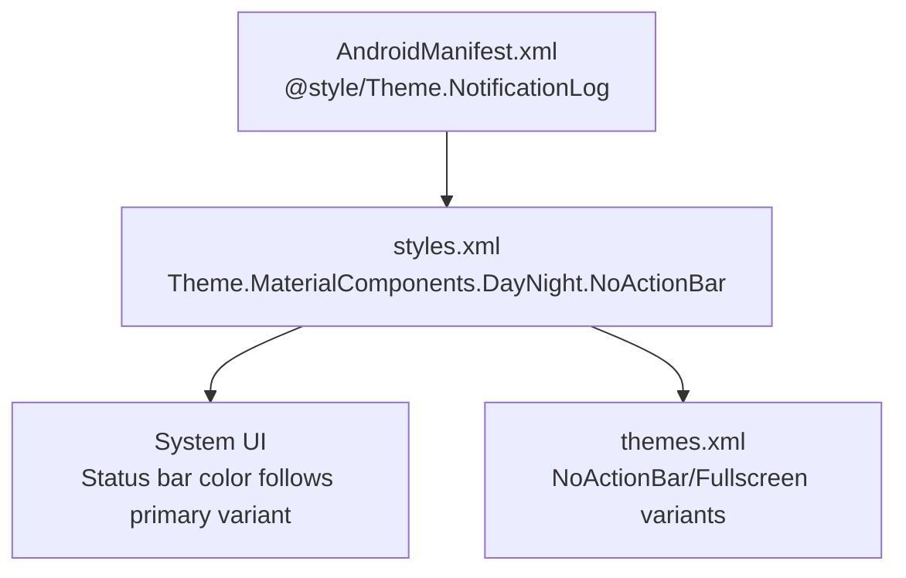
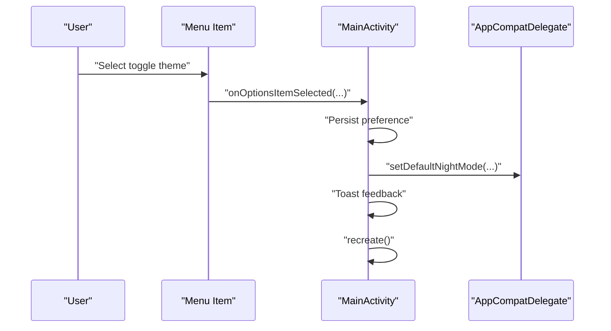
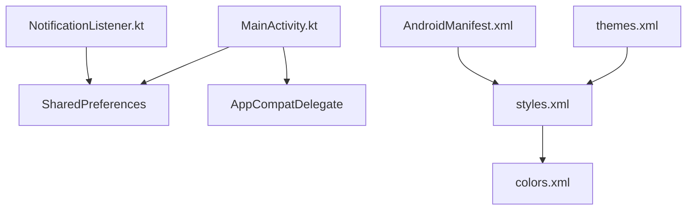

# Theme and User Preferences

<cite>
**Referenced Files in This Document**
- [AndroidManifest.xml](file://app/src/main/AndroidManifest.xml)
- [styles.xml](file://app/src/main/res/values/styles.xml)
- [themes.xml](file://app/src/main/res/values/themes.xml)
- [colors.xml](file://app/src/main/res/values/colors.xml)
- [MainActivity.kt](file://app/src/main/java/com/notificationlog/MainActivity.kt)
- [NotificationListener.kt](file://app/src/main/java/com/notificationlog/NotificationListener.kt)
- [NotificationApp.kt](file://app/src/main/java/com/notificationlog/NotificationApp.kt)
</cite>

## Table of Contents
1. [Introduction](#introduction)
2. [Project Structure](#project-structure)
3. [Core Components](#core-components)
4. [Architecture Overview](#architecture-overview)
5. [Detailed Component Analysis](#detailed-component-analysis)
6. [Dependency Analysis](#dependency-analysis)
7. [Performance Considerations](#performance-considerations)
8. [Troubleshooting Guide](#troubleshooting-guide)
9. [Conclusion](#conclusion)

## Introduction
This document explains the theme system and user preference management in the application. It covers:
- Light/dark theme implementation using Android’s DayNight support
- Material Design color scheme integration via Material Components
- Dynamic theme switching with immediate effect
- SharedPreferences-backed user settings persistence
- Preference migration and default value management
- Theme application lifecycle and system UI adaptation
- Preference synchronization across app components (Activity and background service)
- Accessibility considerations for different visual themes

## Project Structure
The theme and preferences are defined and applied across a small set of focused resources and classes:
- Application-wide theme and Material color definitions
- Activity-level theme application and dynamic switching
- Background service reading preferences to enforce capture behavior
- Application initialization for global state

**Diagram sources**
- [AndroidManifest.xml:9-27](file://app/src/main/AndroidManifest.xml#L9-L27)
- [styles.xml:4-16](file://app/src/main/res/values/styles.xml#L4-L16)
- [themes.xml:2-16](file://app/src/main/res/values/themes.xml#L2-L16)
- [colors.xml:2-12](file://app/src/main/res/values/colors.xml#L2-L12)
- [MainActivity.kt:78-108](file://app/src/main/java/com/notificationlog/MainActivity.kt#L78-L108)
- [NotificationListener.kt:125-127](file://app/src/main/java/com/notificationlog/NotificationListener.kt#L125-L127)

**Section sources**
- [AndroidManifest.xml:9-27](file://app/src/main/AndroidManifest.xml#L9-L27)
- [styles.xml:4-16](file://app/src/main/res/values/styles.xml#L4-L16)
- [themes.xml:2-16](file://app/src/main/res/values/themes.xml#L2-L16)
- [colors.xml:2-12](file://app/src/main/res/values/colors.xml#L2-L12)

## Core Components
- Base theme and Material colors
  - The base theme inherits from a DayNight variant of Material Components and defines primary/secondary palettes and status bar color.
  - Color resources define the palette used by the theme.
- Activity theme application and dynamic switching
  - On startup, the Activity reads a dark mode preference and sets the default night mode accordingly.
  - The overflow menu provides a toggle to switch modes, persisting the preference and immediately recreating the Activity to apply the new theme.
- Background service preference synchronization
  - The NotificationListener reads the same preference to decide whether to capture notifications, ensuring consistent behavior across app components.
- Application initialization
  - The Application class initializes the database and exposes a shared repository instance.

**Section sources**
- [styles.xml:4-16](file://app/src/main/res/values/styles.xml#L4-L16)
- [colors.xml:2-12](file://app/src/main/res/values/colors.xml#L2-L12)
- [MainActivity.kt:78-108](file://app/src/main/java/com/notificationlog/MainActivity.kt#L78-L108)
- [MainActivity.kt:473-487](file://app/src/main/java/com/notificationlog/MainActivity.kt#L473-L487)
- [NotificationListener.kt:125-127](file://app/src/main/java/com/notificationlog/NotificationListener.kt#L125-L127)
- [NotificationApp.kt:15-27](file://app/src/main/java/com/notificationlog/NotificationApp.kt#L15-L27)

## Architecture Overview
The theme system centers on a single preference controlling DayNight mode, applied at the delegate level and synchronized across components.

**Diagram sources**
- [MainActivity.kt:473-487](file://app/src/main/java/com/notificationlog/MainActivity.kt#L473-L487)

## Detailed Component Analysis

### Theme Definition and Material Integration
- Base theme
  - Inherits from a DayNight Material Components theme, enabling automatic light/dark mode selection.
  - Defines primary and secondary color roles and status bar color.
- Color palette
  - Provides named colors for Material roles (primary, secondary, on-primary, on-secondary).
- Variants
  - NoActionBar and Fullscreen variants inherit from the base theme.

**Diagram sources**
- [styles.xml:4-16](file://app/src/main/res/values/styles.xml#L4-L16)
- [colors.xml:2-12](file://app/src/main/res/values/colors.xml#L2-L12)

**Section sources**
- [styles.xml:4-16](file://app/src/main/res/values/styles.xml#L4-L16)
- [colors.xml:2-12](file://app/src/main/res/values/colors.xml#L2-L12)

### Dynamic Theme Switching Workflow
- Startup
  - Reads the dark mode preference and sets the default night mode.
- Toggle action
  - Writes the inverted preference, updates the delegate, shows a feedback toast, and recreates the Activity to apply the new theme immediately.

**Diagram sources**
- [MainActivity.kt:78-90](file://app/src/main/java/com/notificationlog/MainActivity.kt#L78-L90)
- [MainActivity.kt:473-487](file://app/src/main/java/com/notificationlog/MainActivity.kt#L473-L487)

**Section sources**
- [MainActivity.kt:78-90](file://app/src/main/java/com/notificationlog/MainActivity.kt#L78-L90)
- [MainActivity.kt:473-487](file://app/src/main/java/com/notificationlog/MainActivity.kt#L473-L487)

### Preference Storage and Migration
- Storage
  - SharedPreferences file key: a package-scoped string.
  - Keys used:
    - dark_mode: boolean controlling DayNight mode
    - capture_enabled: boolean controlling notification capture
    - show_running_notif: boolean controlling persistent notification visibility
- Defaults
  - dark_mode defaults to false (light)
  - capture_enabled defaults to true
  - show_running_notif defaults to false
- Migration
  - On first run, capture_enabled is normalized to true if previously missing or false, ensuring consistent behavior.

**Diagram sources**
- [MainActivity.kt:80-87](file://app/src/main/java/com/notificationlog/MainActivity.kt#L80-L87)
- [MainActivity.kt:88-90](file://app/src/main/java/com/notificationlog/MainActivity.kt#L88-L90)

**Section sources**
- [MainActivity.kt:80-87](file://app/src/main/java/com/notificationlog/MainActivity.kt#L80-L87)
- [MainActivity.kt:88-90](file://app/src/main/java/com/notificationlog/MainActivity.kt#L88-L90)

### Preference Synchronization Across Components
- Activity writes preferences and triggers theme changes
- Background service reads preferences to enforce capture behavior
- Consistency is maintained by using the same preference keys and default values

**Diagram sources**
- [MainActivity.kt:473-487](file://app/src/main/java/com/notificationlog/MainActivity.kt#L473-L487)
- [MainActivity.kt:300-311](file://app/src/main/java/com/notificationlog/MainActivity.kt#L300-L311)
- [NotificationListener.kt:125-127](file://app/src/main/java/com/notificationlog/NotificationListener.kt#L125-L127)

**Section sources**
- [MainActivity.kt:473-487](file://app/src/main/java/com/notificationlog/MainActivity.kt#L473-L487)
- [MainActivity.kt:300-311](file://app/src/main/java/com/notificationlog/MainActivity.kt#L300-L311)
- [NotificationListener.kt:125-127](file://app/src/main/java/com/notificationlog/NotificationListener.kt#L125-L127)

### Theme Application Process and System UI Adaptation
- Theme application
  - Base theme applied at application/activity level via manifest and resource inheritance.
  - DayNight mode controlled centrally by the delegate; system UI adapts automatically.
- System UI adaptation
  - Status bar color derives from the primary variant; DayNight variants adjust automatically.

**Diagram sources**
- [AndroidManifest.xml:14](file://app/src/main/AndroidManifest.xml#L14)
- [styles.xml:4-16](file://app/src/main/res/values/styles.xml#L4-L16)
- [themes.xml:2-16](file://app/src/main/res/values/themes.xml#L2-L16)

**Section sources**
- [AndroidManifest.xml:14](file://app/src/main/AndroidManifest.xml#L14)
- [styles.xml:4-16](file://app/src/main/res/values/styles.xml#L4-L16)
- [themes.xml:2-16](file://app/src/main/res/values/themes.xml#L2-L16)

### Theme Preference Dialogs and Immediate Effect Activation
- Overflow menu option toggles theme
- Immediate effect achieved by updating the delegate and recreating the Activity
- User feedback provided via toast messages

**Diagram sources**
- [MainActivity.kt:473-487](file://app/src/main/java/com/notificationlog/MainActivity.kt#L473-L487)

**Section sources**
- [MainActivity.kt:473-487](file://app/src/main/java/com/notificationlog/MainActivity.kt#L473-L487)

### Examples and Customization Guidance
- Custom theme modifications
  - Adjust primary/secondary colors in the base theme to reflect brand identity while keeping DayNight compatibility.
  - Add or refine variants in the variants file for specialized screens.
- Color palette customization
  - Replace named colors with brand-specific values; ensure contrast ratios meet accessibility guidelines.
- Accessibility considerations
  - Verify sufficient contrast between foreground and background colors in both light and dark modes.
  - Test readability with larger text sizes and reduced motion options.
  - Confirm that interactive elements remain clearly distinguishable across modes.

[No sources needed since this section provides general guidance]

## Dependency Analysis
- Theme dependencies
  - Activity depends on SharedPreferences for theme preference and on AppCompatDelegate for applying DayNight mode.
  - Background service depends on SharedPreferences for capture control.
- Resource dependencies
  - Base theme depends on Material Components and color resources.
  - Variants depend on the base theme.

**Diagram sources**
- [MainActivity.kt:78-90](file://app/src/main/java/com/notificationlog/MainActivity.kt#L78-L90)
- [MainActivity.kt:473-487](file://app/src/main/java/com/notificationlog/MainActivity.kt#L473-L487)
- [NotificationListener.kt:125-127](file://app/src/main/java/com/notificationlog/NotificationListener.kt#L125-L127)
- [styles.xml:4-16](file://app/src/main/res/values/styles.xml#L4-L16)
- [colors.xml:2-12](file://app/src/main/res/values/colors.xml#L2-L12)
- [themes.xml:2-16](file://app/src/main/res/values/themes.xml#L2-L16)
- [AndroidManifest.xml:14](file://app/src/main/AndroidManifest.xml#L14)

**Section sources**
- [MainActivity.kt:78-90](file://app/src/main/java/com/notificationlog/MainActivity.kt#L78-L90)
- [MainActivity.kt:473-487](file://app/src/main/java/com/notificationlog/MainActivity.kt#L473-L487)
- [NotificationListener.kt:125-127](file://app/src/main/java/com/notificationlog/NotificationListener.kt#L125-L127)
- [styles.xml:4-16](file://app/src/main/res/values/styles.xml#L4-L16)
- [colors.xml:2-12](file://app/src/main/res/values/colors.xml#L2-L12)
- [themes.xml:2-16](file://app/src/main/res/values/themes.xml#L2-L16)
- [AndroidManifest.xml:14](file://app/src/main/AndroidManifest.xml#L14)

## Performance Considerations
- Minimizing recreation overhead
  - Recreating the Activity on theme change is lightweight but avoid unnecessary recreations by guarding preference writes.
- Efficient preference reads/writes
  - Batch writes when updating multiple preferences to reduce I/O.
- Background service efficiency
  - Reading a single boolean per notification event is negligible; keep preference access minimal and cached if needed.

[No sources needed since this section provides general guidance]

## Troubleshooting Guide
- Theme does not switch immediately
  - Ensure the preference is written and the delegate is updated before recreating the Activity.
  - Confirm the menu handler persists the preference and calls recreate.
- Dark mode not applied on startup
  - Verify the preference load occurs before setting the delegate and that the default value is correct.
- Capture behavior inconsistent between foreground and background
  - Confirm both components read the same preference key and default value.
- System UI color not adapting
  - Ensure the status bar color references the primary variant and that the base theme inherits the DayNight variant.

**Section sources**
- [MainActivity.kt:78-90](file://app/src/main/java/com/notificationlog/MainActivity.kt#L78-L90)
- [MainActivity.kt:473-487](file://app/src/main/java/com/notificationlog/MainActivity.kt#L473-L487)
- [NotificationListener.kt:125-127](file://app/src/main/java/com/notificationlog/NotificationListener.kt#L125-L127)

## Conclusion
The application implements a clean, efficient theme system leveraging DayNight mode and Material Components. Preferences are stored in SharedPreferences with sensible defaults and are synchronized across the Activity and background service. Dynamic theme switching is immediate and user-friendly, with straightforward extension points for further customization while maintaining accessibility and performance.