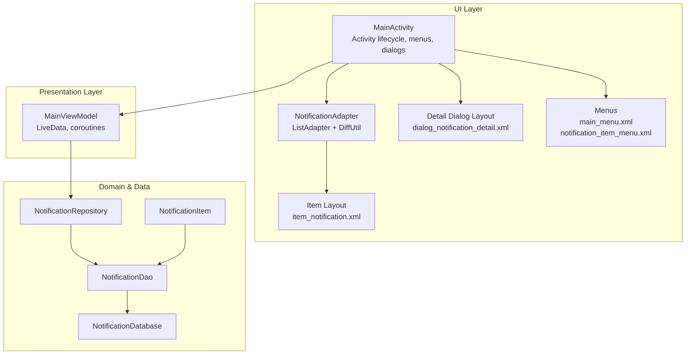
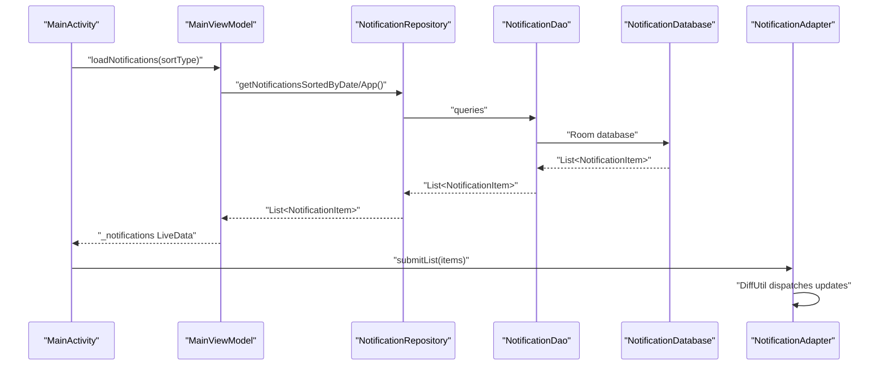
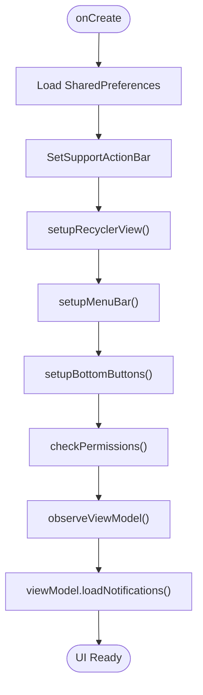
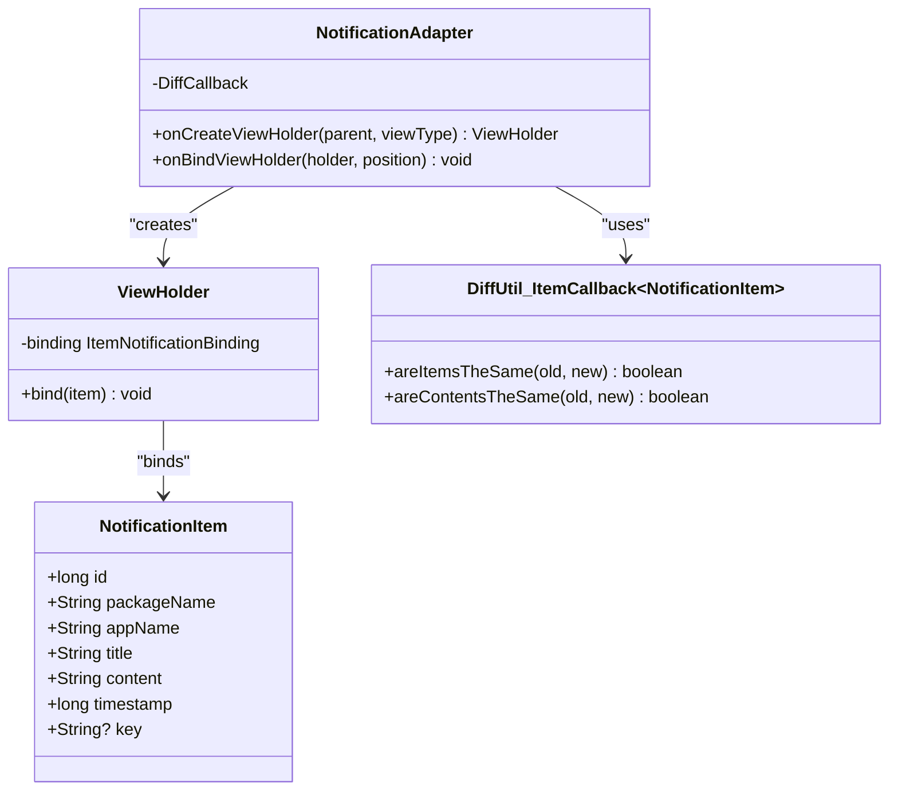
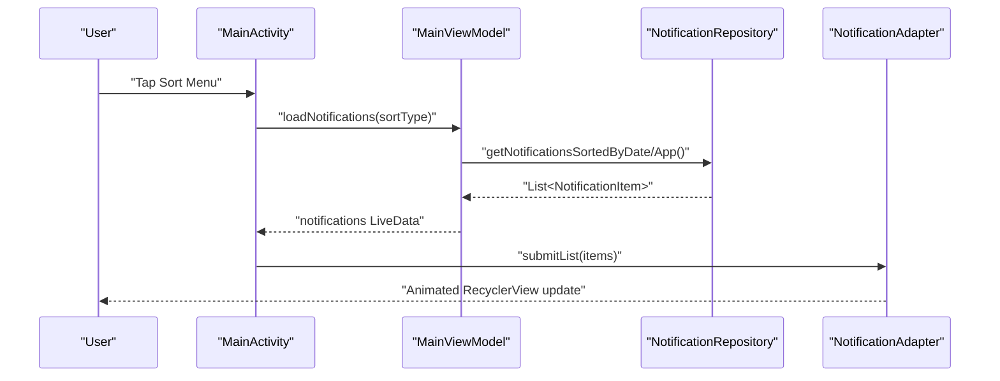
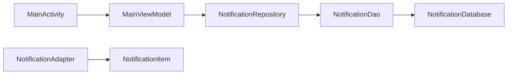

# User Interface Components

<cite>
**Referenced Files in This Document**
- [MainActivity.kt](file://app/src/main/java/com/notificationlog/MainActivity.kt)
- [NotificationAdapter.kt](file://app/src/main/java/com/notificationlog/adapter/NotificationAdapter.kt)
- [MainViewModel.kt](file://app/src/main/java/com/notificationlog/MainViewModel.kt)
- [NotificationItem.kt](file://app/src/main/java/com/notificationlog/model/NotificationItem.kt)
- [NotificationRepository.kt](file://app/src/main/java/com/notificationlog/repository/NotificationRepository.kt)
- [NotificationDao.kt](file://app/src/main/java/com/notificationlog/data/NotificationDao.kt)
- [NotificationDatabase.kt](file://app/src/main/java/com/notificationlog/data/NotificationDatabase.kt)
- [activity_main.xml](file://app/src/main/res/layout/activity_main.xml)
- [item_notification.xml](file://app/src/main/res/layout/item_notification.xml)
- [dialog_notification_detail.xml](file://app/src/main/res/layout/dialog_notification_detail.xml)
- [main_menu.xml](file://app/src/main/res/menu/main_menu.xml)
- [notification_item_menu.xml](file://app/src/main/res/menu/notification_item_menu.xml)
- [strings.xml](file://app/src/main/res/values/strings.xml)
- [colors.xml](file://app/src/main/res/values/colors.xml)
- [content_main.xml](file://app/src/main/res/layout/content_main.xml)
</cite>

## Table of Contents
1. [Introduction](#introduction)
2. [Project Structure](#project-structure)
3. [Core Components](#core-components)
4. [Architecture Overview](#architecture-overview)
5. [Detailed Component Analysis](#detailed-component-analysis)
6. [Dependency Analysis](#dependency-analysis)
7. [Performance Considerations](#performance-considerations)
8. [Troubleshooting Guide](#troubleshooting-guide)
9. [Conclusion](#conclusion)

## Introduction
This document explains the user interface components and interaction patterns of the Notification Log app. It focuses on the MainActivity implementation, the RecyclerView adapter with DiffUtil integration, and the notification list display mechanism. It also covers the notification item layout, detail dialog functionality, user interaction workflows, menu systems, context actions, swipe-to-dismiss considerations, UI state management, loading indicators, empty state handling, responsive design, accessibility features, and Material Design implementation.

## Project Structure
The UI is built around a single-activity architecture with a RecyclerView list, a custom adapter, and a ViewModel-driven data flow. Layouts use data binding and ConstraintLayout for responsiveness. Menus are defined via XML resources.

**Diagram sources**
- [MainActivity.kt:1-717](file://app/src/main/java/com/notificationlog/MainActivity.kt#L1-L717)
- [NotificationAdapter.kt:1-59](file://app/src/main/java/com/notificationlog/adapter/NotificationAdapter.kt#L1-L59)
- [MainViewModel.kt:1-121](file://app/src/main/java/com/notificationlog/MainViewModel.kt#L1-L121)
- [NotificationRepository.kt:1-28](file://app/src/main/java/com/notificationlog/repository/NotificationRepository.kt#L1-L28)
- [NotificationDao.kt:1-26](file://app/src/main/java/com/notificationlog/data/NotificationDao.kt#L1-L26)
- [NotificationDatabase.kt:1-10](file://app/src/main/java/com/notificationlog/data/NotificationDatabase.kt#L1-L10)
- [NotificationItem.kt:1-19](file://app/src/main/java/com/notificationlog/model/NotificationItem.kt#L1-L19)
- [item_notification.xml:1-74](file://app/src/main/res/layout/item_notification.xml#L1-L74)
- [dialog_notification_detail.xml:1-23](file://app/src/main/res/layout/dialog_notification_detail.xml#L1-L23)
- [main_menu.xml:1-45](file://app/src/main/res/menu/main_menu.xml#L1-L45)
- [notification_item_menu.xml:1-9](file://app/src/main/res/menu/notification_item_menu.xml#L1-L9)

**Section sources**
- [MainActivity.kt:78-108](file://app/src/main/java/com/notificationlog/MainActivity.kt#L78-L108)
- [activity_main.xml:1-240](file://app/src/main/res/layout/activity_main.xml#L1-L240)

## Core Components
- MainActivity orchestrates UI state, menus, dialogs, permissions, and persistent notification toggles. It observes LiveData from MainViewModel and updates the RecyclerView via NotificationAdapter.
- NotificationAdapter extends ListAdapter with DiffUtil to efficiently animate and update list items.
- MainViewModel exposes LiveData streams for notifications, counts, and service status, performing IO work on Dispatchers.IO and updating UI on Dispatchers.Main.
- NotificationItem is the data model persisted via Room; NotificationRepository abstracts DAO access; NotificationDao defines queries and mutations; NotificationDatabase configures the Room database.

**Section sources**
- [MainActivity.kt:146-153](file://app/src/main/java/com/notificationlog/MainActivity.kt#L146-L153)
- [NotificationAdapter.kt:13-59](file://app/src/main/java/com/notificationlog/adapter/NotificationAdapter.kt#L13-L59)
- [MainViewModel.kt:26-77](file://app/src/main/java/com/notificationlog/MainViewModel.kt#L26-L77)
- [NotificationItem.kt:8-19](file://app/src/main/java/com/notificationlog/model/NotificationItem.kt#L8-L19)
- [NotificationRepository.kt:6-27](file://app/src/main/java/com/notificationlog/repository/NotificationRepository.kt#L6-L27)
- [NotificationDao.kt:6-26](file://app/src/main/java/com/notificationlog/data/NotificationDao.kt#L6-L26)
- [NotificationDatabase.kt:7-10](file://app/src/main/java/com/notificationlog/data/NotificationDatabase.kt#L7-L10)

## Architecture Overview
The UI follows MVVM with LiveData and coroutines. MainActivity binds to views and delegates logic to MainViewModel. The adapter consumes items from LiveData and renders them efficiently.

**Diagram sources**
- [MainActivity.kt:324-343](file://app/src/main/java/com/notificationlog/MainActivity.kt#L324-L343)
- [MainViewModel.kt:59-77](file://app/src/main/java/com/notificationlog/MainViewModel.kt#L59-L77)
- [NotificationRepository.kt:8-14](file://app/src/main/java/com/notificationlog/repository/NotificationRepository.kt#L8-L14)
- [NotificationDao.kt:9-16](file://app/src/main/java/com/notificationlog/data/NotificationDao.kt#L9-L16)
- [NotificationAdapter.kt:18-28](file://app/src/main/java/com/notificationlog/adapter/NotificationAdapter.kt#L18-L28)

## Detailed Component Analysis

### MainActivity Implementation
- Lifecycle and binding: Uses View Binding inflated from activity_main.xml, sets toolbar, initializes ViewModel, and registers broadcast receivers for live updates and listener disconnect events.
- RecyclerView setup: Initializes NotificationAdapter with click lambdas for item and delete actions, sets a linear layout manager, and assigns the adapter.
- Menus and bottom bar: Implements horizontal menu bar and bottom action buttons with tooltips and dynamic tinting based on state.
- Permissions and service checks: Validates notification access and runtime permission, prompting dialogs and settings as needed.
- Observes LiveData: Subscribes to service status, notification count, and notifications list to update UI and button states.
- Persistent notification: Conditionally shows a foreground-like ongoing notification based on preferences and current state.
- Saving screenshots and text logs: Captures UI bitmap and writes logs to MediaStore or legacy storage depending on platform version.

**Diagram sources**
- [MainActivity.kt:78-108](file://app/src/main/java/com/notificationlog/MainActivity.kt#L78-L108)
- [MainActivity.kt:146-153](file://app/src/main/java/com/notificationlog/MainActivity.kt#L146-L153)
- [MainActivity.kt:324-343](file://app/src/main/java/com/notificationlog/MainActivity.kt#L324-L343)

**Section sources**
- [MainActivity.kt:78-108](file://app/src/main/java/com/notificationlog/MainActivity.kt#L78-L108)
- [MainActivity.kt:146-153](file://app/src/main/java/com/notificationlog/MainActivity.kt#L146-L153)
- [MainActivity.kt:155-240](file://app/src/main/java/com/notificationlog/MainActivity.kt#L155-L240)
- [MainActivity.kt:324-343](file://app/src/main/java/com/notificationlog/MainActivity.kt#L324-L343)
- [MainActivity.kt:416-447](file://app/src/main/java/com/notificationlog/MainActivity.kt#L416-L447)
- [MainActivity.kt:461-519](file://app/src/main/java/com/notificationlog/MainActivity.kt#L461-L519)
- [MainActivity.kt:535-628](file://app/src/main/java/com/notificationlog/MainActivity.kt#L535-L628)
- [MainActivity.kt:686-715](file://app/src/main/java/com/notificationlog/MainActivity.kt#L686-L715)

### RecyclerView Adapter with DiffUtil Integration
- Extends ListAdapter<NotificationItem, ViewHolder> with a DiffUtil.ItemCallback that compares by id and content equality.
- ViewHolder inflates item_notification.xml, binds NotificationItem to the layout variables, formats timestamps, wires item click and delete button click to callbacks, and triggers data binding execution.
- Adapter submitList is called from MainActivity when observing LiveData from MainViewModel.

**Diagram sources**
- [NotificationAdapter.kt:13-59](file://app/src/main/java/com/notificationlog/adapter/NotificationAdapter.kt#L13-L59)
- [NotificationItem.kt:8-19](file://app/src/main/java/com/notificationlog/model/NotificationItem.kt#L8-L19)

**Section sources**
- [NotificationAdapter.kt:13-59](file://app/src/main/java/com/notificationlog/adapter/NotificationAdapter.kt#L13-L59)
- [item_notification.xml:1-74](file://app/src/main/res/layout/item_notification.xml#L1-L74)

### Notification Item Layout and Data Binding
- item_notification.xml uses data binding to expose a notification variable of type NotificationItem.
- Displays app name, formatted timestamp, title, and a delete button aligned to the end.
- Uses ConstraintLayout for responsive sizing and spacing; selectable backgrounds for touch feedback.

**Section sources**
- [item_notification.xml:1-74](file://app/src/main/res/layout/item_notification.xml#L1-L74)
- [NotificationItem.kt:8-19](file://app/src/main/java/com/notificationlog/model/NotificationItem.kt#L8-L19)

### Detail Dialog Functionality
- MainActivity constructs a detail dialog using AlertDialog.Builder with a formatted message containing app, package, date, title, and content.
- An alternative dialog layout dialog_notification_detail.xml exists but is not used in the shown code paths.

**Section sources**
- [MainActivity.kt:416-436](file://app/src/main/java/com/notificationlog/MainActivity.kt#L416-L436)
- [dialog_notification_detail.xml:1-23](file://app/src/main/res/layout/dialog_notification_detail.xml#L1-L23)

### User Interaction Workflows
- Sorting: Users can sort by date or app via toolbar menu or top bar menu; MainActivity updates SortType and reloads LiveData.
- Save actions: Screenshots and text logs are exported to device storage using MediaStore or legacy directories.
- Clear actions: Confirmation dialogs trigger deletion of selected item or all items.
- Persistent notification toggle: Menu option switches ongoing notification visibility.

**Diagram sources**
- [MainActivity.kt:175-195](file://app/src/main/java/com/notificationlog/MainActivity.kt#L175-L195)
- [MainActivity.kt:324-343](file://app/src/main/java/com/notificationlog/MainActivity.kt#L324-L343)
- [MainViewModel.kt:59-77](file://app/src/main/java/com/notificationlog/MainViewModel.kt#L59-L77)
- [NotificationRepository.kt:10-14](file://app/src/main/java/com/notificationlog/repository/NotificationRepository.kt#L10-L14)
- [NotificationAdapter.kt:18-28](file://app/src/main/java/com/notificationlog/adapter/NotificationAdapter.kt#L18-L28)

### Menu Systems and Context Actions
- Toolbar menu (main_menu.xml) includes sorting, refresh, save actions, theme toggle, persistent notification toggle, and exit.
- Top bar menu bar items (activity_main.xml) provide File, Sort, Save, About, Exit actions handled via PopupMenu.
- Item-level actions (notification_item_menu.xml) include View Details and Delete.

**Section sources**
- [main_menu.xml:1-45](file://app/src/main/res/menu/main_menu.xml#L1-L45)
- [notification_item_menu.xml:1-9](file://app/src/main/res/menu/notification_item_menu.xml#L1-L9)
- [activity_main.xml:21-75](file://app/src/main/res/layout/activity_main.xml#L21-L75)
- [MainActivity.kt:155-215](file://app/src/main/java/com/notificationlog/MainActivity.kt#L155-L215)

### Swipe-to-Dismiss Functionality
- No swipe-to-dismiss is implemented in the provided code. The adapter supports item click and delete button click. To add swipe-to-dismiss, integrate ItemTouchHelper with a callback to call the ViewModel’s delete method and refresh the list.

[No sources needed since this section provides implementation guidance]

### UI State Management, Loading Indicators, and Empty States
- State management: SharedPreferences persist dark mode, running notification preference, and capture enable flag. LiveData drives UI updates for service status, notification count, and list items.
- Loading indicators: Not present in the provided code. Consider adding a progress indicator in the list container while loading and a shimmer placeholder for smoother UX.
- Empty state handling: Not present in the provided code. Add a dedicated empty view in the list container when notifications LiveData is empty.

**Section sources**
- [MainActivity.kt:81-90](file://app/src/main/java/com/notificationlog/MainActivity.kt#L81-L90)
- [MainActivity.kt:324-343](file://app/src/main/java/com/notificationlog/MainActivity.kt#L324-L343)
- [MainViewModel.kt:17-27](file://app/src/main/java/com/notificationlog/MainViewModel.kt#L17-L27)

### Responsive Design and Accessibility
- Responsive layout: activity_main.xml uses ConstraintLayout and weight-based layouts for the status bar and bottom buttons. item_notification.xml uses width percentages and constraints for responsive text truncation.
- Accessibility: Content descriptions are set for buttons (e.g., permission, access, capture, clear). Tooltips enhance discoverability. Consider increasing touch targets and ensuring sufficient color contrast.

**Section sources**
- [activity_main.xml:6-240](file://app/src/main/res/layout/activity_main.xml#L6-L240)
- [item_notification.xml:1-74](file://app/src/main/res/layout/item_notification.xml#L1-L74)
- [colors.xml:1-12](file://app/src/main/res/values/colors.xml#L1-L12)

### Material Design Implementation
- Toolbar theming and popup overlays are applied in activity_main.xml.
- Surface and primary colors are used for bars and backgrounds.
- Selectable backgrounds and ripple effects are used for interactive elements.

**Section sources**
- [activity_main.xml:11-19](file://app/src/main/res/layout/activity_main.xml#L11-L19)
- [activity_main.xml:27,130](file://app/src/main/res/layout/activity_main.xml#L27,L130)
- [colors.xml:3-12](file://app/src/main/res/values/colors.xml#L3-L12)

## Dependency Analysis
The UI layer depends on the presentation and domain layers as follows:

**Diagram sources**
- [MainActivity.kt:96](file://app/src/main/java/com/notificationlog/MainActivity.kt#L96)
- [NotificationAdapter.kt:8](file://app/src/main/java/com/notificationlog/adapter/NotificationAdapter.kt#L8)
- [MainViewModel.kt:62](file://app/src/main/java/com/notificationlog/MainViewModel.kt#L62)
- [NotificationRepository.kt:6](file://app/src/main/java/com/notificationlog/repository/NotificationRepository.kt#L6)
- [NotificationDao.kt:6](file://app/src/main/java/com/notificationlog/data/NotificationDao.kt#L6)
- [NotificationDatabase.kt:7](file://app/src/main/java/com/notificationlog/data/NotificationDatabase.kt#L7)

**Section sources**
- [MainActivity.kt:96](file://app/src/main/java/com/notificationlog/MainActivity.kt#L96)
- [MainViewModel.kt:62](file://app/src/main/java/com/notificationlog/MainViewModel.kt#L62)
- [NotificationRepository.kt:6](file://app/src/main/java/com/notificationlog/repository/NotificationRepository.kt#L6)
- [NotificationDao.kt:6](file://app/src/main/java/com/notificationlog/data/NotificationDao.kt#L6)
- [NotificationDatabase.kt:7](file://app/src/main/java/com/notificationlog/data/NotificationDatabase.kt#L7)

## Performance Considerations
- Use DiffUtil via ListAdapter to minimize expensive view updates when lists change.
- Keep data binding lightweight; avoid heavy computations in bindings.
- Perform IO-bound operations on Dispatchers.IO and switch to Main for UI updates.
- Consider virtualization and limiting list size to maintain smooth scrolling.

[No sources needed since this section provides general guidance]

## Troubleshooting Guide
- Notification access disabled: MainActivity detects disabled listeners and shows a dialog to open settings.
- Permission denied: Requests runtime permission and shows a denial dialog with guidance.
- Service status: LiveData updates reflect whether the notification listener is enabled; buttons reflect current state.
- Error messaging: MainViewModel posts error messages via LiveData for UI display.

**Section sources**
- [MainActivity.kt:345-362](file://app/src/main/java/com/notificationlog/MainActivity.kt#L345-L362)
- [MainActivity.kt:375-414](file://app/src/main/java/com/notificationlog/MainActivity.kt#L375-L414)
- [MainActivity.kt:461-519](file://app/src/main/java/com/notificationlog/MainActivity.kt#L461-L519)
- [MainViewModel.kt:29-31](file://app/src/main/java/com/notificationlog/MainViewModel.kt#L29-L31)

## Conclusion
The UI is structured around a clean separation of concerns: MainActivity handles orchestration and user interactions, NotificationAdapter efficiently renders lists with DiffUtil, and MainViewModel manages state and asynchronous operations. The layouts leverage data binding and Material theming for a responsive and accessible experience. Enhancements such as swipe-to-dismiss, loading indicators, and empty states would further improve usability.