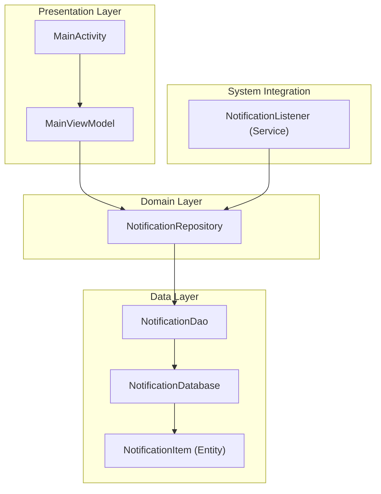
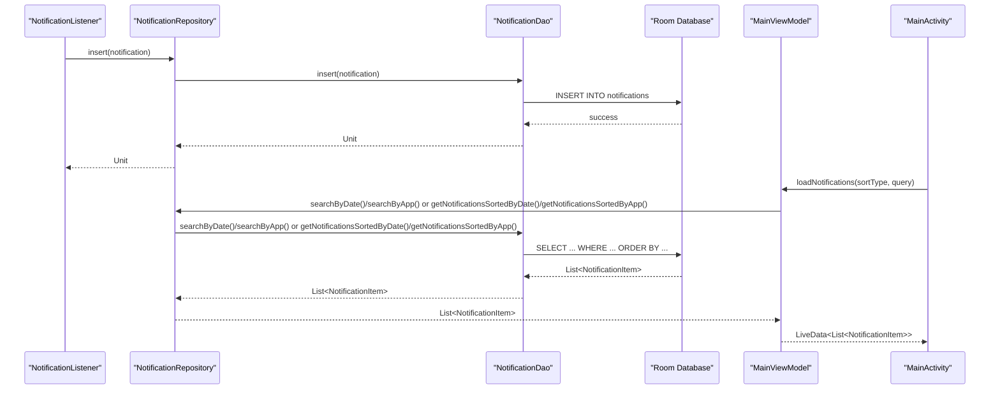
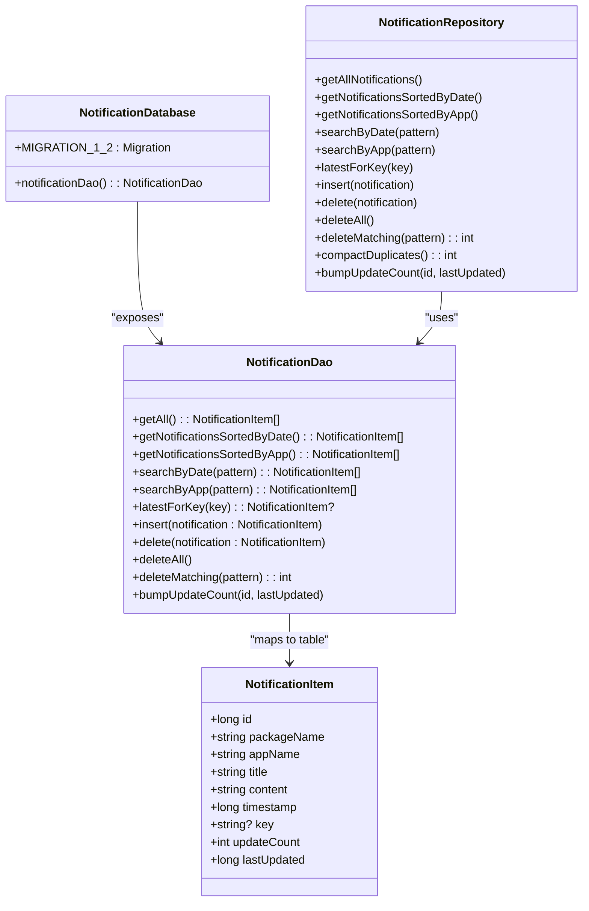

Now I have a comprehensive understanding of the changes. Let me update the documentation to reflect the enhanced NotificationDao.kt with search query support, duplicate compaction methods, and improved performance through proper indexing.

# Data Access Objects

<cite>
**Referenced Files in This Document**
- [NotificationDao.kt](file://app/src/main/java/com/notificationlog/data/NotificationDao.kt)
- [NotificationDatabase.kt](file://app/src/main/java/com/notificationlog/data/NotificationDatabase.kt)
- [NotificationItem.kt](file://app/src/main/java/com/notificationlog/model/NotificationItem.kt)
- [NotificationRepository.kt](file://app/src/main/java/com/notificationlog/repository/NotificationRepository.kt)
- [NotificationApp.kt](file://app/src/main/java/com/notificationlog/NotificationApp.kt)
- [MainViewModel.kt](file://app/src/main/java/com/notificationlog/MainViewModel.kt)
- [MainActivity.kt](file://app/src/main/java/com/notificationlog/MainActivity.kt)
- [NotificationListener.kt](file://app/src/main/java/com/notificationlog/NotificationListener.kt)
- [build.gradle](file://app/build.gradle)
</cite>

## Update Summary
**Changes Made**
- Added comprehensive search query functionality with LIKE pattern matching
- Implemented duplicate compaction methods for data cleanup and optimization
- Enhanced indexing strategy with proper database indexes for performance
- Added update tracking fields (updateCount, lastUpdated) for notification deduplication
- Expanded DAO methods to support bulk operations and advanced filtering

## Table of Contents
1. [Introduction](#introduction)
2. [Project Structure](#project-structure)
3. [Core Components](#core-components)
4. [Architecture Overview](#architecture-overview)
5. [Detailed Component Analysis](#detailed-component-analysis)
6. [Search and Filtering Capabilities](#search-and-filtering-capabilities)
7. [Duplicate Management and Compaction](#duplicate-management-and-compaction)
8. [Performance Optimization and Indexing](#performance-optimization-and-indexing)
9. [Dependency Analysis](#dependency-analysis)
10. [Performance Considerations](#performance-considerations)
11. [Troubleshooting Guide](#troubleshooting-guide)
12. [Conclusion](#conclusion)

## Introduction
This document provides comprehensive Data Access Object (DAO) documentation for the enhanced NotificationDao interface implementation used in the Notification Log application. The DAO now includes advanced search capabilities, duplicate management features, and optimized performance through proper indexing strategies. It focuses on CRUD operations, sophisticated query methods with LIKE pattern matching, parameter binding, SQL injection prevention via Room's type-safe query system, transaction handling, batch operations, and performance optimization techniques.

## Project Structure
The application follows a layered architecture with enhanced data access capabilities:
- Model: NotificationItem entity mapped to the "notifications" table with deduplication support.
- Data: Room database with migration support and DAO definition.
- Repository: Encapsulates DAO usage and exposes suspend-friendly APIs including compaction operations.
- Presentation: ViewModel and Activity orchestrate coroutines and UI updates with search state management.
- Service: NotificationListener captures system notifications and inserts them into the database.

**Diagram sources**
- [NotificationDao.kt:1-68](file://app/src/main/java/com/notificationlog/data/NotificationDao.kt#L1-L68)
- [NotificationDatabase.kt:1-43](file://app/src/main/java/com/notificationlog/data/NotificationDatabase.kt#L1-L43)
- [NotificationItem.kt:1-35](file://app/src/main/java/com/notificationlog/model/NotificationItem.kt#L1-L35)
- [NotificationRepository.kt:1-92](file://app/src/main/java/com/notificationlog/repository/NotificationRepository.kt#L1-L92)
- [NotificationApp.kt:1-28](file://app/src/main/java/com/notificationlog/NotificationApp.kt#L1-L28)
- [MainViewModel.kt:1-285](file://app/src/main/java/com/notificationlog/MainViewModel.kt#L1-L285)
- [MainActivity.kt:1-717](file://app/src/main/java/com/notificationlog/MainActivity.kt#L1-L717)
- [NotificationListener.kt:1-173](file://app/src/main/java/com/notificationlog/NotificationListener.kt#L1-L173)

## Core Components
This section documents the enhanced DAO contract and its expanded usage across the application.

- NotificationDao
  - Purpose: Defines type-safe queries and operations against the "notifications" table with advanced search and management capabilities.
  - Implemented by Room at compile-time using KSP.
  - Exposes suspend functions for asynchronous database operations.
  - **Enhanced**: Now includes search queries, duplicate detection, and bulk operations.

- NotificationDatabase
  - Declares the Room database with migration support from v1 to v2.
  - **Enhanced**: Includes migration logic for adding deduplication fields and indexes.

- NotificationItem
  - Entity mapped to the "notifications" table with primary key and fields for package/app names, title, content, timestamp, optional key, update tracking, and deduplication support.
  - **Enhanced**: Added updateCount and lastUpdated fields for tracking repeated notifications.

- NotificationRepository
  - Wraps DAO calls and exposes suspend-friendly methods to the ViewModel.
  - **Enhanced**: Includes compaction operations and bulk delete functionality.

- NotificationApp
  - Initializes Room database and exposes a global repository instance.

- MainViewModel and MainActivity
  - Drive UI actions and lifecycle-aware coroutines to load, sort, search, and display notifications.
  - **Enhanced**: Includes search state management and bulk operation handling.

**Section sources**
- [NotificationDao.kt:1-68](file://app/src/main/java/com/notificationlog/data/NotificationDao.kt#L1-L68)
- [NotificationDatabase.kt:1-43](file://app/src/main/java/com/notificationlog/data/NotificationDatabase.kt#L1-L43)
- [NotificationItem.kt:1-35](file://app/src/main/java/com/notificationlog/model/NotificationItem.kt#L1-L35)
- [NotificationRepository.kt:1-92](file://app/src/main/java/com/notificationlog/repository/NotificationRepository.kt#L1-L92)
- [NotificationApp.kt:1-28](file://app/src/main/java/com/notificationlog/NotificationApp.kt#L1-L28)
- [MainViewModel.kt:1-285](file://app/src/main/java/com/notificationlog/MainViewModel.kt#L1-L285)
- [MainActivity.kt:1-717](file://app/src/main/java/com/notificationlog/MainActivity.kt#L1-L717)

## Architecture Overview
The DAO sits at the boundary between the domain and persistence layers with enhanced search and management capabilities. Queries are executed asynchronously via suspend functions, ensuring UI thread safety. The NotificationListener captures system notifications and inserts them into the database, while the UI loads, sorts, searches, and manages notifications using the DAO.

**Diagram sources**
- [NotificationListener.kt:139-149](file://app/src/main/java/com/notificationlog/NotificationListener.kt#L139-L149)
- [NotificationRepository.kt:10-22](file://app/src/main/java/com/notificationlog/repository/NotificationRepository.kt#L10-L22)
- [NotificationDao.kt:11-43](file://app/src/main/java/com/notificationlog/data/NotificationDao.kt#L11-L43)
- [MainViewModel.kt:133-161](file://app/src/main/java/com/notificationlog/MainViewModel.kt#L133-L161)
- [MainActivity.kt:1-717](file://app/src/main/java/com/notificationlog/MainActivity.kt#L1-L717)

## Detailed Component Analysis

### NotificationDao: Enhanced CRUD and Query Methods
- Insert Operations
  - Signature: suspend fun insert(notification: NotificationItem)
  - Behavior: Inserts a single NotificationItem into the "notifications" table. Uses OnConflictStrategy.REPLACE to handle duplicates.
  - Notes: No explicit transaction block is needed; Room batches operations efficiently.

- Delete Operations
  - Single item: suspend fun delete(notification: NotificationItem)
  - All items: suspend fun deleteAll()
  - **New**: Bulk delete matching pattern: suspend fun deleteMatching(pattern: String): Int
    - Deletes every row that matches the search criteria, returning the count of deleted rows.

- Query Operations
  - Basic queries:
    - suspend fun getAll(): List<NotificationItem>
    - suspend fun getNotificationsSortedByDate(): List<NotificationItem>
    - suspend fun getNotificationsSortedByApp(): List<NotificationItem>
  - **New**: Search queries:
    - suspend fun searchByDate(pattern: String): List<NotificationItem>
    - suspend fun searchByApp(pattern: String): List<NotificationItem>
  - **New**: Duplicate management:
    - suspend fun latestForKey(key: String): NotificationItem?
    - suspend fun bumpUpdateCount(id: Long, lastUpdated: Long)

- Query semantics and ordering
  - All query methods return lists sorted by timestamp descending with stable tie-breaking using id DESC.
  - getNotificationsSortedByApp additionally orders by appName ascending, then timestamp descending, then id DESC.
  - Search queries apply LIKE pattern matching across appName, title, content, and packageName fields.

- Parameter binding and SQL injection prevention
  - All queries are defined using Room's @Query annotation with compile-time verification.
  - Parameters are bound safely with proper escaping for LIKE patterns.
  - The escape character '\' is used to prevent SQL injection and properly handle special characters.

- Transaction handling
  - Room executes each @Query and @Insert/@Delete annotated method in a single transaction by default.
  - For multi-statement atomicity across multiple DAO calls, wrap them inside a single suspend function or use a transaction block at the database level if needed.

- Async patterns and coroutine integration
  - All DAO methods are suspend functions, enabling seamless integration with coroutines.
  - The ViewModel launches IO dispatcher and posts results to Main for UI updates.

- Pagination strategies
  - Current DAO does not expose paginated queries. To paginate, add LIMIT and OFFSET to the @Query and introduce page number and page size parameters to the DAO methods.

- Result set processing
  - DAO returns List<NotificationItem>. The ViewModel transforms the list into LiveData for UI consumption.

**Section sources**
- [NotificationDao.kt:1-68](file://app/src/main/java/com/notificationlog/data/NotificationDao.kt#L1-L68)
- [NotificationRepository.kt:1-92](file://app/src/main/java/com/notificationlog/repository/NotificationRepository.kt#L1-L92)
- [MainViewModel.kt:133-161](file://app/src/main/java/com/notificationlog/MainViewModel.kt#L133-L161)

### NotificationDatabase and Entity Mapping
- Database declaration
  - @Database with NotificationItem as an entity and exposes notificationDao().
  - **Enhanced**: Version 2 with migration support from v1 to v2.

- Entity mapping
  - @Entity(tableName = "notifications") maps NotificationItem to the "notifications" table.
  - @PrimaryKey(autoGenerate = true) defines the id field as auto-incremented.
  - **Enhanced**: Added indices for key and timestamp fields for performance optimization.

- Migration support
  - **New**: MIGRATION_1_2 adds updateCount and lastUpdated columns.
  - Creates indexes on key and timestamp fields for improved query performance.

**Section sources**
- [NotificationDatabase.kt:1-43](file://app/src/main/java/com/notificationlog/data/NotificationDatabase.kt#L1-L43)
- [NotificationItem.kt:1-35](file://app/src/main/java/com/notificationlog/model/NotificationItem.kt#L1-L35)

### Repository and Application Initialization
- Repository
  - Delegates DAO calls to the database's notificationDao() and exposes suspend methods to the ViewModel.
  - **Enhanced**: Includes compaction operations and bulk delete functionality.

- Application initialization
  - NotificationApp builds the Room database and initializes the repository singleton.

**Section sources**
- [NotificationRepository.kt:1-92](file://app/src/main/java/com/notificationlog/repository/NotificationRepository.kt#L1-L92)
- [NotificationApp.kt:1-28](file://app/src/main/java/com/notificationlog/NotificationApp.kt#L1-L28)

### ViewModel and UI Integration
- Sorting options
  - SortType enum supports DATE and APP modes.
  - loadNotifications chooses the appropriate DAO method based on SortType and current query state.
  - **Enhanced**: Integrates search functionality with sorting options.

- Error handling
  - CoroutineExceptionHandler posts error messages to UI.
  - **Enhanced**: Handles errors for new search and compaction operations.

- UI triggers
  - MainActivity observes LiveData and updates RecyclerView.
  - Menu actions trigger sorting, searching, and refresh operations.

**Section sources**
- [MainViewModel.kt:133-161](file://app/src/main/java/com/notificationlog/MainViewModel.kt#L133-L161)
- [MainViewModel.kt:163-181](file://app/src/main/java/com/notificationlog/MainViewModel.kt#L163-L181)
- [MainActivity.kt:1-717](file://app/src/main/java/com/notificationlog/MainActivity.kt#L1-L717)

### NotificationListener Integration
- Captures StatusBarNotification events and constructs NotificationItem.
- Inserts into the database via repository.insert and broadcasts updates to the UI.

**Section sources**
- [NotificationListener.kt:109-153](file://app/src/main/java/com/notificationlog/NotificationListener.kt#L109-L153)

## Search and Filtering Capabilities

### Pattern-Based Search Implementation
The enhanced NotificationDao provides sophisticated search capabilities through LIKE pattern matching:

- **searchByDate(pattern: String)**: Searches across appName, title, content, and packageName fields with date-based sorting.
- **searchByApp(pattern: String)**: Searches across the same fields but sorts by app name first, then timestamp.
- **deleteMatching(pattern: String)**: Performs bulk deletion based on the same search criteria.

### Pattern Escaping and Security
- All search patterns are automatically escaped to prevent SQL injection.
- Special characters like %, _, and \ are properly handled.
- The pattern is wrapped with % wildcards for substring matching.

### Search Performance Optimization
- Uses ESCAPE '\\' clause to handle special characters in LIKE queries.
- Leverages existing indexes on timestamp and key fields where applicable.
- Maintains consistent sorting behavior with base query methods.

**Section sources**
- [NotificationDao.kt:20-39](file://app/src/main/java/com/notificationlog/data/NotificationDao.kt#L20-L39)
- [NotificationDao.kt:54-63](file://app/src/main/java/com/notificationlog/data/NotificationDao.kt#L54-L63)
- [MainViewModel.kt:171-181](file://app/src/main/java/com/notificationlog/MainViewModel.kt#L171-L181)

## Duplicate Management and Compaction

### Deduplication Strategy
The system implements a sophisticated deduplication mechanism to handle repeated notifications:

- **Key-based Identification**: Notifications with the same key are considered duplicates.
- **Update Tracking**: Each notification tracks how many times it has been updated (updateCount).
- **Timestamp Management**: lastUpdated field tracks when the notification was last modified.

### Compaction Operations
- **latestForKey(key: String)**: Retrieves the most recent version of a notification with a specific key.
- **bumpUpdateCount(id: Long, lastUpdated: Long)**: Increments the update counter for existing notifications.
- **compactDuplicates()**: Performs bulk deduplication by collapsing repeated notifications into single entries.

### Compaction Algorithm
The compaction process uses a temporary table approach for optimal performance:
1. Groups notifications by packageName, key, title, and content.
2. Counts occurrences and identifies the latest timestamp.
3. Updates the surviving rows with aggregated data.
4. Removes duplicate rows.
5. Returns the count of removed rows for UI feedback.

**Section sources**
- [NotificationDao.kt:41-49](file://app/src/main/java/com/notificationlog/data/NotificationDao.kt#L41-L49)
- [NotificationRepository.kt:44-85](file://app/src/main/java/com/notificationlog/repository/NotificationRepository.kt#L44-L85)
- [NotificationItem.kt:9-17](file://app/src/main/java/com/notificationlog/model/NotificationItem.kt#L9-L17)

## Performance Optimization and Indexing

### Database Schema Enhancements
- **Index on key field**: Optimizes lookups for duplicate detection and latest notification retrieval.
- **Index on timestamp field**: Improves chronological sorting and date-based queries.
- **Composite sorting**: All queries use timestamp DESC, id DESC for stable ordering.

### Query Optimization Strategies
- **Stable tie-breaking**: Using id DESC ensures consistent ordering even for notifications posted simultaneously.
- **Efficient LIKE patterns**: Proper escaping prevents full table scans where possible.
- **Batch operations**: Bulk delete and update operations reduce database round trips.

### Memory and Storage Optimization
- **Deduplication reduces storage**: Repeated notifications are collapsed into single entries with counters.
- **Efficient compaction**: Temporary table approach minimizes memory footprint during large-scale operations.
- **Lazy loading**: Suspend functions enable efficient resource management.

**Section sources**
- [NotificationItem.kt:19-22](file://app/src/main/java/com/notificationlog/model/NotificationItem.kt#L19-L22)
- [NotificationDatabase.kt:21-39](file://app/src/main/java/com/notificationlog/data/NotificationDatabase.kt#L21-L39)
- [NotificationDao.kt:9-18](file://app/src/main/java/com/notificationlog/data/NotificationDao.kt#L9-L18)

## Dependency Analysis
The enhanced DAO depends on Room's compile-time code generation and the NotificationItem entity with deduplication support. The ViewModel and Repository layers depend on the DAO for data access, including search and compaction operations. The NotificationListener depends on the Repository for insertion.

**Diagram sources**
- [NotificationDao.kt:1-68](file://app/src/main/java/com/notificationlog/data/NotificationDao.kt#L1-L68)
- [NotificationDatabase.kt:1-43](file://app/src/main/java/com/notificationlog/data/NotificationDatabase.kt#L1-L43)
- [NotificationItem.kt:1-35](file://app/src/main/java/com/notificationlog/model/NotificationItem.kt#L1-L35)
- [NotificationRepository.kt:1-92](file://app/src/main/java/com/notificationlog/repository/NotificationRepository.kt#L1-L92)

**Section sources**
- [NotificationDao.kt:1-68](file://app/src/main/java/com/notificationlog/data/NotificationDao.kt#L1-L68)
- [NotificationDatabase.kt:1-43](file://app/src/main/java/com/notificationlog/data/NotificationDatabase.kt#L1-L43)
- [NotificationItem.kt:1-35](file://app/src/main/java/com/notificationlog/model/NotificationItem.kt#L1-L35)
- [NotificationRepository.kt:1-92](file://app/src/main/java/com/notificationlog/repository/NotificationRepository.kt#L1-L92)

## Performance Considerations
- **Query optimization**
  - Existing indexes on timestamp and key fields provide optimal performance for common queries.
  - Stable sorting with id DESC ensures consistent results across multiple loads.
  - LIKE pattern queries benefit from proper escaping and index utilization.

- **Pagination**
  - Current DAO does not expose paginated queries. To paginate, add LIMIT and OFFSET to the @Query and introduce page number and page size parameters to the DAO methods.

- **Batch operations**
  - Prefer bulk delete operations via deleteMatching() over repeated single deletes when removing filtered results.
  - Use compactDuplicates() for large-scale deduplication operations.

- **Concurrency**
  - DAO methods are suspend functions; keep work off the main thread using Dispatchers.IO.
  - Compaction operations run within transactions to ensure data consistency.

- **Schema evolution**
  - Room migrations handle schema changes gracefully; the current version is 2 with proper migration from v1.

- **Memory management**
  - Deduplication significantly reduces memory footprint for applications that send repeated notifications.
  - Temporary tables in compaction operations are properly cleaned up after use.

[No sources needed since this section provides general guidance]

## Troubleshooting Guide
- **SQL injection prevention**
  - The DAO uses @Query with compile-time verification and safe parameter binding; avoid dynamic SQL concatenation.
  - All LIKE patterns are automatically escaped to prevent injection attacks.

- **Error handling in UI**
  - MainViewModel uses CoroutineExceptionHandler to post error messages to LiveData for display.
  - Enhanced error handling for search, compaction, and bulk operations.

- **Listener disconnection**
  - NotificationListener handles onListenerDisconnected by showing a warning notification and broadcasting a disconnect event.

- **Performance issues**
  - Monitor database size growth; consider periodic compaction for high-volume notification scenarios.
  - Use Android Studio's Database Inspector to analyze query performance and index usage.

**Section sources**
- [MainViewModel.kt:61-63](file://app/src/main/java/com/notificationlog/MainViewModel.kt#L61-L63)
- [NotificationListener.kt:44-65](file://app/src/main/java/com/notificationlog/NotificationListener.kt#L44-L65)

## Conclusion
The enhanced NotificationDao provides a comprehensive, type-safe interface for notification data access using Room with advanced search capabilities, duplicate management, and optimized performance. Its suspend-based API integrates cleanly with coroutines, enabling responsive UI updates while handling complex search queries and bulk operations. The addition of deduplication support, proper indexing, and compaction features significantly improves both performance and data integrity for applications dealing with high volumes of repeated notifications. The system now offers robust search functionality, efficient data management, and scalable architecture suitable for production environments with demanding notification logging requirements.