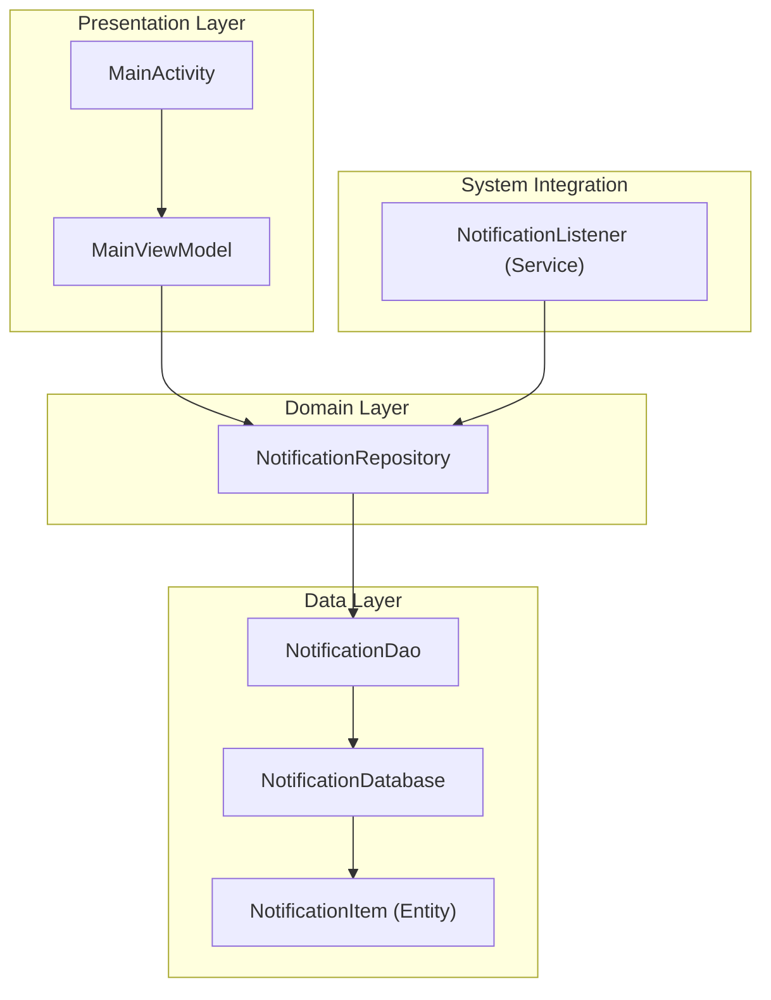
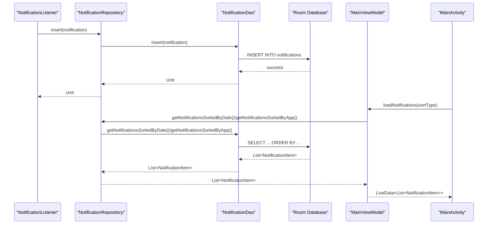
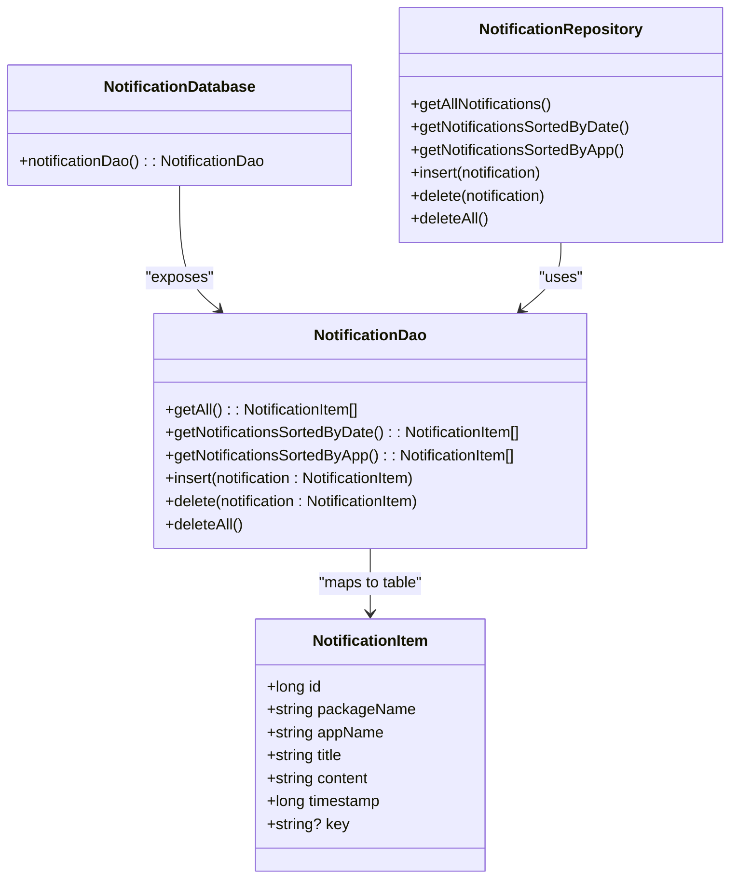

# Data Access Objects

<cite>
**Referenced Files in This Document**
- [NotificationDao.kt](file://app/src/main/java/com/notificationlog/data/NotificationDao.kt)
- [NotificationDatabase.kt](file://app/src/main/java/com/notificationlog/data/NotificationDatabase.kt)
- [NotificationItem.kt](file://app/src/main/java/com/notificationlog/model/NotificationItem.kt)
- [NotificationRepository.kt](file://app/src/main/java/com/notificationlog/repository/NotificationRepository.kt)
- [NotificationApp.kt](file://app/src/main/java/com/notificationlog/NotificationApp.kt)
- [MainViewModel.kt](file://app/src/main/java/com/notificationlog/MainViewModel.kt)
- [MainActivity.kt](file://app/src/main/java/com/notificationlog/MainActivity.kt)
- [NotificationListener.kt](file://app/src/main/java/com/notificationlog/NotificationListener.kt)
- [build.gradle](file://app/build.gradle)
</cite>

## Table of Contents
1. [Introduction](#introduction)
2. [Project Structure](#project-structure)
3. [Core Components](#core-components)
4. [Architecture Overview](#architecture-overview)
5. [Detailed Component Analysis](#detailed-component-analysis)
6. [Dependency Analysis](#dependency-analysis)
7. [Performance Considerations](#performance-considerations)
8. [Troubleshooting Guide](#troubleshooting-guide)
9. [Conclusion](#conclusion)

## Introduction
This document provides comprehensive Data Access Object (DAO) documentation for the NotificationDao interface implementation used in the Notification Log application. It focuses on the CRUD operations (insert, delete, update, and query), the supported query methods, parameter binding, SQL injection prevention via Room’s type-safe query system, transaction handling, and performance optimization techniques. It also covers async operation patterns using suspend functions and coroutines, pagination strategies, result set processing, and practical guidance for query optimization and indexing.

## Project Structure
The application follows a layered architecture:
- Model: NotificationItem entity mapped to the “notifications” table.
- Data: Room database and DAO definition.
- Repository: Encapsulates DAO usage and exposes suspend-friendly APIs.
- Presentation: ViewModel and Activity orchestrate coroutines and UI updates.
- Service: NotificationListener captures system notifications and inserts them into the database.

**Diagram sources**
- [NotificationDao.kt:1-26](file://app/src/main/java/com/notificationlog/data/NotificationDao.kt#L1-L26)
- [NotificationDatabase.kt:1-10](file://app/src/main/java/com/notificationlog/data/NotificationDatabase.kt#L1-L10)
- [NotificationItem.kt:1-19](file://app/src/main/java/com/notificationlog/model/NotificationItem.kt#L1-L19)
- [NotificationRepository.kt:1-28](file://app/src/main/java/com/notificationlog/repository/NotificationRepository.kt#L1-L28)
- [NotificationApp.kt:1-28](file://app/src/main/java/com/notificationlog/NotificationApp.kt#L1-L28)
- [MainViewModel.kt:1-121](file://app/src/main/java/com/notificationlog/MainViewModel.kt#L1-L121)
- [MainActivity.kt:1-717](file://app/src/main/java/com/notificationlog/MainActivity.kt#L1-L717)
- [NotificationListener.kt:1-173](file://app/src/main/java/com/notificationlog/NotificationListener.kt#L1-L173)

**Section sources**
- [NotificationDao.kt:1-26](file://app/src/main/java/com/notificationlog/data/NotificationDao.kt#L1-L26)
- [NotificationDatabase.kt:1-10](file://app/src/main/java/com/notificationlog/data/NotificationDatabase.kt#L1-L10)
- [NotificationItem.kt:1-19](file://app/src/main/java/com/notificationlog/model/NotificationItem.kt#L1-L19)
- [NotificationRepository.kt:1-28](file://app/src/main/java/com/notificationlog/repository/NotificationRepository.kt#L1-L28)
- [NotificationApp.kt:1-28](file://app/src/main/java/com/notificationlog/NotificationApp.kt#L1-L28)
- [MainViewModel.kt:1-121](file://app/src/main/java/com/notificationlog/MainViewModel.kt#L1-L121)
- [MainActivity.kt:1-717](file://app/src/main/java/com/notificationlog/MainActivity.kt#L1-L717)
- [NotificationListener.kt:1-173](file://app/src/main/java/com/notificationlog/NotificationListener.kt#L1-L173)

## Core Components
This section documents the DAO contract and its usage across the application.

- NotificationDao
  - Purpose: Defines type-safe queries and operations against the “notifications” table.
  - Implemented by Room at compile-time using KSP.
  - Exposes suspend functions for asynchronous database operations.

- NotificationDatabase
  - Declares the Room database and exposes the DAO.

- NotificationItem
  - Entity mapped to the “notifications” table with primary key and fields for package/app names, title, content, timestamp, and optional key.

- NotificationRepository
  - Wraps DAO calls and exposes suspend-friendly methods to the ViewModel.

- NotificationApp
  - Initializes Room database and exposes a global repository instance.

- MainViewModel and MainActivity
  - Drive UI actions and lifecycle-aware coroutines to load, sort, and display notifications.

**Section sources**
- [NotificationDao.kt:1-26](file://app/src/main/java/com/notificationlog/data/NotificationDao.kt#L1-L26)
- [NotificationDatabase.kt:1-10](file://app/src/main/java/com/notificationlog/data/NotificationDatabase.kt#L1-L10)
- [NotificationItem.kt:1-19](file://app/src/main/java/com/notificationlog/model/NotificationItem.kt#L1-L19)
- [NotificationRepository.kt:1-28](file://app/src/main/java/com/notificationlog/repository/NotificationRepository.kt#L1-L28)
- [NotificationApp.kt:1-28](file://app/src/main/java/com/notificationlog/NotificationApp.kt#L1-L28)
- [MainViewModel.kt:1-121](file://app/src/main/java/com/notificationlog/MainViewModel.kt#L1-L121)
- [MainActivity.kt:1-717](file://app/src/main/java/com/notificationlog/MainActivity.kt#L1-L717)

## Architecture Overview
The DAO sits at the boundary between the domain and persistence layers. Queries are executed asynchronously via suspend functions, ensuring UI thread safety. The NotificationListener captures system notifications and inserts them into the database, while the UI loads and sorts notifications using the DAO.

**Diagram sources**
- [NotificationListener.kt:139-149](file://app/src/main/java/com/notificationlog/NotificationListener.kt#L139-L149)
- [NotificationRepository.kt:16-26](file://app/src/main/java/com/notificationlog/repository/NotificationRepository.kt#L16-L26)
- [NotificationDao.kt:18-25](file://app/src/main/java/com/notificationlog/data/NotificationDao.kt#L18-L25)
- [MainViewModel.kt:59-77](file://app/src/main/java/com/notificationlog/MainViewModel.kt#L59-L77)
- [MainActivity.kt:57-66](file://app/src/main/java/com/notificationlog/MainActivity.kt#L57-L66)

## Detailed Component Analysis

### NotificationDao: CRUD and Query Methods
- Insert
  - Signature: suspend fun insert(notification: NotificationItem)
  - Behavior: Inserts a single NotificationItem into the “notifications” table. Uses OnConflictStrategy.REPLACE to handle duplicates.
  - Notes: No explicit transaction block is needed; Room batches operations efficiently. Batch insert is supported via DAO method overloads (not shown here).

- Delete
  - Single item: suspend fun delete(notification: NotificationItem)
  - All items: suspend fun deleteAll()

- Query
  - suspend fun getAll(): List<NotificationItem>
  - suspend fun getNotificationsSortedByDate(): List<NotificationItem>
  - suspend fun getNotificationsSortedByApp(): List<NotificationItem>

- Query semantics and ordering
  - All query methods return a list sorted by timestamp descending.
  - getNotificationsSortedByApp additionally orders by appName ascending, then timestamp descending.

- Parameter binding and SQL injection prevention
  - All queries are defined using Room’s @Query annotation with compile-time verification.
  - Parameters are bound safely; there is no dynamic SQL construction in the provided DAO, eliminating SQL injection risks.

- Transaction handling
  - Room executes each @Query and @Insert/@Delete annotated method in a single transaction by default.
  - For multi-statement atomicity across multiple DAO calls, wrap them inside a single suspend function or use a transaction block at the database level if needed.

- Async patterns and coroutine integration
  - All DAO methods are suspend functions, enabling seamless integration with coroutines.
  - The ViewModel launches IO dispatcher and posts results to Main for UI updates.

- Pagination strategies
  - Current DAO does not expose paginated queries. To paginate, add LIMIT and OFFSET to the @Query and introduce page number and page size parameters to the DAO methods.

- Result set processing
  - DAO returns List<NotificationItem>. The ViewModel transforms the list into LiveData for UI consumption.

**Section sources**
- [NotificationDao.kt:1-26](file://app/src/main/java/com/notificationlog/data/NotificationDao.kt#L1-L26)
- [NotificationRepository.kt:1-28](file://app/src/main/java/com/notificationlog/repository/NotificationRepository.kt#L1-L28)
- [MainViewModel.kt:59-77](file://app/src/main/java/com/notificationlog/MainViewModel.kt#L59-L77)

### NotificationDatabase and Entity Mapping
- Database declaration
  - @Database with NotificationItem as an entity and exposes notificationDao().
- Entity mapping
  - @Entity(tableName = "notifications") maps NotificationItem to the “notifications” table.
  - @PrimaryKey(autoGenerate = true) defines the id field as auto-incremented.

- Indexing considerations
  - The current schema does not define explicit indexes.
  - Recommended indexes for performance:
    - Index on timestamp for chronological queries.
    - Index on appName for app-based sorting/filtering.
    - Composite index on (appName, timestamp) to optimize getNotificationsSortedByApp.

**Section sources**
- [NotificationDatabase.kt:1-10](file://app/src/main/java/com/notificationlog/data/NotificationDatabase.kt#L1-L10)
- [NotificationItem.kt:1-19](file://app/src/main/java/com/notificationlog/model/NotificationItem.kt#L1-L19)

### Repository and Application Initialization
- Repository
  - Delegates DAO calls to the database’s notificationDao() and exposes suspend methods to the ViewModel.
- Application initialization
  - NotificationApp builds the Room database and initializes the repository singleton.

**Section sources**
- [NotificationRepository.kt:1-28](file://app/src/main/java/com/notificationlog/repository/NotificationRepository.kt#L1-L28)
- [NotificationApp.kt:1-28](file://app/src/main/java/com/notificationlog/NotificationApp.kt#L1-L28)

### ViewModel and UI Integration
- Sorting options
  - SortType enum supports DATE and APP modes.
  - loadNotifications chooses the appropriate DAO method based on SortType.
- Error handling
  - CoroutineExceptionHandler posts error messages to UI.
- UI triggers
  - MainActivity observes LiveData and updates RecyclerView.
  - Menu actions trigger sorting and refresh.

**Section sources**
- [MainViewModel.kt:59-106](file://app/src/main/java/com/notificationlog/MainViewModel.kt#L59-L106)
- [MainActivity.kt:175-195](file://app/src/main/java/com/notificationlog/MainActivity.kt#L175-L195)

### NotificationListener Integration
- Captures StatusBarNotification events and constructs NotificationItem.
- Inserts into the database via repository.insert and broadcasts updates to the UI.

**Section sources**
- [NotificationListener.kt:109-153](file://app/src/main/java/com/notificationlog/NotificationListener.kt#L109-L153)

## Dependency Analysis
The DAO depends on Room’s compile-time code generation and the NotificationItem entity. The ViewModel and Repository layers depend on the DAO for data access. The NotificationListener depends on the Repository for insertion.

**Diagram sources**
- [NotificationDao.kt:1-26](file://app/src/main/java/com/notificationlog/data/NotificationDao.kt#L1-L26)
- [NotificationDatabase.kt:1-10](file://app/src/main/java/com/notificationlog/data/NotificationDatabase.kt#L1-L10)
- [NotificationItem.kt:1-19](file://app/src/main/java/com/notificationlog/model/NotificationItem.kt#L1-L19)
- [NotificationRepository.kt:1-28](file://app/src/main/java/com/notificationlog/repository/NotificationRepository.kt#L1-L28)

**Section sources**
- [NotificationDao.kt:1-26](file://app/src/main/java/com/notificationlog/data/NotificationDao.kt#L1-L26)
- [NotificationDatabase.kt:1-10](file://app/src/main/java/com/notificationlog/data/NotificationDatabase.kt#L1-L10)
- [NotificationItem.kt:1-19](file://app/src/main/java/com/notificationlog/model/NotificationItem.kt#L1-L19)
- [NotificationRepository.kt:1-28](file://app/src/main/java/com/notificationlog/repository/NotificationRepository.kt#L1-L28)

## Performance Considerations
- Query optimization
  - Add indexes on frequently queried columns:
    - timestamp for chronological sorting.
    - appName for app-based sorting.
    - Composite (appName, timestamp) for optimized app+date sorting.
- Pagination
  - Extend DAO with paged queries using LIMIT and OFFSET parameters to reduce memory footprint for large datasets.
- Batch operations
  - Prefer batch insert via DAO insert over repeated single inserts when ingesting multiple notifications.
- Concurrency
  - DAO methods are suspend functions; keep work off the main thread using Dispatchers.IO.
- Schema evolution
  - Use Room migrations for future schema changes; the current version is 1.

[No sources needed since this section provides general guidance]

## Troubleshooting Guide
- SQL injection prevention
  - The DAO uses @Query with compile-time verification and safe parameter binding; avoid dynamic SQL concatenation.
- Error handling in UI
  - MainViewModel uses CoroutineExceptionHandler to post error messages to LiveData for display.
- Listener disconnection
  - NotificationListener handles onListenerDisconnected by showing a warning notification and broadcasting a disconnect event.

**Section sources**
- [MainViewModel.kt:29-31](file://app/src/main/java/com/notificationlog/MainViewModel.kt#L29-L31)
- [NotificationListener.kt:44-65](file://app/src/main/java/com/notificationlog/NotificationListener.kt#L44-L65)

## Conclusion
The NotificationDao provides a concise, type-safe interface for notification data access using Room. Its suspend-based API integrates cleanly with coroutines, enabling responsive UI updates. While the current implementation focuses on essential CRUD and sorting operations, extending it with pagination, composite indexes, and batch insertions will further improve performance and scalability for larger datasets.