# Data Management

<cite>
**Referenced Files in This Document**
- [NotificationItem.kt](file://app/src/main/java/com/notificationlog/model/NotificationItem.kt)
- [NotificationDao.kt](file://app/src/main/java/com/notificationlog/data/NotificationDao.kt)
- [NotificationDatabase.kt](file://app/src/main/java/com/notificationlog/data/NotificationDatabase.kt)
- [NotificationRepository.kt](file://app/src/main/java/com/notificationlog/repository/NotificationRepository.kt)
- [NotificationApp.kt](file://app/src/main/java/com/notificationlog/NotificationApp.kt)
- [MainViewModel.kt](file://app/src/main/java/com/notificationlog/MainViewModel.kt)
- [MainActivity.kt](file://app/src/main/java/com/notificationlog/MainActivity.kt)
- [NotificationAdapter.kt](file://app/src/main/java/com/notificationlog/adapter/NotificationAdapter.kt)
- [NotificationListener.kt](file://app/src/main/java/com/notificationlog/NotificationListener.kt)
- [DateConverter.kt](file://app/src/main/java/com/notificationlog/DateConverter.kt)
- [AndroidManifest.xml](file://app/src/main/AndroidManifest.xml)
</cite>

## Table of Contents
1. [Introduction](#introduction)
2. [Project Structure](#project-structure)
3. [Core Components](#core-components)
4. [Architecture Overview](#architecture-overview)
5. [Detailed Component Analysis](#detailed-component-analysis)
6. [Dependency Analysis](#dependency-analysis)
7. [Performance Considerations](#performance-considerations)
8. [Troubleshooting Guide](#troubleshooting-guide)
9. [Conclusion](#conclusion)
10. [Appendices](#appendices)

## Introduction
This document describes the data management implementation for NotificationLog’s Room database. It covers the database schema design, entity relationships, and persistence strategies used to store real-time notifications. It documents the NotificationItem model, NotificationDao interface, and the repository pattern implementation. It also explains data access patterns, query optimization techniques, and migration strategies, along with entity relationship diagrams, table specifications, and field definitions. Finally, it addresses data lifecycle management, retention policies, and performance considerations for real-time notification storage, and provides examples of CRUD operations and querying patterns used throughout the application.

## Project Structure
The data layer is organized around Room’s entity, DAO, database, and repository pattern. Supporting components include the application initialization, ViewModel for UI state and data orchestration, RecyclerView adapter for UI rendering, and a NotificationListener service that captures notifications and persists them.

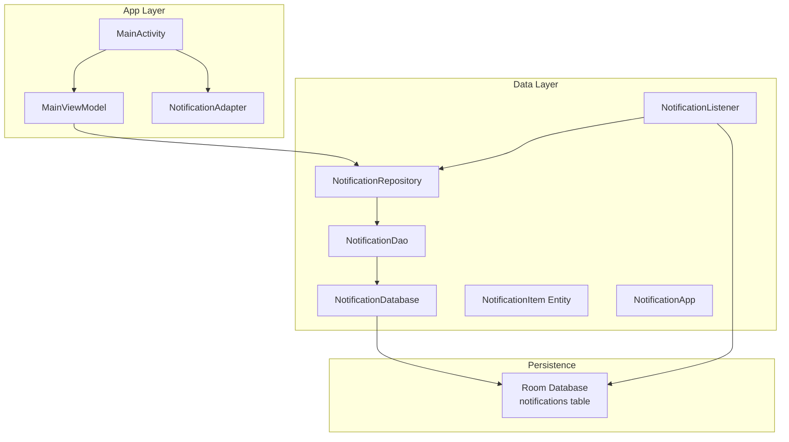

**Diagram sources**
- [MainActivity.kt:1-717](file://app/src/main/java/com/notificationlog/MainActivity.kt#L1-L717)
- [MainViewModel.kt:1-121](file://app/src/main/java/com/notificationlog/MainViewModel.kt#L1-L121)
- [NotificationAdapter.kt:1-59](file://app/src/main/java/com/notificationlog/adapter/NotificationAdapter.kt#L1-L59)
- [NotificationDatabase.kt:1-10](file://app/src/main/java/com/notificationlog/data/NotificationDatabase.kt#L1-L10)
- [NotificationDao.kt:1-26](file://app/src/main/java/com/notificationlog/data/NotificationDao.kt#L1-L26)
- [NotificationItem.kt:1-19](file://app/src/main/java/com/notificationlog/model/NotificationItem.kt#L1-L19)
- [NotificationRepository.kt:1-28](file://app/src/main/java/com/notificationlog/repository/NotificationRepository.kt#L1-L28)
- [NotificationApp.kt:1-28](file://app/src/main/java/com/notificationlog/NotificationApp.kt#L1-L28)
- [NotificationListener.kt:1-173](file://app/src/main/java/com/notificationlog/NotificationListener.kt#L1-L173)

**Section sources**
- [MainActivity.kt:1-717](file://app/src/main/java/com/notificationlog/MainActivity.kt#L1-L717)
- [MainViewModel.kt:1-121](file://app/src/main/java/com/notificationlog/MainViewModel.kt#L1-L121)
- [NotificationAdapter.kt:1-59](file://app/src/main/java/com/notificationlog/adapter/NotificationAdapter.kt#L1-L59)
- [NotificationDatabase.kt:1-10](file://app/src/main/java/com/notificationlog/data/NotificationDatabase.kt#L1-L10)
- [NotificationDao.kt:1-26](file://app/src/main/java/com/notificationlog/data/NotificationDao.kt#L1-L26)
- [NotificationItem.kt:1-19](file://app/src/main/java/com/notificationlog/model/NotificationItem.kt#L1-L19)
- [NotificationRepository.kt:1-28](file://app/src/main/java/com/notificationlog/repository/NotificationRepository.kt#L1-L28)
- [NotificationApp.kt:1-28](file://app/src/main/java/com/notificationlog/NotificationApp.kt#L1-L28)
- [NotificationListener.kt:1-173](file://app/src/main/java/com/notificationlog/NotificationListener.kt#L1-L173)

## Core Components
- NotificationItem: Room entity representing a persisted notification record.
- NotificationDao: DAO interface exposing queries and mutations for notifications.
- NotificationDatabase: Room database definition declaring the entity and providing DAO access.
- NotificationRepository: Repository encapsulating DAO access for the rest of the app.
- NotificationApp: Application initializer that builds the Room database and exposes a singleton repository.
- NotificationListener: Background service that captures notifications and inserts them into the database.
- MainViewModel and MainActivity: UI orchestration and presentation layer that observes and manipulates data.
- NotificationAdapter: RecyclerView adapter that renders notifications efficiently.

**Section sources**
- [NotificationItem.kt:1-19](file://app/src/main/java/com/notificationlog/model/NotificationItem.kt#L1-L19)
- [NotificationDao.kt:1-26](file://app/src/main/java/com/notificationlog/data/NotificationDao.kt#L1-L26)
- [NotificationDatabase.kt:1-10](file://app/src/main/java/com/notificationlog/data/NotificationDatabase.kt#L1-L10)
- [NotificationRepository.kt:1-28](file://app/src/main/java/com/notificationlog/repository/NotificationRepository.kt#L1-L28)
- [NotificationApp.kt:1-28](file://app/src/main/java/com/notificationlog/NotificationApp.kt#L1-L28)
- [NotificationListener.kt:1-173](file://app/src/main/java/com/notificationlog/NotificationListener.kt#L1-L173)
- [MainViewModel.kt:1-121](file://app/src/main/java/com/notificationlog/MainViewModel.kt#L1-L121)
- [MainActivity.kt:1-717](file://app/src/main/java/com/notificationlog/MainActivity.kt#L1-L717)
- [NotificationAdapter.kt:1-59](file://app/src/main/java/com/notificationlog/adapter/NotificationAdapter.kt#L1-L59)

## Architecture Overview
The system follows a layered architecture:
- Presentation layer: MainActivity and MainViewModel manage UI state and user actions.
- Domain/Data layer: Repository mediates between UI and DAO.
- Persistence layer: Room database stores notifications in a single table.

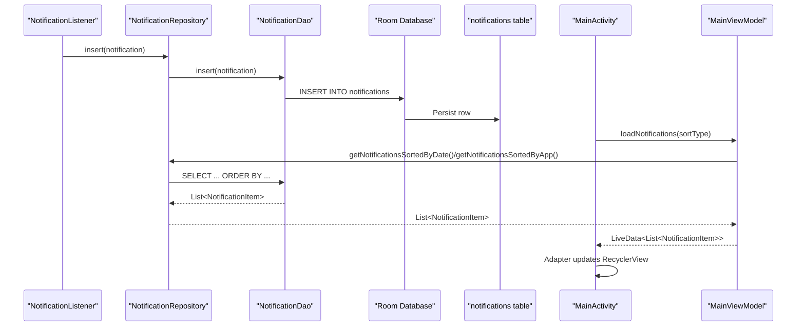

**Diagram sources**
- [NotificationListener.kt:139-149](file://app/src/main/java/com/notificationlog/NotificationListener.kt#L139-L149)
- [NotificationRepository.kt:16-18](file://app/src/main/java/com/notificationlog/repository/NotificationRepository.kt#L16-L18)
- [NotificationDao.kt:18-19](file://app/src/main/java/com/notificationlog/data/NotificationDao.kt#L18-L19)
- [NotificationDao.kt:9-16](file://app/src/main/java/com/notificationlog/data/NotificationDao.kt#L9-L16)
- [MainActivity.kt:59-77](file://app/src/main/java/com/notificationlog/MainActivity.kt#L59-L77)
- [MainViewModel.kt:59-77](file://app/src/main/java/com/notificationlog/MainViewModel.kt#L59-L77)

## Detailed Component Analysis

### Database Schema and Entity Model
- Table name: notifications
- Columns and types:
  - id: INTEGER PRIMARY KEY AUTOINCREMENT (Room auto-generates)
  - packageName: TEXT (non-null)
  - appName: TEXT (non-null)
  - title: TEXT (non-null)
  - content: TEXT (non-null)
  - timestamp: INTEGER (non-null)
  - key: TEXT (nullable)

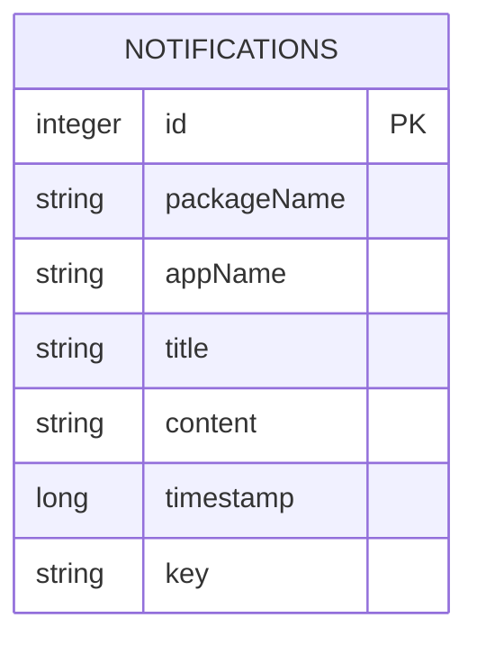

**Diagram sources**
- [NotificationItem.kt:10-19](file://app/src/main/java/com/notificationlog/model/NotificationItem.kt#L10-L19)
- [NotificationDatabase.kt:7-10](file://app/src/main/java/com/notificationlog/data/NotificationDatabase.kt#L7-L10)

**Section sources**
- [NotificationItem.kt:10-19](file://app/src/main/java/com/notificationlog/model/NotificationItem.kt#L10-L19)
- [NotificationDatabase.kt:7-10](file://app/src/main/java/com/notificationlog/data/NotificationDatabase.kt#L7-L10)

### NotificationItem Model
- Purpose: Immutable data carrier for a notification record.
- Key attributes:
  - id: Unique identifier (auto-generated)
  - packageName: Originating app package name
  - appName: Human-readable app name
  - title: Notification title
  - content: Notification content
  - timestamp: Notification post time (milliseconds)
  - key: StatusBarNotification key for deduplication/removal

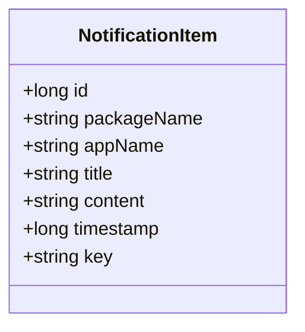

**Diagram sources**
- [NotificationItem.kt:10-19](file://app/src/main/java/com/notificationlog/model/NotificationItem.kt#L10-L19)

**Section sources**
- [NotificationItem.kt:10-19](file://app/src/main/java/com/notificationlog/model/NotificationItem.kt#L10-L19)

### NotificationDao Interface
- Queries:
  - getAll(): Returns all notifications ordered by timestamp descending.
  - getNotificationsSortedByDate(): Alias of getAll().
  - getNotificationsSortedByApp(): Returns notifications ordered by appName ascending, then timestamp descending.
- Mutations:
  - insert(notification): Inserts a new notification; uses REPLACE conflict strategy.
  - delete(notification): Deletes a specific notification.
  - deleteAll(): Clears the entire notifications table.

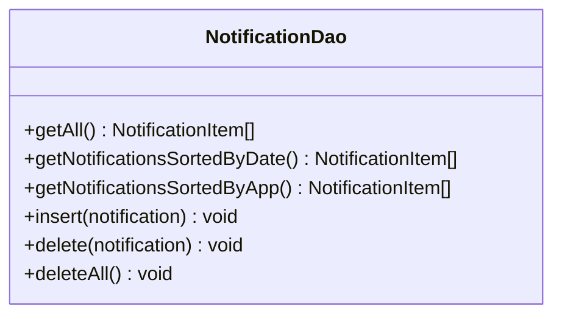

**Diagram sources**
- [NotificationDao.kt:6-26](file://app/src/main/java/com/notificationlog/data/NotificationDao.kt#L6-L26)

**Section sources**
- [NotificationDao.kt:6-26](file://app/src/main/java/com/notificationlog/data/NotificationDao.kt#L6-L26)

### NotificationDatabase
- Declares the entity list and version.
- Exposes notificationDao() for repository and UI access.

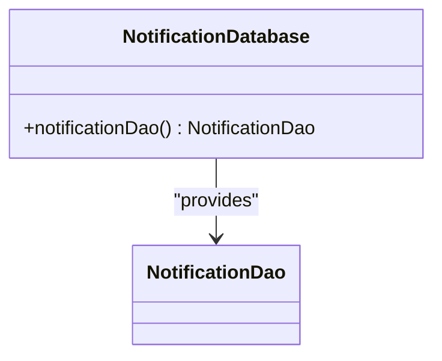

**Diagram sources**
- [NotificationDatabase.kt:7-10](file://app/src/main/java/com/notificationlog/data/NotificationDatabase.kt#L7-L10)

**Section sources**
- [NotificationDatabase.kt:7-10](file://app/src/main/java/com/notificationlog/data/NotificationDatabase.kt#L7-L10)

### Repository Pattern Implementation
- NotificationRepository wraps DAO calls and exposes suspend functions for coroutines.
- Provides:
  - getAllNotifications()
  - getNotificationsSortedByDate()
  - getNotificationsSortedByApp()
  - insert(notification)
  - delete(notification)
  - deleteAll()

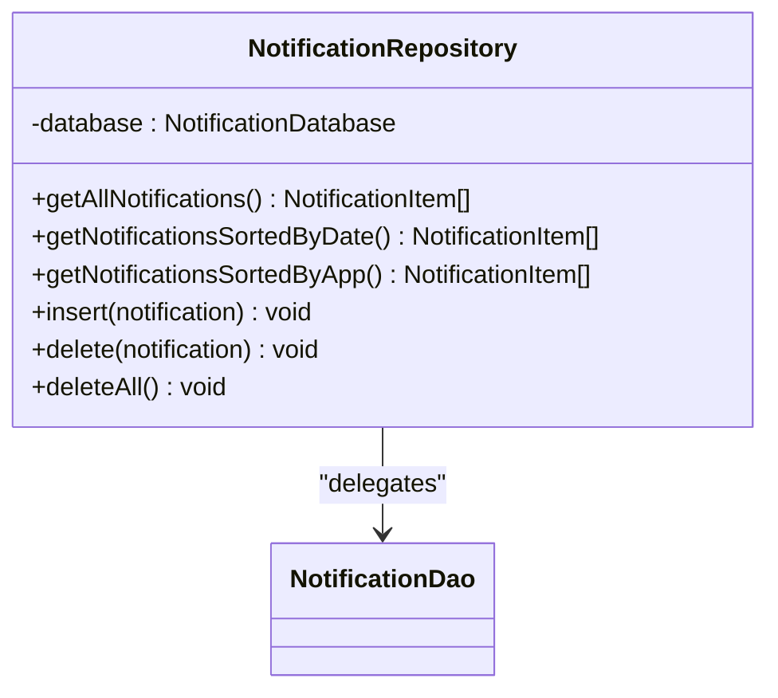

**Diagram sources**
- [NotificationRepository.kt:6-27](file://app/src/main/java/com/notificationlog/repository/NotificationRepository.kt#L6-L27)
- [NotificationDao.kt:6-26](file://app/src/main/java/com/notificationlog/data/NotificationDao.kt#L6-L26)

**Section sources**
- [NotificationRepository.kt:6-27](file://app/src/main/java/com/notificationlog/repository/NotificationRepository.kt#L6-L27)

### Application Initialization and Singleton Repository
- NotificationApp initializes Room database and exposes a singleton repository instance.
- Ensures a single database connection and repository instance across the app lifecycle.

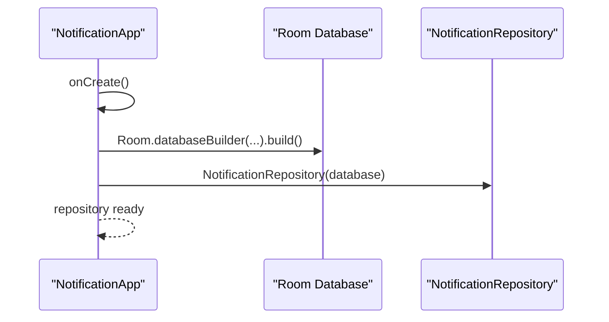

**Diagram sources**
- [NotificationApp.kt:15-27](file://app/src/main/java/com/notificationlog/NotificationApp.kt#L15-L27)

**Section sources**
- [NotificationApp.kt:15-27](file://app/src/main/java/com/notificationlog/NotificationApp.kt#L15-L27)

### Data Access Patterns and UI Integration
- MainViewModel orchestrates data loading and error handling, switching between sort orders.
- MainActivity observes LiveData and updates the RecyclerView via NotificationAdapter.
- Adapter uses DiffUtil to efficiently update lists.

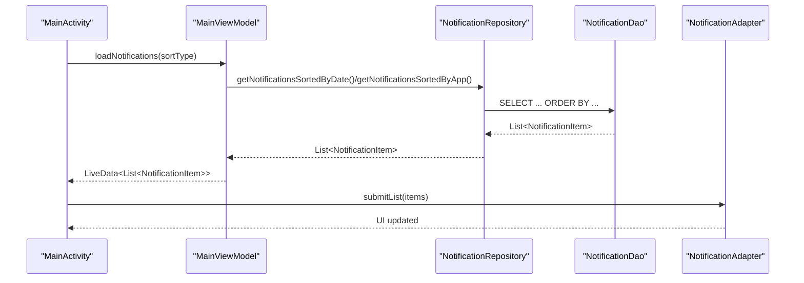

**Diagram sources**
- [MainViewModel.kt:59-77](file://app/src/main/java/com/notificationlog/MainViewModel.kt#L59-L77)
- [MainActivity.kt:324-343](file://app/src/main/java/com/notificationlog/MainActivity.kt#L324-L343)
- [NotificationAdapter.kt:13-59](file://app/src/main/java/com/notificationlog/adapter/NotificationAdapter.kt#L13-L59)

**Section sources**
- [MainViewModel.kt:59-77](file://app/src/main/java/com/notificationlog/MainViewModel.kt#L59-L77)
- [MainActivity.kt:324-343](file://app/src/main/java/com/notificationlog/MainActivity.kt#L324-L343)
- [NotificationAdapter.kt:13-59](file://app/src/main/java/com/notificationlog/adapter/NotificationAdapter.kt#L13-L59)

### Real-Time Capture and Persistence
- NotificationListener captures notifications and inserts them into the database.
- Broadcasts updates to MainActivity to refresh the UI.
- Handles listener disconnects and warns the user.

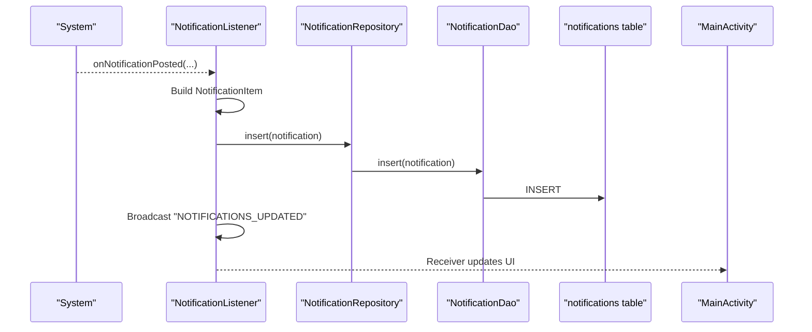

**Diagram sources**
- [NotificationListener.kt:109-149](file://app/src/main/java/com/notificationlog/NotificationListener.kt#L109-L149)
- [NotificationDao.kt:18-19](file://app/src/main/java/com/notificationlog/data/NotificationDao.kt#L18-L19)
- [MainActivity.kt:57-66](file://app/src/main/java/com/notificationlog/MainActivity.kt#L57-L66)

**Section sources**
- [NotificationListener.kt:109-149](file://app/src/main/java/com/notificationlog/NotificationListener.kt#L109-L149)
- [MainActivity.kt:57-66](file://app/src/main/java/com/notificationlog/MainActivity.kt#L57-L66)

### Type Converters and Data Types
- DateConverter handles conversion between Long timestamps and Date objects.
- While NotificationItem uses Long for timestamp, converters enable storing dates if needed elsewhere.

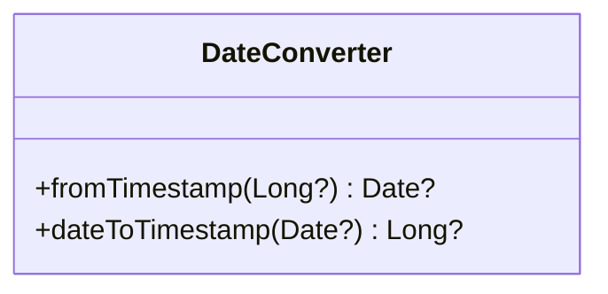

**Diagram sources**
- [DateConverter.kt:6-16](file://app/src/main/java/com/notificationlog/DateConverter.kt#L6-L16)

**Section sources**
- [DateConverter.kt:6-16](file://app/src/main/java/com/notificationlog/DateConverter.kt#L6-L16)

## Dependency Analysis
- Coupling:
  - Repository depends on DAO; DAO depends on Database; UI depends on Repository.
  - NotificationListener depends on Repository and Database.
- Cohesion:
  - DAO encapsulates SQL concerns; Repository encapsulates data access logic; UI focuses on presentation.
- External dependencies:
  - Room runtime and AndroidX Lifecycle.
  - NotificationListener requires system notification access.

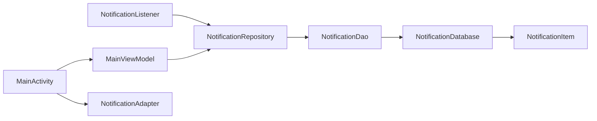

**Diagram sources**
- [NotificationListener.kt:27-34](file://app/src/main/java/com/notificationlog/NotificationListener.kt#L27-L34)
- [NotificationRepository.kt:6-27](file://app/src/main/java/com/notificationlog/repository/NotificationRepository.kt#L6-L27)
- [NotificationDao.kt:6-26](file://app/src/main/java/com/notificationlog/data/NotificationDao.kt#L6-L26)
- [NotificationDatabase.kt:7-10](file://app/src/main/java/com/notificationlog/data/NotificationDatabase.kt#L7-L10)
- [NotificationItem.kt:10-19](file://app/src/main/java/com/notificationlog/model/NotificationItem.kt#L10-L19)
- [MainActivity.kt:96-96](file://app/src/main/java/com/notificationlog/MainActivity.kt#L96-L96)
- [NotificationAdapter.kt:13-59](file://app/src/main/java/com/notificationlog/adapter/NotificationAdapter.kt#L13-L59)

**Section sources**
- [NotificationListener.kt:27-34](file://app/src/main/java/com/notificationlog/NotificationListener.kt#L27-L34)
- [NotificationRepository.kt:6-27](file://app/src/main/java/com/notificationlog/repository/NotificationRepository.kt#L6-L27)
- [NotificationDao.kt:6-26](file://app/src/main/java/com/notificationlog/data/NotificationDao.kt#L6-L26)
- [NotificationDatabase.kt:7-10](file://app/src/main/java/com/notificationlog/data/NotificationDatabase.kt#L7-L10)
- [NotificationItem.kt:10-19](file://app/src/main/java/com/notificationlog/model/NotificationItem.kt#L10-L19)
- [MainActivity.kt:96-96](file://app/src/main/java/com/notificationlog/MainActivity.kt#L96-L96)
- [NotificationAdapter.kt:13-59](file://app/src/main/java/com/notificationlog/adapter/NotificationAdapter.kt#L13-L59)

## Performance Considerations
- Query ordering:
  - Sorting by timestamp descending is efficient for recent-first views.
  - Sorting by appName ascending then timestamp descending adds index overhead; consider indexing appName if frequently queried.
- Conflict resolution:
  - REPLACE on insert prevents duplicates; ensure key uniqueness to avoid unnecessary replacements.
- Concurrency:
  - DAO methods are suspend; use Dispatchers.IO for database operations.
  - NotificationListener uses a dedicated coroutine scope to avoid blocking the main thread.
- Memory and UI updates:
  - Adapter uses DiffUtil to minimize UI churn.
  - LiveData ensures reactive updates without manual observers.
- Storage growth:
  - No built-in retention policy; consider adding periodic cleanup or max-row limits in future versions.

[No sources needed since this section provides general guidance]

## Troubleshooting Guide
- Notification access revoked:
  - Listener detects disconnection and shows a high-priority warning notification; broadcasts a disconnect event to the UI.
- UI not updating:
  - Ensure MainActivity registers receivers and observes LiveData correctly.
- Insert errors:
  - DAO insert uses REPLACE; verify that exceptions are handled in ViewModel and UI error messages are surfaced.
- Permissions:
  - Verify notification listener permission and POST_NOTIFICATIONS permission in the manifest and runtime.

**Section sources**
- [NotificationListener.kt:44-65](file://app/src/main/java/com/notificationlog/NotificationListener.kt#L44-L65)
- [MainActivity.kt:110-144](file://app/src/main/java/com/notificationlog/MainActivity.kt#L110-L144)
- [MainViewModel.kt:29-31](file://app/src/main/java/com/notificationlog/MainViewModel.kt#L29-L31)
- [AndroidManifest.xml:30-43](file://app/src/main/AndroidManifest.xml#L30-L43)

## Conclusion
NotificationLog’s data layer is a clean, Room-backed implementation that captures, persists, and presents notifications efficiently. The repository pattern isolates data access, while DAO queries support common UI needs. The design accommodates real-time capture via a background listener and provides responsive UI updates through LiveData and DiffUtil. Future enhancements could include explicit retention policies, indexing strategies, and migration support for evolving schemas.

[No sources needed since this section summarizes without analyzing specific files]

## Appendices

### CRUD Operations and Querying Patterns
- Create:
  - NotificationListener constructs a NotificationItem and calls repository.insert(notification).
- Read:
  - MainViewModel loads sorted lists using repository.getNotificationsSortedByDate() or repository.getNotificationsSortedByApp().
- Update:
  - Not applicable in current design; replace semantics are used via DAO insert with REPLACE.
- Delete:
  - Per-item deletion via repository.delete(notification).
  - Bulk deletion via repository.deleteAll().

**Section sources**
- [NotificationListener.kt:139-149](file://app/src/main/java/com/notificationlog/NotificationListener.kt#L139-L149)
- [MainViewModel.kt:59-77](file://app/src/main/java/com/notificationlog/MainViewModel.kt#L59-L77)
- [NotificationRepository.kt:16-26](file://app/src/main/java/com/notificationlog/repository/NotificationRepository.kt#L16-L26)
- [NotificationDao.kt:18-25](file://app/src/main/java/com/notificationlog/data/NotificationDao.kt#L18-L25)

### Database Migration Strategies
- Current state:
  - Database version is 1; exportSchema is disabled.
- Recommended migration approach:
  - Add a Room migration when altering the notifications table (e.g., adding indexes, new columns).
  - Use Migration objects to define schema changes and apply them during Room.databaseBuilder.
  - Back up user data before migrations if retention policies require historical records.

**Section sources**
- [NotificationDatabase.kt:7-10](file://app/src/main/java/com/notificationlog/data/NotificationDatabase.kt#L7-L10)

### Data Lifecycle and Retention Policies
- Capture control:
  - SharedPreferences flag capture_enabled controls whether notifications are captured.
- Manual cleanup:
  - Users can clear all notifications via UI, which triggers repository.deleteAll() and resets counts.
- Automatic retention:
  - No automatic pruning; consider adding periodic cleanup jobs or max-row limits.

**Section sources**
- [MainActivity.kt:300-311](file://app/src/main/java/com/notificationlog/MainActivity.kt#L300-L311)
- [MainViewModel.kt:92-106](file://app/src/main/java/com/notificationlog/MainViewModel.kt#L92-L106)
- [NotificationListener.kt:126-128](file://app/src/main/java/com/notificationlog/NotificationListener.kt#L126-L128)