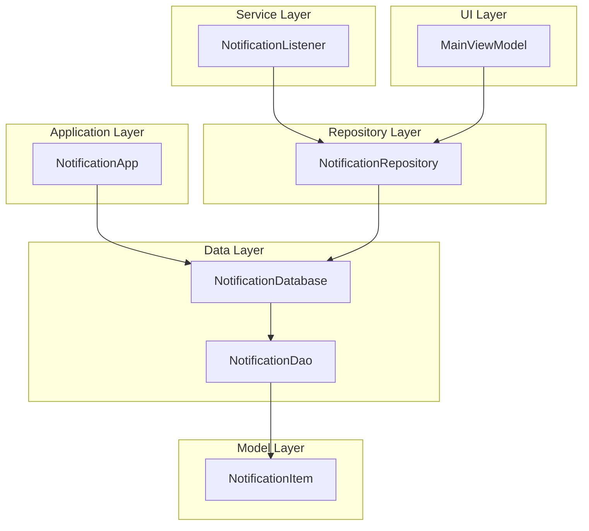
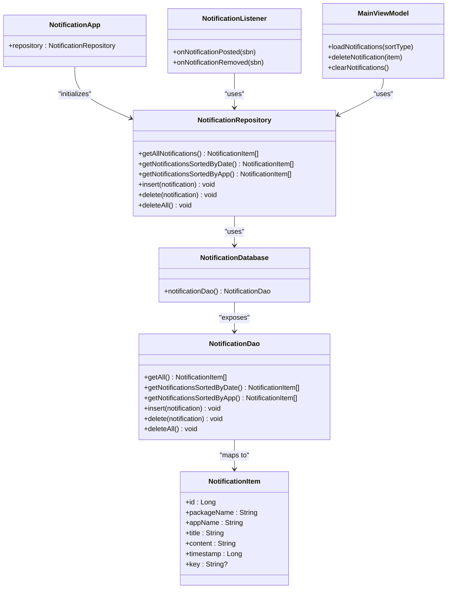
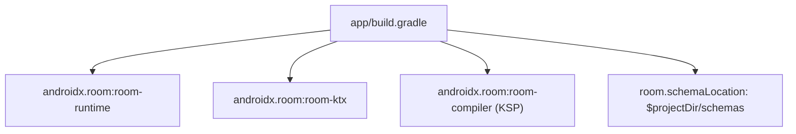

# Database Schema Design

<cite>
**Referenced Files in This Document**
- [NotificationDatabase.kt](file://app/src/main/java/com/notificationlog/data/NotificationDatabase.kt)
- [NotificationItem.kt](file://app/src/main/java/com/notificationlog/model/NotificationItem.kt)
- [NotificationDao.kt](file://app/src/main/java/com/notificationlog/data/NotificationDao.kt)
- [NotificationRepository.kt](file://app/src/main/java/com/notificationlog/repository/NotificationRepository.kt)
- [NotificationApp.kt](file://app/src/main/java/com/notificationlog/NotificationApp.kt)
- [NotificationListener.kt](file://app/src/main/java/com/notificationlog/NotificationListener.kt)
- [MainViewModel.kt](file://app/src/main/java/com/notificationlog/MainViewModel.kt)
- [build.gradle](file://app/build.gradle)
</cite>

## Table of Contents
1. [Introduction](#introduction)
2. [Project Structure](#project-structure)
3. [Core Components](#core-components)
4. [Architecture Overview](#architecture-overview)
5. [Detailed Component Analysis](#detailed-component-analysis)
6. [Dependency Analysis](#dependency-analysis)
7. [Performance Considerations](#performance-considerations)
8. [Troubleshooting Guide](#troubleshooting-guide)
9. [Conclusion](#conclusion)

## Introduction
This document provides comprehensive database schema documentation for NotificationLog's Room database implementation. It details the NotificationDatabase class structure, entity registration, and database versioning strategy. It documents the single-table schema design with the NotificationItem entity, table creation SQL, and index specifications. It explains the database initialization process, singleton pattern implementation via the application class, and exportSchema configuration. Migration considerations, version upgrade strategies, and schema evolution planning are included. Database file location, backup considerations, and performance optimization for notification storage are addressed, along with examples of database creation and entity mapping patterns used throughout the application.

## Project Structure
The database layer is organized around a single Room database module with a straightforward entity-DAO-repository pattern:
- Data layer: database definition and DAO interface
- Model layer: entity definition
- Repository layer: encapsulates DAO access
- Application layer: initializes the database and exposes a global repository instance
- Listener service: captures notifications and persists them via the repository
- UI layer: loads and displays notifications via a ViewModel

**Diagram sources**
- [NotificationApp.kt](file://app/src/main/java/com/notificationlog/NotificationApp.kt)
- [NotificationDatabase.kt](file://app/src/main/java/com/notificationlog/data/NotificationDatabase.kt)
- [NotificationDao.kt](file://app/src/main/java/com/notificationlog/data/NotificationDao.kt)
- [NotificationItem.kt](file://app/src/main/java/com/notificationlog/model/NotificationItem.kt)
- [NotificationRepository.kt](file://app/src/main/java/com/notificationlog/repository/NotificationRepository.kt)
- [NotificationListener.kt](file://app/src/main/java/com/notificationlog/NotificationListener.kt)
- [MainViewModel.kt](file://app/src/main/java/com/notificationlog/MainViewModel.kt)

**Section sources**
- [NotificationDatabase.kt](file://app/src/main/java/com/notificationlog/data/NotificationDatabase.kt)
- [NotificationItem.kt](file://app/src/main/java/com/notificationlog/model/NotificationItem.kt)
- [NotificationDao.kt](file://app/src/main/java/com/notificationlog/data/NotificationDao.kt)
- [NotificationRepository.kt](file://app/src/main/java/com/notificationlog/repository/NotificationRepository.kt)
- [NotificationApp.kt](file://app/src/main/java/com/notificationlog/NotificationApp.kt)
- [NotificationListener.kt](file://app/src/main/java/com/notificationlog/NotificationListener.kt)
- [MainViewModel.kt](file://app/src/main/java/com/notificationlog/MainViewModel.kt)

## Core Components
- NotificationDatabase: Declares the Room database with a single entity and a DAO accessor. Versioning is set to 1, and schema export is disabled.
- NotificationItem: Defines the entity mapped to the "notifications" table with a primary key and fields for package/app metadata, title, content, timestamp, and optional key.
- NotificationDao: Provides queries for retrieving notifications sorted by timestamp and app name, insertion with conflict replacement, deletion of a specific item, and bulk deletion.
- NotificationRepository: Encapsulates DAO operations for the UI and service layers.
- NotificationApp: Initializes the Room database and exposes a global repository instance for the application lifecycle.
- NotificationListener: Captures notifications and persists them using the repository initialized with the same database name.

Key implementation patterns:
- Singleton-like database access via application initialization
- DAO method naming aligned with sorting preferences (date vs app)
- Insertion strategy using REPLACE on conflict to handle duplicates

**Section sources**
- [NotificationDatabase.kt](file://app/src/main/java/com/notificationlog/data/NotificationDatabase.kt)
- [NotificationItem.kt](file://app/src/main/java/com/notificationlog/model/NotificationItem.kt)
- [NotificationDao.kt](file://app/src/main/java/com/notificationlog/data/NotificationDao.kt)
- [NotificationRepository.kt](file://app/src/main/java/com/notificationlog/repository/NotificationRepository.kt)
- [NotificationApp.kt](file://app/src/main/java/com/notificationlog/NotificationApp.kt)
- [NotificationListener.kt](file://app/src/main/java/com/notificationlog/NotificationListener.kt)

## Architecture Overview
The database architecture follows a layered pattern with clear separation of concerns:
- Entity defines the persistent schema
- DAO abstracts SQL operations
- Repository mediates between UI and persistence
- Application initializes the database once
- Service layer integrates capture logic with persistence
- UI observes repository-provided data

**Diagram sources**
- [NotificationDatabase.kt](file://app/src/main/java/com/notificationlog/data/NotificationDatabase.kt)
- [NotificationDao.kt](file://app/src/main/java/com/notificationlog/data/NotificationDao.kt)
- [NotificationItem.kt](file://app/src/main/java/com/notificationlog/model/NotificationItem.kt)
- [NotificationRepository.kt](file://app/src/main/java/com/notificationlog/repository/NotificationRepository.kt)
- [NotificationApp.kt](file://app/src/main/java/com/notificationlog/NotificationApp.kt)
- [NotificationListener.kt](file://app/src/main/java/com/notificationlog/NotificationListener.kt)
- [MainViewModel.kt](file://app/src/main/java/com/notificationlog/MainViewModel.kt)

## Detailed Component Analysis

### NotificationDatabase
- Entity registration: Single entity NotificationItem is registered.
- Versioning: Database version is set to 1.
- Export schema: Disabled to avoid shipping Room schema JSON files.
- DAO accessor: Exposes notificationDao() for repository and service usage.

Initialization and singleton pattern:
- Database is built once in NotificationApp during application startup.
- The same database name is used consistently across the app and the listener service.

**Section sources**
- [NotificationDatabase.kt](file://app/src/main/java/com/notificationlog/data/NotificationDatabase.kt)
- [NotificationApp.kt](file://app/src/main/java/com/notificationlog/NotificationApp.kt)
- [NotificationListener.kt](file://app/src/main/java/com/notificationlog/NotificationListener.kt)

### NotificationItem Entity
- Table name: "notifications"
- Primary key: Auto-generated Long id
- Fields:
  - packageName: String
  - appName: String
  - title: String
  - content: String
  - timestamp: Long
  - key: String? (optional)
- Parcelable support: Enables serialization for inter-process communication and UI transfer.

Index specifications:
- No explicit indices are defined in the entity.
- Implicit primary key index exists on id.
- Queries sort by timestamp and appName; consider adding composite indices for frequently used sort/filter patterns.

Table creation SQL:
- Generated by Room based on the entity definition. The table includes the specified columns and constraints.

**Section sources**
- [NotificationItem.kt](file://app/src/main/java/com/notificationlog/model/NotificationItem.kt)

### NotificationDao
- Queries:
  - Retrieve all notifications ordered by timestamp descending
  - Retrieve notifications ordered by timestamp descending
  - Retrieve notifications ordered by appName ascending, then timestamp descending
- Insert:
  - Insert with OnConflictStrategy.REPLACE to handle duplicates
- Delete:
  - Delete a specific item
  - Delete all items

Optimization opportunities:
- Add indices for timestamp and appName combinations to improve sort performance.
- Consider pagination for large datasets to limit memory usage.

**Section sources**
- [NotificationDao.kt](file://app/src/main/java/com/notificationlog/data/NotificationDao.kt)

### NotificationRepository
- Wraps DAO operations for use by UI and service layers.
- Provides synchronous wrappers for suspend DAO methods.

**Section sources**
- [NotificationRepository.kt](file://app/src/main/java/com/notificationlog/repository/NotificationRepository.kt)

### NotificationApp and NotificationListener
- Both initialize the Room database with the same name, ensuring consistent access to the same underlying file.
- NotificationApp creates a global repository instance for the UI.
- NotificationListener lazily initializes a repository scoped to the service lifecycle.

**Section sources**
- [NotificationApp.kt](file://app/src/main/java/com/notificationlog/NotificationApp.kt)
- [NotificationListener.kt](file://app/src/main/java/com/notificationlog/NotificationListener.kt)

### MainViewModel
- Uses the global repository to load notifications based on selected sort type.
- Handles errors via a CoroutineExceptionHandler and updates LiveData for UI observation.

**Section sources**
- [MainViewModel.kt](file://app/src/main/java/com/notificationlog/MainViewModel.kt)

## Dependency Analysis
Room dependencies and schema generation:
- Room runtime and KTX are included.
- KSP is configured with room-compiler for annotation processing.
- Schema export location is configured under the project directory for offline verification.

**Diagram sources**
- [build.gradle](file://app/build.gradle)

**Section sources**
- [build.gradle](file://app/build.gradle)

## Performance Considerations
- Current state:
  - No explicit indices exist for timestamp or appName.
  - Queries rely on implicit primary key index and table scans for sorting.
- Recommended optimizations:
  - Add an index on timestamp for efficient chronological queries.
  - Add a composite index on (appName, timestamp) for app-based sorting.
  - Consider pagination for large datasets to reduce memory footprint.
  - Use LIMIT clauses in queries to cap result sets.
- Storage considerations:
  - Database file location is managed by Android; backups should leverage Android's backup mechanisms or user-initiated exports.
  - The app supports exporting logs to external storage for user backup.

[No sources needed since this section provides general guidance]

## Troubleshooting Guide
Common issues and resolutions:
- Database version mismatch:
  - Not applicable yet (version 1), but plan to implement migrations when evolving schema.
- Schema export:
  - Schema export is disabled; enable temporarily for verification if needed.
- Duplicate entries:
  - Insert strategy uses REPLACE; ensure key uniqueness aligns with intended behavior.
- Sorting performance:
  - Add indices on timestamp and appName to improve sort performance.
- Backup and restore:
  - Use Android backup APIs or export text logs for manual backup.

**Section sources**
- [NotificationDatabase.kt](file://app/src/main/java/com/notificationlog/data/NotificationDatabase.kt)
- [NotificationDao.kt](file://app/src/main/java/com/notificationlog/data/NotificationDao.kt)

## Conclusion
NotificationLog employs a minimal, single-table Room database design centered on the NotificationItem entity. The NotificationDatabase class registers the entity, exposes a DAO, and uses version 1 with schema export disabled. The application initializes the database once and exposes a global repository instance, while the service layer persists captured notifications. Future enhancements should focus on indexing strategies for improved query performance, migration planning for schema evolution, and robust backup/export capabilities for user data protection.