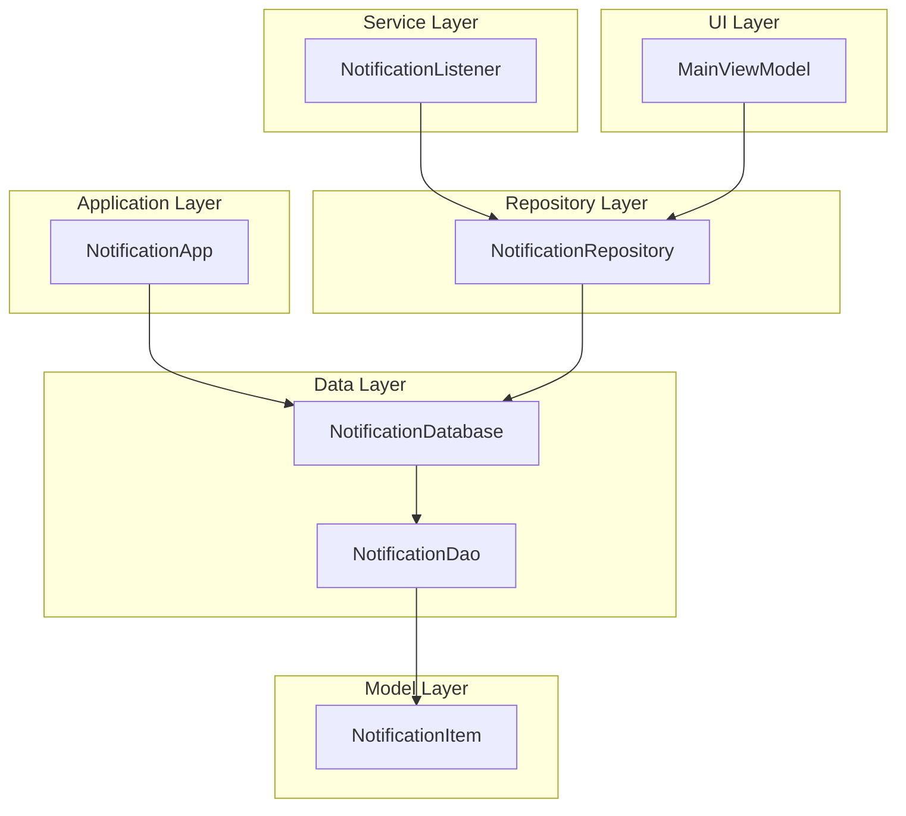
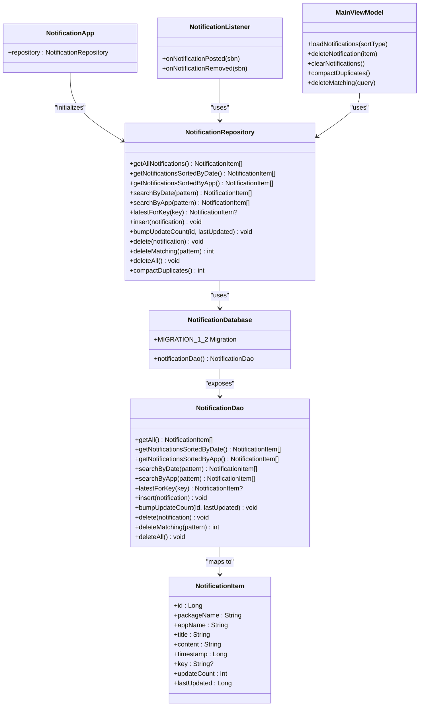
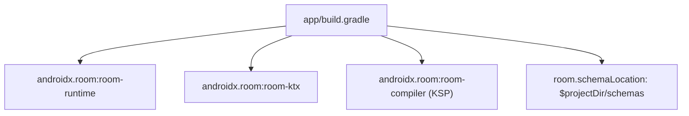

Based on my analysis of the codebase, I can see significant changes have been made to the database schema. The key changes include:

1. **Database version upgraded from 1 to 2**
2. **New indices added** on `key` and `timestamp` columns for improved search performance
3. **New fields added**: `updateCount` and `lastUpdated` for de-duplication support
4. **Migration strategy implemented** with `MIGRATION_1_2`
5. **Enhanced DAO operations** with new methods for de-duplication

Now I'll update the documentation to reflect these changes:

# Database Schema Design

<cite>
**Referenced Files in This Document**
- [NotificationDatabase.kt](file://app/src/main/java/com/notificationlog/data/NotificationDatabase.kt)
- [NotificationItem.kt](file://app/src/main/java/com/notificationlog/model/NotificationItem.kt)
- [NotificationDao.kt](file://app/src/main/java/com/notificationlog/data/NotificationDao.kt)
- [NotificationRepository.kt](file://app/src/main/java/com/notificationlog/repository/NotificationRepository.kt)
- [NotificationApp.kt](file://app/src/main/java/com/notificationlog/NotificationApp.kt)
- [NotificationListener.kt](file://app/src/main/java/com/notificationlog/NotificationListener.kt)
- [MainViewModel.kt](file://app/src/main/java/com/notificationlog/MainViewModel.kt)
- [build.gradle](file://app/build.gradle)
</cite>

## Update Summary
**Changes Made**
- Updated database versioning from v1 to v2 with migration strategy
- Added comprehensive index specifications for key and timestamp columns
- Enhanced entity schema with de-duplication support fields
- Updated table creation SQL with new indices
- Added migration considerations and upgrade strategies
- Enhanced performance optimization section with index benefits

## Table of Contents
1. [Introduction](#introduction)
2. [Project Structure](#project-structure)
3. [Core Components](#core-components)
4. [Architecture Overview](#architecture-overview)
5. [Detailed Component Analysis](#detailed-component-analysis)
6. [Dependency Analysis](#dependency-analysis)
7. [Performance Considerations](#performance-considerations)
8. [Troubleshooting Guide](#troubleshooting-guide)
9. [Conclusion](#conclusion)

## Introduction
This document provides comprehensive database schema documentation for NotificationLog's Room database implementation. It details the NotificationDatabase class structure, entity registration, and database versioning strategy. It documents the enhanced single-table schema design with the NotificationItem entity, table creation SQL, and comprehensive index specifications. It explains the database initialization process, singleton pattern implementation via the application class, and exportSchema configuration. Migration considerations, version upgrade strategies, and schema evolution planning are included. Database file location, backup considerations, and performance optimization for notification storage are addressed, along with examples of database creation and entity mapping patterns used throughout the application.

## Project Structure
The database layer is organized around a single Room database module with a straightforward entity-DAO-repository pattern:
- Data layer: database definition and DAO interface
- Model layer: entity definition with enhanced indexing
- Repository layer: encapsulates DAO access with de-duplication support
- Application layer: initializes the database and exposes a global repository instance
- Listener service: captures notifications and persists them via the repository
- UI layer: loads and displays notifications via a ViewModel

**Diagram sources**
- [NotificationApp.kt](file://app/src/main/java/com/notificationlog/NotificationApp.kt)
- [NotificationDatabase.kt](file://app/src/main/java/com/notificationlog/data/NotificationDatabase.kt)
- [NotificationDao.kt](file://app/src/main/java/com/notificationlog/data/NotificationDao.kt)
- [NotificationItem.kt](file://app/src/main/java/com/notificationlog/model/NotificationItem.kt)
- [NotificationRepository.kt](file://app/src/main/java/com/notificationlog/repository/NotificationRepository.kt)
- [NotificationListener.kt](file://app/src/main/java/com/notificationlog/NotificationListener.kt)
- [MainViewModel.kt](file://app/src/main/java/com/notificationlog/MainViewModel.kt)

**Section sources**
- [NotificationDatabase.kt](file://app/src/main/java/com/notificationlog/data/NotificationDatabase.kt)
- [NotificationItem.kt](file://app/src/main/java/com/notificationlog/model/NotificationItem.kt)
- [NotificationDao.kt](file://app/src/main/java/com/notificationlog/data/NotificationDao.kt)
- [NotificationRepository.kt](file://app/src/main/java/com/notificationlog/repository/NotificationRepository.kt)
- [NotificationApp.kt](file://app/src/main/java/com/notificationlog/NotificationApp.kt)
- [NotificationListener.kt](file://app/src/main/java/com/notificationlog/NotificationListener.kt)
- [MainViewModel.kt](file://app/src/main/java/com/notificationlog/MainViewModel.kt)

## Core Components
- NotificationDatabase: Declares the Room database with a single entity and a DAO accessor. Versioning is set to 2, and schema export is disabled. Includes comprehensive migration strategy for schema evolution.
- NotificationItem: Defines the entity mapped to the "notifications" table with a primary key, enhanced fields for package/app metadata, title, content, timestamp, optional key, and de-duplication support fields (updateCount, lastUpdated). Features explicit indices on key and timestamp columns.
- NotificationDao: Provides queries for retrieving notifications sorted by timestamp and app name, insertion with conflict replacement, deletion of a specific item, bulk deletion, and new de-duplication operations including latest key lookup and update count bumping.
- NotificationRepository: Encapsulates DAO operations for the UI and service layers, including advanced de-duplication logic and compact operations for historical data repair.
- NotificationApp: Initializes the Room database and exposes a global repository instance for the application lifecycle, with proper migration setup.
- NotificationListener: Captures notifications and persists them using the repository initialized with the same database name, featuring mutex-based de-duplication at the service level.

Key implementation patterns:
- Singleton-like database access via application initialization
- DAO method naming aligned with sorting preferences (date vs app)
- Insertion strategy using REPLACE on conflict to handle duplicates
- De-duplication support through key-based lookups and update counters
- Comprehensive indexing strategy for optimal query performance

**Section sources**
- [NotificationDatabase.kt](file://app/src/main/java/com/notificationlog/data/NotificationDatabase.kt)
- [NotificationItem.kt](file://app/src/main/java/com/notificationlog/model/NotificationItem.kt)
- [NotificationDao.kt](file://app/src/main/java/com/notificationlog/data/NotificationDao.kt)
- [NotificationRepository.kt](file://app/src/main/java/com/notificationlog/repository/NotificationRepository.kt)
- [NotificationApp.kt](file://app/src/main/java/com/notificationlog/NotificationApp.kt)
- [NotificationListener.kt](file://app/src/main/java/com/notificationlog/NotificationListener.kt)

## Architecture Overview
The database architecture follows a layered pattern with clear separation of concerns:
- Entity defines the persistent schema with enhanced indexing
- DAO abstracts SQL operations with de-duplication support
- Repository mediates between UI and persistence with advanced operations
- Application initializes the database once with migration support
- Service layer integrates capture logic with persistence and de-duplication
- UI observes repository-provided data with state management

**Diagram sources**
- [NotificationDatabase.kt](file://app/src/main/java/com/notificationlog/data/NotificationDatabase.kt)
- [NotificationDao.kt](file://app/src/main/java/com/notificationlog/data/NotificationDao.kt)
- [NotificationItem.kt](file://app/src/main/java/com/notificationlog/model/NotificationItem.kt)
- [NotificationRepository.kt](file://app/src/main/java/com/notificationlog/repository/NotificationRepository.kt)
- [NotificationApp.kt](file://app/src/main/java/com/notificationlog/NotificationApp.kt)
- [NotificationListener.kt](file://app/src/main/java/com/notificationlog/NotificationListener.kt)
- [MainViewModel.kt](file://app/src/main/java/com/notificationlog/MainViewModel.kt)

## Detailed Component Analysis

### NotificationDatabase
- Entity registration: Single entity NotificationItem is registered.
- Versioning: Database version is set to 2 with comprehensive migration strategy.
- Export schema: Disabled to avoid shipping Room schema JSON files.
- DAO accessor: Exposes notificationDao() for repository and service usage.
- Migration strategy: MIGRATION_1_2 handles schema evolution with de-duplication support.

Initialization and singleton pattern:
- Database is built once in NotificationApp during application startup.
- The same database name is used consistently across the app and the listener service.
- Migration is properly configured with addMigrations(NotificationDatabase.MIGRATION_1_2).

**Section sources**
- [NotificationDatabase.kt:9-42](file://app/src/main/java/com/notificationlog/data/NotificationDatabase.kt#L9-L42)
- [NotificationApp.kt:30-34](file://app/src/main/java/com/notificationlog/NotificationApp.kt#L30-L34)

### NotificationItem Entity
- Table name: "notifications"
- Primary key: Auto-generated Long id
- Fields:
  - packageName: String
  - appName: String
  - title: String
  - content: String
  - timestamp: Long
  - key: String? (optional)
  - updateCount: Int = 1 (for de-duplication tracking)
  - lastUpdated: Long = 0 (for tracking last modification time)
- Parcelable support: Enables serialization for inter-process communication and UI transfer.
- Index specifications:
  - Explicit index on key column for efficient de-duplication lookups
  - Explicit index on timestamp column for efficient chronological queries
  - Implicit primary key index exists on id

Table creation SQL:
- Generated by Room based on the entity definition with indices.
- The table includes all specified columns, constraints, and indices for optimal performance.

**Section sources**
- [NotificationItem.kt:18-34](file://app/src/main/java/com/notificationlog/model/NotificationItem.kt#L18-L34)

### NotificationDao
- Queries:
  - Retrieve all notifications ordered by timestamp descending with stable tie-breaking
  - Retrieve notifications ordered by timestamp descending
  - Retrieve notifications ordered by appName ascending, then timestamp descending
  - Free-text search over app, title, body, and package name with LIKE pattern matching
  - Latest notification lookup by key for de-duplication detection
- Insert:
  - Insert with OnConflictStrategy.REPLACE to handle duplicates
- Update operations:
  - Bump update count and last updated timestamp for de-duplicated entries
- Delete:
  - Delete a specific item
  - Delete all items
  - Delete matching items based on search pattern

Optimization features:
- Stable ordering with id DESC as tie-breaker for consistent results
- Efficient de-duplication through indexed key lookups
- Pattern-matching queries with proper escaping for special characters

**Section sources**
- [NotificationDao.kt:6-67](file://app/src/main/java/com/notificationlog/data/NotificationDao.kt#L6-L67)

### NotificationRepository
- Wraps DAO operations for use by UI and service layers.
- Provides synchronous wrappers for suspend DAO methods.
- Advanced de-duplication support with compactDuplicates operation.
- Transactional operations for complex data integrity maintenance.

De-duplication capabilities:
- Collapses rows that share package, key, title and content into one row
- Tracks update counts and last updated timestamps
- Uses scratch tables for efficient grouping operations on large datasets

**Section sources**
- [NotificationRepository.kt:8-91](file://app/src/main/java/com/notificationlog/repository/NotificationRepository.kt#L8-L91)

### NotificationApp and NotificationListener
- Both initialize the Room database with the same name, ensuring consistent access to the same underlying file.
- NotificationApp creates a global repository instance for the UI with proper migration setup.
- NotificationListener lazily initializes a repository scoped to the service lifecycle.
- Service-level de-duplication with mutex protection for concurrent notification processing.

**Section sources**
- [NotificationApp.kt:9-39](file://app/src/main/java/com/notificationlog/NotificationApp.kt#L9-L39)
- [NotificationListener.kt:23-211](file://app/src/main/java/com/notificationlog/NotificationListener.kt#L23-L211)

### MainViewModel
- Uses the global repository to load notifications based on selected sort type.
- Handles errors via a CoroutineExceptionHandler and updates LiveData for UI observation.
- Supports de-duplication operations and bulk delete functionality.
- Manages capture state and service connection status.

**Section sources**
- [MainViewModel.kt:19-285](file://app/src/main/java/com/notificationlog/MainViewModel.kt#L19-L285)

## Dependency Analysis
Room dependencies and schema generation:
- Room runtime and KTX are included.
- KSP is configured with room-compiler for annotation processing.
- Schema export location is configured under the project directory for offline verification.

**Diagram sources**
- [build.gradle:72-91](file://app/build.gradle#L72-L91)

**Section sources**
- [build.gradle:72-91](file://app/build.gradle#L72-L91)

## Performance Considerations
- Current state:
  - Explicit indices exist on key and timestamp columns for optimized query performance.
  - Queries leverage indices for efficient chronological sorting and key-based lookups.
  - De-duplication operations benefit from indexed key searches.
  - Stable ordering ensures consistent results across multiple loads.
- Optimization benefits:
  - Key index enables fast de-duplication lookups for ongoing notifications.
  - Timestamp index optimizes chronological queries and sorting operations.
  - Composite query patterns benefit from both indices simultaneously.
  - Reduced table scans through targeted index probes.
- Storage considerations:
  - Database file location is managed by Android; backups should leverage Android's backup mechanisms or user-initiated exports.
  - The app supports exporting logs to external storage for user backup.
  - Migration strategy preserves existing data while adding new indices.

[No sources needed since this section provides general guidance]

## Troubleshooting Guide
Common issues and resolutions:
- Database version mismatch:
  - Migration MIGRATION_1_2 handles automatic schema evolution from v1 to v2.
  - Existing duplicate rows are preserved during migration for data safety.
- Schema export:
  - Schema export is disabled; enable temporarily for verification if needed.
- Duplicate entries:
  - Insert strategy uses REPLACE; key uniqueness aligns with de-duplication behavior.
  - Service-level mutex prevents race conditions in concurrent notification processing.
- Sorting performance:
  - Indices on timestamp and key columns provide optimal query performance.
  - Stable ordering with id DESC ensures consistent result sets.
- Backup and restore:
  - Use Android backup APIs or export text logs for manual backup.
  - Migration preserves historical data integrity during upgrades.
- De-duplication issues:
  - Check key field consistency for proper de-duplication behavior.
  - Verify updateCount and lastUpdated fields are properly maintained.

**Section sources**
- [NotificationDatabase.kt:21-40](file://app/src/main/java/com/notificationlog/data/NotificationDatabase.kt#L21-L40)
- [NotificationDao.kt:41-49](file://app/src/main/java/com/notificationlog/data/NotificationDao.kt#L41-L49)

## Conclusion
NotificationLog employs an enhanced, single-table Room database design centered on the NotificationItem entity with comprehensive indexing for optimal performance. The NotificationDatabase class registers the entity, exposes a DAO, and uses version 2 with schema export disabled and robust migration strategy. The application initializes the database once and exposes a global repository instance, while the service layer persists captured notifications with de-duplication support. The enhanced schema includes explicit indices on key and timestamp columns, providing significant performance improvements for chronological queries and de-duplication operations. Future enhancements should focus on additional indexing strategies for complex query patterns, continued migration planning for schema evolution, and robust backup/export capabilities for user data protection.