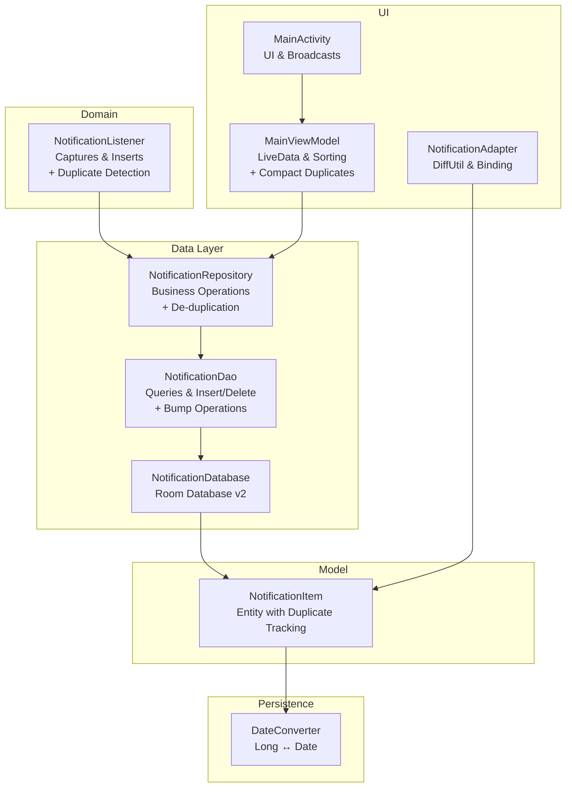
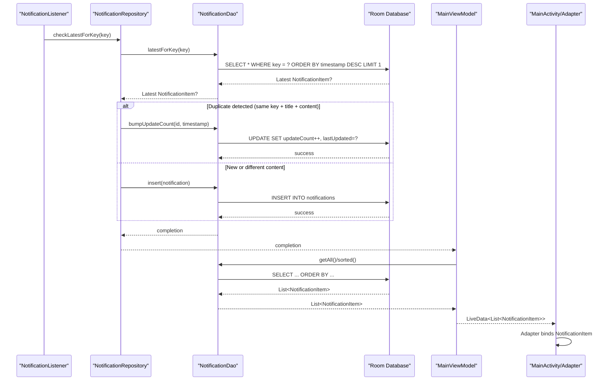
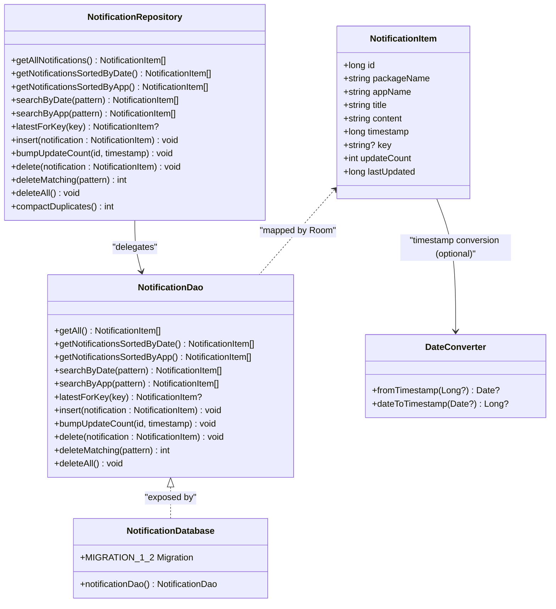
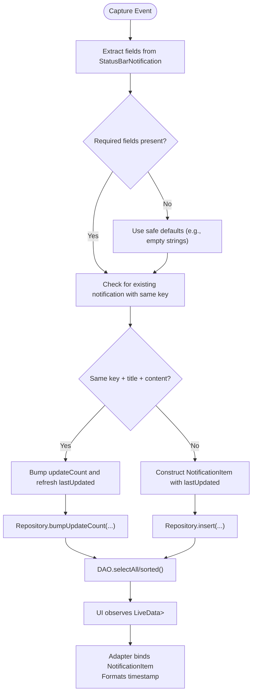
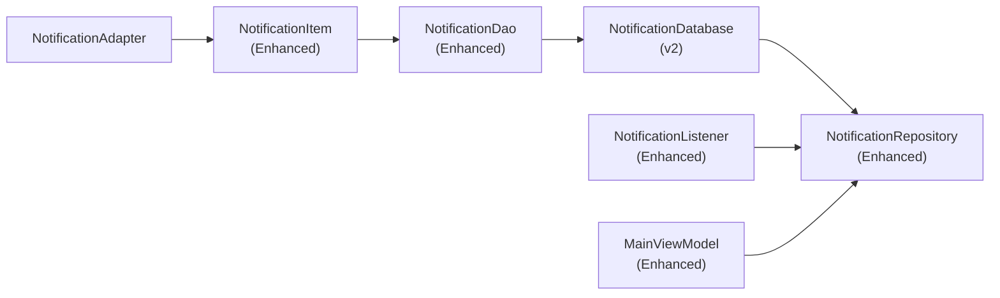

# Entity Models

<cite>
**Referenced Files in This Document**
- [NotificationItem.kt](file://app/src/main/java/com/notificationlog/model/NotificationItem.kt)
- [NotificationDao.kt](file://app/src/main/java/com/notificationlog/data/NotificationDao.kt)
- [NotificationDatabase.kt](file://app/src/main/java/com/notificationlog/data/NotificationDatabase.kt)
- [NotificationRepository.kt](file://app/src/main/java/com/notificationlog/repository/NotificationRepository.kt)
- [NotificationListener.kt](file://app/src/main/java/com/notificationlog/NotificationListener.kt)
- [DateConverter.kt](file://app/src/main/java/com/notificationlog/DateConverter.kt)
- [NotificationAdapter.kt](file://app/src/main/java/com/notificationlog/adapter/NotificationAdapter.kt)
- [MainViewModel.kt](file://app/src/main/java/com/notificationlog/MainViewModel.kt)
- [MainActivity.kt](file://app/src/main/java/com/notificationlog/MainActivity.kt)
</cite>

## Update Summary
**Changes Made**
- Enhanced NotificationItem entity with duplicate tracking capabilities through updateCount and lastUpdated fields
- Added database migration from version 1 to 2 to support new fields
- Implemented de-duplication logic in NotificationListener for ongoing notifications
- Added specialized DAO methods for updating duplicate entries
- Enhanced repository with compactDuplicates functionality for historical data cleanup
- Updated entity annotations with performance indices for key and timestamp fields

## Table of Contents
1. [Introduction](#introduction)
2. [Project Structure](#project-structure)
3. [Core Components](#core-components)
4. [Architecture Overview](#architecture-overview)
5. [Detailed Component Analysis](#detailed-component-analysis)
6. [Dependency Analysis](#dependency-analysis)
7. [Performance Considerations](#performance-considerations)
8. [Troubleshooting Guide](#troubleshooting-guide)
9. [Conclusion](#conclusion)

## Introduction
This document provides a comprehensive entity model specification for NotificationItem, focusing on its enhanced structure with duplicate tracking capabilities, Room annotations, constraints, and integration across the application. The model now includes sophisticated de-duplication features to handle ongoing notifications efficiently while maintaining data integrity.

## Project Structure
The NotificationItem entity resides in the model package and is consumed by the data access layer (DAO), repository, and UI components. Type conversion for timestamps is handled via a dedicated converter. The enhanced model now includes duplicate tracking fields that enable efficient handling of recurring notifications.

**Diagram sources**
- [NotificationItem.kt:1-35](file://app/src/main/java/com/notificationlog/model/NotificationItem.kt#L1-L35)
- [NotificationDao.kt:1-68](file://app/src/main/java/com/notificationlog/data/NotificationDao.kt#L1-L68)
- [NotificationDatabase.kt:1-42](file://app/src/main/java/com/notificationlog/data/NotificationDatabase.kt#L1-L42)
- [NotificationRepository.kt:1-92](file://app/src/main/java/com/notificationlog/repository/NotificationRepository.kt#L1-L92)
- [NotificationListener.kt:1-211](file://app/src/main/java/com/notificationlog/NotificationListener.kt#L1-L211)
- [DateConverter.kt:1-16](file://app/src/main/java/com/notificationlog/DateConverter.kt#L1-L16)
- [NotificationAdapter.kt:1-59](file://app/src/main/java/com/notificationlog/adapter/NotificationAdapter.kt#L1-L59)
- [MainViewModel.kt:1-231](file://app/src/main/java/com/notificationlog/MainViewModel.kt#L1-L231)
- [MainActivity.kt:1-717](file://app/src/main/java/com/notificationlog/MainActivity.kt#L1-L717)

**Section sources**
- [NotificationItem.kt:1-35](file://app/src/main/java/com/notificationlog/model/NotificationItem.kt#L1-L35)
- [NotificationDao.kt:1-68](file://app/src/main/java/com/notificationlog/data/NotificationDao.kt#L1-L68)
- [NotificationDatabase.kt:1-42](file://app/src/main/java/com/notificationlog/data/NotificationDatabase.kt#L1-L42)
- [NotificationRepository.kt:1-92](file://app/src/main/java/com/notificationlog/repository/NotificationRepository.kt#L1-L92)
- [NotificationListener.kt:1-211](file://app/src/main/java/com/notificationlog/NotificationListener.kt#L1-L211)
- [DateConverter.kt:1-16](file://app/src/main/java/com/notificationlog/DateConverter.kt#L1-L16)
- [NotificationAdapter.kt:1-59](file://app/src/main/java/com/notificationlog/adapter/NotificationAdapter.kt#L1-L59)
- [MainViewModel.kt:1-231](file://app/src/main/java/com/notificationlog/MainViewModel.kt#L1-L231)
- [MainActivity.kt:1-717](file://app/src/main/java/com/notificationlog/MainActivity.kt#L1-L717)

## Core Components
- **NotificationItem**: Enhanced Room entity representing a single notification record with duplicate tracking capabilities
- **NotificationDao**: Declares queries and mutation operations including specialized bump operations for duplicate updates
- **NotificationDatabase**: Room database exposing NotificationDao and declaring NotificationItem as an entity with migration support
- **NotificationRepository**: Encapsulates DAO operations for higher-level consumption including de-duplication logic
- **DateConverter**: Provides type conversion for timestamp fields stored as Long

Key characteristics derived from the code:
- **Entity name**: notifications (table name annotation)
- **Primary key**: id (Long), auto-generated by Room
- **Duplicate tracking**: updateCount (Int) tracks repeated notifications, lastUpdated (Long) marks latest modification time
- **Performance optimization**: Indexes on key and timestamp fields for efficient querying
- **Timestamp**: stored as Long (milliseconds since epoch)
- **Optional key**: sbn.key mapped to a nullable String field
- **Parcelable support**: via @Parcelize for cross-process transport

**Section sources**
- [NotificationItem.kt:18-35](file://app/src/main/java/com/notificationlog/model/NotificationItem.kt#L18-L35)
- [NotificationDao.kt:6-68](file://app/src/main/java/com/notificationlog/data/NotificationDao.kt#L6-L68)
- [NotificationDatabase.kt:9-42](file://app/src/main/java/com/notificationlog/data/NotificationDatabase.kt#L9-L42)
- [DateConverter.kt:1-16](file://app/src/main/java/com/notificationlog/DateConverter.kt#L1-L16)

## Architecture Overview
The entity participates in a clean architecture pattern with enhanced duplicate handling:
- Data capture occurs in NotificationListener, which performs intelligent duplicate detection before insertion
- Notifications with identical keys and content trigger counter increments instead of creating duplicate rows
- UI observes LiveData from MainViewModel, which delegates to NotificationRepository and DAO
- Room persists NotificationItem records in the notifications table with optimized indexing
- DateConverter ensures consistent timestamp handling
- Repository provides compaction functionality for historical data cleanup

**Diagram sources**
- [NotificationListener.kt:155-189](file://app/src/main/java/com/notificationlog/NotificationListener.kt#L155-L189)
- [NotificationRepository.kt:22-30](file://app/src/main/java/com/notificationlog/repository/NotificationRepository.kt#L22-L30)
- [NotificationDao.kt:41-49](file://app/src/main/java/com/notificationlog/data/NotificationDao.kt#L41-L49)
- [MainViewModel.kt:59-76](file://app/src/main/java/com/notificationlog/MainViewModel.kt#L59-L76)
- [NotificationAdapter.kt:25-49](file://app/src/main/java/com/notificationlog/adapter/NotificationAdapter.kt#L25-L49)

## Detailed Component Analysis

### Enhanced NotificationItem Entity Model
**Updated** - Enhanced with duplicate tracking capabilities

- **Table**: notifications
- **Primary key**: id (Long, auto-generated)
- **Fields**:
  - id: Long (auto-generated)
  - packageName: String
  - appName: String
  - title: String
  - content: String
  - timestamp: Long
  - key: String? (nullable)
  - **updateCount**: Int (default 1) - tracks how many times identical notification was received
  - **lastUpdated**: Long (default 0) - timestamp of most recent update
- **Annotations**:
  - @Entity(tableName = "notifications", indices = [Index("key"), Index("timestamp")])
  - @PrimaryKey(autoGenerate = true)
  - @Parcelize (Parcelable)
- **Constraints**:
  - No explicit NOT NULL constraints are declared in the entity definition; however, Room does not enforce Kotlin non-nullability at the SQL level. Consumers should ensure non-null values for required fields during insertion.
- **Column naming**:
  - Defaults to field names. No @ColumnInfo annotations are present, so Room uses the declared property names as column names.
- **Type converters**:
  - No custom converter is applied to NotificationItem fields. Timestamp is stored as Long and converted to Date using DateConverter when needed elsewhere in the app.

**Diagram sources**
- [NotificationItem.kt:18-35](file://app/src/main/java/com/notificationlog/model/NotificationItem.kt#L18-L35)
- [NotificationDao.kt:6-68](file://app/src/main/java/com/notificationlog/data/NotificationDao.kt#L6-L68)
- [NotificationDatabase.kt:9-42](file://app/src/main/java/com/notificationlog/data/NotificationDatabase.kt#L9-L42)
- [NotificationRepository.kt:8-92](file://app/src/main/java/com/notificationlog/repository/NotificationRepository.kt#L8-L92)
- [DateConverter.kt:1-16](file://app/src/main/java/com/notificationlog/DateConverter.kt#L1-L16)

**Section sources**
- [NotificationItem.kt:18-35](file://app/src/main/java/com/notificationlog/model/NotificationItem.kt#L18-L35)
- [NotificationDao.kt:6-68](file://app/src/main/java/com/notificationlog/data/NotificationDao.kt#L6-L68)
- [NotificationDatabase.kt:9-42](file://app/src/main/java/com/notificationlog/data/NotificationDatabase.kt#L9-L42)
- [DateConverter.kt:1-16](file://app/src/main/java/com/notificationlog/DateConverter.kt#L1-L16)

### Enhanced Field Definitions and Data Types
**Updated** - Added duplicate tracking fields

- **id**: Long, auto-generated primary key
- **packageName**: String, app package identifier
- **appName**: String, human-readable app name
- **title**: String, notification title
- **content**: String, notification content/body
- **timestamp**: Long, milliseconds since epoch
- **key**: String?, nullable notification key from StatusBarNotification
- **updateCount**: Int, default 1, tracks how many times identical notification was received
- **lastUpdated**: Long, default 0, timestamp of most recent update

**Enhanced duplicate tracking behavior**:
- When a notification with the same key, title, and content is received again, the system increments updateCount instead of creating a new row
- lastUpdated is set to the current timestamp when a new notification is created
- For duplicate updates, lastUpdated is refreshed to track the most recent occurrence
- Different content for the same key creates a new row (preserves chat message history)

**Section sources**
- [NotificationItem.kt:23-35](file://app/src/main/java/com/notificationlog/model/NotificationItem.kt#L23-L35)
- [NotificationListener.kt:158-178](file://app/src/main/java/com/notificationlog/NotificationListener.kt#L158-L178)

### Enhanced Room Annotations and Type Converters
**Updated** - Added performance indices and migration support

- **@Entity(tableName = "notifications", indices = [Index("key"), Index("timestamp")])**: Declares the table name with optimized indexes for duplicate lookup and timestamp sorting
- **@PrimaryKey(autoGenerate = true)**: Enables Room to auto-generate ids
- **@Parcelize**: Adds Parcelable support for inter-process communication
- **Database Migration**: Version 2 migration adds updateCount and lastUpdated columns with proper defaults
- **DateConverter**: Converts between Long (epoch millis) and Date for broader parts of the app

**Enhanced DAO operations**:
- Queries order by timestamp descending and by appName then timestamp for grouped sorting
- Insert uses REPLACE conflict strategy to handle duplicates
- New bumpUpdateCount method for efficient duplicate handling
- latestForKey query for duplicate detection

**Section sources**
- [NotificationItem.kt:18-35](file://app/src/main/java/com/notificationlog/model/NotificationItem.kt#L18-L35)
- [NotificationDao.kt:41-49](file://app/src/main/java/com/notificationlog/data/NotificationDao.kt#L41-L49)
- [NotificationDatabase.kt:21-40](file://app/src/main/java/com/notificationlog/data/NotificationDatabase.kt#L21-L40)
- [DateConverter.kt:1-16](file://app/src/main/java/com/notificationlog/DateConverter.kt#L1-L16)

### Enhanced Entity Instantiation and Field Access Patterns
**Updated** - Enhanced with duplicate detection logic

- **Instantiation occurs in NotificationListener** when capturing notifications with intelligent duplicate handling:
  - Checks for existing notifications with the same key
  - Compares title and content to determine if it's a duplicate
  - Creates new NotificationItem with lastUpdated timestamp for new entries
  - Calls bumpUpdateCount for duplicate entries instead of creating new rows
- **Field access patterns in UI**:
  - MainActivity formats timestamp to a readable string using Date conversion
  - NotificationAdapter binds NotificationItem to views and formats timestamp for display
- **Validation approaches**:
  - NotificationListener extracts title and content from notification extras, falling back to empty strings if missing
  - Repository and DAO operations are invoked with validated NotificationItem instances
  - Mutex-based synchronization prevents race conditions in duplicate detection

**Diagram sources**
- [NotificationListener.kt:155-189](file://app/src/main/java/com/notificationlog/NotificationListener.kt#L155-L189)
- [NotificationRepository.kt:22-30](file://app/src/main/java/com/notificationlog/repository/NotificationRepository.kt#L22-L30)
- [NotificationDao.kt:41-49](file://app/src/main/java/com/notificationlog/data/NotificationDao.kt#L41-L49)
- [MainViewModel.kt:59-76](file://app/src/main/java/com/notificationlog/MainViewModel.kt#L59-L76)
- [NotificationAdapter.kt:25-49](file://app/src/main/java/com/notificationlog/adapter/NotificationAdapter.kt#L25-L49)
- [MainActivity.kt:416-436](file://app/src/main/java/com/notificationlog/MainActivity.kt#L416-L436)

**Section sources**
- [NotificationListener.kt:155-189](file://app/src/main/java/com/notificationlog/NotificationListener.kt#L155-L189)
- [NotificationAdapter.kt:25-49](file://app/src/main/java/com/notificationlog/adapter/NotificationAdapter.kt#L25-L49)
- [MainActivity.kt:416-436](file://app/src/main/java/com/notificationlog/MainActivity.kt#L416-L436)

### Enhanced Entity Lifecycle and Serialization
**Updated** - Enhanced with duplicate tracking lifecycle

- **Lifecycle**:
  - **Creation**: NotificationListener constructs NotificationItem upon onNotificationPosted with duplicate detection
  - **Duplicate Handling**: System checks for existing notifications and either bumps counters or creates new entries
  - **Persistence**: Repository and DAO insert/update/delete records with optimized duplicate handling
  - **Retrieval**: DAO queries return lists ordered by timestamp or app name
  - **Deletion**: Per-item delete and bulk delete supported
  - **Compaction**: Repository provides compactDuplicates for historical data cleanup
- **Serialization**:
  - @Parcelize enables Parcelable serialization for passing NotificationItem across process boundaries (e.g., intents)
  - No JSON serialization is used for this entity in the codebase

**Enhanced duplicate tracking lifecycle**:
- Incoming notifications are checked against existing entries using the notification key
- Identical notifications (same key, title, content) increment updateCount and refresh lastUpdated
- Different content for the same key creates new entries to preserve message history
- Historical data can be compacted to merge pre-duplicate-tracking entries

**Section sources**
- [NotificationListener.kt:155-189](file://app/src/main/java/com/notificationlog/NotificationListener.kt#L155-L189)
- [NotificationRepository.kt:53-85](file://app/src/main/java/com/notificationlog/repository/NotificationRepository.kt#L53-L85)
- [NotificationDao.kt:41-49](file://app/src/main/java/com/notificationlog/data/NotificationDao.kt#L41-L49)
- [NotificationItem.kt:18-35](file://app/src/main/java/com/notificationlog/model/NotificationItem.kt#L18-L35)

### Enhanced Extension Guidance
**Updated** - Guidelines for extending the enhanced model

To add new notification attributes:
- Add a new field to NotificationItem with appropriate type and nullability semantics
- Update DAO queries to select/include the new column if needed
- Adjust NotificationListener to populate the new field from StatusBarNotification extras or other sources
- If storing dates as Date, consider adding a TypeConverter similar to DateConverter for the new field
- Update UI components to render/display the new attribute
- Consider adding NOT NULL constraints at the SQL level if applicable, and adjust insert logic accordingly
- **For duplicate-related fields**: Ensure the duplicate detection logic in NotificationListener considers the new field appropriately
- **For performance**: Consider adding indexes for frequently queried fields like the existing key and timestamp indices

[No sources needed since this section provides general guidance]

## Dependency Analysis
**Updated** - Enhanced dependency relationships with duplicate tracking

- **NotificationItem** depends on Room annotations and Parcelization with enhanced duplicate tracking fields
- **DAO** depends on the entity and defines query contracts including specialized bump operations
- **Database** aggregates entities and exposes DAO with migration support
- **Repository** encapsulates DAO usage for higher-level operations including de-duplication logic
- **Listener** constructs and inserts NotificationItem with intelligent duplicate detection
- **UI** components observe and render NotificationItem with awareness of duplicate counts

**Diagram sources**
- [NotificationItem.kt:18-35](file://app/src/main/java/com/notificationlog/model/NotificationItem.kt#L18-L35)
- [NotificationDao.kt:6-68](file://app/src/main/java/com/notificationlog/data/NotificationDao.kt#L6-L68)
- [NotificationDatabase.kt:9-42](file://app/src/main/java/com/notificationlog/data/NotificationDatabase.kt#L9-L42)
- [NotificationRepository.kt:8-92](file://app/src/main/java/com/notificationlog/repository/NotificationRepository.kt#L8-L92)
- [NotificationListener.kt:155-189](file://app/src/main/java/com/notificationlog/NotificationListener.kt#L155-L189)
- [MainViewModel.kt:216-231](file://app/src/main/java/com/notificationlog/MainViewModel.kt#L216-L231)
- [NotificationAdapter.kt:25-49](file://app/src/main/java/com/notificationlog/adapter/NotificationAdapter.kt#L25-L49)

**Section sources**
- [NotificationItem.kt:18-35](file://app/src/main/java/com/notificationlog/model/NotificationItem.kt#L18-L35)
- [NotificationDao.kt:6-68](file://app/src/main/java/com/notificationlog/data/NotificationDao.kt#L6-L68)
- [NotificationDatabase.kt:9-42](file://app/src/main/java/com/notificationlog/data/NotificationDatabase.kt#L9-L42)
- [NotificationRepository.kt:8-92](file://app/src/main/java/com/notificationlog/repository/NotificationRepository.kt#L8-L92)
- [NotificationListener.kt:155-189](file://app/src/main/java/com/notificationlog/NotificationListener.kt#L155-L189)
- [MainViewModel.kt:216-231](file://app/src/main/java/com/notificationlog/MainViewModel.kt#L216-L231)
- [NotificationAdapter.kt:25-49](file://app/src/main/java/com/notificationlog/adapter/NotificationAdapter.kt#L25-L49)

## Performance Considerations
**Updated** - Enhanced performance considerations with duplicate tracking

- **Indexed columns**: Key and timestamp fields are indexed for efficient duplicate lookup and sorting operations
- **Batch operations**: Use DAO insert(vararg) or transaction blocks for bulk inserts to reduce overhead
- **Pagination**: For large datasets, implement LIMIT/OFFSET or cursor-based pagination in queries
- **UI rendering**: Adapter uses DiffUtil to minimize UI updates; keep NotificationItem immutable for efficient comparison
- **Duplicate handling efficiency**: 
  - Single-row updates via bumpUpdateCount are more efficient than creating duplicate rows
  - Database migration handles existing data without rewriting user history
  - Compaction operation uses temporary tables for efficient grouping and merging
- **Memory management**: Mutex-based synchronization prevents race conditions during concurrent duplicate detection

**Enhanced duplicate tracking performance**:
- Duplicate detection uses indexed key lookups for O(log n) complexity
- Counter increments avoid expensive INSERT operations for frequent updates
- LastUpdated field enables efficient identification of most recent notification versions
- Compaction operation processes large datasets efficiently using scratch tables

[No sources needed since this section provides general guidance]

## Troubleshooting Guide
**Updated** - Enhanced troubleshooting for duplicate tracking issues

Common issues and resolutions:
- **Missing required fields**: Ensure packageName, appName, title, content, and timestamp are populated before insertion. NotificationListener falls back to empty strings if fields are absent.
- **Timestamp inconsistencies**: Verify that timestamp originates from StatusBarNotification.postTime and is stored as Long. Use DateConverter when displaying or persisting as Date elsewhere.
- **Duplicate entry handling**: 
  - System automatically detects duplicates based on key, title, and content matching
  - Duplicate notifications increment updateCount instead of creating new rows
  - lastUpdated is refreshed for both new entries and duplicate updates
- **UI not updating**: Ensure LiveData is observed and the adapter receives updated lists. Check that broadcasts trigger UI refreshes.
- **Migration issues**: Database version 2 migration adds updateCount and lastUpdated columns with proper defaults
- **Race conditions**: Mutex-based synchronization prevents concurrent duplicate detection conflicts
- **Historical data**: Use compactDuplicates function to merge pre-duplicate-tracking entries

**Enhanced duplicate tracking troubleshooting**:
- **Unexpected duplicate creation**: Check if title or content differs between notifications with the same key
- **Counter not incrementing**: Verify that the notification key is consistent and not null
- **LastUpdated not refreshing**: Ensure bumpUpdateCount is called with current timestamp for duplicate updates
- **Performance issues**: Monitor database size growth and consider periodic compaction operations

**Section sources**
- [NotificationListener.kt:155-189](file://app/src/main/java/com/notificationlog/NotificationListener.kt#L155-L189)
- [NotificationDao.kt:41-49](file://app/src/main/java/com/notificationlog/data/NotificationDao.kt#L41-L49)
- [NotificationDatabase.kt:21-40](file://app/src/main/java/com/notificationlog/data/NotificationDatabase.kt#L21-L40)
- [NotificationRepository.kt:53-85](file://app/src/main/java/com/notificationlog/repository/NotificationRepository.kt#L53-L85)
- [DateConverter.kt:1-16](file://app/src/main/java/com/notificationlog/DateConverter.kt#L1-L16)
- [MainActivity.kt:343-356](file://app/src/main/java/com/notificationlog/MainActivity.kt#L343-L356)

## Conclusion
NotificationItem is a well-designed, enhanced Room entity that captures essential notification metadata with sophisticated duplicate tracking capabilities. The addition of updateCount and lastUpdated fields enables efficient handling of ongoing notifications while maintaining data integrity. Its design supports efficient querying, UI binding, straightforward extension for additional attributes, and robust duplicate detection that significantly improves storage efficiency for applications that frequently update their notifications. The enhanced architecture maintains simplicity and performance while providing powerful de-duplication features that prevent database bloat from recurring notifications.