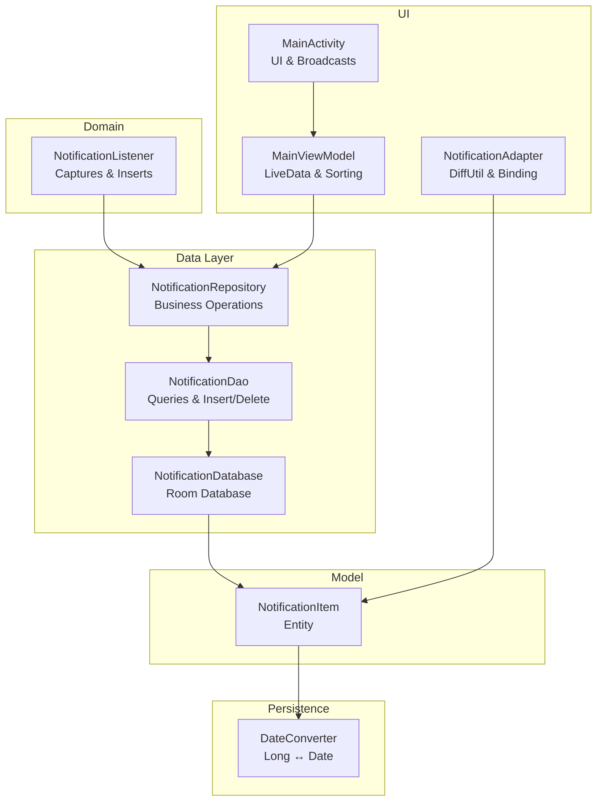
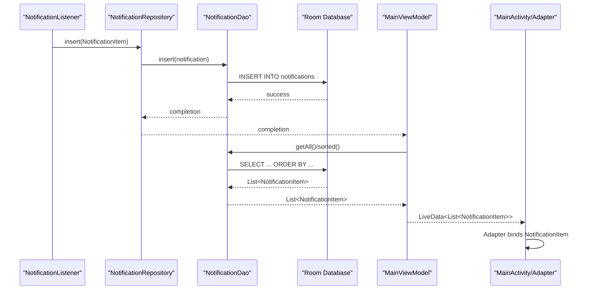
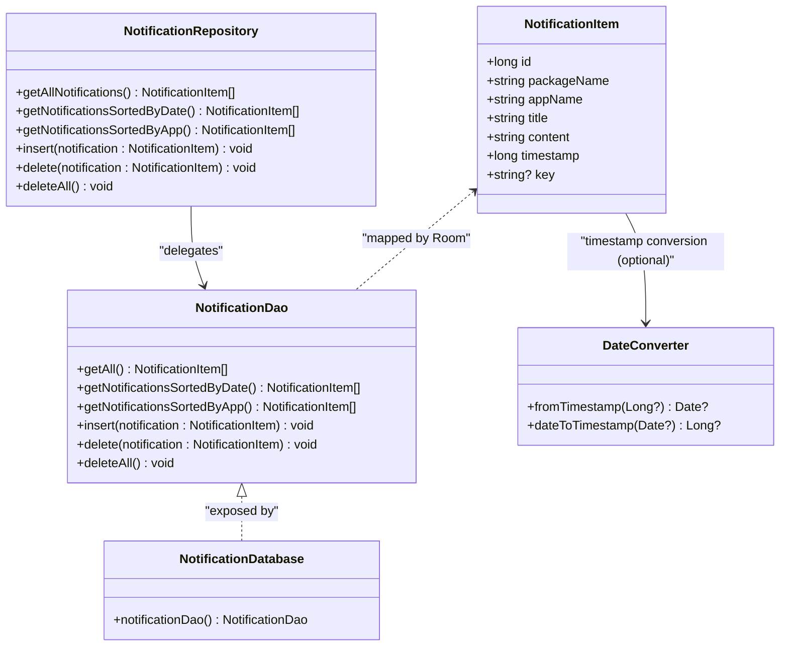
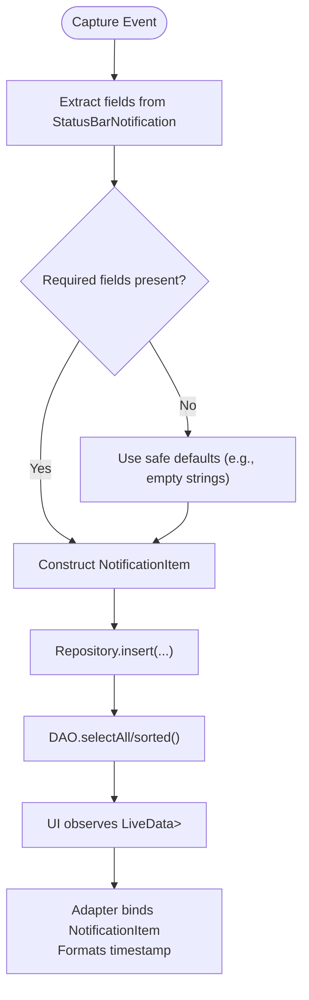
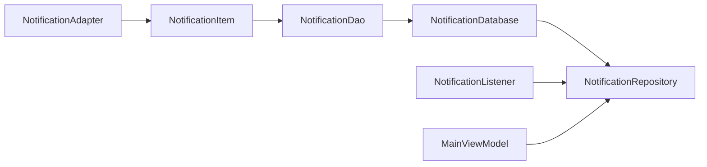

# Entity Models

<cite>
**Referenced Files in This Document**
- [NotificationItem.kt](file://app/src/main/java/com/notificationlog/model/NotificationItem.kt)
- [NotificationDao.kt](file://app/src/main/java/com/notificationlog/data/NotificationDao.kt)
- [NotificationDatabase.kt](file://app/src/main/java/com/notificationlog/data/NotificationDatabase.kt)
- [NotificationRepository.kt](file://app/src/main/java/com/notificationlog/repository/NotificationRepository.kt)
- [NotificationListener.kt](file://app/src/main/java/com/notificationlog/NotificationListener.kt)
- [DateConverter.kt](file://app/src/main/java/com/notificationlog/DateConverter.kt)
- [NotificationAdapter.kt](file://app/src/main/java/com/notificationlog/adapter/NotificationAdapter.kt)
- [MainViewModel.kt](file://app/src/main/java/com/notificationlog/MainViewModel.kt)
- [MainActivity.kt](file://app/src/main/java/com/notificationlog/MainActivity.kt)
</cite>

## Table of Contents
1. [Introduction](#introduction)
2. [Project Structure](#project-structure)
3. [Core Components](#core-components)
4. [Architecture Overview](#architecture-overview)
5. [Detailed Component Analysis](#detailed-component-analysis)
6. [Dependency Analysis](#dependency-analysis)
7. [Performance Considerations](#performance-considerations)
8. [Troubleshooting Guide](#troubleshooting-guide)
9. [Conclusion](#conclusion)

## Introduction
This document provides a comprehensive entity model specification for NotificationItem, focusing on its structure, Room annotations, constraints, and integration across the application. It also covers lifecycle, serialization, DAO operations, and extension guidance for future enhancements.

## Project Structure
The NotificationItem entity resides in the model package and is consumed by the data access layer (DAO), repository, and UI components. Type conversion for timestamps is handled via a dedicated converter.

**Diagram sources**
- [NotificationItem.kt:1-19](file://app/src/main/java/com/notificationlog/model/NotificationItem.kt#L1-L19)
- [NotificationDao.kt:1-26](file://app/src/main/java/com/notificationlog/data/NotificationDao.kt#L1-L26)
- [NotificationDatabase.kt:1-10](file://app/src/main/java/com/notificationlog/data/NotificationDatabase.kt#L1-L10)
- [NotificationRepository.kt:1-28](file://app/src/main/java/com/notificationlog/repository/NotificationRepository.kt#L1-L28)
- [NotificationListener.kt:1-173](file://app/src/main/java/com/notificationlog/NotificationListener.kt#L1-L173)
- [DateConverter.kt:1-16](file://app/src/main/java/com/notificationlog/DateConverter.kt#L1-L16)
- [NotificationAdapter.kt:1-59](file://app/src/main/java/com/notificationlog/adapter/NotificationAdapter.kt#L1-L59)
- [MainViewModel.kt:1-121](file://app/src/main/java/com/notificationlog/MainViewModel.kt#L1-L121)
- [MainActivity.kt:1-717](file://app/src/main/java/com/notificationlog/MainActivity.kt#L1-L717)

**Section sources**
- [NotificationItem.kt:1-19](file://app/src/main/java/com/notificationlog/model/NotificationItem.kt#L1-L19)
- [NotificationDao.kt:1-26](file://app/src/main/java/com/notificationlog/data/NotificationDao.kt#L1-L26)
- [NotificationDatabase.kt:1-10](file://app/src/main/java/com/notificationlog/data/NotificationDatabase.kt#L1-L10)
- [NotificationRepository.kt:1-28](file://app/src/main/java/com/notificationlog/repository/NotificationRepository.kt#L1-L28)
- [NotificationListener.kt:1-173](file://app/src/main/java/com/notificationlog/NotificationListener.kt#L1-L173)
- [DateConverter.kt:1-16](file://app/src/main/java/com/notificationlog/DateConverter.kt#L1-L16)
- [NotificationAdapter.kt:1-59](file://app/src/main/java/com/notificationlog/adapter/NotificationAdapter.kt#L1-L59)
- [MainViewModel.kt:1-121](file://app/src/main/java/com/notificationlog/MainViewModel.kt#L1-L121)
- [MainActivity.kt:1-717](file://app/src/main/java/com/notificationlog/MainActivity.kt#L1-L717)

## Core Components
- NotificationItem: Room entity representing a single notification record persisted locally.
- NotificationDao: Declares queries and mutation operations for NotificationItem.
- NotificationDatabase: Room database exposing NotificationDao and declaring NotificationItem as an entity.
- NotificationRepository: Encapsulates DAO operations for higher-level consumption.
- DateConverter: Provides type conversion for timestamp fields stored as Long.

Key characteristics derived from the code:
- Entity name: notifications (table name annotation).
- Primary key: id (Long), auto-generated by Room.
- Timestamp: stored as Long (milliseconds since epoch).
- Optional key: sbn.key mapped to a nullable String field.
- Parcelable support via @Parcelize for cross-process transport.

**Section sources**
- [NotificationItem.kt:8-19](file://app/src/main/java/com/notificationlog/model/NotificationItem.kt#L8-L19)
- [NotificationDao.kt:9-25](file://app/src/main/java/com/notificationlog/data/NotificationDao.kt#L9-L25)
- [NotificationDatabase.kt:7-10](file://app/src/main/java/com/notificationlog/data/NotificationDatabase.kt#L7-L10)
- [DateConverter.kt:6-16](file://app/src/main/java/com/notificationlog/DateConverter.kt#L6-L16)

## Architecture Overview
The entity participates in a clean architecture pattern:
- Data capture occurs in NotificationListener, which constructs NotificationItem instances and inserts them via NotificationRepository and NotificationDao.
- UI observes LiveData from MainViewModel, which delegates to NotificationRepository and DAO.
- Room persists NotificationItem records in the notifications table.
- DateConverter ensures consistent timestamp handling.

**Diagram sources**
- [NotificationListener.kt:130-149](file://app/src/main/java/com/notificationlog/NotificationListener.kt#L130-L149)
- [NotificationRepository.kt:16-18](file://app/src/main/java/com/notificationlog/repository/NotificationRepository.kt#L16-L18)
- [NotificationDao.kt:18-19](file://app/src/main/java/com/notificationlog/data/NotificationDao.kt#L18-L19)
- [NotificationDao.kt:9-16](file://app/src/main/java/com/notificationlog/data/NotificationDao.kt#L9-L16)
- [MainViewModel.kt:59-76](file://app/src/main/java/com/notificationlog/MainViewModel.kt#L59-L76)
- [NotificationAdapter.kt:25-49](file://app/src/main/java/com/notificationlog/adapter/NotificationAdapter.kt#L25-L49)

## Detailed Component Analysis

### NotificationItem Entity Model
- Table: notifications
- Primary key: id (Long, auto-generated)
- Fields:
  - id: Long (auto-generated)
  - packageName: String
  - appName: String
  - title: String
  - content: String
  - timestamp: Long
  - key: String? (nullable)
- Annotations:
  - @Entity(tableName = "notifications")
  - @PrimaryKey(autoGenerate = true)
  - @Parcelize (Parcelable)
- Constraints:
  - No explicit NOT NULL constraints are declared in the entity definition; however, Room does not enforce Kotlin non-nullability at the SQL level. Consumers should ensure non-null values for required fields during insertion.
- Column naming:
  - Defaults to field names (packageName, appName, title, content, timestamp, key). No @ColumnInfo annotations are present, so Room uses the declared property names as column names.
- Type converters:
  - No custom converter is applied to NotificationItem fields. Timestamp is stored as Long and converted to Date using DateConverter when needed elsewhere in the app.

**Diagram sources**
- [NotificationItem.kt:8-19](file://app/src/main/java/com/notificationlog/model/NotificationItem.kt#L8-L19)
- [NotificationDao.kt:6-26](file://app/src/main/java/com/notificationlog/data/NotificationDao.kt#L6-L26)
- [NotificationDatabase.kt:7-10](file://app/src/main/java/com/notificationlog/data/NotificationDatabase.kt#L7-L10)
- [NotificationRepository.kt:6-27](file://app/src/main/java/com/notificationlog/repository/NotificationRepository.kt#L6-L27)
- [DateConverter.kt:6-16](file://app/src/main/java/com/notificationlog/DateConverter.kt#L6-L16)

**Section sources**
- [NotificationItem.kt:8-19](file://app/src/main/java/com/notificationlog/model/NotificationItem.kt#L8-L19)
- [NotificationDao.kt:9-25](file://app/src/main/java/com/notificationlog/data/NotificationDao.kt#L9-L25)
- [NotificationDatabase.kt:7-10](file://app/src/main/java/com/notificationlog/data/NotificationDatabase.kt#L7-L10)
- [DateConverter.kt:6-16](file://app/src/main/java/com/notificationlog/DateConverter.kt#L6-L16)

### Field Definitions and Data Types
- id: Long, auto-generated primary key
- packageName: String, app package identifier
- appName: String, human-readable app name
- title: String, notification title
- content: String, notification content/body
- timestamp: Long, milliseconds since epoch
- key: String?, nullable notification key from StatusBarNotification

Constraints and defaults:
- No explicit NOT NULL constraints are declared in the entity. Non-nullability is enforced by Kotlin types but not at the SQL schema level. Ensure callers supply non-null values for required fields.

Column naming strategy:
- Uses default naming derived from property names. No @ColumnInfo annotations are present.

**Section sources**
- [NotificationItem.kt:10-19](file://app/src/main/java/com/notificationlog/model/NotificationItem.kt#L10-L19)

### Room Annotations and Type Converters
- @Entity(tableName = "notifications"): Declares the table name.
- @PrimaryKey(autoGenerate = true): Enables Room to auto-generate ids.
- @Parcelize: Adds Parcelable support for inter-process communication.
- DateConverter: Converts between Long (epoch millis) and Date for broader parts of the app. While not directly converting NotificationItem fields, it demonstrates the intended timestamp handling pattern.

Integration with DAO:
- Queries order by timestamp descending and by appName then timestamp for grouped sorting.
- Insert uses REPLACE conflict strategy to handle duplicates.

**Section sources**
- [NotificationItem.kt:8-19](file://app/src/main/java/com/notificationlog/model/NotificationItem.kt#L8-L19)
- [NotificationDao.kt:9-25](file://app/src/main/java/com/notificationlog/data/NotificationDao.kt#L9-L25)
- [DateConverter.kt:6-16](file://app/src/main/java/com/notificationlog/DateConverter.kt#L6-L16)

### Entity Instantiation and Field Access Patterns
- Instantiation occurs in NotificationListener when capturing notifications. The builder-style construction passes required fields and timestamp.
- Field access patterns in UI:
  - MainActivity formats timestamp to a readable string using Date conversion.
  - NotificationAdapter binds NotificationItem to views and formats timestamp for display.
- Validation approaches:
  - NotificationListener extracts title and content from notification extras, falling back to empty strings if missing.
  - Repository and DAO operations are invoked with validated NotificationItem instances.

**Diagram sources**
- [NotificationListener.kt:109-149](file://app/src/main/java/com/notificationlog/NotificationListener.kt#L109-L149)
- [NotificationRepository.kt:16-18](file://app/src/main/java/com/notificationlog/repository/NotificationRepository.kt#L16-L18)
- [NotificationDao.kt:9-16](file://app/src/main/java/com/notificationlog/data/NotificationDao.kt#L9-L16)
- [MainViewModel.kt:59-76](file://app/src/main/java/com/notificationlog/MainViewModel.kt#L59-L76)
- [NotificationAdapter.kt:25-49](file://app/src/main/java/com/notificationlog/adapter/NotificationAdapter.kt#L25-L49)
- [MainActivity.kt:416-436](file://app/src/main/java/com/notificationlog/MainActivity.kt#L416-L436)

**Section sources**
- [NotificationListener.kt:109-149](file://app/src/main/java/com/notificationlog/NotificationListener.kt#L109-L149)
- [NotificationAdapter.kt:25-49](file://app/src/main/java/com/notificationlog/adapter/NotificationAdapter.kt#L25-L49)
- [MainActivity.kt:416-436](file://app/src/main/java/com/notificationlog/MainActivity.kt#L416-L436)

### Entity Lifecycle and Serialization
- Lifecycle:
  - Creation: NotificationListener constructs NotificationItem upon onNotificationPosted.
  - Persistence: Repository and DAO insert/update/delete records.
  - Retrieval: DAO queries return lists ordered by timestamp or app name.
  - Deletion: Per-item delete and bulk delete supported.
- Serialization:
  - @Parcelize enables Parcelable serialization for passing NotificationItem across process boundaries (e.g., intents).
  - No JSON serialization is used for this entity in the codebase.

**Section sources**
- [NotificationListener.kt:130-149](file://app/src/main/java/com/notificationlog/NotificationListener.kt#L130-L149)
- [NotificationRepository.kt:16-26](file://app/src/main/java/com/notificationlog/repository/NotificationRepository.kt#L16-L26)
- [NotificationDao.kt:18-25](file://app/src/main/java/com/notificationlog/data/NotificationDao.kt#L18-L25)
- [NotificationItem.kt:8-19](file://app/src/main/java/com/notificationlog/model/NotificationItem.kt#L8-L19)

### Extension Guidance
To add new notification attributes:
- Add a new field to NotificationItem with appropriate type and nullability semantics.
- Update DAO queries to select/include the new column if needed.
- Adjust NotificationListener to populate the new field from StatusBarNotification extras or other sources.
- If storing dates as Date, consider adding a TypeConverter similar to DateConverter for the new field.
- Update UI components to render/display the new attribute.
- Consider adding NOT NULL constraints at the SQL level if applicable, and adjust insert logic accordingly.

[No sources needed since this section provides general guidance]

## Dependency Analysis
- NotificationItem depends on Room annotations and Parcelization.
- DAO depends on the entity and defines query contracts.
- Database aggregates entities and exposes DAO.
- Repository encapsulates DAO usage for higher-level operations.
- Listener constructs and inserts NotificationItem.
- UI components observe and render NotificationItem.

**Diagram sources**
- [NotificationItem.kt:8-19](file://app/src/main/java/com/notificationlog/model/NotificationItem.kt#L8-L19)
- [NotificationDao.kt:6-26](file://app/src/main/java/com/notificationlog/data/NotificationDao.kt#L6-L26)
- [NotificationDatabase.kt:7-10](file://app/src/main/java/com/notificationlog/data/NotificationDatabase.kt#L7-L10)
- [NotificationRepository.kt:6-27](file://app/src/main/java/com/notificationlog/repository/NotificationRepository.kt#L6-L27)
- [NotificationListener.kt:130-149](file://app/src/main/java/com/notificationlog/NotificationListener.kt#L130-L149)
- [MainViewModel.kt:59-76](file://app/src/main/java/com/notificationlog/MainViewModel.kt#L59-L76)
- [NotificationAdapter.kt:25-49](file://app/src/main/java/com/notificationlog/adapter/NotificationAdapter.kt#L25-L49)

**Section sources**
- [NotificationItem.kt:8-19](file://app/src/main/java/com/notificationlog/model/NotificationItem.kt#L8-L19)
- [NotificationDao.kt:6-26](file://app/src/main/java/com/notificationlog/data/NotificationDao.kt#L6-L26)
- [NotificationDatabase.kt:7-10](file://app/src/main/java/com/notificationlog/data/NotificationDatabase.kt#L7-L10)
- [NotificationRepository.kt:6-27](file://app/src/main/java/com/notificationlog/repository/NotificationRepository.kt#L6-L27)
- [NotificationListener.kt:130-149](file://app/src/main/java/com/notificationlog/NotificationListener.kt#L130-L149)
- [MainViewModel.kt:59-76](file://app/src/main/java/com/notificationlog/MainViewModel.kt#L59-L76)
- [NotificationAdapter.kt:25-49](file://app/src/main/java/com/notificationlog/adapter/NotificationAdapter.kt#L25-L49)

## Performance Considerations
- Prefer indexed columns for frequent filters (e.g., appName, timestamp) if query volume grows; currently, sorting is handled by ORDER BY clauses.
- Batch operations: Use DAO insert(vararg) or transaction blocks for bulk inserts to reduce overhead.
- Pagination: For large datasets, implement LIMIT/OFFSET or cursor-based pagination in queries.
- UI rendering: Adapter uses DiffUtil to minimize UI updates; keep NotificationItem immutable for efficient comparison.

[No sources needed since this section provides general guidance]

## Troubleshooting Guide
Common issues and resolutions:
- Missing required fields: Ensure packageName, appName, title, content, and timestamp are populated before insertion. NotificationListener falls back to empty strings if fields are absent.
- Timestamp inconsistencies: Verify that timestamp originates from StatusBarNotification.postTime and is stored as Long. Use DateConverter when displaying or persisting as Date elsewhere.
- Duplicate entries: DAO uses REPLACE on insert; confirm whether this behavior matches desired semantics.
- UI not updating: Ensure LiveData is observed and the adapter receives updated lists. Check that broadcasts trigger UI refreshes.

**Section sources**
- [NotificationListener.kt:114-116](file://app/src/main/java/com/notificationlog/NotificationListener.kt#L114-L116)
- [NotificationDao.kt:18-19](file://app/src/main/java/com/notificationlog/data/NotificationDao.kt#L18-L19)
- [DateConverter.kt:6-16](file://app/src/main/java/com/notificationlog/DateConverter.kt#L6-L16)
- [MainActivity.kt:57-65](file://app/src/main/java/com/notificationlog/MainActivity.kt#L57-L65)

## Conclusion
NotificationItem is a concise, well-integrated Room entity that captures essential notification metadata with a clear lifecycle from capture to persistence and UI presentation. Its design supports efficient querying, UI binding, and straightforward extension for additional attributes while maintaining simplicity and performance.