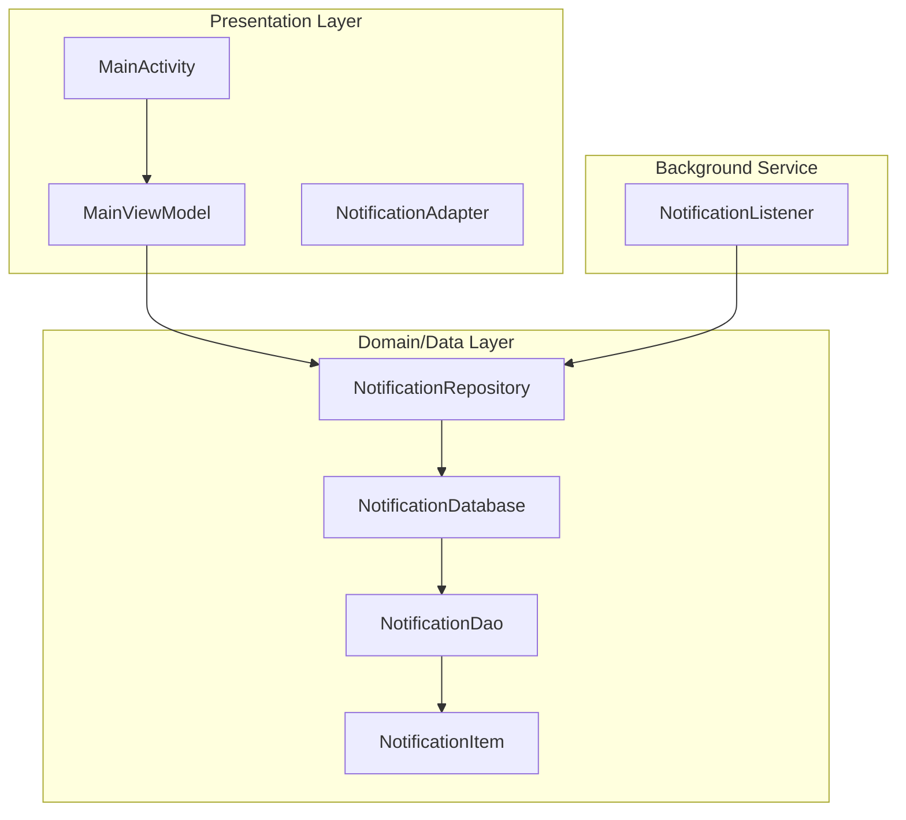
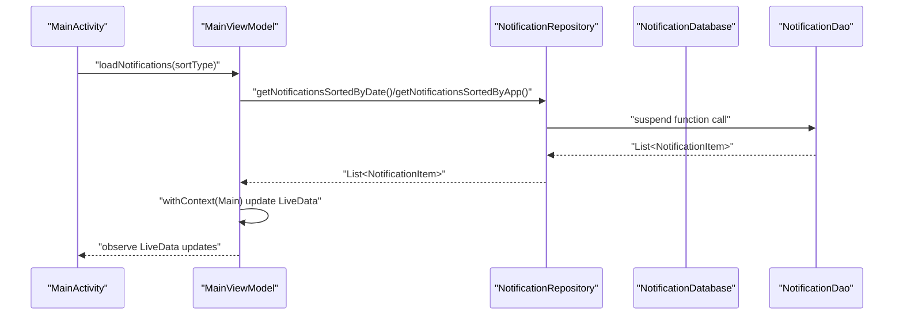
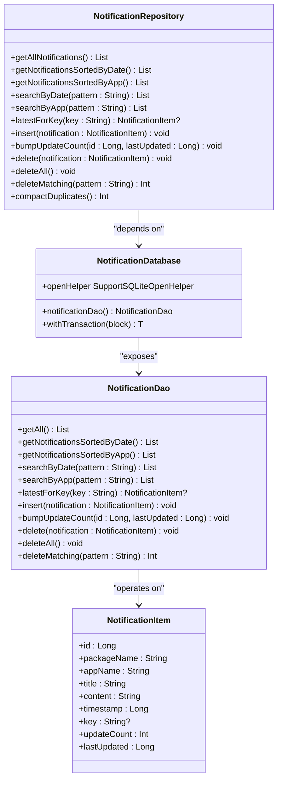
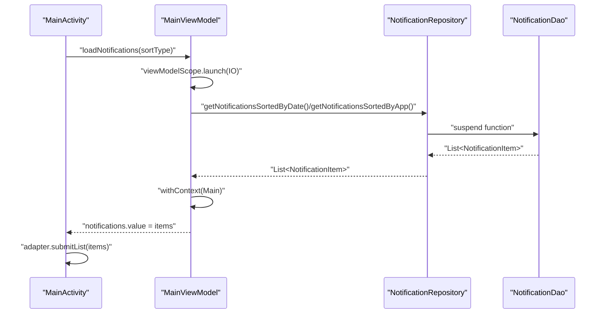
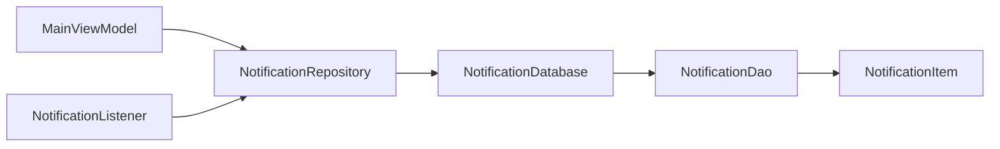

# Repository Pattern Implementation

<cite>
**Referenced Files in This Document**
- [NotificationRepository.kt](file://app/src/main/java/com/notificationlog/repository/NotificationRepository.kt)
- [NotificationDao.kt](file://app/src/main/java/com/notificationlog/data/NotificationDao.kt)
- [NotificationDatabase.kt](file://app/src/main/java/com/notificationlog/data/NotificationDatabase.kt)
- [NotificationItem.kt](file://app/src/main/java/com/notificationlog/model/NotificationItem.kt)
- [MainViewModel.kt](file://app/src/main/java/com/notificationlog/MainViewModel.kt)
- [MainActivity.kt](file://app/src/main/java/com/notificationlog/MainActivity.kt)
- [NotificationApp.kt](file://app/src/main/java/com/notificationlog/NotificationApp.kt)
- [NotificationAdapter.kt](file://app/src/main/java/com/notificationlog/adapter/NotificationAdapter.kt)
- [NotificationListener.kt](file://app/src/main/java/com/notificationlog/NotificationListener.kt)
- [AndroidManifest.xml](file://app/src/main/AndroidManifest.xml)
</cite>

## Update Summary
**Changes Made**
- Enhanced NotificationRepository with new search pattern matching methods (searchByDate, searchByApp)
- Added duplicate compaction functionality (compactDuplicates) for data integrity operations
- Implemented improved data integrity operations including latestForKey and bumpUpdateCount
- Updated NotificationItem entity with updateCount and lastUpdated fields for deduplication support
- Added bulk delete functionality (deleteMatching) for efficient data management
- Enhanced ViewModel integration with new LiveData streams for compact results and bulk deletion feedback

## Table of Contents
1. [Introduction](#introduction)
2. [Project Structure](#project-structure)
3. [Core Components](#core-components)
4. [Architecture Overview](#architecture-overview)
5. [Detailed Component Analysis](#detailed-component-analysis)
6. [Dependency Analysis](#dependency-analysis)
7. [Performance Considerations](#performance-considerations)
8. [Troubleshooting Guide](#troubleshooting-guide)
9. [Conclusion](#conclusion)
10. [Appendices](#appendices)

## Introduction
This document provides comprehensive repository pattern documentation for the enhanced NotificationRepository implementation. It explains how the repository acts as a data access abstraction layer, coordinates between UI and data layers, and integrates with LiveData and reactive programming patterns. The updated implementation includes advanced features like duplicate compaction, search pattern matching, and improved data integrity operations. It also covers singleton pattern implementation, dependency injection considerations, thread safety, Room integration, error handling, asynchronous operations, coroutine scope management, and testing strategies.

## Project Structure
The project follows a layered architecture:
- Presentation layer: Activities, ViewModels, Adapters
- Domain/Data layer: Repository, DAO, Database, Entity
- Background service: NotificationListener

**Diagram sources**
- [MainActivity.kt:56-167](file://app/src/main/java/com/notificationlog/MainActivity.kt#L56-L167)
- [MainViewModel.kt:19-285](file://app/src/main/java/com/notificationlog/MainViewModel.kt#L19-L285)
- [NotificationRepository.kt:8-92](file://app/src/main/java/com/notificationlog/repository/NotificationRepository.kt#L8-L92)
- [NotificationDao.kt:6-68](file://app/src/main/java/com/notificationlog/data/NotificationDao.kt#L6-L68)
- [NotificationDatabase.kt:9-43](file://app/src/main/java/com/notificationlog/data/NotificationDatabase.kt#L9-L43)
- [NotificationItem.kt:18-35](file://app/src/main/java/com/notificationlog/model/NotificationItem.kt#L18-L35)
- [NotificationListener.kt:23-211](file://app/src/main/java/com/notificationlog/NotificationListener.kt#L23-L211)

**Section sources**
- [MainActivity.kt:56-167](file://app/src/main/java/com/notificationlog/MainActivity.kt#L56-L167)
- [MainViewModel.kt:19-285](file://app/src/main/java/com/notificationlog/MainViewModel.kt#L19-L285)
- [NotificationRepository.kt:8-92](file://app/src/main/java/com/notificationlog/repository/NotificationRepository.kt#L8-L92)
- [NotificationDao.kt:6-68](file://app/src/main/java/com/notificationlog/data/NotificationDao.kt#L6-L68)
- [NotificationDatabase.kt:9-43](file://app/src/main/java/com/notificationlog/data/NotificationDatabase.kt#L9-L43)
- [NotificationItem.kt:18-35](file://app/src/main/java/com/notificationlog/model/NotificationItem.kt#L18-L35)
- [NotificationListener.kt:23-211](file://app/src/main/java/com/notificationlog/NotificationListener.kt#L23-L211)

## Core Components
- **NotificationRepository**: Centralized data access facade with enhanced capabilities including search pattern matching, duplicate compaction, and improved data integrity operations. Methods forward suspend DAO calls and expose them as suspend functions to callers.
- **NotificationDao**: Room DAO interface with suspend functions for CRUD operations, sorted queries, and advanced search operations.
- **NotificationDatabase**: Room database exposing DAO accessor with migration support for schema evolution.
- **NotificationItem**: Entity representing persisted notification records with deduplication support through updateCount and lastUpdated fields.
- **MainViewModel**: Orchestrates UI state with LiveData and delegates data operations to the repository, now including compact results and bulk deletion feedback.
- **MainActivity**: Observes LiveData and triggers ViewModel actions, including new UI interactions for duplicate compaction and bulk deletion.
- **NotificationApp**: Application-level initialization setting up Room database and a global repository instance.
- **NotificationAdapter**: UI adapter using DiffUtil for efficient list updates.
- **NotificationListener**: Background service capturing notifications and persisting them via repository with deduplication logic.

Key responsibilities:
- Repository encapsulates data access logic and exposes a clean API to ViewModels with advanced data manipulation capabilities.
- DAO defines typed, suspend-based database operations including complex search patterns and bulk operations.
- ViewModel manages UI state and orchestrates async operations with comprehensive error handling.
- Adapter observes list changes and renders efficiently with deduplication-aware display.

**Section sources**
- [NotificationRepository.kt:8-92](file://app/src/main/java/com/notificationlog/repository/NotificationRepository.kt#L8-L92)
- [NotificationDao.kt:6-68](file://app/src/main/java/com/notificationlog/data/NotificationDao.kt#L6-L68)
- [NotificationDatabase.kt:9-43](file://app/src/main/java/com/notificationlog/data/NotificationDatabase.kt#L9-L43)
- [NotificationItem.kt:18-35](file://app/src/main/java/com/notificationlog/model/NotificationItem.kt#L18-L35)
- [MainViewModel.kt:19-285](file://app/src/main/java/com/notificationlog/MainViewModel.kt#L19-L285)
- [MainActivity.kt:56-800](file://app/src/main/java/com/notificationlog/MainActivity.kt#L56-L800)
- [NotificationApp.kt:9-39](file://app/src/main/java/com/notificationlog/NotificationApp.kt#L9-L39)
- [NotificationAdapter.kt:13-59](file://app/src/main/java/com/notificationlog/adapter/NotificationAdapter.kt#L13-L59)
- [NotificationListener.kt:23-211](file://app/src/main/java/com/notificationlog/NotificationListener.kt#L23-L211)

## Architecture Overview
The repository pattern centralizes data access behind a single interface, enabling:
- Decoupling UI from persistence details
- Testability via dependency injection
- Consistent error handling and threading
- Reactive UI updates through LiveData
- Advanced data integrity operations and deduplication

**Diagram sources**
- [MainActivity.kt:578-645](file://app/src/main/java/com/notificationlog/MainActivity.kt#L578-L645)
- [MainViewModel.kt:133-161](file://app/src/main/java/com/notificationlog/MainViewModel.kt#L133-L161)
- [NotificationRepository.kt:10-16](file://app/src/main/java/com/notificationlog/repository/NotificationRepository.kt#L10-L16)
- [NotificationDao.kt:11-18](file://app/src/main/java/com/notificationlog/data/NotificationDao.kt#L11-L18)

## Detailed Component Analysis

### Enhanced NotificationRepository
Responsibilities:
- Delegates DAO operations to the database with enhanced capabilities
- Exposes suspend functions for UI and background threads
- Provides method forwarding for read/write/delete operations
- Implements advanced data integrity operations including duplicate compaction
- Supports search pattern matching and bulk operations
- Maintains thread safety by relying on Room's suspend DAO methods

**Updated** Enhanced with new methods for duplicate compaction, search pattern matching, and improved data integrity operations.

Implementation patterns:
- Method delegation: Each public suspend function forwards to the DAO's corresponding suspend function.
- Single constructor dependency: Receives a NotificationDatabase instance injected at application startup.
- Transactional operations: Uses Room transactions for complex data integrity operations.

Thread safety:
- DAO methods are suspend and executed on Room's background dispatcher.
- Repository itself is stateless and immutable after construction.
- Complex operations use Room transactions for atomicity.

Error handling:
- Exceptions propagate from DAO to callers; handled in ViewModel with CoroutineExceptionHandler and UI error LiveData.

Extensibility:
- New methods can be added to the repository while keeping DAO unchanged.
- Future enhancements can introduce caching layers or transformation logic here.

**Section sources**
- [NotificationRepository.kt:8-92](file://app/src/main/java/com/notificationlog/repository/NotificationRepository.kt#L8-L92)
- [NotificationDao.kt:6-68](file://app/src/main/java/com/notificationlog/data/NotificationDao.kt#L6-L68)
- [NotificationDatabase.kt:9-43](file://app/src/main/java/com/notificationlog/data/NotificationDatabase.kt#L9-L43)

#### Enhanced Class Diagram

**Diagram sources**
- [NotificationRepository.kt:8-92](file://app/src/main/java/com/notificationlog/repository/NotificationRepository.kt#L8-L92)
- [NotificationDatabase.kt:9-43](file://app/src/main/java/com/notificationlog/data/NotificationDatabase.kt#L9-L43)
- [NotificationDao.kt:6-68](file://app/src/main/java/com/notificationlog/data/NotificationDao.kt#L6-L68)
- [NotificationItem.kt:18-35](file://app/src/main/java/com/notificationlog/model/NotificationItem.kt#L18-L35)

### Enhanced MainViewModel and LiveData Observation Patterns
Responsibilities:
- Manages UI state with LiveData for service status, notifications, counts, errors, compact results, and bulk deletion feedback.
- Uses viewModelScope for lifecycle-aware coroutine execution.
- Delegates data operations to the repository and updates LiveData on the main thread.
- Handles search pattern matching and deduplication operations.

**Updated** Enhanced with new LiveData streams for compact results and bulk deletion feedback.

LiveData observation:
- MainActivity observes LiveData streams and updates UI accordingly.
- Adapter receives list updates via submitList and DiffUtil.
- New observers handle compact results and bulk deletion feedback.

Reactive programming:
- CoroutineExceptionHandler centralizes error handling.
- Dispatchers.IO for database operations, Dispatchers.Main for UI updates.

Asynchronous operation handling:
- loadNotifications, deleteNotification, clearNotifications, compactDuplicates, deleteMatching use viewModelScope.launch with IO dispatcher.
- withContext switches between IO and Main for safe UI updates.

Memory leak prevention:
- Uses viewModelScope which cancels coroutines on ViewModel destruction.
- No retained references to Activity/Fragment.

**Section sources**
- [MainViewModel.kt:19-285](file://app/src/main/java/com/notificationlog/MainViewModel.kt#L19-L285)
- [MainActivity.kt:578-645](file://app/src/main/java/com/notificationlog/MainActivity.kt#L578-L645)
- [NotificationAdapter.kt:13-59](file://app/src/main/java/com/notificationlog/adapter/NotificationAdapter.kt#L13-L59)

#### Enhanced Sequence Diagram: Load Notifications Flow with Search

**Diagram sources**
- [MainViewModel.kt:133-161](file://app/src/main/java/com/notificationlog/MainViewModel.kt#L133-L161)
- [NotificationRepository.kt:10-16](file://app/src/main/java/com/notificationlog/repository/NotificationRepository.kt#L10-L16)
- [NotificationDao.kt:11-18](file://app/src/main/java/com/notificationlog/data/NotificationDao.kt#L11-L18)
- [MainActivity.kt:602-613](file://app/src/main/java/com/notificationlog/MainActivity.kt#L602-L613)
- [NotificationAdapter.kt:13-59](file://app/src/main/java/com/notificationlog/adapter/NotificationAdapter.kt#L13-L59)

### Singleton Pattern and Dependency Injection Considerations
Singleton pattern implementation:
- NotificationApp holds a static repository instance initialized during application startup.
- Repository is constructed with a NotificationDatabase instance.

Dependency injection considerations:
- Current implementation uses a global singleton via NotificationApp.repository.
- Recommended DI improvements:
  - Use a DI framework (e.g., Hilt) to inject NotificationRepository into ViewModels and Services.
  - Provide a factory or module to supply Room database instances.
  - Enable easy mocking for tests by injecting interfaces instead of concrete classes.

Thread safety:
- Repository is stateless and immutable after construction.
- Room database and DAO are thread-safe; suspend functions ensure safe execution.

**Section sources**
- [NotificationApp.kt:9-39](file://app/src/main/java/com/notificationlog/NotificationApp.kt#L9-L39)
- [NotificationRepository.kt:8-92](file://app/src/main/java/com/notificationlog/repository/NotificationRepository.kt#L8-L92)

### Enhanced Integration with NotificationDatabase and NotificationDao
Method forwarding:
- getAllNotifications -> DAO.getAll
- getNotificationsSortedByDate -> DAO.getNotificationsSortedByDate
- getNotificationsSortedByApp -> DAO.getNotificationsSortedByApp
- searchByDate -> DAO.searchByDate (NEW)
- searchByApp -> DAO.searchByApp (NEW)
- latestForKey -> DAO.latestForKey (NEW)
- insert -> DAO.insert
- bumpUpdateCount -> DAO.bumpUpdateCount (NEW)
- delete -> DAO.delete
- deleteAll -> DAO.deleteAll
- deleteMatching -> DAO.deleteMatching (NEW)

**Updated** Enhanced with new methods for search pattern matching, data integrity operations, and bulk deletion.

Error handling strategies:
- DAO methods throw exceptions on failure; ViewModel catches and posts error messages to UI.
- NotificationListener wraps repository calls in try/catch and logs failures.

Complex data operations:
- Sorting by timestamp and app name via DAO queries.
- Insertion with REPLACE conflict strategy ensures deduplication.
- Duplicate compaction using scratch tables for performance optimization.
- Bulk deletion operations for efficient data management.

Caching strategies:
- Current implementation does not implement application-level caching.
- Room's internal caching and query result caching occur automatically.

**Section sources**
- [NotificationRepository.kt:10-92](file://app/src/main/java/com/notificationlog/repository/NotificationRepository.kt#L10-L92)
- [NotificationDao.kt:11-68](file://app/src/main/java/com/notificationlog/data/NotificationDao.kt#L11-L68)
- [MainViewModel.kt:133-285](file://app/src/main/java/com/notificationlog/MainViewModel.kt#L133-L285)
- [NotificationListener.kt:155-189](file://app/src/main/java/com/notificationlog/NotificationListener.kt#L155-L189)

### Enhanced Data Transformation Patterns
- Timestamp formatting occurs in the UI layer (adapter) for display purposes.
- App name resolution happens in the background service before insertion.
- Deduplication logic in NotificationListener handles ongoing notifications by bumping updateCount.
- No transformation logic is implemented in the repository; transformations remain in UI or service layers.

**Updated** Enhanced with deduplication support through updateCount tracking and lastUpdated field management.

**Section sources**
- [NotificationAdapter.kt:33-48](file://app/src/main/java/com/notificationlog/adapter/NotificationAdapter.kt#L33-L48)
- [NotificationListener.kt:155-189](file://app/src/main/java/com/notificationlog/NotificationListener.kt#L155-L189)

### Asynchronous Operations, Coroutine Scope Management, and Memory Leak Prevention
- ViewModel uses viewModelScope for lifecycle-aware coroutine execution.
- Dispatchers.IO for database operations; Dispatchers.Main for UI updates.
- CoroutineExceptionHandler centralizes error handling and posts messages to LiveData.
- NotificationListener uses CoroutineScope with SupervisorJob and cancels on destroy.

Memory leak prevention:
- viewModelScope cancels on ViewModel destruction.
- NotificationListener cancels its SupervisorJob in onDestroy.

**Section sources**
- [MainViewModel.kt:61-63](file://app/src/main/java/com/notificationlog/MainViewModel.kt#L61-L63)
- [MainViewModel.kt:133-285](file://app/src/main/java/com/notificationlog/MainViewModel.kt#L133-L285)
- [NotificationListener.kt:25-26](file://app/src/main/java/com/notificationlog/NotificationListener.kt#L25-L26)
- [NotificationListener.kt:205-209](file://app/src/main/java/com/notificationlog/NotificationListener.kt#L205-L209)

### Enhanced Testing Strategies, Mock Implementations, and Extension Patterns
Testing strategies:
- Mock NotificationRepository in ViewModels for unit tests.
- Use InMemoryDatabase or Room test helpers to replace NotificationDatabase.
- Verify LiveData emissions and error messages.
- Test new search pattern matching and duplicate compaction functionality.

Mock implementations:
- Create a Repository interface and mock implementations for testing.
- Inject mocks via DI or constructor parameters.

Extension patterns:
- Add caching layer in repository for frequently accessed data.
- Introduce transformation functions for derived data (e.g., grouped by day).
- Add filtering and pagination support.
- Extend search capabilities with advanced pattern matching.

**Section sources**
- [MainViewModel.kt:19-285](file://app/src/main/java/com/notificationlog/MainViewModel.kt#L19-L285)
- [NotificationRepository.kt:8-92](file://app/src/main/java/com/notificationlog/repository/NotificationRepository.kt#L8-L92)

## Dependency Analysis
Direct dependencies:
- MainViewModel depends on NotificationApp.repository (global singleton).
- NotificationRepository depends on NotificationDatabase.
- NotificationDatabase depends on NotificationDao.
- NotificationDao depends on NotificationItem entity.
- NotificationListener depends on NotificationRepository and Room database.

Potential circular dependencies:
- None observed; dependencies flow from UI -> ViewModel -> Repository -> Database -> DAO -> Entity.

External dependencies:
- Room for persistence.
- AndroidX Lifecycle for LiveData and ViewModel.
- AndroidX Core for NotificationCompat and PendingIntent.

**Diagram sources**
- [MainViewModel.kt:138-149](file://app/src/main/java/com/notificationlog/MainViewModel.kt#L138-L149)
- [NotificationRepository.kt:8-92](file://app/src/main/java/com/notificationlog/repository/NotificationRepository.kt#L8-L92)
- [NotificationDatabase.kt:9-43](file://app/src/main/java/com/notificationlog/data/NotificationDatabase.kt#L9-L43)
- [NotificationDao.kt:6-68](file://app/src/main/java/com/notificationlog/data/NotificationDao.kt#L6-L68)
- [NotificationItem.kt:18-35](file://app/src/main/java/com/notificationlog/model/NotificationItem.kt#L18-L35)
- [NotificationListener.kt:36-37](file://app/src/main/java/com/notificationlog/NotificationListener.kt#L36-L37)

**Section sources**
- [MainViewModel.kt:138-149](file://app/src/main/java/com/notificationlog/MainViewModel.kt#L138-L149)
- [NotificationRepository.kt:8-92](file://app/src/main/java/com/notificationlog/repository/NotificationRepository.kt#L8-L92)
- [NotificationDatabase.kt:9-43](file://app/src/main/java/com/notificationlog/data/NotificationDatabase.kt#L9-L43)
- [NotificationDao.kt:6-68](file://app/src/main/java/com/notificationlog/data/NotificationDao.kt#L6-L68)
- [NotificationItem.kt:18-35](file://app/src/main/java/com/notificationlog/model/NotificationItem.kt#L18-L35)
- [NotificationListener.kt:36-37](file://app/src/main/java/com/notificationlog/NotificationListener.kt#L36-L37)

## Performance Considerations
- DAO methods are suspend and offload work to Room's background dispatcher.
- Using DiffUtil in the adapter minimizes UI churn during list updates.
- Avoid blocking the main thread by performing all database operations on Dispatchers.IO.
- Consider adding paging for large datasets and indexing on frequently queried columns (timestamp, appName).
- **Updated** Enhanced performance through optimized duplicate compaction using scratch tables and indexed lookups.
- **Updated** Efficient search pattern matching with proper LIKE escaping and index utilization.

## Troubleshooting Guide
Common issues and resolutions:
- Notification access revoked: The listener detects disconnection and broadcasts a warning; UI shows a dialog and updates status.
- Database errors: ViewModel posts error messages to LiveData; UI displays them to the user.
- Memory leaks: Ensure viewModelScope is used and NotificationListener cancels its scope in onDestroy.
- **Updated** Duplicate compaction issues: The compactDuplicates method uses transactional operations to ensure data consistency.
- **Updated** Search pattern issues: Proper LIKE escaping prevents wildcard interpretation and improves search accuracy.

**Section sources**
- [NotificationListener.kt:55-77](file://app/src/main/java/com/notificationlog/NotificationListener.kt#L55-L77)
- [MainActivity.kt:617-622](file://app/src/main/java/com/notificationlog/MainActivity.kt#L617-L622)
- [MainViewModel.kt:61-63](file://app/src/main/java/com/notificationlog/MainViewModel.kt#L61-L63)
- [NotificationListener.kt:205-209](file://app/src/main/java/com/notificationlog/NotificationListener.kt#L205-L209)

## Conclusion
The enhanced NotificationRepository implements a robust repository pattern that abstracts data access, delegates to Room DAOs, and integrates seamlessly with ViewModels and LiveData. The updated implementation includes advanced features like duplicate compaction, search pattern matching, and improved data integrity operations. It maintains thread safety, supports reactive UI updates, and provides a solid foundation for future enhancements such as DI, caching, and advanced data transformations. The current singleton approach simplifies setup but can be improved with DI frameworks for better testability and modularity.

## Appendices

### Enhanced API Definitions
- getAllNotifications(): Returns a list of all notifications ordered by timestamp descending.
- getNotificationsSortedByDate(): Returns notifications ordered by timestamp descending.
- getNotificationsSortedByApp(): Returns notifications ordered by app name ascending, then timestamp descending.
- searchByDate(pattern): Performs free-text search over app, title, content, and package name with date ordering.
- searchByApp(pattern): Performs free-text search over app, title, content, and package name with app ordering.
- latestForKey(key): Returns the most recent notification for a given key, used for deduplication.
- insert(notification): Inserts a notification record.
- bumpUpdateCount(id, lastUpdated): Updates the update counter and last updated timestamp for existing notifications.
- delete(notification): Deletes a specific notification.
- deleteAll(): Clears all notifications.
- deleteMatching(pattern): Deletes all rows matching the search pattern, returns count of deleted rows.
- compactDuplicates(): Collapses duplicate entries sharing package, key, title and content into one row with aggregated updateCount.

**Section sources**
- [NotificationRepository.kt:10-92](file://app/src/main/java/com/notificationlog/repository/NotificationRepository.kt#L10-L92)
- [NotificationDao.kt:11-68](file://app/src/main/java/com/notificationlog/data/NotificationDao.kt#L11-L68)

### Enhanced UI Integration Notes
- MainActivity observes LiveData for notifications, counts, errors, compact results, and bulk deletion feedback.
- Adapter uses DiffUtil for efficient list updates.
- Menu actions trigger ViewModel operations that delegate to the repository.
- **Updated** New UI interactions for duplicate compaction confirmation and bulk deletion operations.
- **Updated** Enhanced search functionality with debounced input and real-time filtering.

**Section sources**
- [MainActivity.kt:578-645](file://app/src/main/java/com/notificationlog/MainActivity.kt#L578-L645)
- [NotificationAdapter.kt:13-59](file://app/src/main/java/com/notificationlog/adapter/NotificationAdapter.kt#L13-L59)

### Permissions and Manifest
- Manifest declares INTERNET, ACCESS_NETWORK_STATE, and POST_NOTIFICATIONS permissions.
- NotificationListener service is declared with required metadata.

**Section sources**
- [AndroidManifest.xml:5-43](file://app/src/main/AndroidManifest.xml#L5-L43)

### Enhanced Entity Schema
The NotificationItem entity has been enhanced with additional fields for deduplication support:
- updateCount: Tracks how many times an identical posting of the same notification key was received
- lastUpdated: Records when the notification was last updated (for ongoing notifications)

These fields enable efficient deduplication of repeated notifications while maintaining separate entries for different content variations.

**Section sources**
- [NotificationItem.kt:18-35](file://app/src/main/java/com/notificationlog/model/NotificationItem.kt#L18-L35)