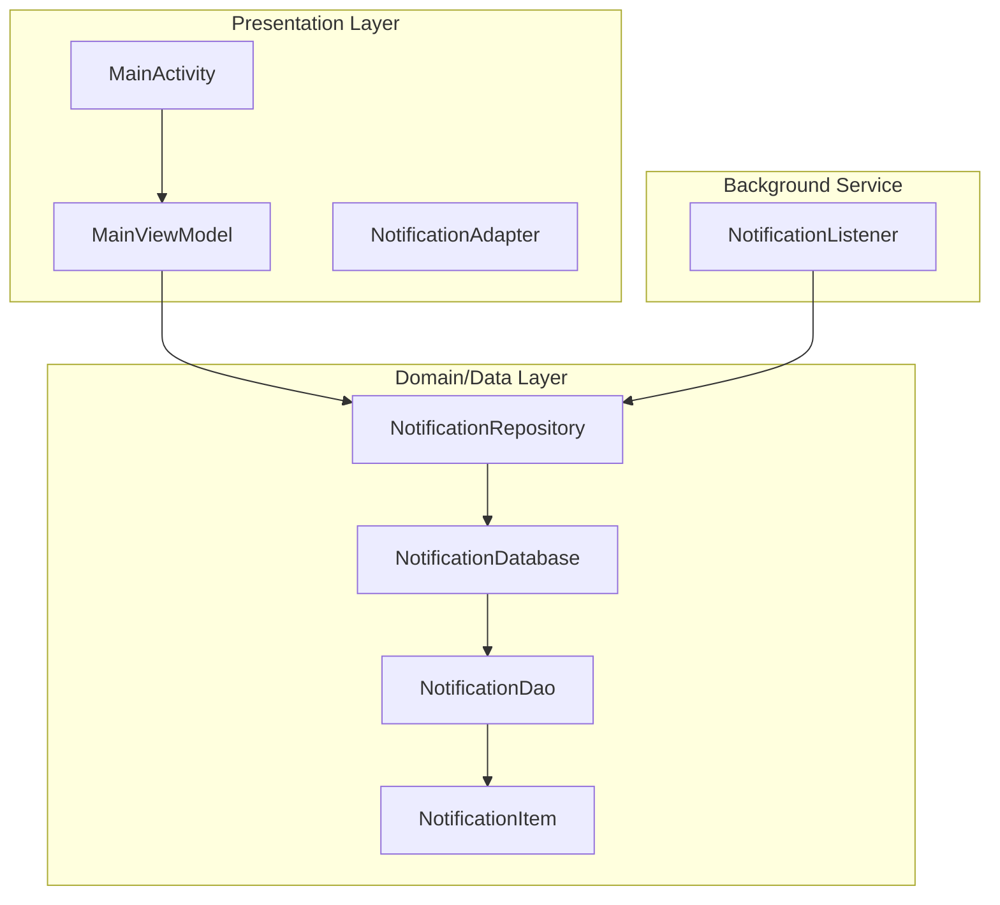
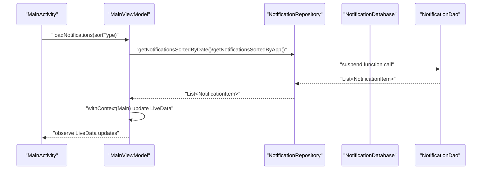
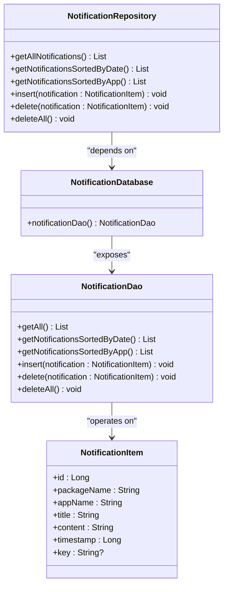
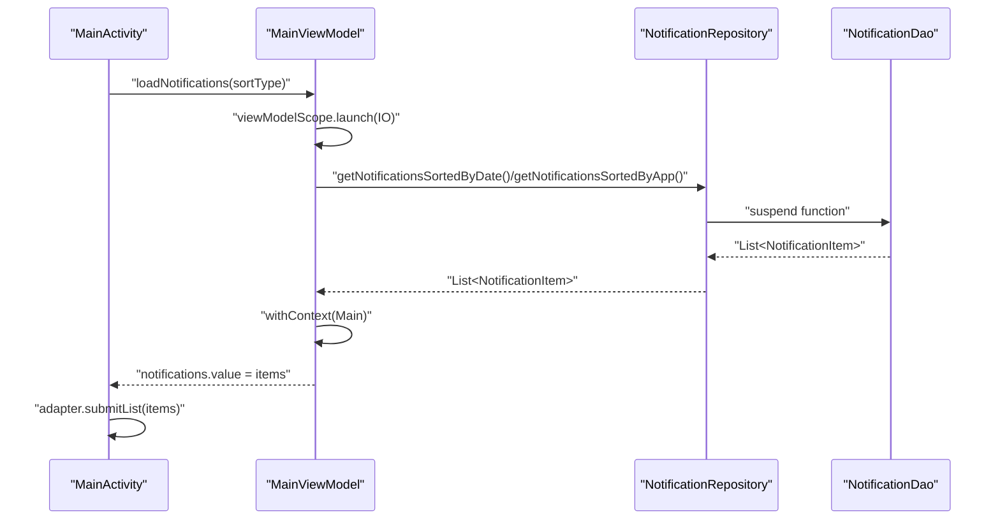
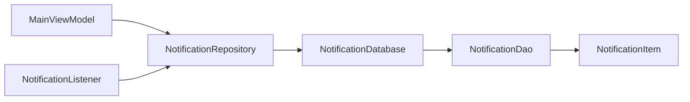

# Repository Pattern Implementation

<cite>
**Referenced Files in This Document**
- [NotificationRepository.kt](file://app/src/main/java/com/notificationlog/repository/NotificationRepository.kt)
- [NotificationDao.kt](file://app/src/main/java/com/notificationlog/data/NotificationDao.kt)
- [NotificationDatabase.kt](file://app/src/main/java/com/notificationlog/data/NotificationDatabase.kt)
- [NotificationItem.kt](file://app/src/main/java/com/notificationlog/model/NotificationItem.kt)
- [MainViewModel.kt](file://app/src/main/java/com/notificationlog/MainViewModel.kt)
- [MainActivity.kt](file://app/src/main/java/com/notificationlog/MainActivity.kt)
- [NotificationApp.kt](file://app/src/main/java/com/notificationlog/NotificationApp.kt)
- [NotificationAdapter.kt](file://app/src/main/java/com/notificationlog/adapter/NotificationAdapter.kt)
- [NotificationListener.kt](file://app/src/main/java/com/notificationlog/NotificationListener.kt)
- [AndroidManifest.xml](file://app/src/main/AndroidManifest.xml)
</cite>

## Table of Contents
1. [Introduction](#introduction)
2. [Project Structure](#project-structure)
3. [Core Components](#core-components)
4. [Architecture Overview](#architecture-overview)
5. [Detailed Component Analysis](#detailed-component-analysis)
6. [Dependency Analysis](#dependency-analysis)
7. [Performance Considerations](#performance-considerations)
8. [Troubleshooting Guide](#troubleshooting-guide)
9. [Conclusion](#conclusion)
10. [Appendices](#appendices)

## Introduction
This document provides comprehensive repository pattern documentation for the NotificationRepository implementation. It explains how the repository acts as a data access abstraction layer, coordinates between UI and data layers, and integrates with LiveData and reactive programming patterns. It also covers singleton pattern implementation, dependency injection considerations, thread safety, Room integration, error handling, asynchronous operations, coroutine scope management, and testing strategies.

## Project Structure
The project follows a layered architecture:
- Presentation layer: Activities, ViewModels, Adapters
- Domain/Data layer: Repository, DAO, Database, Entity
- Background service: NotificationListener

**Diagram sources**
- [MainActivity.kt:43-108](file://app/src/main/java/com/notificationlog/MainActivity.kt#L43-L108)
- [MainViewModel.kt:15-115](file://app/src/main/java/com/notificationlog/MainViewModel.kt#L15-L115)
- [NotificationRepository.kt:6-27](file://app/src/main/java/com/notificationlog/repository/NotificationRepository.kt#L6-L27)
- [NotificationDao.kt:6-26](file://app/src/main/java/com/notificationlog/data/NotificationDao.kt#L6-L26)
- [NotificationDatabase.kt:7-10](file://app/src/main/java/com/notificationlog/data/NotificationDatabase.kt#L7-L10)
- [NotificationItem.kt:8-19](file://app/src/main/java/com/notificationlog/model/NotificationItem.kt#L8-L19)
- [NotificationListener.kt:23-34](file://app/src/main/java/com/notificationlog/NotificationListener.kt#L23-L34)

**Section sources**
- [MainActivity.kt:43-108](file://app/src/main/java/com/notificationlog/MainActivity.kt#L43-L108)
- [MainViewModel.kt:15-115](file://app/src/main/java/com/notificationlog/MainViewModel.kt#L15-L115)
- [NotificationRepository.kt:6-27](file://app/src/main/java/com/notificationlog/repository/NotificationRepository.kt#L6-L27)
- [NotificationDao.kt:6-26](file://app/src/main/java/com/notificationlog/data/NotificationDao.kt#L6-L26)
- [NotificationDatabase.kt:7-10](file://app/src/main/java/com/notificationlog/data/NotificationDatabase.kt#L7-L10)
- [NotificationItem.kt:8-19](file://app/src/main/java/com/notificationlog/model/NotificationItem.kt#L8-L19)
- [NotificationListener.kt:23-34](file://app/src/main/java/com/notificationlog/NotificationListener.kt#L23-L34)

## Core Components
- NotificationRepository: Centralized data access facade delegating to DAO methods. Methods forward suspend DAO calls and expose them as suspend functions to callers.
- NotificationDao: Room DAO interface with suspend functions for CRUD operations and sorted queries.
- NotificationDatabase: Room database exposing DAO accessor.
- NotificationItem: Entity representing persisted notification records.
- MainViewModel: Orchestrates UI state with LiveData and delegates data operations to the repository.
- MainActivity: Observes LiveData and triggers ViewModel actions.
- NotificationApp: Application-level initialization setting up Room database and a global repository instance.
- NotificationAdapter: UI adapter using DiffUtil for efficient list updates.
- NotificationListener: Background service capturing notifications and persisting them via repository.

Key responsibilities:
- Repository encapsulates data access logic and exposes a clean API to ViewModels.
- DAO defines typed, suspend-based database operations.
- ViewModel manages UI state and orchestrates async operations.
- Adapter observes list changes and renders efficiently.

**Section sources**
- [NotificationRepository.kt:6-27](file://app/src/main/java/com/notificationlog/repository/NotificationRepository.kt#L6-L27)
- [NotificationDao.kt:6-26](file://app/src/main/java/com/notificationlog/data/NotificationDao.kt#L6-L26)
- [NotificationDatabase.kt:7-10](file://app/src/main/java/com/notificationlog/data/NotificationDatabase.kt#L7-L10)
- [NotificationItem.kt:8-19](file://app/src/main/java/com/notificationlog/model/NotificationItem.kt#L8-L19)
- [MainViewModel.kt:15-115](file://app/src/main/java/com/notificationlog/MainViewModel.kt#L15-L115)
- [MainActivity.kt:324-343](file://app/src/main/java/com/notificationlog/MainActivity.kt#L324-L343)
- [NotificationApp.kt:8-27](file://app/src/main/java/com/notificationlog/NotificationApp.kt#L8-L27)
- [NotificationAdapter.kt:13-59](file://app/src/main/java/com/notificationlog/adapter/NotificationAdapter.kt#L13-L59)
- [NotificationListener.kt:23-34](file://app/src/main/java/com/notificationlog/NotificationListener.kt#L23-L34)

## Architecture Overview
The repository pattern centralizes data access behind a single interface, enabling:
- Decoupling UI from persistence details
- Testability via dependency injection
- Consistent error handling and threading
- Reactive UI updates through LiveData

**Diagram sources**
- [MainActivity.kt:324-343](file://app/src/main/java/com/notificationlog/MainActivity.kt#L324-L343)
- [MainViewModel.kt:59-77](file://app/src/main/java/com/notificationlog/MainViewModel.kt#L59-L77)
- [NotificationRepository.kt:10-14](file://app/src/main/java/com/notificationlog/repository/NotificationRepository.kt#L10-L14)
- [NotificationDao.kt:12-16](file://app/src/main/java/com/notificationlog/data/NotificationDao.kt#L12-L16)

## Detailed Component Analysis

### NotificationRepository
Responsibilities:
- Delegates DAO operations to the database
- Exposes suspend functions for UI and background threads
- Provides method forwarding for read/write/delete operations
- Maintains thread safety by relying on Room’s suspend DAO methods

Implementation patterns:
- Method delegation: Each public suspend function forwards to the DAO’s corresponding suspend function.
- Single constructor dependency: Receives a NotificationDatabase instance injected at application startup.

Thread safety:
- DAO methods are suspend and executed on Room’s background dispatcher.
- Repository itself is stateless and immutable after construction.

Error handling:
- Exceptions propagate from DAO to callers; handled in ViewModel with CoroutineExceptionHandler and UI error LiveData.

Extensibility:
- New methods can be added to the repository while keeping DAO unchanged.
- Future enhancements can introduce caching layers or transformation logic here.

**Section sources**
- [NotificationRepository.kt:6-27](file://app/src/main/java/com/notificationlog/repository/NotificationRepository.kt#L6-L27)
- [NotificationDao.kt:6-26](file://app/src/main/java/com/notificationlog/data/NotificationDao.kt#L6-L26)
- [NotificationDatabase.kt:7-10](file://app/src/main/java/com/notificationlog/data/NotificationDatabase.kt#L7-L10)

#### Class Diagram

**Diagram sources**
- [NotificationRepository.kt:6-27](file://app/src/main/java/com/notificationlog/repository/NotificationRepository.kt#L6-L27)
- [NotificationDatabase.kt:7-10](file://app/src/main/java/com/notificationlog/data/NotificationDatabase.kt#L7-L10)
- [NotificationDao.kt:6-26](file://app/src/main/java/com/notificationlog/data/NotificationDao.kt#L6-L26)
- [NotificationItem.kt:8-19](file://app/src/main/java/com/notificationlog/model/NotificationItem.kt#L8-L19)

### MainViewModel and LiveData Observation Patterns
Responsibilities:
- Manages UI state with LiveData for service status, notifications, counts, and errors.
- Uses viewModelScope for lifecycle-aware coroutine execution.
- Delegates data operations to the repository and updates LiveData on the main thread.

LiveData observation:
- MainActivity observes LiveData streams and updates UI accordingly.
- Adapter receives list updates via submitList and DiffUtil.

Reactive programming:
- CoroutineExceptionHandler centralizes error handling.
- Dispatchers.IO for database operations, Dispatchers.Main for UI updates.

Asynchronous operation handling:
- loadNotifications, deleteNotification, clearNotifications use viewModelScope.launch with IO dispatcher.
- withContext switches between IO and Main for safe UI updates.

Memory leak prevention:
- Uses viewModelScope which cancels coroutines on ViewModel destruction.
- No retained references to Activity/Fragment.

**Section sources**
- [MainViewModel.kt:15-115](file://app/src/main/java/com/notificationlog/MainViewModel.kt#L15-L115)
- [MainActivity.kt:324-343](file://app/src/main/java/com/notificationlog/MainActivity.kt#L324-L343)
- [NotificationAdapter.kt:13-59](file://app/src/main/java/com/notificationlog/adapter/NotificationAdapter.kt#L13-L59)

#### Sequence Diagram: Load Notifications Flow

**Diagram sources**
- [MainViewModel.kt:59-77](file://app/src/main/java/com/notificationlog/MainViewModel.kt#L59-L77)
- [NotificationRepository.kt:10-14](file://app/src/main/java/com/notificationlog/repository/NotificationRepository.kt#L10-L14)
- [NotificationDao.kt:12-16](file://app/src/main/java/com/notificationlog/data/NotificationDao.kt#L12-L16)
- [MainActivity.kt:324-343](file://app/src/main/java/com/notificationlog/MainActivity.kt#L324-L343)
- [NotificationAdapter.kt:13-59](file://app/src/main/java/com/notificationlog/adapter/NotificationAdapter.kt#L13-L59)

### Singleton Pattern and Dependency Injection Considerations
Singleton pattern implementation:
- NotificationApp holds a static repository instance initialized during application startup.
- Repository is constructed with a NotificationDatabase instance.

Dependency injection considerations:
- Current implementation uses a global singleton via NotificationApp.repository.
- Recommended DI improvements:
  - Use a DI framework (e.g., Hilt) to inject NotificationRepository into ViewModels and Services.
  - Provide a factory or module to supply Room database instances.
  - Enable easy mocking for tests by injecting interfaces instead of concrete classes.

Thread safety:
- Repository is stateless and immutable after construction.
- Room database and DAO are thread-safe; suspend functions ensure safe execution.

**Section sources**
- [NotificationApp.kt:8-27](file://app/src/main/java/com/notificationlog/NotificationApp.kt#L8-L27)
- [NotificationRepository.kt:6-27](file://app/src/main/java/com/notificationlog/repository/NotificationRepository.kt#L6-L27)

### Integration with NotificationDatabase and NotificationDao
Method forwarding:
- getAllNotifications -> DAO.getAll
- getNotificationsSortedByDate -> DAO.getNotificationsSortedByDate
- getNotificationsSortedByApp -> DAO.getNotificationsSortedByApp
- insert -> DAO.insert
- delete -> DAO.delete
- deleteAll -> DAO.deleteAll

Error handling strategies:
- DAO methods throw exceptions on failure; ViewModel catches and posts error messages to UI.
- NotificationListener wraps repository calls in try/catch and logs failures.

Complex data operations:
- Sorting by timestamp and app name via DAO queries.
- Insertion with REPLACE conflict strategy ensures deduplication.

Caching strategies:
- Current implementation does not implement application-level caching.
- Room’s internal caching and query result caching occur automatically.

**Section sources**
- [NotificationRepository.kt:8-26](file://app/src/main/java/com/notificationlog/repository/NotificationRepository.kt#L8-L26)
- [NotificationDao.kt:6-26](file://app/src/main/java/com/notificationlog/data/NotificationDao.kt#L6-L26)
- [MainViewModel.kt:71-76](file://app/src/main/java/com/notificationlog/MainViewModel.kt#L71-L76)
- [NotificationListener.kt:139-149](file://app/src/main/java/com/notificationlog/NotificationListener.kt#L139-L149)

### Data Transformation Patterns
- Timestamp formatting occurs in the UI layer (adapter) for display purposes.
- App name resolution happens in the background service before insertion.
- No transformation logic is implemented in the repository; transformations remain in UI or service layers.

**Section sources**
- [NotificationAdapter.kt:33-48](file://app/src/main/java/com/notificationlog/adapter/NotificationAdapter.kt#L33-L48)
- [NotificationListener.kt:118-124](file://app/src/main/java/com/notificationlog/NotificationListener.kt#L118-L124)

### Asynchronous Operations, Coroutine Scope Management, and Memory Leak Prevention
- ViewModel uses viewModelScope for lifecycle-aware coroutine execution.
- Dispatchers.IO for database operations; Dispatchers.Main for UI updates.
- CoroutineExceptionHandler centralizes error handling and posts messages to LiveData.
- NotificationListener uses CoroutineScope with SupervisorJob and cancels on destroy.

Memory leak prevention:
- viewModelScope cancels on ViewModel destruction.
- NotificationListener cancels its SupervisorJob in onDestroy.

**Section sources**
- [MainViewModel.kt:29-31](file://app/src/main/java/com/notificationlog/MainViewModel.kt#L29-L31)
- [MainViewModel.kt:59-77](file://app/src/main/java/com/notificationlog/MainViewModel.kt#L59-L77)
- [NotificationListener.kt:25-26](file://app/src/main/java/com/notificationlog/NotificationListener.kt#L25-L26)
- [NotificationListener.kt:168-171](file://app/src/main/java/com/notificationlog/NotificationListener.kt#L168-L171)

### Testing Strategies, Mock Implementations, and Extension Patterns
Testing strategies:
- Mock NotificationRepository in ViewModels for unit tests.
- Use InMemoryDatabase or Room test helpers to replace NotificationDatabase.
- Verify LiveData emissions and error messages.

Mock implementations:
- Create a Repository interface and mock implementations for testing.
- Inject mocks via DI or constructor parameters.

Extension patterns:
- Add caching layer in repository for frequently accessed data.
- Introduce transformation functions for derived data (e.g., grouped by day).
- Add filtering and pagination support.

**Section sources**
- [MainViewModel.kt:15-115](file://app/src/main/java/com/notificationlog/MainViewModel.kt#L15-L115)
- [NotificationRepository.kt:6-27](file://app/src/main/java/com/notificationlog/repository/NotificationRepository.kt#L6-L27)

## Dependency Analysis
Direct dependencies:
- MainViewModel depends on NotificationApp.repository (global singleton).
- NotificationRepository depends on NotificationDatabase.
- NotificationDatabase depends on NotificationDao.
- NotificationDao depends on NotificationItem entity.
- NotificationListener depends on NotificationRepository and Room database.

Potential circular dependencies:
- None observed; dependencies flow from UI -> ViewModel -> Repository -> Database -> DAO -> Entity.

External dependencies:
- Room for persistence.
- AndroidX Lifecycle for LiveData and ViewModel.
- AndroidX Core for NotificationCompat and PendingIntent.

**Diagram sources**
- [MainViewModel.kt:62-66](file://app/src/main/java/com/notificationlog/MainViewModel.kt#L62-L66)
- [NotificationRepository.kt:6-27](file://app/src/main/java/com/notificationlog/repository/NotificationRepository.kt#L6-L27)
- [NotificationDatabase.kt:7-10](file://app/src/main/java/com/notificationlog/data/NotificationDatabase.kt#L7-L10)
- [NotificationDao.kt:6-26](file://app/src/main/java/com/notificationlog/data/NotificationDao.kt#L6-L26)
- [NotificationItem.kt:8-19](file://app/src/main/java/com/notificationlog/model/NotificationItem.kt#L8-L19)
- [NotificationListener.kt:27-34](file://app/src/main/java/com/notificationlog/NotificationListener.kt#L27-L34)

**Section sources**
- [MainViewModel.kt:62-66](file://app/src/main/java/com/notificationlog/MainViewModel.kt#L62-L66)
- [NotificationRepository.kt:6-27](file://app/src/main/java/com/notificationlog/repository/NotificationRepository.kt#L6-L27)
- [NotificationDatabase.kt:7-10](file://app/src/main/java/com/notificationlog/data/NotificationDatabase.kt#L7-L10)
- [NotificationDao.kt:6-26](file://app/src/main/java/com/notificationlog/data/NotificationDao.kt#L6-L26)
- [NotificationItem.kt:8-19](file://app/src/main/java/com/notificationlog/model/NotificationItem.kt#L8-L19)
- [NotificationListener.kt:27-34](file://app/src/main/java/com/notificationlog/NotificationListener.kt#L27-L34)

## Performance Considerations
- DAO methods are suspend and offload work to Room’s background dispatcher.
- Using DiffUtil in the adapter minimizes UI churn during list updates.
- Avoid blocking the main thread by performing all database operations on Dispatchers.IO.
- Consider adding paging for large datasets and indexing on frequently queried columns (timestamp, appName).

## Troubleshooting Guide
Common issues and resolutions:
- Notification access revoked: The listener detects disconnection and broadcasts a warning; UI shows a dialog and updates status.
- Database errors: ViewModel posts error messages to LiveData; UI displays them to the user.
- Memory leaks: Ensure viewModelScope is used and NotificationListener cancels its scope in onDestroy.

**Section sources**
- [NotificationListener.kt:44-65](file://app/src/main/java/com/notificationlog/NotificationListener.kt#L44-L65)
- [MainActivity.kt:645-661](file://app/src/main/java/com/notificationlog/MainActivity.kt#L645-L661)
- [MainViewModel.kt:29-31](file://app/src/main/java/com/notificationlog/MainViewModel.kt#L29-L31)
- [NotificationListener.kt:168-171](file://app/src/main/java/com/notificationlog/NotificationListener.kt#L168-L171)

## Conclusion
The NotificationRepository implements a clean repository pattern that abstracts data access, delegates to Room DAOs, and integrates seamlessly with ViewModels and LiveData. It maintains thread safety, supports reactive UI updates, and provides a foundation for future enhancements such as DI, caching, and advanced data transformations. The current singleton approach simplifies setup but can be improved with DI frameworks for better testability and modularity.

## Appendices

### API Definitions
- getAllNotifications(): Returns a list of all notifications ordered by timestamp descending.
- getNotificationsSortedByDate(): Returns notifications ordered by timestamp descending.
- getNotificationsSortedByApp(): Returns notifications ordered by app name ascending, then timestamp descending.
- insert(notification): Inserts a notification record.
- delete(notification): Deletes a specific notification.
- deleteAll(): Clears all notifications.

**Section sources**
- [NotificationRepository.kt:8-26](file://app/src/main/java/com/notificationlog/repository/NotificationRepository.kt#L8-L26)
- [NotificationDao.kt:9-25](file://app/src/main/java/com/notificationlog/data/NotificationDao.kt#L9-L25)

### UI Integration Notes
- MainActivity observes LiveData for notifications, counts, and errors.
- Adapter uses DiffUtil for efficient list updates.
- Menu actions trigger ViewModel operations that delegate to the repository.

**Section sources**
- [MainActivity.kt:324-343](file://app/src/main/java/com/notificationlog/MainActivity.kt#L324-L343)
- [NotificationAdapter.kt:13-59](file://app/src/main/java/com/notificationlog/adapter/NotificationAdapter.kt#L13-L59)

### Permissions and Manifest
- Manifest declares INTERNET, ACCESS_NETWORK_STATE, and POST_NOTIFICATIONS permissions.
- NotificationListener service is declared with required metadata.

**Section sources**
- [AndroidManifest.xml:5-43](file://app/src/main/AndroidManifest.xml#L5-L43)