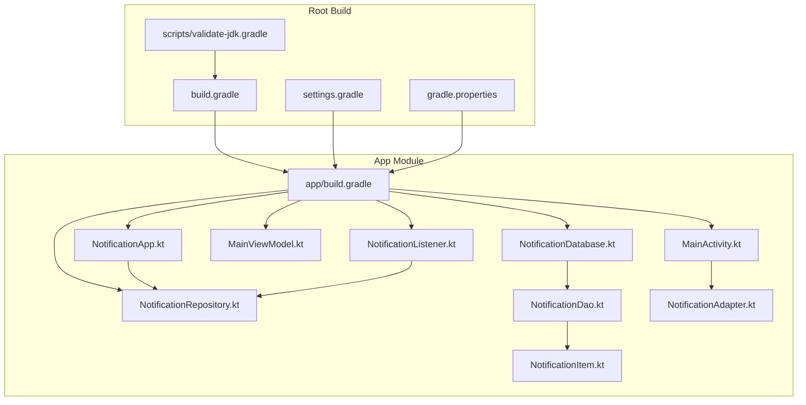
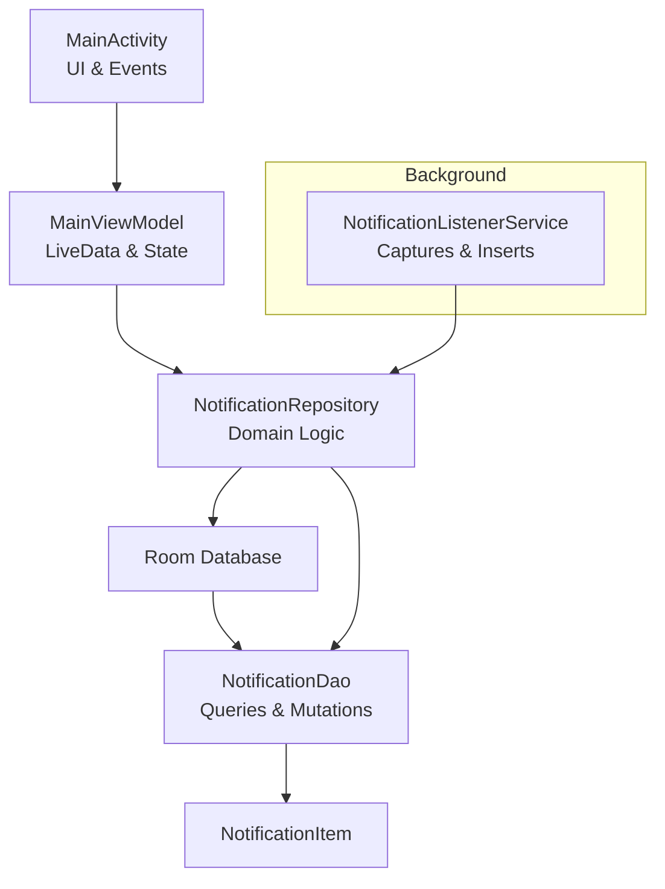
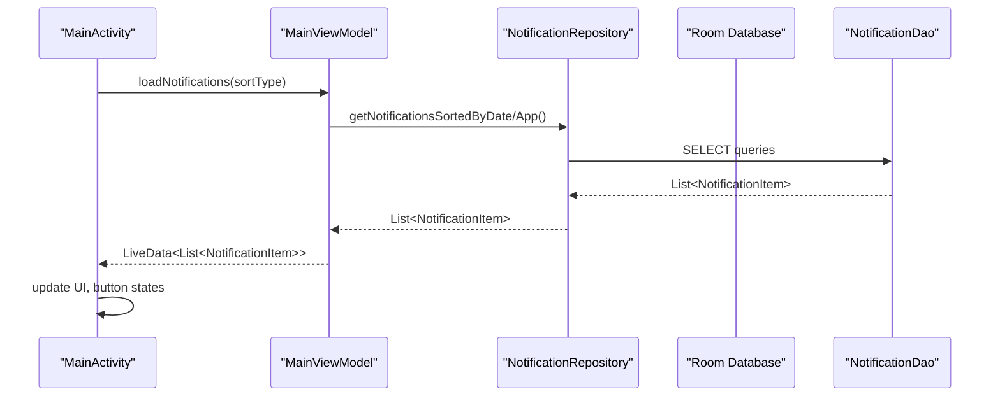
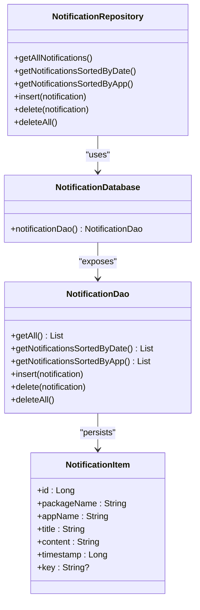
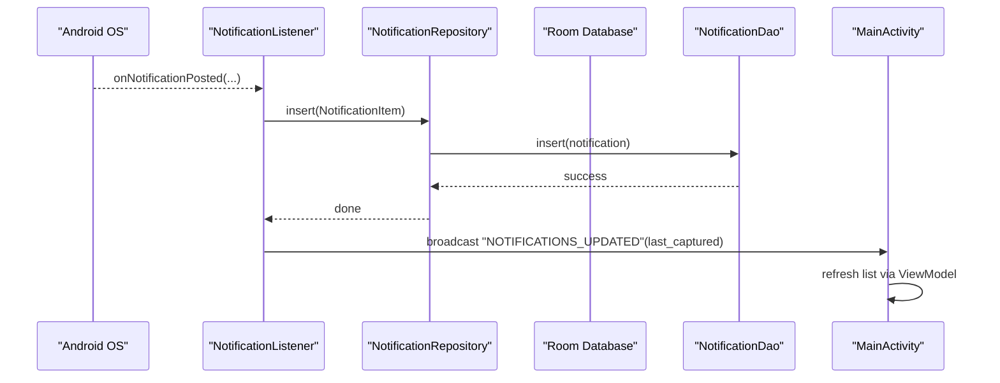
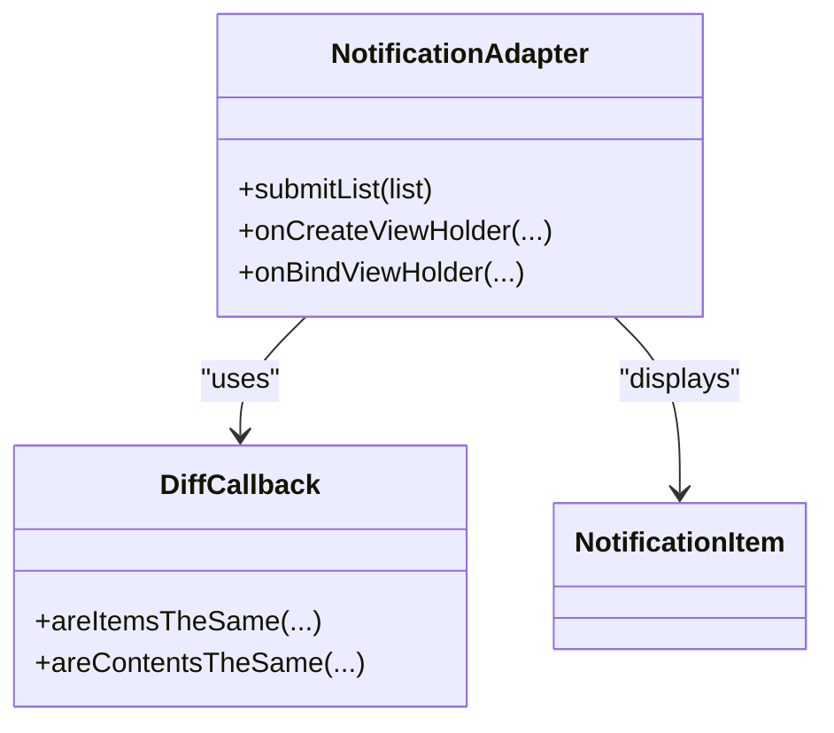
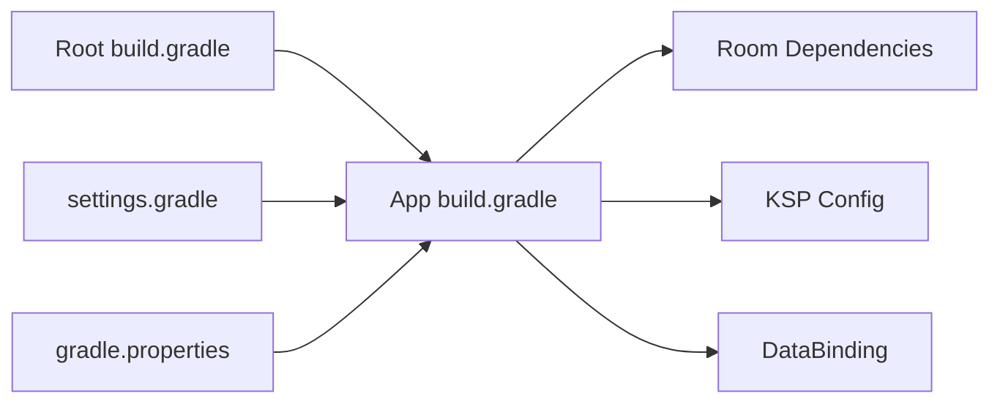
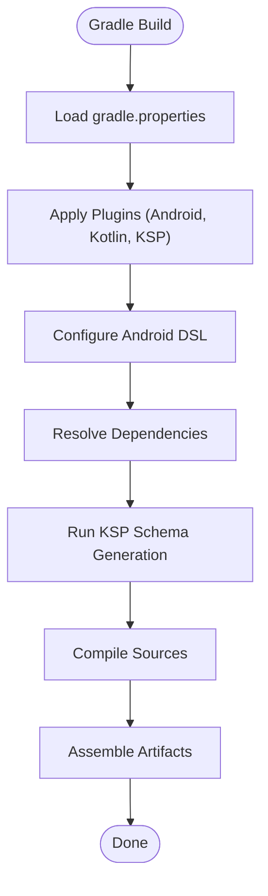

# Development Guidelines

<cite>
**Referenced Files in This Document**
- [build.gradle](file://build.gradle)
- [app/build.gradle](file://app/build.gradle)
- [settings.gradle](file://settings.gradle)
- [gradle.properties](file://gradle.properties)
- [README-JDK-SETUP.md](file://README-JDK-SETUP.md)
- [scripts/validate-jdk.gradle](file://scripts/validate-jdk.gradle)
- [app/src/main/java/com/notificationlog/MainActivity.kt](file://app/src/main/java/com/notificationlog/MainActivity.kt)
- [app/src/main/java/com/notificationlog/MainViewModel.kt](file://app/src/main/java/com/notificationlog/MainViewModel.kt)
- [app/src/main/java/com/notificationlog/repository/NotificationRepository.kt](file://app/src/main/java/com/notificationlog/repository/NotificationRepository.kt)
- [app/src/main/java/com/notificationlog/data/NotificationDao.kt](file://app/src/main/java/com/notificationlog/data/NotificationDao.kt)
- [app/src/main/java/com/notificationlog/model/NotificationItem.kt](file://app/src/main/java/com/notificationlog/model/NotificationItem.kt)
- [app/src/main/java/com/notificationlog/adapter/NotificationAdapter.kt](file://app/src/main/java/com/notificationlog/adapter/NotificationAdapter.kt)
- [app/src/main/java/com/notificationlog/NotificationApp.kt](file://app/src/main/java/com/notificationlog/NotificationApp.kt)
- [app/src/main/java/com/notificationlog/NotificationListener.kt](file://app/src/main/java/com/notificationlog/NotificationListener.kt)
- [app/src/main/java/com/notificationlog/data/NotificationDatabase.kt](file://app/src/main/java/com/notificationlog/data/NotificationDatabase.kt)
</cite>

## Table of Contents
1. [Introduction](#introduction)
2. [Project Structure](#project-structure)
3. [Core Components](#core-components)
4. [Architecture Overview](#architecture-overview)
5. [Detailed Component Analysis](#detailed-component-analysis)
6. [Dependency Analysis](#dependency-analysis)
7. [Performance Considerations](#performance-considerations)
8. [Testing Strategies](#testing-strategies)
9. [Quality Assurance Procedures](#quality-assurance-procedures)
10. [Continuous Integration Practices](#continuous-integration-practices)
11. [Build System and Gradle Configuration](#build-system-and-gradle-configuration)
12. [Development Workflow](#development-workflow)
13. [Version Control and Release Management](#version-control-and-release-management)
14. [Adding New Features and Maintaining Compatibility](#adding-new-features-and-maintaining-compatibility)
15. [Code Review and Documentation Standards](#code-review-and-documentation-standards)
16. [Community Contribution Guidelines](#community-contribution-guidelines)
17. [Development Environment Setup](#development-environment-setup)
18. [Debugging Techniques](#debugging-techniques)
19. [Performance Profiling Methods](#performance-profiling-methods)
20. [Deployment Procedures](#deployment-procedures)
21. [Troubleshooting Guide](#troubleshooting-guide)
22. [Conclusion](#conclusion)

## Introduction
This document provides comprehensive development guidelines for contributors to NotificationLog. It covers contribution standards, coding conventions, development workflow, build configuration, validation processes, testing strategies, quality assurance, continuous integration practices, deployment, release management, version control workflows, feature addition, backward compatibility, code review, documentation standards, community guidelines, environment setup, debugging, and performance profiling.

## Project Structure
NotificationLog is an Android application module with a clear separation of concerns:
- app module: Android app code, UI, ViewModels, Repositories, DAOs, Entities, Adapters, and Services
- Root Gradle configuration: plugin management, dependency resolution, and shared tasks
- Scripts: JDK validation and verification utilities
- Properties: Gradle JVM and build performance tuning

**Diagram sources**
- [build.gradle:1-16](file://build.gradle#L1-L16)
- [settings.gradle:1-18](file://settings.gradle#L1-L18)
- [gradle.properties:1-39](file://gradle.properties#L1-L39)
- [scripts/validate-jdk.gradle:1-94](file://scripts/validate-jdk.gradle#L1-L94)
- [app/build.gradle:1-97](file://app/build.gradle#L1-L97)
- [app/src/main/java/com/notificationlog/NotificationApp.kt:1-28](file://app/src/main/java/com/notificationlog/NotificationApp.kt#L1-L28)
- [app/src/main/java/com/notificationlog/MainActivity.kt:1-717](file://app/src/main/java/com/notificationlog/MainActivity.kt#L1-L717)
- [app/src/main/java/com/notificationlog/MainViewModel.kt:1-121](file://app/src/main/java/com/notificationlog/MainViewModel.kt#L1-L121)
- [app/src/main/java/com/notificationlog/NotificationListener.kt:1-173](file://app/src/main/java/com/notificationlog/NotificationListener.kt#L1-L173)
- [app/src/main/java/com/notificationlog/repository/NotificationRepository.kt:1-28](file://app/src/main/java/com/notificationlog/repository/NotificationRepository.kt#L1-L28)
- [app/src/main/java/com/notificationlog/data/NotificationDatabase.kt:1-10](file://app/src/main/java/com/notificationlog/data/NotificationDatabase.kt#L1-L10)
- [app/src/main/java/com/notificationlog/data/NotificationDao.kt:1-26](file://app/src/main/java/com/notificationlog/data/NotificationDao.kt#L1-L26)
- [app/src/main/java/com/notificationlog/model/NotificationItem.kt:1-19](file://app/src/main/java/com/notificationlog/model/NotificationItem.kt#L1-L19)
- [app/src/main/java/com/notificationlog/adapter/NotificationAdapter.kt:1-59](file://app/src/main/java/com/notificationlog/adapter/NotificationAdapter.kt#L1-L59)

**Section sources**
- [build.gradle:1-16](file://build.gradle#L1-L16)
- [settings.gradle:1-18](file://settings.gradle#L1-L18)
- [gradle.properties:1-39](file://gradle.properties#L1-L39)
- [scripts/validate-jdk.gradle:1-94](file://scripts/validate-jdk.gradle#L1-L94)
- [app/build.gradle:1-97](file://app/build.gradle#L1-L97)

## Core Components
- Application bootstrap and DI-like initialization via NotificationApp
- UI and state orchestration via MainActivity and MainViewModel
- Data persistence via Room (Database, DAO, Entity)
- Repository pattern for data access
- Adapter for RecyclerView UI updates
- Background notification capture via NotificationListenerService

Key responsibilities:
- NotificationApp initializes Room database and exposes a singleton repository
- MainViewModel manages LiveData streams and orchestrates repository calls
- NotificationListener captures notifications and persists them
- NotificationAdapter renders lists efficiently with DiffUtil

**Section sources**
- [app/src/main/java/com/notificationlog/NotificationApp.kt:1-28](file://app/src/main/java/com/notificationlog/NotificationApp.kt#L1-L28)
- [app/src/main/java/com/notificationlog/MainViewModel.kt:1-121](file://app/src/main/java/com/notificationlog/MainViewModel.kt#L1-L121)
- [app/src/main/java/com/notificationlog/repository/NotificationRepository.kt:1-28](file://app/src/main/java/com/notificationlog/repository/NotificationRepository.kt#L1-L28)
- [app/src/main/java/com/notificationlog/data/NotificationDatabase.kt:1-10](file://app/src/main/java/com/notificationlog/data/NotificationDatabase.kt#L1-L10)
- [app/src/main/java/com/notificationlog/data/NotificationDao.kt:1-26](file://app/src/main/java/com/notificationlog/data/NotificationDao.kt#L1-L26)
- [app/src/main/java/com/notificationlog/model/NotificationItem.kt:1-19](file://app/src/main/java/com/notificationlog/model/NotificationItem.kt#L1-L19)
- [app/src/main/java/com/notificationlog/adapter/NotificationAdapter.kt:1-59](file://app/src/main/java/com/notificationlog/adapter/NotificationAdapter.kt#L1-L59)
- [app/src/main/java/com/notificationlog/NotificationListener.kt:1-173](file://app/src/main/java/com/notificationlog/NotificationListener.kt#L1-L173)

## Architecture Overview
The app follows MVVM with Repository and Room:
- UI (Activity/Fragment) observes LiveData from ViewModel
- ViewModel delegates to Repository
- Repository uses DAO to access Room database
- NotificationListenerService writes to the same database

**Diagram sources**
- [app/src/main/java/com/notificationlog/MainActivity.kt:1-717](file://app/src/main/java/com/notificationlog/MainActivity.kt#L1-L717)
- [app/src/main/java/com/notificationlog/MainViewModel.kt:1-121](file://app/src/main/java/com/notificationlog/MainViewModel.kt#L1-L121)
- [app/src/main/java/com/notificationlog/repository/NotificationRepository.kt:1-28](file://app/src/main/java/com/notificationlog/repository/NotificationRepository.kt#L1-L28)
- [app/src/main/java/com/notificationlog/data/NotificationDao.kt:1-26](file://app/src/main/java/com/notificationlog/data/NotificationDao.kt#L1-L26)
- [app/src/main/java/com/notificationlog/model/NotificationItem.kt:1-19](file://app/src/main/java/com/notificationlog/model/NotificationItem.kt#L1-L19)
- [app/src/main/java/com/notificationlog/NotificationListener.kt:1-173](file://app/src/main/java/com/notificationlog/NotificationListener.kt#L1-L173)

## Detailed Component Analysis

### UI and State Management
- MainActivity coordinates permissions, UI state, persistent notification, and broadcast receivers
- MainViewModel exposes LiveData for service status, counts, and notifications; handles coroutine exceptions

**Diagram sources**
- [app/src/main/java/com/notificationlog/MainActivity.kt:324-343](file://app/src/main/java/com/notificationlog/MainActivity.kt#L324-L343)
- [app/src/main/java/com/notificationlog/MainViewModel.kt:59-77](file://app/src/main/java/com/notificationlog/MainViewModel.kt#L59-L77)
- [app/src/main/java/com/notificationlog/repository/NotificationRepository.kt:8-14](file://app/src/main/java/com/notificationlog/repository/NotificationRepository.kt#L8-L14)
- [app/src/main/java/com/notificationlog/data/NotificationDao.kt:9-16](file://app/src/main/java/com/notificationlog/data/NotificationDao.kt#L9-L16)

**Section sources**
- [app/src/main/java/com/notificationlog/MainActivity.kt:78-108](file://app/src/main/java/com/notificationlog/MainActivity.kt#L78-L108)
- [app/src/main/java/com/notificationlog/MainActivity.kt:324-343](file://app/src/main/java/com/notificationlog/MainActivity.kt#L324-L343)
- [app/src/main/java/com/notificationlog/MainViewModel.kt:15-48](file://app/src/main/java/com/notificationlog/MainViewModel.kt#L15-L48)

### Data Layer and Persistence
- NotificationDatabase defines the Room database and exposes NotificationDao
- NotificationDao declares queries and mutations
- NotificationItem is the entity persisted in the database
- NotificationRepository encapsulates DAO usage

**Diagram sources**
- [app/src/main/java/com/notificationlog/data/NotificationDatabase.kt:1-10](file://app/src/main/java/com/notificationlog/data/NotificationDatabase.kt#L1-L10)
- [app/src/main/java/com/notificationlog/data/NotificationDao.kt:1-26](file://app/src/main/java/com/notificationlog/data/NotificationDao.kt#L1-L26)
- [app/src/main/java/com/notificationlog/model/NotificationItem.kt:1-19](file://app/src/main/java/com/notificationlog/model/NotificationItem.kt#L1-L19)
- [app/src/main/java/com/notificationlog/repository/NotificationRepository.kt:1-28](file://app/src/main/java/com/notificationlog/repository/NotificationRepository.kt#L1-L28)

**Section sources**
- [app/src/main/java/com/notificationlog/data/NotificationDatabase.kt:1-10](file://app/src/main/java/com/notificationlog/data/NotificationDatabase.kt#L1-L10)
- [app/src/main/java/com/notificationlog/data/NotificationDao.kt:1-26](file://app/src/main/java/com/notificationlog/data/NotificationDao.kt#L1-L26)
- [app/src/main/java/com/notificationlog/model/NotificationItem.kt:1-19](file://app/src/main/java/com/notificationlog/model/NotificationItem.kt#L1-L19)
- [app/src/main/java/com/notificationlog/repository/NotificationRepository.kt:1-28](file://app/src/main/java/com/notificationlog/repository/NotificationRepository.kt#L1-L28)

### Background Notification Capture
- NotificationListenerService runs in the background, captures notifications, and inserts them into the database
- Emits broadcasts to inform the UI of updates and disconnection events

**Diagram sources**
- [app/src/main/java/com/notificationlog/NotificationListener.kt:109-153](file://app/src/main/java/com/notificationlog/NotificationListener.kt#L109-L153)
- [app/src/main/java/com/notificationlog/repository/NotificationRepository.kt:16-18](file://app/src/main/java/com/notificationlog/repository/NotificationRepository.kt#L16-L18)
- [app/src/main/java/com/notificationlog/data/NotificationDao.kt:18-19](file://app/src/main/java/com/notificationlog/data/NotificationDao.kt#L18-L19)
- [app/src/main/java/com/notificationlog/MainActivity.kt:57-66](file://app/src/main/java/com/notificationlog/MainActivity.kt#L57-L66)

**Section sources**
- [app/src/main/java/com/notificationlog/NotificationListener.kt:36-65](file://app/src/main/java/com/notificationlog/NotificationListener.kt#L36-L65)
- [app/src/main/java/com/notificationlog/NotificationListener.kt:109-153](file://app/src/main/java/com/notificationlog/NotificationListener.kt#L109-L153)

### UI Adapter and DiffUtil
- NotificationAdapter extends ListAdapter with DiffUtil.ItemCallback to efficiently update RecyclerView items
- Binds NotificationItem to views and handles click actions

**Diagram sources**
- [app/src/main/java/com/notificationlog/adapter/NotificationAdapter.kt:1-59](file://app/src/main/java/com/notificationlog/adapter/NotificationAdapter.kt#L1-L59)
- [app/src/main/java/com/notificationlog/model/NotificationItem.kt:1-19](file://app/src/main/java/com/notificationlog/model/NotificationItem.kt#L1-L19)

**Section sources**
- [app/src/main/java/com/notificationlog/adapter/NotificationAdapter.kt:13-59](file://app/src/main/java/com/notificationlog/adapter/NotificationAdapter.kt#L13-L59)

## Dependency Analysis
- Plugin and toolchain versions are centralized in the root build.gradle
- App module configures Android, KSP, Data Binding, Java/Kotlin targets, Room dependencies, and KSP schema generation
- Dependency resolution is managed centrally in settings.gradle
- Gradle properties configure AndroidX, Kotlin style, JDK path, and performance flags

**Diagram sources**
- [build.gradle:1-16](file://build.gradle#L1-L16)
- [settings.gradle:1-18](file://settings.gradle#L1-L18)
- [gradle.properties:1-39](file://gradle.properties#L1-L39)
- [app/build.gradle:1-97](file://app/build.gradle#L1-L97)

**Section sources**
- [build.gradle:1-16](file://build.gradle#L1-L16)
- [settings.gradle:1-18](file://settings.gradle#L1-L18)
- [gradle.properties:1-39](file://gradle.properties#L1-L39)
- [app/build.gradle:1-97](file://app/build.gradle#L1-L97)

## Performance Considerations
- Use IO dispatcher for database operations in ViewModels and Repository
- Employ DiffUtil in adapters to minimize UI churn
- Avoid blocking the main thread; keep UI updates on main thread
- Leverage LiveData and coroutines for reactive updates
- Keep Room queries efficient; consider indexing if needed
- Minimize unnecessary broadcasts and UI refreshes

[No sources needed since this section provides general guidance]

## Testing Strategies
- Unit tests for Repository and DAO logic using Room test helpers
- Instrumented tests for ViewModel behavior and UI interactions
- Integration tests covering NotificationListenerService and database persistence
- Snapshot tests for UI rendering consistency
- Mock external dependencies (e.g., Settings API) for deterministic tests

[No sources needed since this section provides general guidance]

## Quality Assurance Procedures
- Enforce Kotlin coding conventions and official style
- Run static analysis and lint checks during CI
- Validate JDK version using provided Gradle task
- Perform manual QA on supported Android versions
- Review accessibility and internationalization readiness

[No sources needed since this section provides general guidance]

## Continuous Integration Practices
- Automate JDK validation on every build
- Run unit and instrumentation tests on CI agents
- Enforce code coverage thresholds
- Publish artifacts and APKs on successful builds
- Gate PRs with passing checks

[No sources needed since this section provides general guidance]

## Build System and Gradle Configuration
- Root build.gradle applies Android and Kotlin plugins, KSP, and includes a JDK validation script
- App module sets compile/target SDK, min SDK, signing config, Data Binding, KSP arguments, and Room dependencies
- settings.gradle centralizes repositories and project inclusion
- gradle.properties configures AndroidX, Kotlin style, JDK path, and performance flags

**Diagram sources**
- [build.gradle:1-16](file://build.gradle#L1-L16)
- [app/build.gradle:1-97](file://app/build.gradle#L1-L97)
- [gradle.properties:1-39](file://gradle.properties#L1-L39)

**Section sources**
- [build.gradle:1-16](file://build.gradle#L1-L16)
- [app/build.gradle:1-97](file://app/build.gradle#L1-L97)
- [settings.gradle:1-18](file://settings.gradle#L1-L18)
- [gradle.properties:1-39](file://gradle.properties#L1-L39)

## Development Workflow
- Fork and branch from main
- Make atomic commits with clear messages
- Open a Pull Request against main
- Ensure CI passes and reviews are approved
- Squash and merge following project conventions

[No sources needed since this section provides general guidance]

## Version Control and Release Management
- Use semantic versioning for releases
- Tag releases and maintain changelog entries
- Manage release branches as needed
- Sign release builds using configured signingConfigs

**Section sources**
- [app/build.gradle:34-48](file://app/build.gradle#L34-L48)

## Adding New Features and Maintaining Compatibility
- Extend NotificationItem with optional fields and handle migrations
- Add new DAO queries and Repository methods
- Update ViewModel with new LiveData streams and handlers
- Keep UI backward compatible; guard new features with flags
- Preserve existing APIs and behavior where possible

[No sources needed since this section provides general guidance]

## Code Review and Documentation Standards
- Follow Kotlin official style and idioms
- Write clear commit messages and PR descriptions
- Document public APIs and breaking changes
- Include screenshots or videos for UI changes
- Address reviewer feedback promptly

[No sources needed since this section provides general guidance]

## Community Contribution Guidelines
- Be respectful and inclusive
- Follow the code of conduct
- Test thoroughly before submitting PRs
- Engage constructively in discussions

[No sources needed since this section provides general guidance]

## Development Environment Setup
- Install JDK 21 and configure org.gradle.java.home
- Verify setup with validateJdk task
- Sync project in Android Studio
- Ensure Android SDK and build tools match project requirements

**Section sources**
- [README-JDK-SETUP.md:1-22](file://README-JDK-SETUP.md#L1-L22)
- [scripts/validate-jdk.gradle:1-94](file://scripts/validate-jdk.gradle#L1-L94)
- [gradle.properties:1-39](file://gradle.properties#L1-L39)

## Debugging Techniques
- Use logs from NotificationListener and MainActivity
- Inspect Room database using schema location generated by KSP
- Monitor LiveData emissions and coroutine scopes
- Reproduce permission-related issues on different Android versions

**Section sources**
- [app/src/main/java/com/notificationlog/NotificationListener.kt:36-42](file://app/src/main/java/com/notificationlog/NotificationListener.kt#L36-L42)
- [app/src/main/java/com/notificationlog/MainActivity.kt:110-144](file://app/src/main/java/com/notificationlog/MainActivity.kt#L110-L144)
- [app/build.gradle:66-68](file://app/build.gradle#L66-L68)

## Performance Profiling Methods
- Use Android Studio Profiler for CPU, memory, and network
- Profile database operations and query performance
- Measure UI render performance with Layout Inspector
- Analyze coroutine dispatchers and threading behavior

[No sources needed since this section provides general guidance]

## Deployment Procedures
- Build release APK/AAB using assembleRelease
- Sign artifacts with configured signingConfigs
- Upload to distribution platforms
- Publish release notes and update version metadata

**Section sources**
- [app/build.gradle:42-48](file://app/build.gradle#L42-L48)

## Troubleshooting Guide
Common issues and resolutions:
- JDK version mismatch: run validateJdk and set org.gradle.java.home
- Build failures due to missing keystore: provide keystore.properties or remove signingConfigs
- Room schema errors: regenerate schema via KSP argument
- Permission denials: guide users to grant Notification access and POST_NOTIFICATIONS on Android 13+

**Section sources**
- [scripts/validate-jdk.gradle:13-62](file://scripts/validate-jdk.gradle#L13-L62)
- [app/build.gradle:11-16](file://app/build.gradle#L11-L16)
- [app/build.gradle:66-68](file://app/build.gradle#L66-L68)
- [app/src/main/java/com/notificationlog/MainActivity.kt:313-322](file://app/src/main/java/com/notificationlog/MainActivity.kt#L313-L322)

## Conclusion
These guidelines standardize contributions, streamline development, and ensure high-quality releases. By following the established patterns, validation steps, and quality practices, contributors can efficiently add features, maintain compatibility, and deliver robust updates.