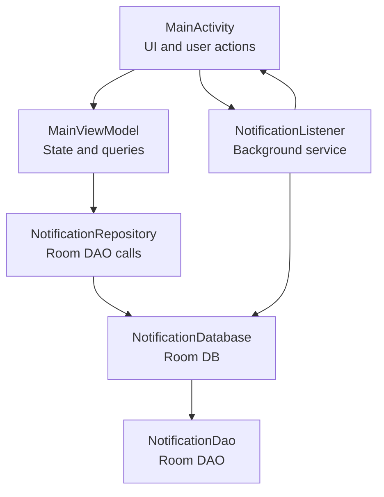

# Getting Started

<cite>
**Referenced Files in This Document**
- [README-JDK-SETUP.md](file://README-JDK-SETUP.md)
- [gradle.properties](file://gradle.properties)
- [build.gradle](file://build.gradle)
- [app/build.gradle](file://app/build.gradle)
- [gradle-wrapper.properties](file://gradle/wrapper/gradle-wrapper.properties)
- [gradlew.bat](file://gradlew.bat)
- [scripts/validate-jdk.gradle](file://scripts/validate-jdk.gradle)
- [settings.gradle](file://settings.gradle)
- [AndroidManifest.xml](file://app/src/main/AndroidManifest.xml)
- [MainActivity.kt](file://app/src/main/java/com/notificationlog/MainActivity.kt)
- [NotificationListener.kt](file://app/src/main/java/com/notificationlog/NotificationListener.kt)
- [MainViewModel.kt](file://app/src/main/java/com/notificationlog/MainViewModel.kt)
- [NotificationRepository.kt](file://app/src/main/java/com/notificationlog/repository/NotificationRepository.kt)
- [NotificationDatabase.kt](file://app/src/main/java/com/notificationlog/data/NotificationDatabase.kt)
- [NotificationItem.kt](file://app/src/main/java/com/notificationlog/model/NotificationItem.kt)
</cite>

## Table of Contents
1. [Introduction](#introduction)
2. [Prerequisites and JDK 21 Setup](#prerequisites-and-jdk-21-setup)
3. [Gradle Wrapper and Project Compilation](#gradle-wrapper-and-project-compilation)
4. [Android Studio Setup](#android-studio-setup)
5. [Emulator and Device Configuration](#emulator-and-device-configuration)
6. [First Launch and Initial Setup](#first-launch-and-initial-setup)
7. [Permission Granting Process](#permission-granting-process)
8. [Understanding Background Operation Requirements](#understanding-background-operation-requirements)
9. [Verification Steps](#verification-steps)
10. [Troubleshooting Common Issues](#troubleshooting-common-issues)
11. [Architecture Overview](#architecture-overview)
12. [Conclusion](#conclusion)

## Introduction
This guide helps first-time users install, configure, and run NotificationLog. It covers JDK 21 setup, Gradle wrapper configuration, building the project, Android Studio prerequisites, emulator/device setup, enabling permissions, and verifying successful installation. It also explains the app's background operation requirements and provides troubleshooting guidance.

## Prerequisites and JDK 21 Setup
NotificationLog requires JDK 21. The project includes a validation script and documentation to help you configure and verify your JDK setup.

- Install JDK 21 from the official provider.
- Configure the project to use JDK 21 by setting the Gradle Java home path in the project properties.
- Run the validation task to confirm the correct JDK is being used.

Key configuration and validation resources:
- JDK installation and configuration steps are documented in the project’s setup guide.
- The Gradle properties file defines the JDK path used by the project.
- A dedicated validation task checks the JDK version and provides actionable fixes if incorrect.

**Section sources**
- [README-JDK-SETUP.md:1-22](file://README-JDK-SETUP.md#L1-L22)
- [gradle.properties:9-31](file://gradle.properties#L9-L31)
- [scripts/validate-jdk.gradle:13-62](file://scripts/validate-jdk.gradle#L13-L62)

## Gradle Wrapper and Project Compilation
The project uses a Gradle wrapper to manage builds consistently across environments. The wrapper distribution is configured in the wrapper properties file.

- Use the Gradle wrapper to build the project.
- The top-level build script applies a JDK validation script and defines a clean task.
- The app module configures Java/Kotlin compatibility to JDK 21 and enables Data Binding and KSP.

Compilation steps:
- Open a terminal in the project root.
- Run the validation task to verify JDK 21 is detected.
- Build the project using the Gradle wrapper.

**Section sources**
- [gradle-wrapper.properties:1-6](file://gradle/wrapper/gradle-wrapper.properties#L1-L6)
- [build.gradle:9-16](file://build.gradle#L9-L16)
- [app/build.gradle:51-68](file://app/build.gradle#L51-L68)
- [gradlew.bat:39-75](file://gradlew.bat#L39-L75)

## Android Studio Setup
Android Studio is recommended for development and testing. Ensure your IDE is configured to use JDK 21.

- Install Android Studio with the Android SDK and Android Virtual Device (AVD) tools.
- Configure Android Studio to use JDK 21 as the Gradle JVM in the IDE settings.
- Open the project in Android Studio and sync the Gradle files.

Project configuration highlights:
- The project targets Android 14 (API 34) and requires a minimum SDK level compatible with the app’s configuration.
- Kotlin and Android plugin versions are defined at the project level.
- The app module enables Data Binding and KSP for Room schema generation.

**Section sources**
- [app/build.gradle:19-40](file://app/build.gradle#L19-L40)
- [build.gradle:2-7](file://build.gradle#L2-L7)
- [settings.gradle:1-18](file://settings.gradle#L1-L18)

## Emulator and Device Configuration
Use an Android 14 (API 34) emulator or a physical device for testing. The app targets API 34 and uses modern Android features.

- Create or use an existing AVD with Android 14.
- For physical devices, ensure the OS supports the required APIs and permissions.
- Enable developer options and USB debugging if using a physical device.

Build and run:
- Sync the project in Android Studio.
- Select your target device/emulator.
- Build and run the app.

**Section sources**
- [app/build.gradle:21, 37](file://app/build.gradle#L21,L37)
- [AndroidManifest.xml:17](file://app/src/main/AndroidManifest.xml#L17)

## First Launch and Initial Setup
On first launch, the app checks for required permissions and service status. It may prompt you to enable notification access and grant runtime permissions.

- Launch the app from Android Studio or install the built APK.
- On resume, the app verifies:
  - Notification access is enabled for the app.
  - Runtime permission for posting notifications (Android 13+).
- Buttons and menus reflect current status (e.g., “Enable Notification Access,” “Grant Permission”).

Initial checks performed by the app:
- Checks whether the notification listener service is enabled.
- Verifies runtime notification permission on Android 13+.
- Updates UI state and button colors based on current status.

**Section sources**
- [MainActivity.kt:101, 133-137](file://app/src/main/java/com/notificationlog/MainActivity.kt#L101,L133-L137)
- [MainActivity.kt:313-322](file://app/src/main/java/com/notificationlog/MainActivity.kt#L313-L322)
- [MainActivity.kt:242-298](file://app/src/main/java/com/notificationlog/MainActivity.kt#L242-L298)

## Permission Granting Process
NotificationLog requires two key permissions to function:

1. Notification access (to listen to notifications):
   - The app opens the system settings screen for notification listeners.
   - After enabling, the app updates its internal status and UI.

2. Post notifications permission (Android 13+):
   - The app requests the runtime permission to post its own notifications.
   - On success, the persistent notification can be shown while capturing is active.

Permission flow:
- If notification access is not enabled, the app shows a dialog and opens the appropriate settings page.
- On Android 13+, if the post notifications permission is not granted, the app requests it via a permission launcher.
- The UI updates immediately after granting permissions.

**Section sources**
- [AndroidManifest.xml:5-7](file://app/src/main/AndroidManifest.xml#L5-L7)
- [MainActivity.kt:364-367](file://app/src/main/java/com/notificationlog/MainActivity.kt#L364-L367)
- [MainActivity.kt:369-373](file://app/src/main/java/com/notificationlog/MainActivity.kt#L369-L373)
- [MainActivity.kt:386-414](file://app/src/main/java/com/notificationlog/MainActivity.kt#L386-L414)

## Understanding Background Operation Requirements
NotificationLog captures notifications in the background using a NotificationListenerService. The app also supports a persistent notification while capturing is active.

Key behaviors:
- The listener service runs in the background and stores notifications in a Room database.
- The app can optionally show a persistent notification indicating that capture is active.
- Users can toggle the capture on/off and choose whether to show the persistent notification.

Background operation details:
- The service inserts captured notifications into the Room database and broadcasts updates to the UI.
- The persistent notification can be toggled via the app menu.

**Section sources**
- [AndroidManifest.xml:29-43](file://app/src/main/AndroidManifest.xml#L29-L43)
- [NotificationListener.kt:109-153](file://app/src/main/java/com/notificationlog/NotificationListener.kt#L109-L153)
- [MainActivity.kt:686-715](file://app/src/main/java/com/notificationlog/MainActivity.kt#L686-L715)

## Verification Steps
After completing setup and launching the app, verify the installation:

- Confirm the app launches without build errors.
- Verify the UI buttons reflect correct status:
  - “Enable Notification Access” indicates whether notification access is enabled.
  - “Grant Permission” reflects whether the post notifications permission is granted (Android 13+).
- Toggle capture on/off and verify the persistent notification appears/disappears when enabled.
- Open the notification settings page and confirm the app appears under enabled notification listeners.
- Use the refresh action to load stored notifications from the Room database.

**Section sources**
- [MainActivity.kt:242-298](file://app/src/main/java/com/notificationlog/MainActivity.kt#L242-L298)
- [MainActivity.kt:506-519](file://app/src/main/java/com/notificationlog/MainActivity.kt#L506-L519)
- [NotificationListener.kt:139-149](file://app/src/main/java/com/notificationlog/NotificationListener.kt#L139-L149)

## Troubleshooting Common Issues
Common setup and runtime issues and their resolutions:

- JDK version mismatch:
  - Symptom: Build fails with an unsupported class file error.
  - Resolution: Ensure org.gradle.java.home points to JDK 21 in gradle.properties and run the validation task.

- Gradle wrapper issues:
  - Symptom: Gradle cannot locate Java.
  - Resolution: Set JAVA_HOME or configure Android Studio to use JDK 21; verify the wrapper distribution URL.

- Notification access not enabled:
  - Symptom: App prompts to enable notification access or shows a warning notification.
  - Resolution: Open notification listener settings, enable the app, and return to the app.

- Permission denied for posting notifications (Android 13+):
  - Symptom: Persistent notification not shown or warnings.
  - Resolution: Grant the post notifications permission when prompted.

- Build fails due to missing keystore:
  - Symptom: Release build fails due to missing keystore properties.
  - Resolution: Provide keystore properties or build a debug variant.

- Validation task output:
  - Run the validation task to confirm JDK 21 detection and receive suggested fixes if needed.

**Section sources**
- [gradle.properties:26-36](file://gradle.properties#L26-L36)
- [gradlew.bat:40-66](file://gradlew.bat#L40-L66)
- [scripts/validate-jdk.gradle:23-61](file://scripts/validate-jdk.gradle#L23-L61)
- [MainActivity.kt:375-384](file://app/src/main/java/com/notificationlog/MainActivity.kt#L375-L384)
- [MainActivity.kt:405-414](file://app/src/main/java/com/notificationlog/MainActivity.kt#L405-L414)
- [app/build.gradle:12-31](file://app/build.gradle#L12-L31)

## Architecture Overview
The app follows a layered architecture with a UI layer, ViewModel, repository, database, and a background listener service.

**Diagram sources**
- [MainActivity.kt:43-108](file://app/src/main/java/com/notificationlog/MainActivity.kt#L43-L108)
- [MainViewModel.kt:15-77](file://app/src/main/java/com/notificationlog/MainViewModel.kt#L15-L77)
- [NotificationRepository.kt:6-27](file://app/src/main/java/com/notificationlog/repository/NotificationRepository.kt#L6-L27)
- [NotificationDatabase.kt:7-10](file://app/src/main/java/com/notificationlog/data/NotificationDatabase.kt#L7-L10)
- [NotificationListener.kt:23-65](file://app/src/main/java/com/notificationlog/NotificationListener.kt#L23-L65)

## Conclusion
You are now ready to use NotificationLog. Ensure JDK 21 is configured, the project compiles successfully, and the app has notification access and runtime permissions. Enable the persistent notification if desired, and verify that notifications are captured and displayed. Use the troubleshooting section to resolve common issues quickly.