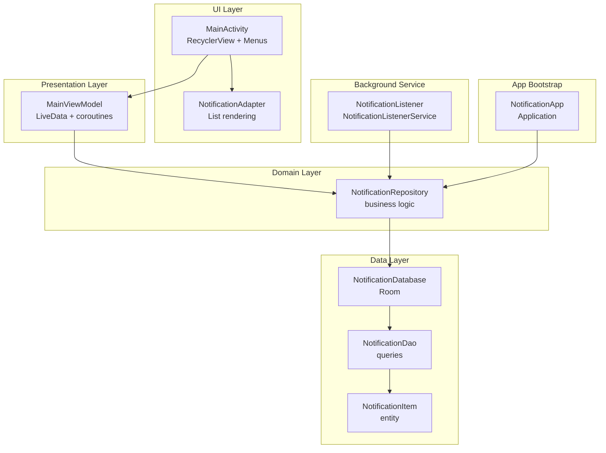
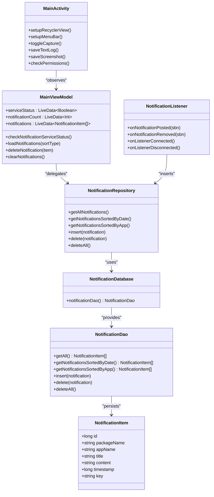
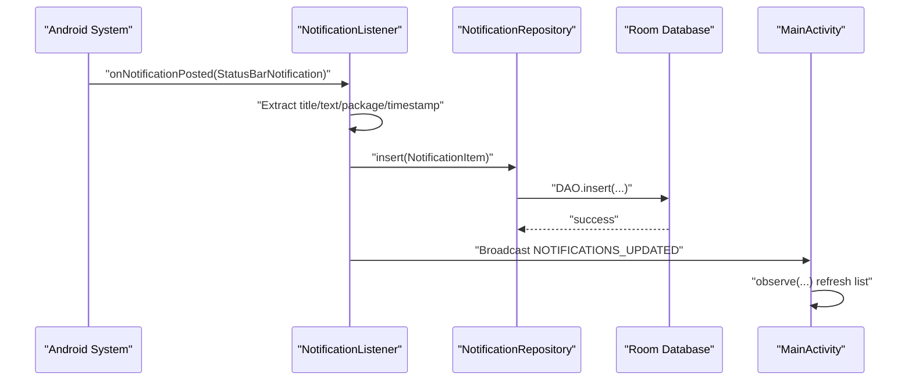
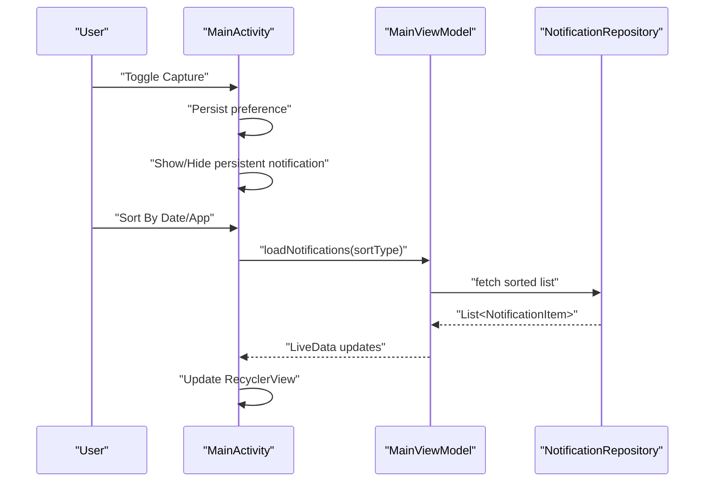
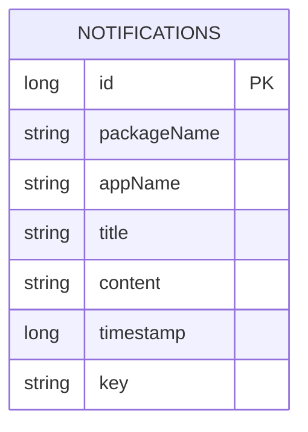
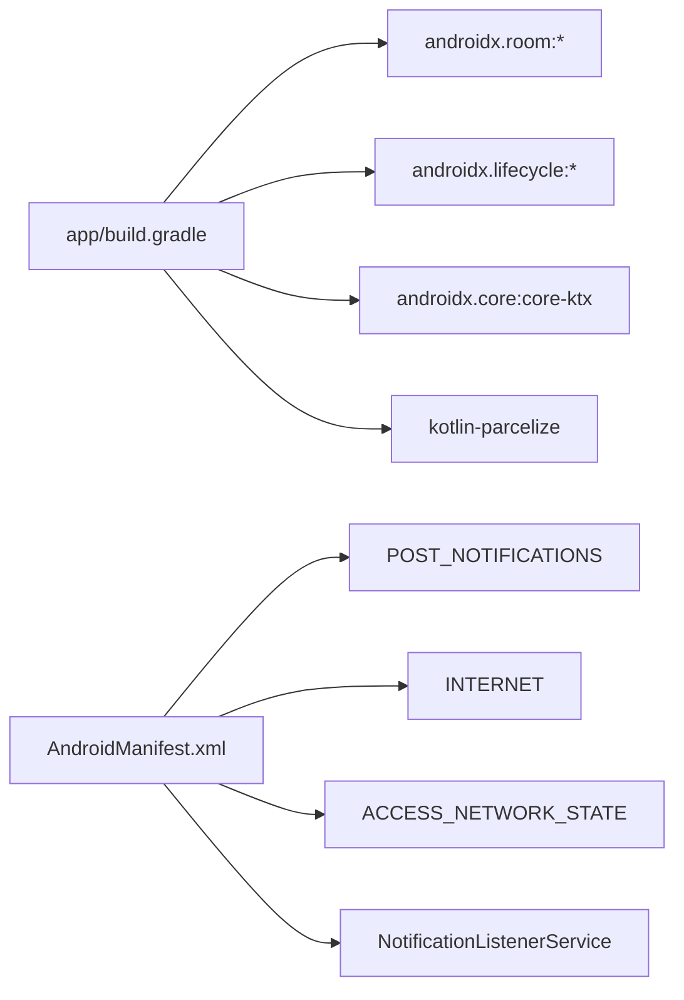

# Project Overview

<cite>
**Referenced Files in This Document**
- [MainActivity.kt](file://app/src/main/java/com/notificationlog/MainActivity.kt)
- [MainViewModel.kt](file://app/src/main/java/com/notificationlog/MainViewModel.kt)
- [NotificationListener.kt](file://app/src/main/java/com/notificationlog/NotificationListener.kt)
- [NotificationDatabase.kt](file://app/src/main/java/com/notificationlog/data/NotificationDatabase.kt)
- [NotificationDao.kt](file://app/src/main/java/com/notificationlog/data/NotificationDao.kt)
- [NotificationItem.kt](file://app/src/main/java/com/notificationlog/model/NotificationItem.kt)
- [NotificationRepository.kt](file://app/src/main/java/com/notificationlog/repository/NotificationRepository.kt)
- [NotificationAdapter.kt](file://app/src/main/java/com/notificationlog/adapter/NotificationAdapter.kt)
- [NotificationApp.kt](file://app/src/main/java/com/notificationlog/NotificationApp.kt)
- [AndroidManifest.xml](file://app/src/main/AndroidManifest.xml)
- [build.gradle](file://app/build.gradle)
- [README-JDK-SETUP.md](file://README-JDK-SETUP.md)
</cite>

## Table of Contents
1. [Introduction](#introduction)
2. [Project Structure](#project-structure)
3. [Core Components](#core-components)
4. [Architecture Overview](#architecture-overview)
5. [Detailed Component Analysis](#detailed-component-analysis)
6. [Dependency Analysis](#dependency-analysis)
7. [Performance Considerations](#performance-considerations)
8. [Troubleshooting Guide](#troubleshooting-guide)
9. [Conclusion](#conclusion)
10. [Appendices](#appendices)

## Introduction
NotificationLog is a real-time notification capture and management application for Android. It continuously monitors system notifications via Android’s NotificationListenerService, stores them locally using Room, and presents them in a searchable, sortable list. Users can export logs as text files, take screenshots of the current screen, and manage notification capture with on/off toggles and persistent status notifications. The app targets users who need insight into their notification stream, including power users, developers investigating notification behavior, and anyone interested in auditing notification activity.

## Project Structure
The project follows a feature-based structure under the app module with clear separation of concerns:
- UI layer: MainActivity and RecyclerView adapter
- Presentation layer: MainViewModel implementing MVVM
- Domain layer: NotificationRepository
- Data layer: Room database, DAO, and entity
- Background service: NotificationListener (NotificationListenerService)
- Application bootstrap: NotificationApp

**Diagram sources**
- [MainActivity.kt](file://app/src/main/java/com/notificationlog/MainActivity.kt)
- [MainViewModel.kt](file://app/src/main/java/com/notificationlog/MainViewModel.kt)
- [NotificationRepository.kt](file://app/src/main/java/com/notificationlog/repository/NotificationRepository.kt)
- [NotificationDatabase.kt](file://app/src/main/java/com/notificationlog/data/NotificationDatabase.kt)
- [NotificationDao.kt](file://app/src/main/java/com/notificationlog/data/NotificationDao.kt)
- [NotificationItem.kt](file://app/src/main/java/com/notificationlog/model/NotificationItem.kt)
- [NotificationListener.kt](file://app/src/main/java/com/notificationlog/NotificationListener.kt)
- [NotificationApp.kt](file://app/src/main/java/com/notificationlog/NotificationApp.kt)

**Section sources**
- [MainActivity.kt](file://app/src/main/java/com/notificationlog/MainActivity.kt)
- [NotificationListener.kt](file://app/src/main/java/com/notificationlog/NotificationListener.kt)
- [NotificationApp.kt](file://app/src/main/java/com/notificationlog/NotificationApp.kt)

## Core Components
- Real-time notification capture: NotificationListenerService intercepts notifications and persists them to Room.
- Local storage: Room database with a single entity and DAO for CRUD operations.
- UI and management: MainActivity with sorting, filtering, deletion, and export capabilities.
- MVVM presentation: MainViewModel exposes LiveData streams and orchestrates repository operations.
- Export and persistence: Text log export to external storage and screenshot capture to MediaStore.

Key features:
- Notification monitoring via NotificationListenerService
- Local storage with Room database
- Export logs as text files
- Screenshot capture of the current UI
- Sorting by date or app
- Toggle capture on/off and persistent status notification

**Section sources**
- [NotificationListener.kt](file://app/src/main/java/com/notificationlog/NotificationListener.kt)
- [NotificationDatabase.kt](file://app/src/main/java/com/notificationlog/data/NotificationDatabase.kt)
- [NotificationDao.kt](file://app/src/main/java/com/notificationlog/data/NotificationDao.kt)
- [NotificationItem.kt](file://app/src/main/java/com/notificationlog/model/NotificationItem.kt)
- [MainActivity.kt](file://app/src/main/java/com/notificationlog/MainActivity.kt)
- [MainViewModel.kt](file://app/src/main/java/com/notificationlog/MainViewModel.kt)

## Architecture Overview
NotificationLog implements MVVM:
- Model: Room entity and DAO
- View: MainActivity and RecyclerView
- ViewModel: MainViewModel manages LiveData and delegates to repository
- Service: NotificationListener captures notifications and updates UI via broadcasts

**Diagram sources**
- [NotificationItem.kt](file://app/src/main/java/com/notificationlog/model/NotificationItem.kt)
- [NotificationDao.kt](file://app/src/main/java/com/notificationlog/data/NotificationDao.kt)
- [NotificationDatabase.kt](file://app/src/main/java/com/notificationlog/data/NotificationDatabase.kt)
- [NotificationRepository.kt](file://app/src/main/java/com/notificationlog/repository/NotificationRepository.kt)
- [MainViewModel.kt](file://app/src/main/java/com/notificationlog/MainViewModel.kt)
- [MainActivity.kt](file://app/src/main/java/com/notificationlog/MainActivity.kt)
- [NotificationListener.kt](file://app/src/main/java/com/notificationlog/NotificationListener.kt)

## Detailed Component Analysis

### NotificationListener (Background Capture)
Responsibilities:
- Subscribes to system notifications via NotificationListenerService
- Extracts metadata (title, text, package, timestamp)
- Inserts into Room database and notifies UI via broadcast
- Handles disconnection events and requests rebind on newer Android versions
- Posts a high-priority warning notification when access is lost

**Diagram sources**
- [NotificationListener.kt](file://app/src/main/java/com/notificationlog/NotificationListener.kt)
- [NotificationRepository.kt](file://app/src/main/java/com/notificationlog/repository/NotificationRepository.kt)
- [NotificationDao.kt](file://app/src/main/java/com/notificationlog/data/NotificationDao.kt)
- [MainActivity.kt](file://app/src/main/java/com/notificationlog/MainActivity.kt)

**Section sources**
- [NotificationListener.kt](file://app/src/main/java/com/notificationlog/NotificationListener.kt)

### MainViewModel (Presentation Logic)
Responsibilities:
- Exposes LiveData for service status, notification count, and list
- Loads sorted lists from repository on demand
- Delegates delete/clear operations
- Observes and surfaces errors

**Diagram sources**
- [MainViewModel.kt](file://app/src/main/java/com/notificationlog/MainViewModel.kt)
- [NotificationRepository.kt](file://app/src/main/java/com/notificationlog/repository/NotificationRepository.kt)

**Section sources**
- [MainViewModel.kt](file://app/src/main/java/com/notificationlog/MainViewModel.kt)

### MainActivity (UI and Actions)
Responsibilities:
- Manages permissions and service status
- Provides menus for sort, save, and about
- Supports screenshot and text log export
- Controls capture on/off and persistent status notification
- Observes ViewModel LiveData and broadcasts for updates

**Diagram sources**
- [MainActivity.kt](file://app/src/main/java/com/notificationlog/MainActivity.kt)
- [MainViewModel.kt](file://app/src/main/java/com/notificationlog/MainViewModel.kt)
- [NotificationRepository.kt](file://app/src/main/java/com/notificationlog/repository/NotificationRepository.kt)

**Section sources**
- [MainActivity.kt](file://app/src/main/java/com/notificationlog/MainActivity.kt)

### Data Layer (Room)
- Entity: NotificationItem with primary key and fields for app identity and content
- DAO: Queries for full list and sorted variants, insert/delete/clear
- Database: Single-table notifications database

**Diagram sources**
- [NotificationItem.kt](file://app/src/main/java/com/notificationlog/model/NotificationItem.kt)
- [NotificationDao.kt](file://app/src/main/java/com/notificationlog/data/NotificationDao.kt)
- [NotificationDatabase.kt](file://app/src/main/java/com/notificationlog/data/NotificationDatabase.kt)

**Section sources**
- [NotificationItem.kt](file://app/src/main/java/com/notificationlog/model/NotificationItem.kt)
- [NotificationDao.kt](file://app/src/main/java/com/notificationlog/data/NotificationDao.kt)
- [NotificationDatabase.kt](file://app/src/main/java/com/notificationlog/data/NotificationDatabase.kt)

### Adapter (UI Rendering)
- RecyclerView adapter using DiffUtil for efficient list updates
- Binds NotificationItem to views and handles click/delete actions

**Section sources**
- [NotificationAdapter.kt](file://app/src/main/java/com/notificationlog/adapter/NotificationAdapter.kt)

## Dependency Analysis
- AndroidX: Core, AppCompat, Material, ConstraintLayout, Lifecycle (ViewModel/LiveData), Activity/Fragment KTX
- Room: Runtime, KTX, compiler (via KSP)
- Kotlin: Parcelize for Parcelable entity
- Manifest declares INTERNET, ACCESS_NETWORK_STATE, POST_NOTIFICATIONS
- NotificationListenerService declared with required meta-data

**Diagram sources**
- [build.gradle](file://app/build.gradle)
- [AndroidManifest.xml](file://app/src/main/AndroidManifest.xml)

**Section sources**
- [build.gradle](file://app/build.gradle)
- [AndroidManifest.xml](file://app/src/main/AndroidManifest.xml)

## Performance Considerations
- Background capture runs on IO dispatcher with coroutine supervision to avoid blocking UI.
- Room queries are executed off the main thread; LiveData updates UI safely.
- DiffUtil minimizes RecyclerView churn during frequent updates.
- Export operations write to external storage asynchronously and provide user feedback.
- Consider batching inserts if high-frequency bursts occur; current design inserts per notification.

## Troubleshooting Guide
Common issues and resolutions:
- Notification access disabled: The app detects disabled access and prompts to enable it. Open Settings → Apps → Notification Access and enable the app.
- Permission denied for POST_NOTIFICATIONS (Android 13+): Grant the permission when prompted; the app checks and requests it at runtime.
- Listener disconnected: On disconnection, a high-priority warning notification appears and a broadcast informs the UI to show a dialog. Re-enable notification access.
- Export failures: Ensure storage permissions are granted; on Android Q+, the app uses MediaStore; on older versions, it writes to public documents directory.
- Persistent notification visibility: Toggle “Show running notification” in the menu to display or hide the ongoing status notification.

**Section sources**
- [MainActivity.kt](file://app/src/main/java/com/notificationlog/MainActivity.kt)
- [NotificationListener.kt](file://app/src/main/java/com/notificationlog/NotificationListener.kt)

## Conclusion
NotificationLog provides a robust, real-time notification capture and management solution built on modern Android technologies. Its MVVM architecture cleanly separates UI, presentation, domain, and data layers, while NotificationListenerService ensures reliable background capture. Room-backed local storage enables efficient querying and export capabilities. The app is suitable for both beginners seeking a straightforward notification viewer and advanced users needing auditability and export options.

## Appendices

### System Requirements and Supported Versions
- Minimum Android version: Android 7.0 (API 24)
- Target and compile SDK: Android 14 (API 34)
- JDK: Version 21 (required for building)
- Permissions:
  - POST_NOTIFICATIONS (Android 13+)
  - INTERNET and ACCESS_NETWORK_STATE
- Additional requirement: Notification access must be granted to the app

**Section sources**
- [build.gradle](file://app/build.gradle)
- [AndroidManifest.xml](file://app/src/main/AndroidManifest.xml)
- [README-JDK-SETUP.md](file://README-JDK-SETUP.md)

### Installation Prerequisites
- Install JDK 21 and configure gradle.properties accordingly
- Grant notification access to the app in system settings
- On Android 13+, grant POST_NOTIFICATIONS permission when prompted
- Launch the app; it will guide you to enable notification access if not yet granted

**Section sources**
- [README-JDK-SETUP.md](file://README-JDK-SETUP.md)
- [MainActivity.kt](file://app/src/main/java/com/notificationlog/MainActivity.kt)
- [AndroidManifest.xml](file://app/src/main/AndroidManifest.xml)