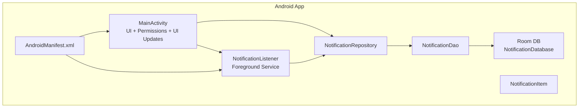
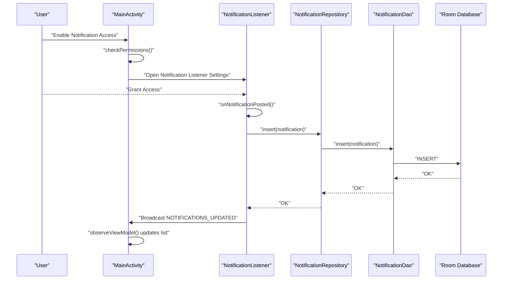
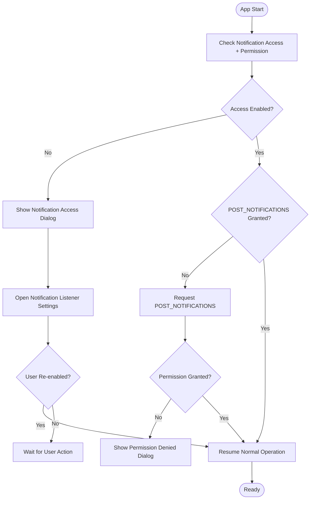
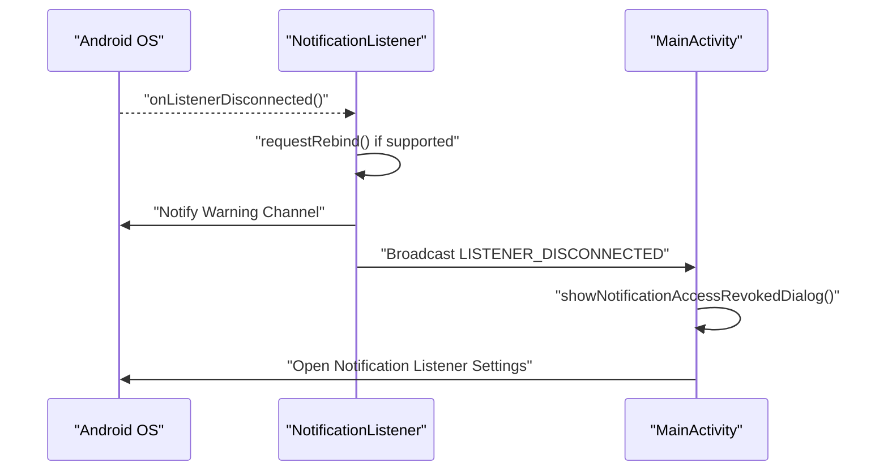
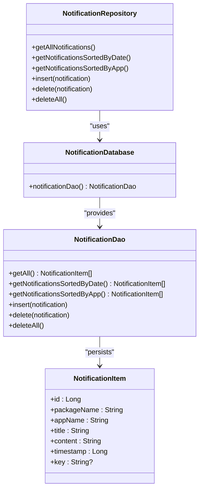
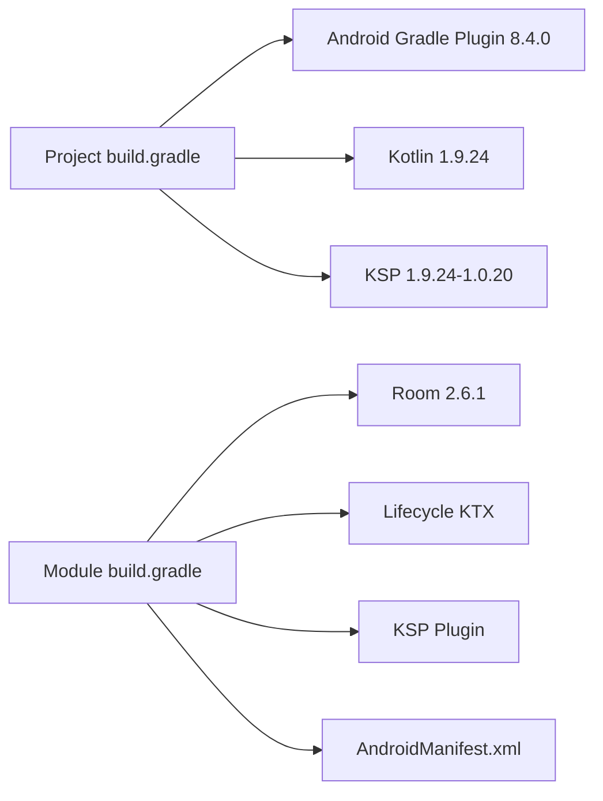

# Troubleshooting & FAQ

<cite>
**Referenced Files in This Document**
- [MainActivity.kt](file://app/src/main/java/com/notificationlog/MainActivity.kt)
- [NotificationListener.kt](file://app/src/main/java/com/notificationlog/NotificationListener.kt)
- [NotificationDatabase.kt](file://app/src/main/java/com/notificationlog/data/NotificationDatabase.kt)
- [NotificationDao.kt](file://app/src/main/java/com/notificationlog/data/NotificationDao.kt)
- [NotificationRepository.kt](file://app/src/main/java/com/notificationlog/repository/NotificationRepository.kt)
- [NotificationItem.kt](file://app/src/main/java/com/notificationlog/model/NotificationItem.kt)
- [AndroidManifest.xml](file://app/src/main/AndroidManifest.xml)
- [build.gradle (Module)](file://app/build.gradle)
- [build.gradle (Project)](file://build.gradle)
- [gradle.properties](file://gradle.properties)
- [validate-jdk.gradle](file://scripts/validate-jdk.gradle)
- [README-JDK-SETUP.md](file://README-JDK-SETUP.md)
- [strings.xml](file://app/src/main/res/values/strings.xml)
</cite>

## Table of Contents
1. [Introduction](#introduction)
2. [Project Structure](#project-structure)
3. [Core Components](#core-components)
4. [Architecture Overview](#architecture-overview)
5. [Detailed Component Analysis](#detailed-component-analysis)
6. [Dependency Analysis](#dependency-analysis)
7. [Performance Considerations](#performance-considerations)
8. [Troubleshooting Guide](#troubleshooting-guide)
9. [Conclusion](#conclusion)
10. [Appendices](#appendices)

## Introduction
This document provides a comprehensive troubleshooting guide and FAQ for NotificationLog. It focuses on resolving common issues such as notification access permission problems, background service operation failures, and database connectivity issues. It also covers JDK 21 setup problems, Gradle configuration errors, and Android Studio compatibility concerns. Step-by-step solutions are provided for permission granting, service restart procedures, and data recovery methods. Diagnostic commands, log analysis techniques, and performance optimization tips are included, along with answers to frequently asked questions about notification capture limitations, battery optimization conflicts, and Android version compatibility.

## Project Structure
NotificationLog is an Android application that captures notifications via a foreground NotificationListenerService, stores them in a Room database, and presents them in a RecyclerView. Permissions and runtime behavior are managed through the main Activity and manifest declarations.

**Diagram sources**
- [MainActivity.kt:43-108](file://app/src/main/java/com/notificationlog/MainActivity.kt#L43-L108)
- [NotificationListener.kt:23-65](file://app/src/main/java/com/notificationlog/NotificationListener.kt#L23-L65)
- [NotificationDatabase.kt:7-10](file://app/src/main/java/com/notificationlog/data/NotificationDatabase.kt#L7-L10)
- [NotificationDao.kt:6-26](file://app/src/main/java/com/notificationlog/data/NotificationDao.kt#L6-L26)
- [NotificationRepository.kt:6-27](file://app/src/main/java/com/notificationlog/repository/NotificationRepository.kt#L6-L27)
- [NotificationItem.kt:8-19](file://app/src/main/java/com/notificationlog/model/NotificationItem.kt#L8-L19)
- [AndroidManifest.xml:1-45](file://app/src/main/AndroidManifest.xml#L1-L45)

**Section sources**
- [MainActivity.kt:43-108](file://app/src/main/java/com/notificationlog/MainActivity.kt#L43-L108)
- [NotificationListener.kt:23-65](file://app/src/main/java/com/notificationlog/NotificationListener.kt#L23-L65)
- [AndroidManifest.xml:1-45](file://app/src/main/AndroidManifest.xml#L1-L45)

## Core Components
- MainActivity: Handles UI, permissions, persistent notification, broadcast receivers for updates and disconnection, and data export.
- NotificationListener: Foreground service that receives notifications, inserts them into Room, and notifies the UI.
- Room Database: Stores notifications with DAO and Repository abstractions.
- Manifest: Declares permissions, activity, and NotificationListenerService with required metadata.

Key responsibilities:
- Permission gating and dialogs for notification access and POST_NOTIFICATIONS.
- Service status checks and persistent notification toggling.
- Broadcast-based UI refresh and disconnection alerts.
- Room CRUD operations and sorting queries.

**Section sources**
- [MainActivity.kt:313-414](file://app/src/main/java/com/notificationlog/MainActivity.kt#L313-L414)
- [NotificationListener.kt:109-153](file://app/src/main/java/com/notificationlog/NotificationListener.kt#L109-L153)
- [NotificationDatabase.kt:7-10](file://app/src/main/java/com/notificationlog/data/NotificationDatabase.kt#L7-L10)
- [NotificationDao.kt:6-26](file://app/src/main/java/com/notificationlog/data/NotificationDao.kt#L6-L26)
- [NotificationRepository.kt:6-27](file://app/src/main/java/com/notificationlog/repository/NotificationRepository.kt#L6-L27)
- [AndroidManifest.xml:5-43](file://app/src/main/AndroidManifest.xml#L5-L43)

## Architecture Overview
The system relies on a foreground NotificationListenerService to capture notifications and persist them in a local Room database. The UI observes LiveData from a ViewModel backed by the Repository and DAO.

**Diagram sources**
- [MainActivity.kt:324-343](file://app/src/main/java/com/notificationlog/MainActivity.kt#L324-L343)
- [NotificationListener.kt:109-153](file://app/src/main/java/com/notificationlog/NotificationListener.kt#L109-L153)
- [NotificationRepository.kt:16-18](file://app/src/main/java/com/notificationlog/repository/NotificationRepository.kt#L16-L18)
- [NotificationDao.kt:18-19](file://app/src/main/java/com/notificationlog/data/NotificationDao.kt#L18-L19)
- [NotificationDatabase.kt:7-10](file://app/src/main/java/com/notificationlog/data/NotificationDatabase.kt#L7-L10)

## Detailed Component Analysis

### Notification Access and Permission Flow
Common issues:
- Notification access disabled or revoked.
- POST_NOTIFICATIONS permission missing on Android 13+.
- Receiver registration mismatch across lifecycle events.

Recommended actions:
- Open Notification Access settings from the UI.
- Grant POST_NOTIFICATIONS permission when targeting Android 13+.
- Ensure receivers are registered/unregistered in onResume/onPause.

**Diagram sources**
- [MainActivity.kt:313-373](file://app/src/main/java/com/notificationlog/MainActivity.kt#L313-L373)
- [MainActivity.kt:110-144](file://app/src/main/java/com/notificationlog/MainActivity.kt#L110-L144)
- [AndroidManifest.xml:5-7](file://app/src/main/AndroidManifest.xml#L5-L7)

**Section sources**
- [MainActivity.kt:313-373](file://app/src/main/java/com/notificationlog/MainActivity.kt#L313-L373)
- [MainActivity.kt:110-144](file://app/src/main/java/com/notificationlog/MainActivity.kt#L110-L144)
- [AndroidManifest.xml:5-7](file://app/src/main/AndroidManifest.xml#L5-L7)

### Background Service Operation Failures
Symptoms:
- Service stops unexpectedly.
- Disconnection broadcasts received.
- Warning notification shown.

Root causes:
- Notification access revoked by the system.
- Device enforcing battery optimization or Doze.
- Rebind request failure on Android 13+.

Resolution steps:
- Confirm service is bound in system settings.
- Restart the service by toggling capture or re-enabling access.
- Disable battery optimization for the app if applicable.
- Review logs for rebind failures and handle gracefully.

**Diagram sources**
- [NotificationListener.kt:44-65](file://app/src/main/java/com/notificationlog/NotificationListener.kt#L44-L65)
- [NotificationListener.kt:67-107](file://app/src/main/java/com/notificationlog/NotificationListener.kt#L67-L107)
- [MainActivity.kt:51-66](file://app/src/main/java/com/notificationlog/MainActivity.kt#L51-L66)

**Section sources**
- [NotificationListener.kt:44-65](file://app/src/main/java/com/notificationlog/NotificationListener.kt#L44-L65)
- [NotificationListener.kt:67-107](file://app/src/main/java/com/notificationlog/NotificationListener.kt#L67-L107)
- [MainActivity.kt:51-66](file://app/src/main/java/com/notificationlog/MainActivity.kt#L51-L66)

### Database Connectivity and Storage Issues
Symptoms:
- Insert failures reported in logs.
- No notifications appear in UI.
- Room schema or migration issues.

Checks and fixes:
- Verify Room database initialization and DAO queries.
- Confirm repository methods are invoked on IO dispatcher.
- Ensure broadcast is sent after successful insert to refresh UI.

**Diagram sources**
- [NotificationDatabase.kt:7-10](file://app/src/main/java/com/notificationlog/data/NotificationDatabase.kt#L7-L10)
- [NotificationDao.kt:6-26](file://app/src/main/java/com/notificationlog/data/NotificationDao.kt#L6-L26)
- [NotificationRepository.kt:6-27](file://app/src/main/java/com/notificationlog/repository/NotificationRepository.kt#L6-L27)
- [NotificationItem.kt:8-19](file://app/src/main/java/com/notificationlog/model/NotificationItem.kt#L8-L19)

**Section sources**
- [NotificationRepository.kt:6-27](file://app/src/main/java/com/notificationlog/repository/NotificationRepository.kt#L6-L27)
- [NotificationDao.kt:6-26](file://app/src/main/java/com/notificationlog/data/NotificationDao.kt#L6-L26)
- [NotificationDatabase.kt:7-10](file://app/src/main/java/com/notificationlog/data/NotificationDatabase.kt#L7-L10)

### Android Version Compatibility and Notification Capture Limitations
- Android 13+ requires explicit POST_NOTIFICATIONS permission for the app to post its own notifications.
- Notification access must be granted via system settings; otherwise, capture is blocked.
- Some devices restrict background work or notification listener access under aggressive battery optimization.

Mitigations:
- Prompt users to grant POST_NOTIFICATIONS when targeting Android 13+.
- Advise enabling “Don’t optimize” for the app if the device enforces strict power-saving modes.
- Inform users that notification capture may be limited by OEM restrictions.

**Section sources**
- [MainActivity.kt:353-362](file://app/src/main/java/com/notificationlog/MainActivity.kt#L353-L362)
- [AndroidManifest.xml:5-7](file://app/src/main/AndroidManifest.xml#L5-L7)

## Dependency Analysis
Build-time and runtime dependencies:
- Android Gradle Plugin 8.4.0, Kotlin 1.9.24, KSP 1.9.24-1.0.20.
- Room 2.6.1 with KSP compiler.
- Lifecycle components for ViewModel/LiveData.
- Manifest declares INTERNET, ACCESS_NETWORK_STATE, and POST_NOTIFICATIONS.

**Diagram sources**
- [build.gradle (Project):2-7](file://build.gradle#L2-L7)
- [build.gradle (Module):72-94](file://app/build.gradle#L72-L94)
- [AndroidManifest.xml:5-7](file://app/src/main/AndroidManifest.xml#L5-L7)

**Section sources**
- [build.gradle (Project):2-7](file://build.gradle#L2-L7)
- [build.gradle (Module):72-94](file://app/build.gradle#L72-L94)
- [AndroidManifest.xml:5-7](file://app/src/main/AndroidManifest.xml#L5-L7)

## Performance Considerations
- Use IO dispatcher for Room operations to avoid blocking the main thread.
- Avoid excessive logging in production; keep Log.d/w/e statements scoped to development.
- Prefer batch UI updates and minimize frequent broadcasts if unnecessary.
- Ensure persistent notification is optional and controlled by user preference to reduce overhead.

[No sources needed since this section provides general guidance]

## Troubleshooting Guide

### 1) Notification Access Permission Problems
Symptoms:
- UI shows “Service Stopped” or “Enable Notification Access” prompt.
- Disconnection dialog appears indicating access was revoked.

Steps:
- From the app UI, tap “Enable Notification Access” to open system settings.
- Toggle off and back on the app’s notification listener setting.
- If targeting Android 13+, ensure POST_NOTIFICATIONS permission is granted.
- Reopen the app and confirm the service status turns green.

Logs to check:
- Look for “Notification access lost!” warning notification and rebind attempts.

**Section sources**
- [MainActivity.kt:364-384](file://app/src/main/java/com/notificationlog/MainActivity.kt#L364-L384)
- [MainActivity.kt:645-661](file://app/src/main/java/com/notificationlog/MainActivity.kt#L645-L661)
- [NotificationListener.kt:44-65](file://app/src/main/java/com/notificationlog/NotificationListener.kt#L44-L65)
- [AndroidManifest.xml:5-7](file://app/src/main/AndroidManifest.xml#L5-L7)

### 2) Background Service Operation Failures
Symptoms:
- Capture stops unexpectedly.
- Warning notification appears indicating access loss.
- Broadcast receiver for LISTENER_DISCONNECTED triggers.

Steps:
- Open Notification Listener Settings and re-grant access.
- Restart the app and verify persistent notification is visible if enabled.
- If running on Android 13+, ensure rebind request succeeds; otherwise, re-open settings.

Data recovery:
- Notifications are stored in Room; clearing data will remove logs.

**Section sources**
- [NotificationListener.kt:44-65](file://app/src/main/java/com/notificationlog/NotificationListener.kt#L44-L65)
- [MainActivity.kt:51-66](file://app/src/main/java/com/notificationlog/MainActivity.kt#L51-L66)

### 3) Database Connectivity Issues
Symptoms:
- No notifications appear despite access being granted.
- Errors logged during insert.

Steps:
- Confirm Room database is initialized and DAO queries are correct.
- Ensure repository insert is called on IO dispatcher.
- Verify broadcast is sent after successful insert to trigger UI refresh.

Data recovery:
- Use “Clear All Notifications” from the menu to reset the database.

**Section sources**
- [NotificationRepository.kt:16-18](file://app/src/main/java/com/notificationlog/repository/NotificationRepository.kt#L16-L18)
- [NotificationDao.kt:18-19](file://app/src/main/java/com/notificationlog/data/NotificationDao.kt#L18-L19)
- [NotificationListener.kt:139-152](file://app/src/main/java/com/notificationlog/NotificationListener.kt#L139-L152)

### 4) JDK 21 Setup Problems
Symptoms:
- Gradle fails with “Unsupported class file major version”.
- Build tasks fail due to incompatible Java version.

Fixes:
- Install JDK 21 and configure one of:
  - JAVA_HOME environment variable.
  - org.gradle.java.home in gradle.properties.
  - Android Studio Gradle JVM pointing to JDK 21.
- Run the validation task to confirm setup.

Diagnostic commands:
- ./gradlew validateJdk
- ./gradlew jdkInfo

**Section sources**
- [validate-jdk.gradle:13-62](file://scripts/validate-jdk.gradle#L13-L62)
- [validate-jdk.gradle:81-93](file://scripts/validate-jdk.gradle#L81-L93)
- [README-JDK-SETUP.md:1-22](file://README-JDK-SETUP.md#L1-L22)
- [gradle.properties:11-15](file://gradle.properties#L11-L15)

### 5) Gradle Configuration Errors
Symptoms:
- Build fails due to plugin or dependency version mismatches.
- KSP or Room compilation errors.

Fixes:
- Ensure Android Gradle Plugin 8.4.0 and Kotlin 1.9.24 are applied.
- Align KSP version with Kotlin version.
- Verify Room dependencies and KSP processor are present.

**Section sources**
- [build.gradle (Project):2-7](file://build.gradle#L2-L7)
- [build.gradle (Module):2-9](file://app/build.gradle#L2-L9)
- [build.gradle (Module):72-94](file://app/build.gradle#L72-L94)

### 6) Android Studio Compatibility Issues
Symptoms:
- IDE reports Gradle or JDK version mismatch.
- Cannot sync project.

Fixes:
- In Android Studio, go to:
  - File > Settings > Build, Execution, Deployment > Build Tools > Gradle
  - Set Gradle JVM to JDK 21.
- Ensure project JDK matches org.gradle.java.home.

**Section sources**
- [validate-jdk.gradle:44-46](file://scripts/validate-jdk.gradle#L44-L46)
- [gradle.properties:11-15](file://gradle.properties#L11-L15)

### 7) Service Restart Procedures
Steps:
- Toggle “Start/Stop Capture” in the UI to restart capture logic.
- If access was revoked, re-open Notification Listener Settings and re-enable.
- Confirm persistent notification visibility if enabled.

**Section sources**
- [MainActivity.kt:300-311](file://app/src/main/java/com/notificationlog/MainActivity.kt#L300-L311)
- [MainActivity.kt:364-384](file://app/src/main/java/com/notificationlog/MainActivity.kt#L364-L384)

### 8) Data Recovery Methods
- Export current logs:
  - Use “Save Text Log” to export to Documents/NotificationLog or MediaStore.
  - Use “Save Screenshot” to export UI snapshot.
- Clear all notifications:
  - Use “Clear All Notifications” to reset the database.

**Section sources**
- [MainActivity.kt:573-628](file://app/src/main/java/com/notificationlog/MainActivity.kt#L573-L628)
- [MainActivity.kt:449-459](file://app/src/main/java/com/notificationlog/MainActivity.kt#L449-L459)

### 9) Diagnostic Commands and Log Analysis
Commands:
- ./gradlew validateJdk
- ./gradlew jdkInfo
- adb logcat | grep -E "(NotificationListener|NotificationLog)"

Log analysis tips:
- Look for “onListenerDisconnected” and “rebind request failed” entries.
- Search for “Error inserting notification” to diagnose database issues.
- Confirm “Captured: …” messages indicate successful capture.

**Section sources**
- [validate-jdk.gradle:13-62](file://scripts/validate-jdk.gradle#L13-L62)
- [validate-jdk.gradle:81-93](file://scripts/validate-jdk.gradle#L81-L93)
- [NotificationListener.kt:44-65](file://app/src/main/java/com/notificationlog/NotificationListener.kt#L44-L65)
- [NotificationListener.kt:146-148](file://app/src/main/java/com/notificationlog/NotificationListener.kt#L146-L148)

### 10) Frequently Asked Questions

Q: Why are notifications not captured?
- Ensure Notification Access is enabled and POST_NOTIFICATIONS is granted on Android 13+.

Q: Why does the service stop?
- Access may have been revoked; re-enable in system settings.

Q: How do I export logs?
- Use “Save Text Log” to export a text file of captured notifications.

Q: How do I clear logs?
- Use “Clear All Notifications” from the menu.

Q: Does this work on Android 14?
- Yes, subject to system settings and OEM restrictions.

Q: What permissions does the app need?
- INTERNET, ACCESS_NETWORK_STATE, and POST_NOTIFICATIONS on Android 13+.

**Section sources**
- [MainActivity.kt:364-384](file://app/src/main/java/com/notificationlog/MainActivity.kt#L364-L384)
- [AndroidManifest.xml:5-7](file://app/src/main/AndroidManifest.xml#L5-L7)
- [strings.xml:8-19](file://app/src/main/res/values/strings.xml#L8-L19)

## Conclusion
NotificationLog’s reliability hinges on proper notification access, correct permissions, and a functioning foreground service with Room persistence. Use the provided diagnostics and step-by-step resolutions to address permission revocation, service failures, database issues, and JDK/Gradle misconfiguration. For Android version-specific limitations and battery optimization conflicts, follow the mitigations outlined above.

[No sources needed since this section summarizes without analyzing specific files]

## Appendices

### A. Quick Reference: Common Actions
- Grant notification access: Open Notification Listener Settings from the UI.
- Grant POST_NOTIFICATIONS: Request permission when targeting Android 13+.
- Restart service: Toggle “Start/Stop Capture” or re-open settings.
- Export logs: Use “Save Text Log” or “Save Screenshot”.
- Clear logs: Use “Clear All Notifications”.

**Section sources**
- [MainActivity.kt:364-384](file://app/src/main/java/com/notificationlog/MainActivity.kt#L364-L384)
- [MainActivity.kt:369-373](file://app/src/main/java/com/notificationlog/MainActivity.kt#L369-L373)
- [MainActivity.kt:573-628](file://app/src/main/java/com/notificationlog/MainActivity.kt#L573-L628)
- [MainActivity.kt:449-459](file://app/src/main/java/com/notificationlog/MainActivity.kt#L449-L459)