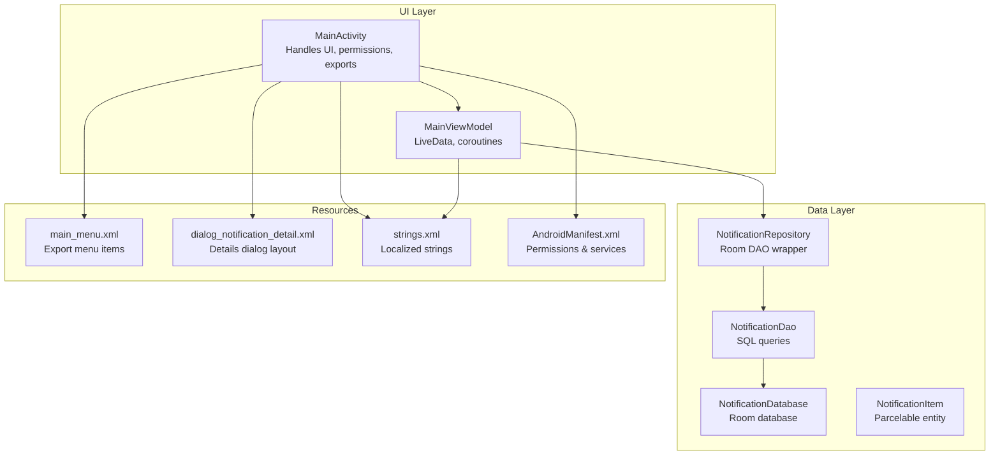
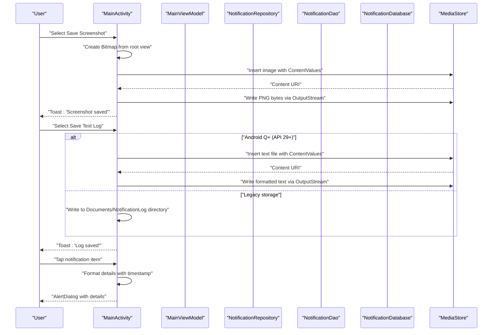
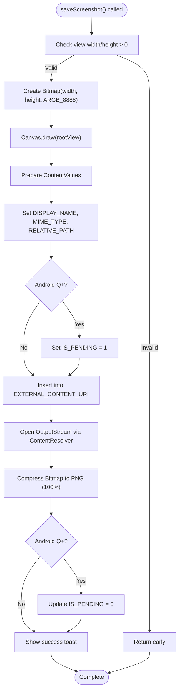
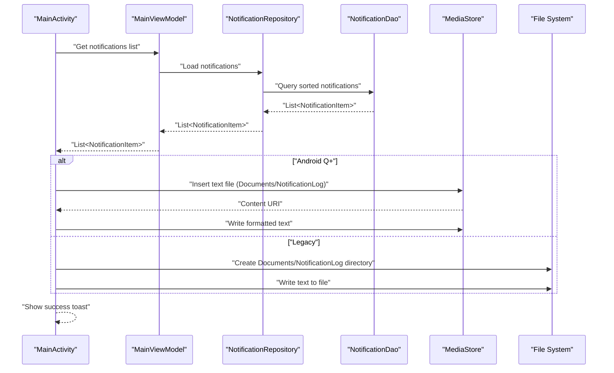
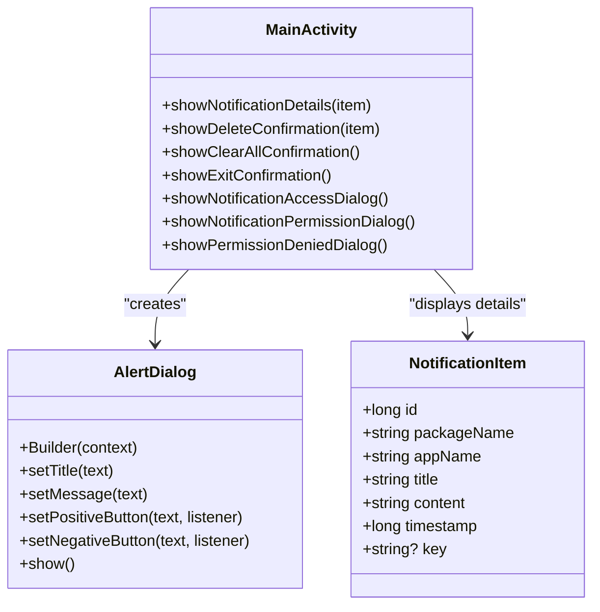
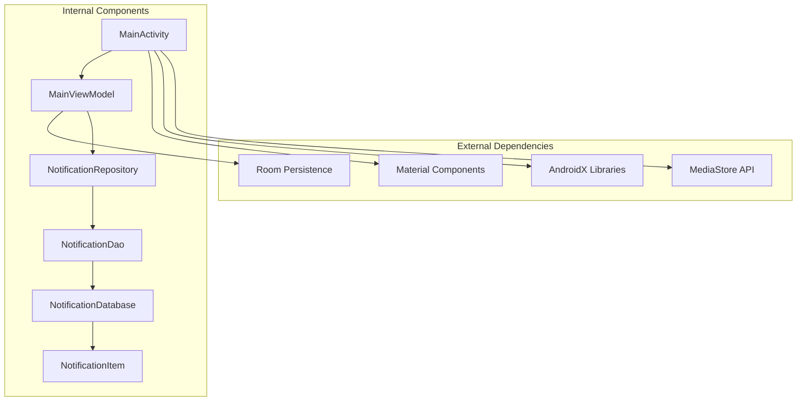

# Export and Dialog System

<cite>
**Referenced Files in This Document**
- [MainActivity.kt](file://app/src/main/java/com/notificationlog/MainActivity.kt)
- [MainViewModel.kt](file://app/src/main/java/com/notificationlog/MainViewModel.kt)
- [NotificationRepository.kt](file://app/src/main/java/com/notificationlog/repository/NotificationRepository.kt)
- [NotificationDao.kt](file://app/src/main/java/com/notificationlog/data/NotificationDao.kt)
- [NotificationDatabase.kt](file://app/src/main/java/com/notificationlog/data/NotificationDatabase.kt)
- [NotificationItem.kt](file://app/src/main/java/com/notificationlog/model/NotificationItem.kt)
- [AndroidManifest.xml](file://app/src/main/AndroidManifest.xml)
- [main_menu.xml](file://app/src/main/res/menu/main_menu.xml)
- [dialog_notification_detail.xml](file://app/src/main/res/layout/dialog_notification_detail.xml)
- [strings.xml](file://app/src/main/res/values/strings.xml)
</cite>

## Table of Contents
1. [Introduction](#introduction)
2. [Project Structure](#project-structure)
3. [Core Components](#core-components)
4. [Architecture Overview](#architecture-overview)
5. [Detailed Component Analysis](#detailed-component-analysis)
6. [Dependency Analysis](#dependency-analysis)
7. [Performance Considerations](#performance-considerations)
8. [Troubleshooting Guide](#troubleshooting-guide)
9. [Conclusion](#conclusion)

## Introduction
This document provides comprehensive documentation for the export functionality and dialog system in the Notification Log application. It covers:
- Screenshot capture implementation using Bitmap creation and MediaStore integration for saving to device storage
- Text log generation with proper formatting, timestamp inclusion, and file naming conventions
- Dialog implementations including notification details view, confirmation dialogs for destructive actions, and permission request dialogs
- File export mechanisms for both legacy storage and Android Q+ scoped storage
- Examples of permission handling for external storage access, error handling for save operations, and user feedback through toast messages
- Integration with Android's media framework and file system permissions

## Project Structure
The export and dialog system spans several key components:
- UI and orchestration: MainActivity handles user interactions, permissions, and export operations
- Data layer: Room database with DAO and repository pattern for notification persistence
- ViewModel: MainViewModel manages UI-related data and coordinates with repository
- Resources: Menus and layouts define the user interface for export options and dialogs

**Diagram sources**
- [MainActivity.kt:1-717](file://app/src/main/java/com/notificationlog/MainActivity.kt#L1-L717)
- [MainViewModel.kt:1-121](file://app/src/main/java/com/notificationlog/MainViewModel.kt#L1-L121)
- [NotificationRepository.kt:1-28](file://app/src/main/java/com/notificationlog/repository/NotificationRepository.kt#L1-L28)
- [NotificationDao.kt:1-26](file://app/src/main/java/com/notificationlog/data/NotificationDao.kt#L1-L26)
- [NotificationDatabase.kt:1-10](file://app/src/main/java/com/notificationlog/data/NotificationDatabase.kt#L1-L10)
- [NotificationItem.kt:1-19](file://app/src/main/java/com/notificationlog/model/NotificationItem.kt#L1-L19)
- [main_menu.xml:1-45](file://app/src/main/res/menu/main_menu.xml#L1-L45)
- [dialog_notification_detail.xml:1-23](file://app/src/main/res/layout/dialog_notification_detail.xml#L1-L23)
- [strings.xml:1-21](file://app/src/main/res/values/strings.xml#L1-L21)
- [AndroidManifest.xml:1-45](file://app/src/main/AndroidManifest.xml#L1-L45)

**Section sources**
- [MainActivity.kt:1-717](file://app/src/main/java/com/notificationlog/MainActivity.kt#L1-L717)
- [main_menu.xml:1-45](file://app/src/main/res/menu/main_menu.xml#L1-L45)
- [AndroidManifest.xml:1-45](file://app/src/main/AndroidManifest.xml#L1-L45)

## Core Components
This section focuses on the export functionality and dialog implementations that handle user interactions and data persistence.

- Screenshot export
  - Captures the main activity view as a Bitmap
  - Saves to MediaStore with appropriate metadata and scoped storage support
  - Uses timestamp-based naming and proper MIME type for PNG images

- Text log export
  - Formats notifications with timestamps, app names, titles, and content
  - Supports both legacy storage (Documents directory) and Android Q+ scoped storage
  - Writes to MediaStore files content URI for modern Android versions

- Dialog system
  - Notification details dialog with formatted content
  - Confirmation dialogs for destructive actions (delete single, clear all)
  - Permission request dialogs for notification access and POST_NOTIFICATIONS
  - About dialog and exit confirmation dialog

**Section sources**
- [MainActivity.kt:535-628](file://app/src/main/java/com/notificationlog/MainActivity.kt#L535-L628)
- [MainActivity.kt:416-459](file://app/src/main/java/com/notificationlog/MainActivity.kt#L416-L459)
- [MainActivity.kt:375-414](file://app/src/main/java/com/notificationlog/MainActivity.kt#L375-L414)
- [MainActivity.kt:644-669](file://app/src/main/java/com/notificationlog/MainActivity.kt#L644-L669)

## Architecture Overview
The export and dialog system integrates UI, data, and Android platform APIs through a clean separation of concerns.

**Diagram sources**
- [MainActivity.kt:535-628](file://app/src/main/java/com/notificationlog/MainActivity.kt#L535-L628)
- [MainViewModel.kt:59-77](file://app/src/main/java/com/notificationlog/MainViewModel.kt#L59-L77)
- [NotificationRepository.kt:1-28](file://app/src/main/java/com/notificationlog/repository/NotificationRepository.kt#L1-L28)
- [NotificationDao.kt:1-26](file://app/src/main/java/com/notificationlog/data/NotificationDao.kt#L1-L26)
- [NotificationDatabase.kt:1-10](file://app/src/main/java/com/notificationlog/data/NotificationDatabase.kt#L1-L10)

## Detailed Component Analysis

### Screenshot Export Implementation
The screenshot export captures the main activity root view and saves it to device storage using MediaStore for modern Android versions and legacy storage for older devices.

Key implementation aspects:
- Bitmap creation from view hierarchy
- MediaStore integration with proper metadata
- Scoped storage support for Android Q+
- Timestamp-based file naming with PNG extension
- Error handling with user feedback

**Diagram sources**
- [MainActivity.kt:535-571](file://app/src/main/java/com/notificationlog/MainActivity.kt#L535-L571)

**Section sources**
- [MainActivity.kt:535-571](file://app/src/main/java/com/notificationlog/MainActivity.kt#L535-L571)

### Text Log Generation and Export
The text log export formats notification data into a human-readable format with timestamps and writes it to storage using either MediaStore (Android Q+) or legacy file system access.

Formatting specifications:
- Timestamp format: "yyyy-MM-dd HH:mm:ss"
- Line format: "[$timestamp] $appName ($packageName): $title - $content"
- File naming: "notification_log_YYYYMMDD_HHMMSS.txt"
- Directory placement: Documents/NotificationLog

**Diagram sources**
- [MainActivity.kt:573-628](file://app/src/main/java/com/notificationlog/MainActivity.kt#L573-L628)
- [MainViewModel.kt:59-77](file://app/src/main/java/com/notificationlog/MainViewModel.kt#L59-L77)
- [NotificationRepository.kt:1-28](file://app/src/main/java/com/notificationlog/repository/NotificationRepository.kt#L1-L28)
- [NotificationDao.kt:1-26](file://app/src/main/java/com/notificationlog/data/NotificationDao.kt#L1-L26)

**Section sources**
- [MainActivity.kt:573-628](file://app/src/main/java/com/notificationlog/MainActivity.kt#L573-L628)
- [MainViewModel.kt:59-77](file://app/src/main/java/com/notificationlog/MainViewModel.kt#L59-L77)

### Dialog System Components
The application implements multiple dialog types to handle user interactions and confirmations.

#### Notification Details Dialog
Displays formatted notification information including app name, package, timestamp, title, and content.

Implementation highlights:
- Uses AlertDialog.Builder with custom message formatting
- Formats timestamp using SimpleDateFormat
- Provides single OK button for dismissal

#### Confirmation Dialogs
Handles destructive actions with explicit user confirmation:
- Delete single notification: Asks for confirmation before deletion
- Clear all notifications: Confirms bulk deletion operation
- Exit application: Confirms termination with capture disable

#### Permission Request Dialogs
Manages runtime permissions:
- Notification access dialog: Guides users to system settings
- POST_NOTIFICATIONS permission: Requests notification posting permission on Android 13+
- Permission denied dialog: Handles denial scenarios

**Diagram sources**
- [MainActivity.kt:416-459](file://app/src/main/java/com/notificationlog/MainActivity.kt#L416-L459)
- [MainActivity.kt:375-414](file://app/src/main/java/com/notificationlog/MainActivity.kt#L375-L414)
- [MainActivity.kt:521-533](file://app/src/main/java/com/notificationlog/MainActivity.kt#L521-L533)
- [NotificationItem.kt:1-19](file://app/src/main/java/com/notificationlog/model/NotificationItem.kt#L1-L19)

**Section sources**
- [MainActivity.kt:416-459](file://app/src/main/java/com/notificationlog/MainActivity.kt#L416-L459)
- [MainActivity.kt:375-414](file://app/src/main/java/com/notificationlog/MainActivity.kt#L375-L414)
- [MainActivity.kt:521-533](file://app/src/main/java/com/notificationlog/MainActivity.kt#L521-L533)

### Permission Handling and Storage Integration
The application integrates with Android's permission and storage systems to provide seamless export functionality.

#### Runtime Permissions
- Notification access: Checks and requests notification listener access
- POST_NOTIFICATIONS: Requests permission for Android 13+ to post notifications
- Permission callbacks: Handles grant/denial scenarios with user feedback

#### MediaStore Integration
- Scoped storage compliance: Uses MediaStore for Android Q+ with proper content URIs
- Pending media support: Sets IS_PENDING flag for incomplete media during write operations
- Relative path specification: Places files in app-specific directories under Pictures/NotificationLog and Documents/NotificationLog

#### Legacy Storage Support
- Direct file system access: Creates directories and writes files for Android versions below Q
- External storage public directory: Uses Environment.getExternalStoragePublicDirectory for Documents folder

**Section sources**
- [MainActivity.kt:313-373](file://app/src/main/java/com/notificationlog/MainActivity.kt#L313-L373)
- [MainActivity.kt:535-609](file://app/src/main/java/com/notificationlog/MainActivity.kt#L535-L609)
- [AndroidManifest.xml:1-45](file://app/src/main/AndroidManifest.xml#L1-L45)

## Dependency Analysis
The export and dialog system demonstrates clear separation of concerns with well-defined dependencies.

**Diagram sources**
- [MainActivity.kt:1-717](file://app/src/main/java/com/notificationlog/MainActivity.kt#L1-L717)
- [MainViewModel.kt:1-121](file://app/src/main/java/com/notificationlog/MainViewModel.kt#L1-L121)
- [NotificationRepository.kt:1-28](file://app/src/main/java/com/notificationlog/repository/NotificationRepository.kt#L1-L28)
- [NotificationDao.kt:1-26](file://app/src/main/java/com/notificationlog/data/NotificationDao.kt#L1-L26)
- [NotificationDatabase.kt:1-10](file://app/src/main/java/com/notificationlog/data/NotificationDatabase.kt#L1-L10)
- [NotificationItem.kt:1-19](file://app/src/main/java/com/notificationlog/model/NotificationItem.kt#L1-L19)

**Section sources**
- [MainActivity.kt:1-717](file://app/src/main/java/com/notificationlog/MainActivity.kt#L1-L717)
- [MainViewModel.kt:1-121](file://app/src/main/java/com/notificationlog/MainViewModel.kt#L1-L121)

## Performance Considerations
- Bitmap compression: Uses PNG format with 100% quality for lossless screenshots
- Stream handling: Properly closes OutputStream resources after writing
- Background operations: All database operations run on Dispatchers.IO
- UI thread safety: Updates LiveData on main thread after IO operations
- Memory management: Creates bitmaps sized to view dimensions only when needed

## Troubleshooting Guide
Common issues and resolutions:

### Export Failures
- **No notifications available**: Export functions check for empty lists and show appropriate toasts
- **Storage permission errors**: Verify MediaStore insertion succeeds before writing streams
- **Scoped storage conflicts**: Ensure proper IS_PENDING handling for Android Q+

### Dialog Issues
- **Dialog not showing**: Check AlertDialog.Builder instantiation and show() invocation
- **Permission dialogs**: Verify requestPermissionLauncher callback handling
- **Resource localization**: Confirm string resources exist in strings.xml

### Performance Issues
- **Large bitmaps**: Consider scaling down for very large screens
- **Slow database queries**: NotificationDao already uses indexed timestamp ordering
- **Memory pressure**: Dispose of bitmaps properly after compression

**Section sources**
- [MainActivity.kt:573-628](file://app/src/main/java/com/notificationlog/MainActivity.kt#L573-L628)
- [MainActivity.kt:416-459](file://app/src/main/java/com/notificationlog/MainActivity.kt#L416-L459)

## Conclusion
The export and dialog system provides a robust foundation for capturing and sharing notification data while respecting modern Android storage and permission paradigms. The implementation balances user experience with technical correctness, offering:
- Seamless integration with Android's media framework
- Comprehensive error handling and user feedback
- Support for both legacy and modern storage APIs
- Well-structured dialog system for user interactions
- Clean separation of concerns through MVVM architecture

The system successfully addresses the documented requirements for screenshot capture, text log generation, dialog implementations, and storage integration across different Android versions.