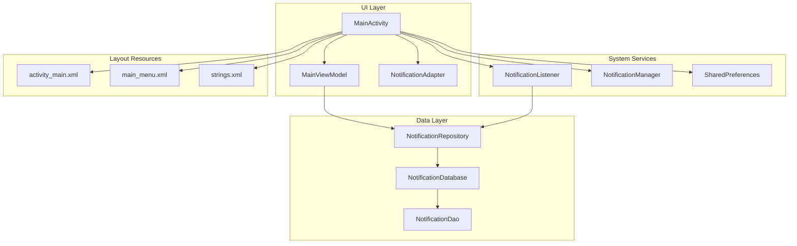
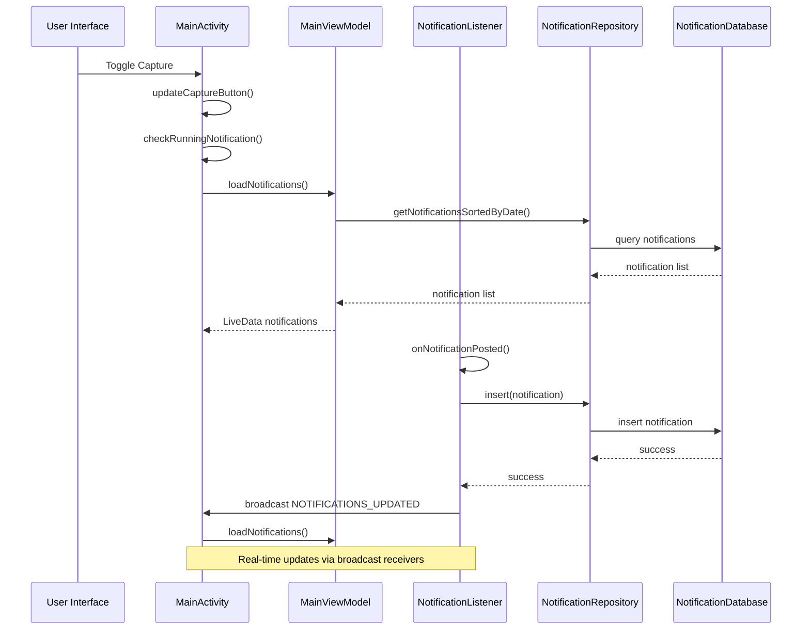
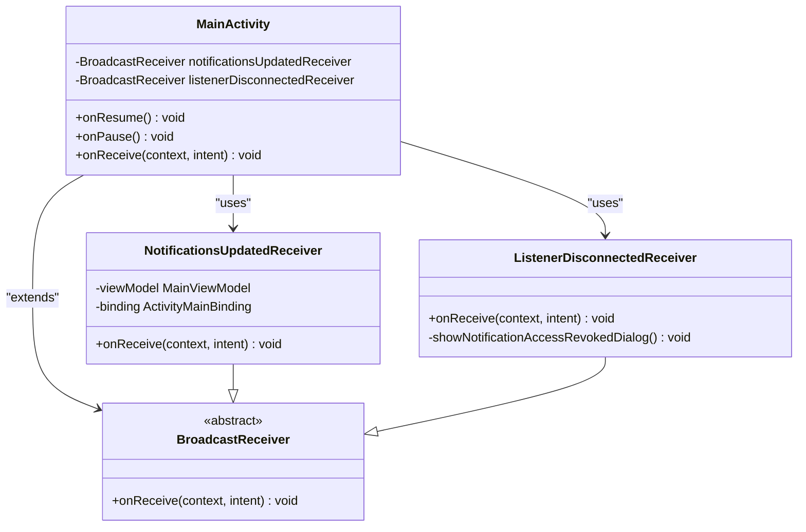
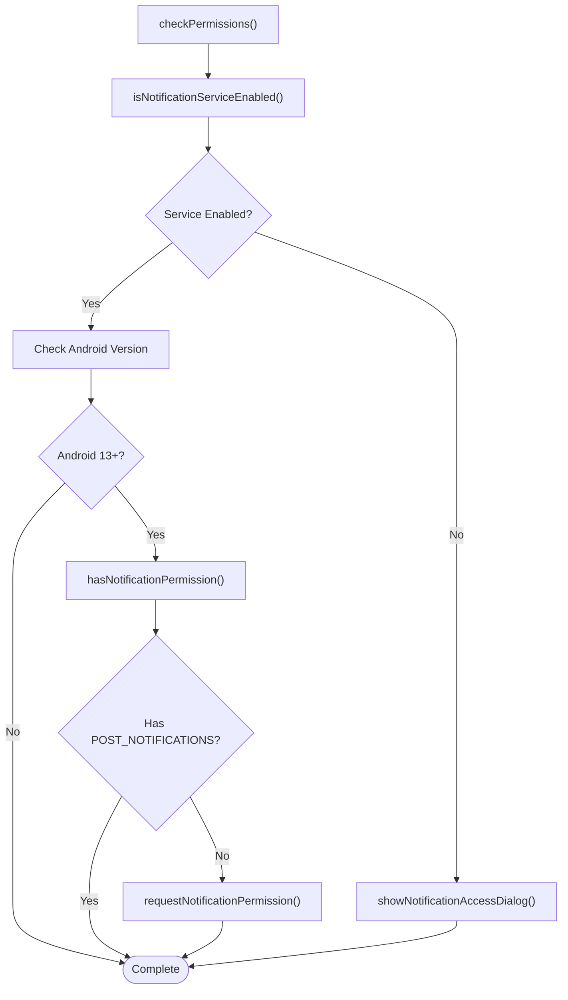
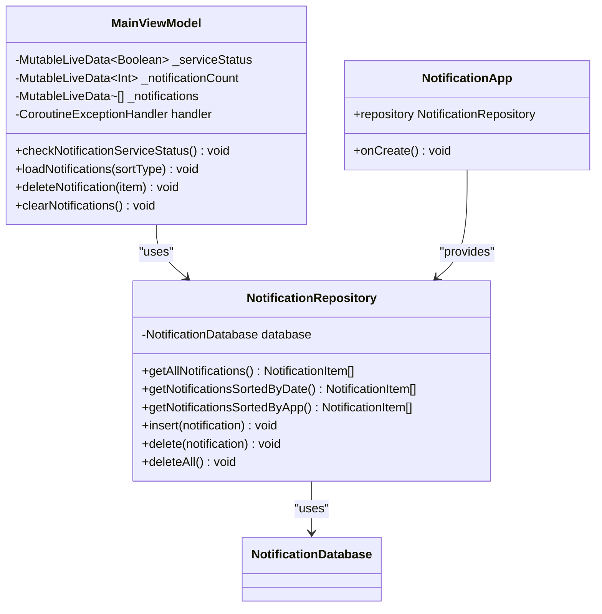
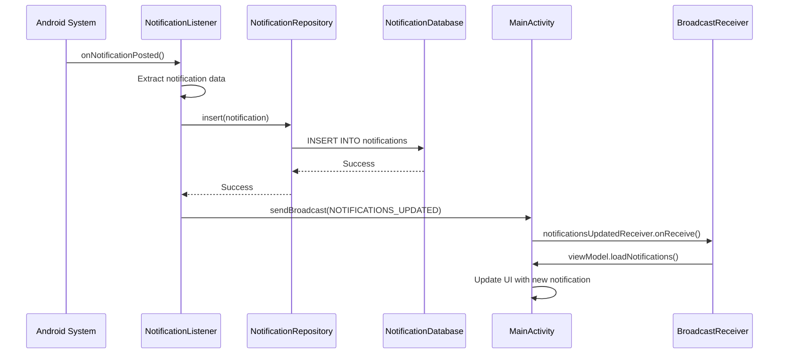
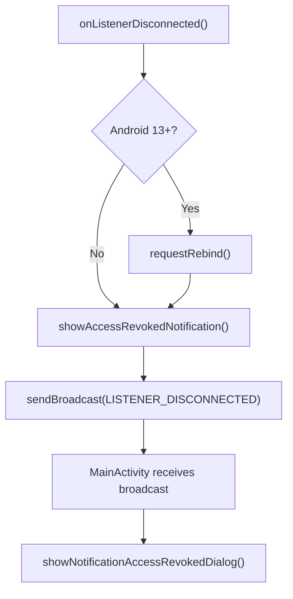
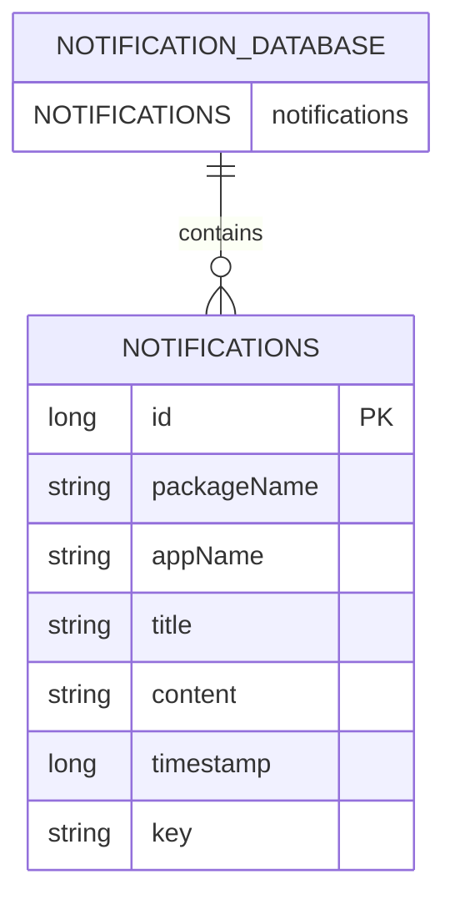
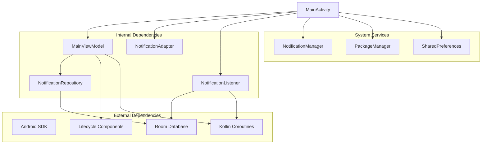

# Main Activity Interface

<cite>
**Referenced Files in This Document**
- [MainActivity.kt](file://app/src/main/java/com/notificationlog/MainActivity.kt)
- [MainViewModel.kt](file://app/src/main/java/com/notificationlog/MainViewModel.kt)
- [NotificationListener.kt](file://app/src/main/java/com/notificationlog/NotificationListener.kt)
- [NotificationAdapter.kt](file://app/src/main/java/com/notificationlog/adapter/NotificationAdapter.kt)
- [NotificationItem.kt](file://app/src/main/java/com/notificationlog/model/NotificationItem.kt)
- [NotificationRepository.kt](file://app/src/main/java/com/notificationlog/repository/NotificationRepository.kt)
- [NotificationApp.kt](file://app/src/main/java/com/notificationlog/NotificationApp.kt)
- [NotificationDatabase.kt](file://app/src/main/java/com/notificationlog/data/NotificationDatabase.kt)
- [NotificationDao.kt](file://app/src/main/java/com/notificationlog/data/NotificationDao.kt)
- [activity_main.xml](file://app/src/main/res/layout/activity_main.xml)
- [main_menu.xml](file://app/src/main/res/menu/main_menu.xml)
- [strings.xml](file://app/src/main/res/values/strings.xml)
- [AndroidManifest.xml](file://app/src/main/AndroidManifest.xml)
</cite>

## Table of Contents
1. [Introduction](#introduction)
2. [Project Structure](#project-structure)
3. [Core Components](#core-components)
4. [Architecture Overview](#architecture-overview)
5. [Detailed Component Analysis](#detailed-component-analysis)
6. [Dependency Analysis](#dependency-analysis)
7. [Performance Considerations](#performance-considerations)
8. [Troubleshooting Guide](#troubleshooting-guide)
9. [Conclusion](#conclusion)

## Introduction
This document provides comprehensive documentation for the MainActivity interface implementation in the Notification Log application. It covers the main activity lifecycle, toolbar setup, menu system integration, user interaction patterns, broadcast receiver implementation, service status monitoring, notification count display, real-time UI updates, permission dialogs, confirmation dialogs, persistent notification system, MainViewModel integration for reactive UI updates, and handling of different Android versions and permission models.

## Project Structure
The MainActivity serves as the primary user interface controller coordinating between the UI layer, ViewModel, data repositories, and system services. The application follows a clean architecture pattern with clear separation of concerns:

**Diagram sources**
- [MainActivity.kt:1-717](file://app/src/main/java/com/notificationlog/MainActivity.kt#L1-L717)
- [MainViewModel.kt:1-121](file://app/src/main/java/com/notificationlog/MainViewModel.kt#L1-L121)
- [NotificationListener.kt:1-173](file://app/src/main/java/com/notificationlog/NotificationListener.kt#L1-L173)
- [NotificationRepository.kt:1-28](file://app/src/main/java/com/notificationlog/repository/NotificationRepository.kt#L1-L28)
- [NotificationDatabase.kt:1-10](file://app/src/main/java/com/notificationlog/data/NotificationDatabase.kt#L1-L10)
- [NotificationDao.kt:1-26](file://app/src/main/java/com/notificationlog/data/NotificationDao.kt#L1-L26)

**Section sources**
- [MainActivity.kt:43-108](file://app/src/main/java/com/notificationlog/MainActivity.kt#L43-L108)
- [activity_main.xml:1-240](file://app/src/main/res/layout/activity_main.xml#L1-L240)
- [AndroidManifest.xml:19-43](file://app/src/main/AndroidManifest.xml#L19-L43)

## Core Components
The MainActivity implements a sophisticated interface with multiple integrated systems:

### Main Activity Lifecycle Management
The MainActivity manages a complex lifecycle with proper initialization, state preservation, and cleanup:

- **Initialization Phase**: Sets up preferences, dark mode, binding, toolbar, ViewModel, RecyclerView, and menu bar
- **Resume Phase**: Registers broadcast receivers, checks service status, loads notifications, updates UI states
- **Pause Phase**: Unregisters broadcast receivers to prevent memory leaks
- **State Persistence**: Uses SharedPreferences to maintain capture state, theme preference, and running notification setting

### Toolbar and Menu System Integration
The application implements both a custom toolbar and traditional ActionBar menu system:

- **Custom Toolbar**: Built-in ConstraintLayout toolbar with popup theme support
- **ActionBar Menu**: Traditional menu system with sorting, refresh, save options, theme toggle, and running notification control
- **Horizontal Menu Bar**: Custom TextView-based menu bar for quick access to File, Sort, Save, About, and Exit actions

### User Interaction Patterns
The MainActivity provides comprehensive user interaction controls:

- **Service Control Buttons**: Enable/disable notification access, grant permissions, start/stop capture, clear notifications
- **Real-time Status Indicators**: Service status, notification count, and last captured timestamp display
- **Interactive Elements**: Clickable RecyclerView items with delete functionality and detailed view

**Section sources**
- [MainActivity.kt:78-144](file://app/src/main/java/com/notificationlog/MainActivity.kt#L78-L144)
- [MainActivity.kt:155-240](file://app/src/main/java/com/notificationlog/MainActivity.kt#L155-L240)
- [activity_main.xml:11-236](file://app/src/main/res/layout/activity_main.xml#L11-L236)

## Architecture Overview
The MainActivity coordinates a reactive architecture pattern with LiveData observers and broadcast communication:

**Diagram sources**
- [MainActivity.kt:51-66](file://app/src/main/java/com/notificationlog/MainActivity.kt#L51-L66)
- [MainActivity.kt:110-137](file://app/src/main/java/com/notificationlog/MainActivity.kt#L110-L137)
- [NotificationListener.kt:109-153](file://app/src/main/java/com/notificationlog/NotificationListener.kt#L109-L153)
- [MainViewModel.kt:59-77](file://app/src/main/java/com/notificationlog/MainViewModel.kt#L59-L77)

## Detailed Component Analysis

### MainActivity Implementation
The MainActivity serves as the central coordinator implementing AppCompatActivity with comprehensive functionality:

#### Lifecycle Management
The activity implements proper Android lifecycle management with careful resource handling:

**Diagram sources**
- [MainActivity.kt:78-108](file://app/src/main/java/com/notificationlog/MainActivity.kt#L78-L108)
- [MainActivity.kt:110-144](file://app/src/main/java/com/notificationlog/MainActivity.kt#L110-L144)

#### Broadcast Receiver Implementation
The MainActivity implements two critical broadcast receivers for real-time system integration:

1. **notificationsUpdatedReceiver**: Handles notification capture updates
2. **listenerDisconnectedReceiver**: Monitors service disconnection events

Both receivers are conditionally registered based on Android version requirements:

**Diagram sources**
- [MainActivity.kt:51-66](file://app/src/main/java/com/notificationlog/MainActivity.kt#L51-L66)
- [MainActivity.kt:110-144](file://app/src/main/java/com/notificationlog/MainActivity.kt#L110-L144)

#### User Interface Controls
The MainActivity provides comprehensive button controls with visual feedback:

| Button | Purpose | State Changes | Visual Feedback |
|--------|---------|---------------|-----------------|
| btnEnableService | Enable Notification Access | Color changes (green/red) | Tooltip updates |
| btnRequestPermission | Grant Notification Permission | Color changes (green/red) | Tooltip updates |
| btnCapture | Start/Stop Capture | Icon changes (play/pause) | Color changes (green/red) |
| btnClear | Clear All Notifications | Enabled/disabled state | Color changes |

#### Permission Management System
The MainActivity implements a sophisticated permission handling system:

**Diagram sources**
- [MainActivity.kt:313-322](file://app/src/main/java/com/notificationlog/MainActivity.kt#L313-L322)
- [MainActivity.kt:353-362](file://app/src/main/java/com/notificationlog/MainActivity.kt#L353-L362)
- [MainActivity.kt:369-373](file://app/src/main/java/com/notificationlog/MainActivity.kt#L369-L373)

**Section sources**
- [MainActivity.kt:43-717](file://app/src/main/java/com/notificationlog/MainActivity.kt#L43-L717)

### MainViewModel Integration
The MainViewModel provides reactive data management with comprehensive LiveData observables:

#### LiveData Observables
The ViewModel exposes multiple LiveData streams for reactive UI updates:

- **serviceStatus**: Boolean indicating notification service status
- **notificationCount**: Integer count of stored notifications
- **notifications**: List of NotificationItem objects
- **errorMessage**: String for displaying error messages

#### Repository Integration
The ViewModel integrates with the NotificationRepository through the NotificationApp singleton:

**Diagram sources**
- [MainViewModel.kt:15-115](file://app/src/main/java/com/notificationlog/MainViewModel.kt#L15-L115)
- [NotificationRepository.kt:6-27](file://app/src/main/java/com/notificationlog/repository/NotificationRepository.kt#L6-L27)
- [NotificationApp.kt:8-27](file://app/src/main/java/com/notificationlog/NotificationApp.kt#L8-L27)

**Section sources**
- [MainViewModel.kt:15-121](file://app/src/main/java/com/notificationlog/MainViewModel.kt#L15-L121)
- [NotificationApp.kt:8-27](file://app/src/main/java/com/notificationlog/NotificationApp.kt#L8-L27)

### NotificationListener Service Integration
The NotificationListener service provides background notification capture:

#### Notification Capture Flow
The service captures notifications in real-time and communicates with the MainActivity:

**Diagram sources**
- [NotificationListener.kt:109-153](file://app/src/main/java/com/notificationlog/NotificationListener.kt#L109-L153)
- [MainActivity.kt:57-66](file://app/src/main/java/com/notificationlog/MainActivity.kt#L57-L66)

#### Service Disconnection Handling
The service handles disconnection scenarios gracefully:

**Diagram sources**
- [NotificationListener.kt:44-65](file://app/src/main/java/com/notificationlog/NotificationListener.kt#L44-L65)
- [MainActivity.kt:51-55](file://app/src/main/java/com/notificationlog/MainActivity.kt#L51-L55)

**Section sources**
- [NotificationListener.kt:23-173](file://app/src/main/java/com/notificationlog/NotificationListener.kt#L23-L173)

### Persistent Notification System
The MainActivity implements a persistent notification system for ongoing service visibility:

#### Notification Channel Management
The application creates two notification channels:

1. **Service Channel**: Low importance channel for ongoing service status
2. **Warning Channel**: High importance channel for permission-related warnings

#### Persistent Notification Logic
The persistent notification displays current capture status and allows quick app access:

**Diagram sources**
- [MainActivity.kt:686-715](file://app/src/main/java/com/notificationlog/MainActivity.kt#L686-L715)

**Section sources**
- [MainActivity.kt:671-715](file://app/src/main/java/com/notificationlog/MainActivity.kt#L671-L715)

### Data Model and Repository Pattern
The application implements a clean data layer with Room database integration:

#### Data Model Structure
The NotificationItem model provides comprehensive notification data representation:

**Diagram sources**
- [NotificationItem.kt:10-19](file://app/src/main/java/com/notificationlog/model/NotificationItem.kt#L10-L19)
- [NotificationDatabase.kt:7-10](file://app/src/main/java/com/notificationlog/data/NotificationDatabase.kt#L7-L10)

#### Repository Pattern Implementation
The repository pattern provides abstraction over database operations:

| Method | Purpose | Database Operation |
|--------|---------|-------------------|
| getAllNotifications() | Retrieve all notifications | SELECT * FROM notifications |
| getNotificationsSortedByDate() | Sort by timestamp desc | SELECT ... ORDER BY timestamp DESC |
| getNotificationsSortedByApp() | Sort by app name | SELECT ... ORDER BY appName ASC, timestamp DESC |
| insert() | Add new notification | INSERT INTO notifications |
| delete() | Remove specific notification | DELETE FROM notifications WHERE id=? |
| deleteAll() | Clear all notifications | DELETE FROM notifications |

**Section sources**
- [NotificationItem.kt:8-19](file://app/src/main/java/com/notificationlog/model/NotificationItem.kt#L8-L19)
- [NotificationRepository.kt:6-27](file://app/src/main/java/com/notificationlog/repository/NotificationRepository.kt#L6-L27)
- [NotificationDao.kt:9-25](file://app/src/main/java/com/notificationlog/data/NotificationDao.kt#L9-L25)

## Dependency Analysis
The MainActivity has several key dependencies that drive its functionality:

**Diagram sources**
- [MainActivity.kt:1-717](file://app/src/main/java/com/notificationlog/MainActivity.kt#L1-L717)
- [MainViewModel.kt:1-121](file://app/src/main/java/com/notificationlog/MainViewModel.kt#L1-L121)
- [NotificationListener.kt:1-173](file://app/src/main/java/com/notificationlog/NotificationListener.kt#L1-L173)

### Integration Points
The MainActivity integrates with multiple system components:

1. **Notification Access**: Direct integration with Android's notification listener framework
2. **Storage**: Room database for persistent notification storage
3. **UI Framework**: RecyclerView with custom adapter for efficient list rendering
4. **Permissions**: Runtime permission handling for Android 13+
5. **Preferences**: SharedPreferences for state persistence across app sessions

**Section sources**
- [MainActivity.kt:345-362](file://app/src/main/java/com/notificationlog/MainActivity.kt#L345-L362)
- [AndroidManifest.xml:29-43](file://app/src/main/AndroidManifest.xml#L29-L43)

## Performance Considerations
The MainActivity implements several performance optimization strategies:

### Memory Management
- **Broadcast Receiver Lifecycle**: Proper registration/unregistration in onResume/onPause to prevent memory leaks
- **RecyclerView Optimization**: Efficient diffing with ListAdapter and ViewHolder pattern
- **Coroutine Scope Management**: Proper coroutine job cancellation in onDestroy

### UI Performance
- **Lazy Loading**: Database operations performed on IO dispatcher
- **Background Processing**: Heavy operations moved off main thread
- **State Preservation**: SharedPreferences for immediate UI state restoration

### Storage Efficiency
- **Database Indexing**: Room database with proper entity mapping
- **Batch Operations**: Single transaction for notification inserts
- **Memory Management**: Efficient bitmap creation for screenshots

## Troubleshooting Guide

### Common Issues and Solutions

#### Notification Access Not Working
**Symptoms**: Service status shows "Stopped", notifications not captured
**Causes**: 
- Notification access permission not granted
- Notification listener service disabled
- Android system restrictions

**Solutions**:
1. Verify notification access in system settings
2. Restart notification listener service
3. Check for Android system permission restrictions

#### Permission Dialog Issues
**Symptoms**: Permission dialogs not appearing or not responding
**Causes**:
- Android version compatibility issues
- Activity lifecycle conflicts
- Fragment manager issues

**Solutions**:
1. Ensure proper ActivityResultContract usage
2. Check activity lifecycle state before showing dialogs
3. Verify manifest permissions are declared

#### Real-time Updates Not Working
**Symptoms**: Notifications not updating in real-time
**Causes**:
- Broadcast receiver not registered
- Incorrect broadcast intents
- Service disconnection

**Solutions**:
1. Verify broadcast receiver registration in onResume
2. Check intent action strings match
3. Monitor service connection status

#### Persistent Notification Problems
**Symptoms**: Persistent notification not showing or disappearing
**Causes**:
- Notification channel not created
- Wrong notification ID or channel
- User disabled notifications

**Solutions**:
1. Verify notification channel creation
2. Check notification importance levels
3. Verify user notification settings

**Section sources**
- [MainActivity.kt:375-414](file://app/src/main/java/com/notificationlog/MainActivity.kt#L375-L414)
- [MainActivity.kt:645-661](file://app/src/main/java/com/notificationlog/MainActivity.kt#L645-L661)
- [NotificationListener.kt:44-65](file://app/src/main/java/com/notificationlog/NotificationListener.kt#L44-L65)

## Conclusion
The MainActivity interface implementation demonstrates a comprehensive approach to Android application development with robust architecture patterns, proper lifecycle management, and extensive user interaction capabilities. The implementation successfully integrates multiple systems including notification capture, real-time updates, permission management, and persistent notification services while maintaining good performance and user experience standards.

Key strengths of the implementation include:
- Clean separation of concerns with ViewModel and repository patterns
- Comprehensive broadcast receiver system for real-time updates
- Robust permission handling across different Android versions
- Efficient UI rendering with RecyclerView and diffing algorithms
- Persistent notification system for ongoing service visibility
- Comprehensive error handling and user feedback mechanisms

The architecture provides a solid foundation for future enhancements while maintaining backward compatibility and performance optimization across different Android versions.