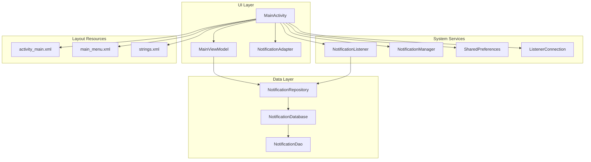
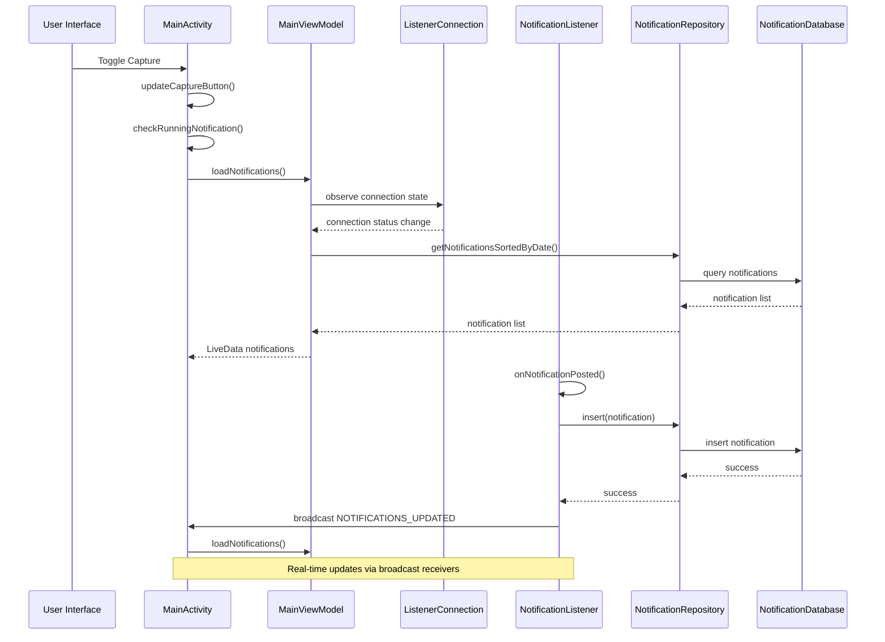
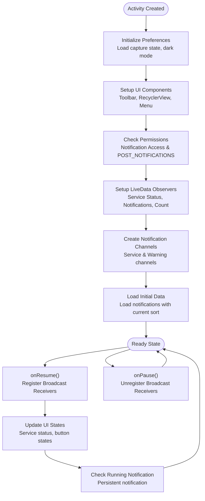
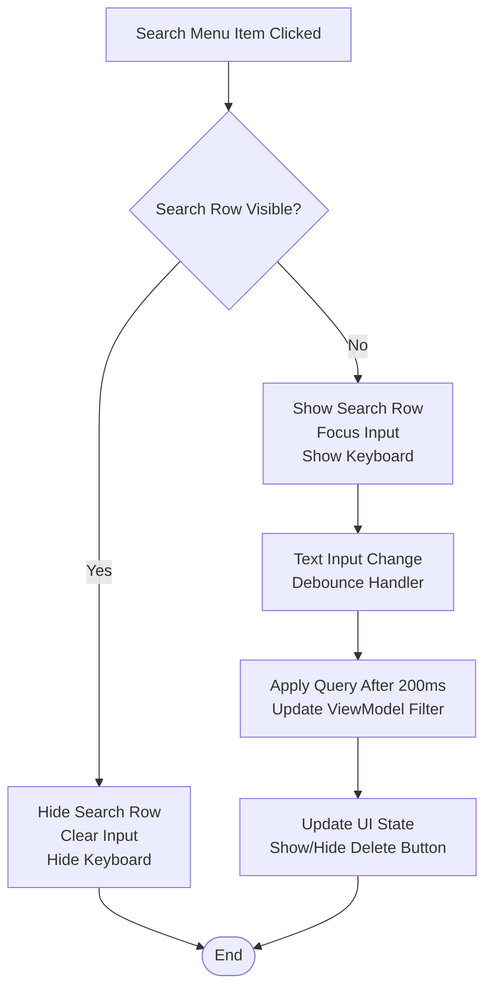
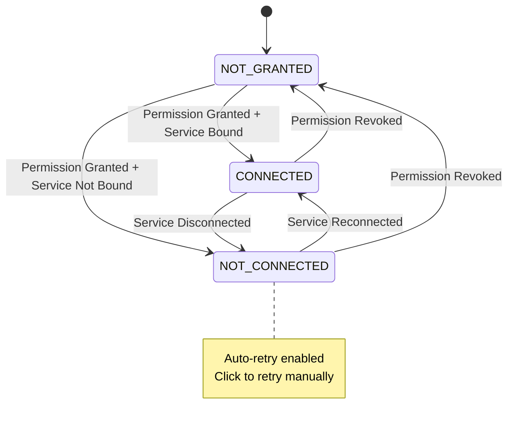
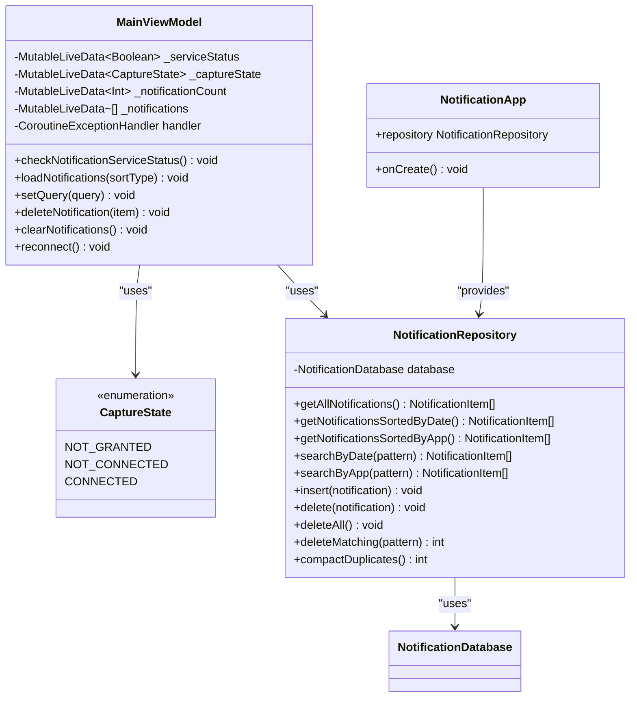
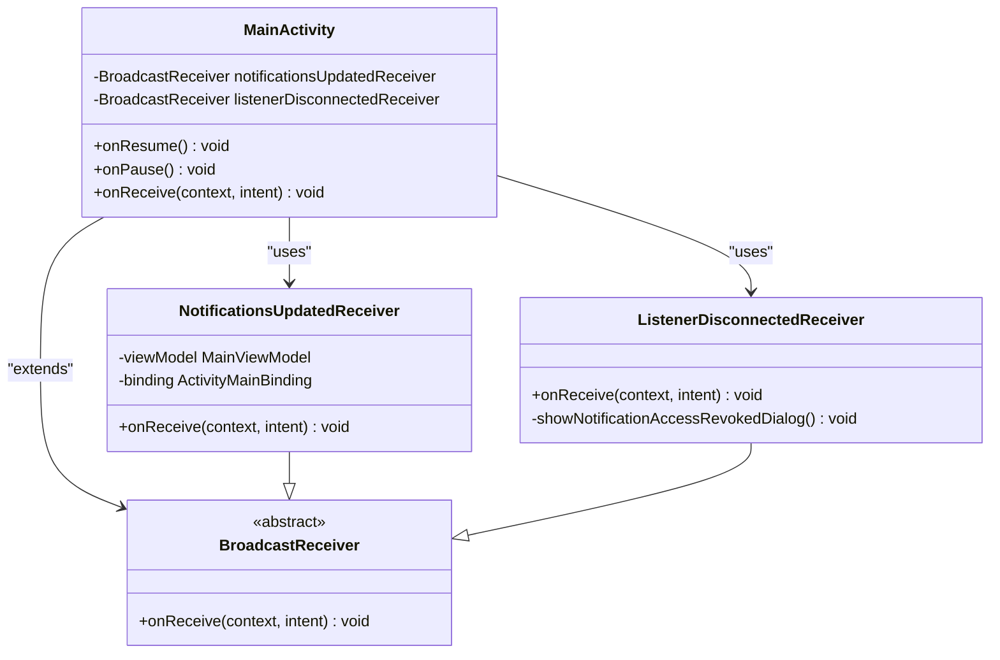
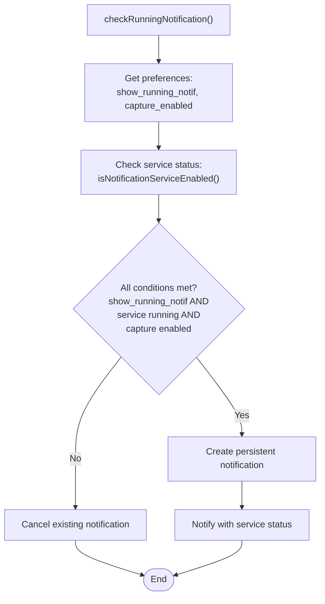
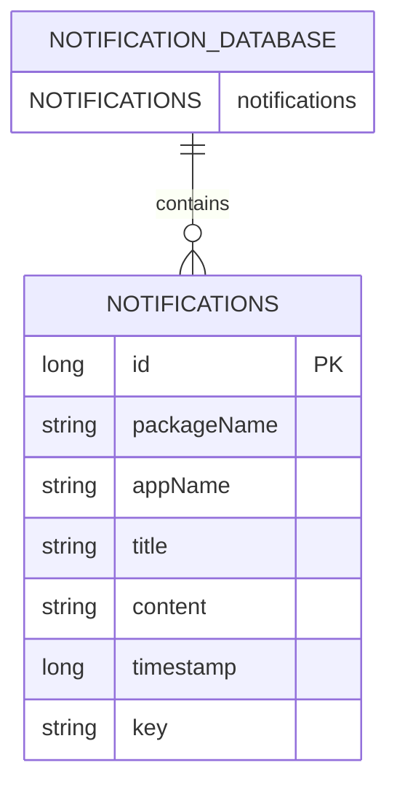
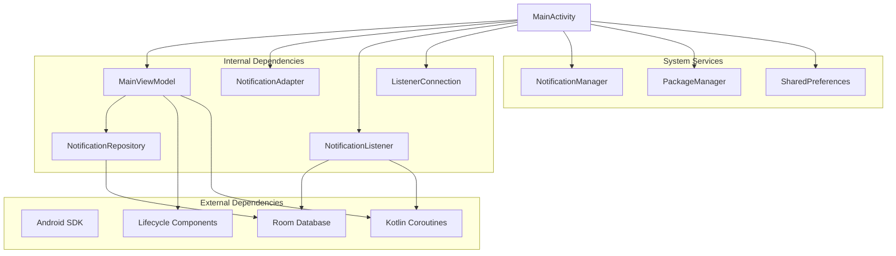

# Main Activity Interface

<cite>
**Referenced Files in This Document**
- [MainActivity.kt](file://app/src/main/java/com/notificationlog/MainActivity.kt)
- [MainViewModel.kt](file://app/src/main/java/com/notificationlog/MainViewModel.kt)
- [ListenerConnection.kt](file://app/src/main/java/com/notificationlog/ListenerConnection.kt)
- [NotificationListener.kt](file://app/src/main/java/com/notificationlog/NotificationListener.kt)
- [NotificationAdapter.kt](file://app/src/main/java/com/notificationlog/adapter/NotificationAdapter.kt)
- [NotificationItem.kt](file://app/src/main/java/com/notificationlog/model/NotificationItem.kt)
- [NotificationRepository.kt](file://app/src/main/java/com/notificationlog/repository/NotificationRepository.kt)
- [NotificationApp.kt](file://app/src/main/java/com/notificationlog/NotificationApp.kt)
- [NotificationDatabase.kt](file://app/src/main/java/com/notificationlog/data/NotificationDatabase.kt)
- [NotificationDao.kt](file://app/src/main/java/com/notificationlog/data/NotificationDao.kt)
- [activity_main.xml](file://app/src/main/res/layout/activity_main.xml)
- [main_menu.xml](file://app/src/main/res/menu/main_menu.xml)
- [strings.xml](file://app/src/main/res/values/strings.xml)
- [AndroidManifest.xml](file://app/src/main/AndroidManifest.xml)
</cite>

## Update Summary
**Changes Made**
- Added comprehensive documentation for the new collapsible search row functionality
- Updated user interaction patterns to include debounced search input handling
- Enhanced documentation for improved bottom action bar layout and visual feedback
- Added detailed coverage of enhanced connection state management with three-state system
- Updated edge-to-edge UI implementation and system bar handling documentation
- Enhanced error handling and user feedback mechanisms documentation

## Table of Contents
1. [Introduction](#introduction)
2. [Project Structure](#project-structure)
3. [Core Components](#core-components)
4. [Architecture Overview](#architecture-overview)
5. [Detailed Component Analysis](#detailed-component-analysis)
6. [Dependency Analysis](#dependency-analysis)
7. [Performance Considerations](#performance-considerations)
8. [Troubleshooting Guide](#troubleshooting-guide)
9. [Conclusion](#conclusion)

## Introduction
This document provides comprehensive documentation for the MainActivity interface implementation in the Notification Log application. It covers the main activity lifecycle, toolbar setup, menu system integration, user interaction patterns, broadcast receiver implementation, service status monitoring, notification count display, real-time UI updates, permission dialogs, confirmation dialogs, persistent notification system, MainViewModel integration for reactive UI updates, and handling of different Android versions and permission models.

The application has undergone major UI modernization including collapsible search functionality, debounced input handling, improved bottom action bar layout, and enhanced user feedback for connection states.

## Project Structure
The MainActivity serves as the primary user interface controller coordinating between the UI layer, ViewModel, data repositories, and system services. The application follows a clean architecture pattern with clear separation of concerns:

**Diagram sources**
- [MainActivity.kt:56-1076](file://app/src/main/java/com/notificationlog/MainActivity.kt#L56-L1076)
- [MainViewModel.kt:19-285](file://app/src/main/java/com/notificationlog/MainViewModel.kt#L19-L285)
- [ListenerConnection.kt:18-31](file://app/src/main/java/com/notificationlog/ListenerConnection.kt#L18-L31)
- [NotificationListener.kt:1-173](file://app/src/main/java/com/notificationlog/NotificationListener.kt#L1-L173)
- [NotificationRepository.kt:1-28](file://app/src/main/java/com/notificationlog/repository/NotificationRepository.kt#L1-L28)
- [NotificationDatabase.kt:1-10](file://app/src/main/java/com/notificationlog/data/NotificationDatabase.kt#L1-L10)
- [NotificationDao.kt:1-26](file://app/src/main/java/com/notificationlog/data/NotificationDao.kt#L1-L26)

**Section sources**
- [MainActivity.kt:56-167](file://app/src/main/java/com/notificationlog/MainActivity.kt#L56-L167)
- [activity_main.xml:1-310](file://app/src/main/res/layout/activity_main.xml#L1-L310)
- [AndroidManifest.xml:19-43](file://app/src/main/AndroidManifest.xml#L19-L43)

## Core Components
The MainActivity implements a sophisticated interface with multiple integrated systems:

### Main Activity Lifecycle Management
The MainActivity manages a complex lifecycle with proper initialization, state preservation, and cleanup:

- **Initialization Phase**: Sets up preferences, dark mode, binding, toolbar, ViewModel, RecyclerView, and menu bar
- **Resume Phase**: Registers broadcast receivers, checks service status, loads notifications, updates UI states
- **Pause Phase**: Unregisters broadcast receivers to prevent memory leaks
- **State Persistence**: Uses SharedPreferences to maintain capture state, theme preference, and running notification setting

### Toolbar and Menu System Integration
The application implements both a custom toolbar and traditional ActionBar menu system:

- **Custom Toolbar**: Built-in ConstraintLayout toolbar with popup theme support
- **ActionBar Menu**: Traditional menu system with sorting, refresh, save options, theme toggle, and running notification control
- **Horizontal Menu Bar**: Custom TextView-based menu bar for quick access to File, Sort, Save, About, and Exit actions

### User Interaction Patterns
The MainActivity provides comprehensive user interaction controls:

- **Service Control Buttons**: Enable/disable notification access, grant permissions, start/stop capture, clear notifications
- **Real-time Status Indicators**: Service status, notification count, and last captured timestamp display
- **Interactive Elements**: Clickable RecyclerView items with delete functionality and detailed view

**Updated** Enhanced with collapsible search functionality and improved visual feedback

**Section sources**
- [MainActivity.kt:99-167](file://app/src/main/java/com/notificationlog/MainActivity.kt#L99-L167)
- [MainActivity.kt:250-431](file://app/src/main/java/com/notificationlog/MainActivity.kt#L250-L431)
- [activity_main.xml:11-306](file://app/src/main/res/layout/activity_main.xml#L11-L306)

## Architecture Overview
The MainActivity coordinates a reactive architecture pattern with LiveData observers and broadcast communication:

**Diagram sources**
- [MainActivity.kt:78-87](file://app/src/main/java/com/notificationlog/MainActivity.kt#L78-L87)
- [MainActivity.kt:110-144](file://app/src/main/java/com/notificationlog/MainActivity.kt#L110-L144)
- [MainViewModel.kt:65-76](file://app/src/main/java/com/notificationlog/MainViewModel.kt#L65-L76)
- [ListenerConnection.kt:18-31](file://app/src/main/java/com/notificationlog/ListenerConnection.kt#L18-L31)
- [NotificationListener.kt:109-153](file://app/src/main/java/com/notificationlog/NotificationListener.kt#L109-L153)
- [MainViewModel.kt:133-161](file://app/src/main/java/com/notificationlog/MainViewModel.kt#L133-L161)

## Detailed Component Analysis

### MainActivity Implementation
The MainActivity serves as the central coordinator implementing AppCompatActivity with comprehensive functionality:

#### Lifecycle Management
The activity implements proper Android lifecycle management with careful resource handling:

**Updated** Enhanced with edge-to-edge support and improved system bar handling

**Diagram sources**
- [MainActivity.kt:99-167](file://app/src/main/java/com/notificationlog/MainActivity.kt#L99-L167)
- [MainActivity.kt:179-195](file://app/src/main/java/com/notificationlog/MainActivity.kt#L179-L195)

#### Collapsible Search Row Implementation
The application features a modern collapsible search row that enhances user experience:

- **Toggle Functionality**: Search row can be shown/hidden via menu item or back button
- **Debounced Input**: 200ms debounce prevents excessive database queries during typing
- **Visual Feedback**: Clear and delete buttons appear contextually based on search state
- **Keyboard Management**: Automatic focus and keyboard show/hide behavior

**Diagram sources**
- [MainActivity.kt:267-321](file://app/src/main/java/com/notificationlog/MainActivity.kt#L267-L321)
- [activity_main.xml:87-135](file://app/src/main/res/layout/activity_main.xml#L87-L135)

#### Enhanced Connection State Management
The application now implements a sophisticated three-state connection system:

- **CONNECTED**: Service is active and capturing notifications
- **NOT_CONNECTED**: Permission granted but service not bound (common on MIUI/HyperOS)
- **NOT_GRANTED**: Permission not granted or revoked

**Diagram sources**
- [MainViewModel.kt:275-284](file://app/src/main/java/com/notificationlog/MainViewModel.kt#L275-L284)
- [MainActivity.kt:443-468](file://app/src/main/java/com/notificationlog/MainActivity.kt#L443-L468)

#### Edge-to-Edge UI Implementation
Modern Android UI with proper system bar handling:

- **Edge-to-Edge Support**: Full-screen content with proper insets handling
- **System Bar Styling**: Dynamic status and navigation bar styling based on theme
- **Inset Management**: Proper padding for system bars and display cutouts
- **Toolbar Integration**: Toolbar maintains its own color behind status bar

**Section sources**
- [MainActivity.kt:113-124](file://app/src/main/java/com/notificationlog/MainActivity.kt#L113-L124)
- [MainActivity.kt:179-195](file://app/src/main/java/com/notificationlog/MainActivity.kt#L179-L195)

### MainViewModel Integration
The MainViewModel provides reactive data management with comprehensive LiveData observables:

#### Enhanced LiveData Observables
The ViewModel exposes multiple LiveData streams for reactive UI updates:

- **serviceStatus**: Boolean indicating notification service status
- **captureState**: Three-state enum (CONNECTED, NOT_CONNECTED, NOT_GRANTED)
- **notificationCount**: Integer count of stored notifications
- **notifications**: List of NotificationItem objects
- **errorMessage**: String for displaying error messages
- **filterQuery**: Current search filter state

#### Repository Integration
The ViewModel integrates with the NotificationRepository through the NotificationApp singleton:

**Diagram sources**
- [MainViewModel.kt:19-285](file://app/src/main/java/com/notificationlog/MainViewModel.kt#L19-L285)
- [NotificationRepository.kt:6-27](file://app/src/main/java/com/notificationlog/repository/NotificationRepository.kt#L6-L27)
- [NotificationApp.kt:8-27](file://app/src/main/java/com/notificationlog/NotificationApp.kt#L8-L27)

**Section sources**
- [MainViewModel.kt:19-285](file://app/src/main/java/com/notificationlog/MainViewModel.kt#L19-L285)
- [NotificationApp.kt:8-27](file://app/src/main/java/com/notificationlog/NotificationApp.kt#L8-L27)

### Enhanced User Feedback System
The application provides comprehensive user feedback through multiple channels:

#### Toast Messages and Dialogs
- **Permission Handling**: Clear dialogs for permission requests and denials
- **Operation Feedback**: Success/failure messages for all user operations
- **Error Reporting**: Detailed error messages with recovery options
- **Confirmation Dialogs**: Destructive operations require explicit confirmation

#### Visual State Indicators
- **Button States**: Color-coded buttons (green/red) for service status
- **Status Text**: Dynamic status text with actionable hints
- **Icon Changes**: Play/pause icons for capture state
- **Tooltip Support**: Contextual help for all interactive elements

**Section sources**
- [MainActivity.kt:400-552](file://app/src/main/java/com/notificationlog/MainActivity.kt#L400-L552)
- [MainActivity.kt:681-737](file://app/src/main/java/com/notificationlog/MainActivity.kt#L681-L737)

### Broadcast Receiver Implementation
The MainActivity implements two critical broadcast receivers for real-time system integration:

1. **notificationsUpdatedReceiver**: Handles notification capture updates
2. **listenerDisconnectedReceiver**: Monitors service disconnection events

Both receivers are conditionally registered based on Android version requirements:

**Diagram sources**
- [MainActivity.kt:72-87](file://app/src/main/java/com/notificationlog/MainActivity.kt#L72-L87)
- [MainActivity.kt:197-231](file://app/src/main/java/com/notificationlog/MainActivity.kt#L197-L231)

**Section sources**
- [MainActivity.kt:72-87](file://app/src/main/java/com/notificationlog/MainActivity.kt#L72-L87)
- [MainActivity.kt:197-231](file://app/src/main/java/com/notificationlog/MainActivity.kt#L197-L231)

### Persistent Notification System
The MainActivity implements a persistent notification system for ongoing service visibility:

#### Notification Channel Management
The application creates two notification channels:

1. **Service Channel**: Low importance channel for ongoing service status
2. **Warning Channel**: High importance channel for permission-related warnings

#### Persistent Notification Logic
The persistent notification displays current capture status and allows quick app access:

**Diagram sources**
- [MainActivity.kt:686-715](file://app/src/main/java/com/notificationlog/MainActivity.kt#L686-L715)

**Section sources**
- [MainActivity.kt:686-715](file://app/src/main/java/com/notificationlog/MainActivity.kt#L686-L715)

### Data Model and Repository Pattern
The application implements a clean data layer with Room database integration:

#### Data Model Structure
The NotificationItem model provides comprehensive notification data representation:

**Diagram sources**
- [NotificationItem.kt:10-19](file://app/src/main/java/com/notificationlog/model/NotificationItem.kt#L10-L19)
- [NotificationDatabase.kt:7-10](file://app/src/main/java/com/notificationlog/data/NotificationDatabase.kt#L7-L10)

#### Repository Pattern Implementation
The repository pattern provides abstraction over database operations:

| Method | Purpose | Database Operation |
|--------|---------|-------------------|
| getAllNotifications() | Retrieve all notifications | SELECT * FROM notifications |
| getNotificationsSortedByDate() | Sort by timestamp desc | SELECT ... ORDER BY timestamp DESC |
| getNotificationsSortedByApp() | Sort by app name | SELECT ... ORDER BY appName ASC, timestamp DESC |
| searchByDate(pattern) | Search with LIKE pattern | SELECT ... WHERE title/content LIKE pattern |
| searchByApp(pattern) | Search by app with LIKE pattern | SELECT ... WHERE appName LIKE pattern |
| insert() | Add new notification | INSERT INTO notifications |
| delete() | Remove specific notification | DELETE FROM notifications WHERE id=? |
| deleteAll() | Clear all notifications | DELETE FROM notifications |
| deleteMatching(pattern) | Bulk delete with pattern | DELETE FROM notifications WHERE ... LIKE pattern |
| compactDuplicates() | Merge duplicate entries | Complex aggregation operation |

**Section sources**
- [NotificationItem.kt:8-19](file://app/src/main/java/com/notificationlog/model/NotificationItem.kt#L8-L19)
- [NotificationRepository.kt:6-27](file://app/src/main/java/com/notificationlog/repository/NotificationRepository.kt#L6-L27)
- [NotificationDao.kt:9-25](file://app/src/main/java/com/notificationlog/data/NotificationDao.kt#L9-L25)

## Dependency Analysis
The MainActivity has several key dependencies that drive its functionality:

**Diagram sources**
- [MainActivity.kt:1-1076](file://app/src/main/java/com/notificationlog/MainActivity.kt#L1-L1076)
- [MainViewModel.kt:1-285](file://app/src/main/java/com/notificationlog/MainViewModel.kt#L1-L285)
- [ListenerConnection.kt:1-32](file://app/src/main/java/com/notificationlog/ListenerConnection.kt#L1-L32)
- [NotificationListener.kt:1-173](file://app/src/main/java/com/notificationlog/NotificationListener.kt#L1-L173)

### Integration Points
The MainActivity integrates with multiple system components:

1. **Notification Access**: Direct integration with Android's notification listener framework
2. **Storage**: Room database for persistent notification storage
3. **UI Framework**: RecyclerView with custom adapter for efficient list rendering
4. **Permissions**: Runtime permission handling for Android 13+
5. **Preferences**: SharedPreferences for state persistence across app sessions
6. **Connection Monitoring**: Live connection state tracking via ListenerConnection

**Section sources**
- [MainActivity.kt:567-576](file://app/src/main/java/com/notificationlog/MainActivity.kt#L567-L576)
- [AndroidManifest.xml:29-43](file://app/src/main/AndroidManifest.xml#L29-L43)

## Performance Considerations
The MainActivity implements several performance optimization strategies:

### Memory Management
- **Broadcast Receiver Lifecycle**: Proper registration/unregistration in onResume/onPause to prevent memory leaks
- **RecyclerView Optimization**: Efficient diffing with ListAdapter and ViewHolder pattern
- **Coroutine Scope Management**: Proper coroutine job cancellation in onDestroy

### UI Performance
- **Debounced Search Input**: 200ms debounce prevents excessive database queries during typing
- **Lazy Loading**: Database operations performed on IO dispatcher
- **Background Processing**: Heavy operations moved off main thread
- **State Preservation**: SharedPreferences for immediate UI state restoration

### Storage Efficiency
- **Database Indexing**: Room database with proper entity mapping
- **Batch Operations**: Single transaction for notification inserts
- **Memory Management**: Efficient bitmap creation for screenshots

**Updated** Enhanced with debounced search functionality and improved connection state management

## Troubleshooting Guide

### Common Issues and Solutions

#### Notification Access Not Working
**Symptoms**: Service status shows "Stopped", notifications not captured
**Causes**: 
- Notification access permission not granted
- Notification listener service disabled
- Android system restrictions

**Solutions**:
1. Verify notification access in system settings
2. Restart notification listener service
3. Check for Android system permission restrictions

#### Connection State Issues
**Symptoms**: Status shows "Not connected" despite having permissions
**Causes**:
- MIUI/HyperOS blocking service binding
- Service not properly bound after install
- System restrictions preventing reconnection

**Solutions**:
1. Use auto-retry feature (enabled by default)
2. Manually tap status text to retry connection
3. Check app settings for AutoStart permissions
4. Reboot device if necessary

#### Search Functionality Problems
**Symptoms**: Search not working or slow response
**Causes**:
- Debounce timing issues
- Large dataset performance problems
- Incorrect search pattern matching

**Solutions**:
1. Wait for debounce timer (200ms)
2. Use shorter search terms
3. Clear search and try again
4. Check database integrity

#### Permission Dialog Issues
**Symptoms**: Permission dialogs not appearing or not responding
**Causes**:
- Android version compatibility issues
- Activity lifecycle conflicts
- Fragment manager issues

**Solutions**:
1. Ensure proper ActivityResultContract usage
2. Check activity lifecycle state before showing dialogs
3. Verify manifest permissions are declared

#### Real-time Updates Not Working
**Symptoms**: Notifications not updating in real-time
**Causes**:
- Broadcast receiver not registered
- Incorrect broadcast intents
- Service disconnection

**Solutions**:
1. Verify broadcast receiver registration in onResume
2. Check intent action strings match
3. Monitor service connection status

#### Persistent Notification Problems
**Symptoms**: Persistent notification not showing or disappearing
**Causes**:
- Notification channel not created
- Wrong notification ID or channel
- User disabled notifications

**Solutions**:
1. Verify notification channel creation
2. Check notification importance levels
3. Verify user notification settings

**Section sources**
- [MainActivity.kt:485-501](file://app/src/main/java/com/notificationlog/MainActivity.kt#L485-L501)
- [MainActivity.kt:645-661](file://app/src/main/java/com/notificationlog/MainActivity.kt#L645-L661)
- [NotificationListener.kt:44-65](file://app/src/main/java/com/notificationlog/NotificationListener.kt#L44-L65)

## Conclusion
The MainActivity interface implementation demonstrates a comprehensive approach to Android application development with robust architecture patterns, proper lifecycle management, and extensive user interaction capabilities. The recent UI modernization enhancements have significantly improved the user experience through collapsible search functionality, debounced input handling, improved bottom action bar layout, and enhanced connection state management.

Key strengths of the implementation include:
- Clean separation of concerns with ViewModel and repository patterns
- Comprehensive broadcast receiver system for real-time updates
- Robust permission handling across different Android versions
- Efficient UI rendering with RecyclerView and diffing algorithms
- Persistent notification system for ongoing service visibility
- Enhanced error handling and user feedback mechanisms
- Modern edge-to-edge UI with proper system bar handling
- Sophisticated three-state connection management
- Debounced search functionality for optimal performance

The architecture provides a solid foundation for future enhancements while maintaining backward compatibility and performance optimization across different Android versions. The enhanced user feedback system ensures users always understand the current state of the application and how to resolve any issues they encounter.