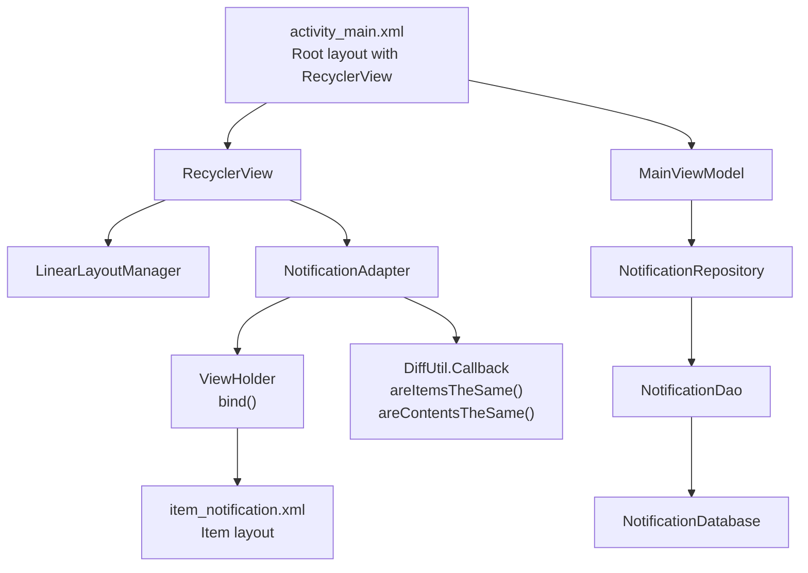
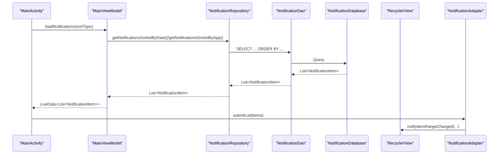
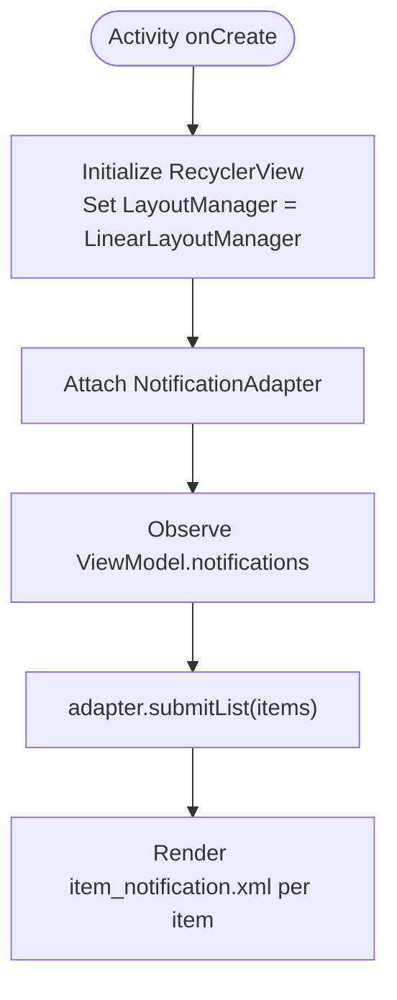
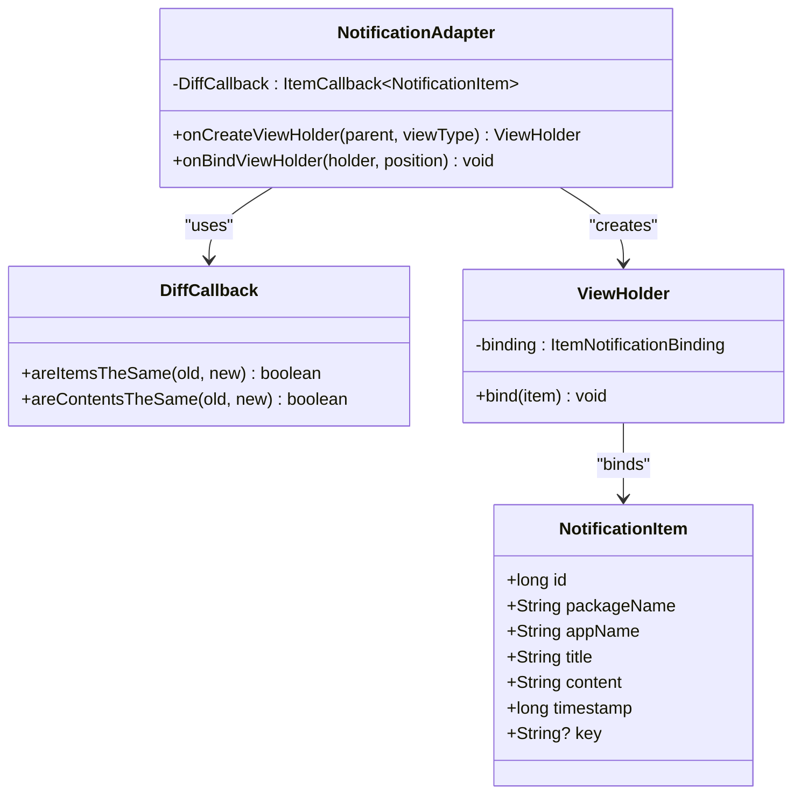
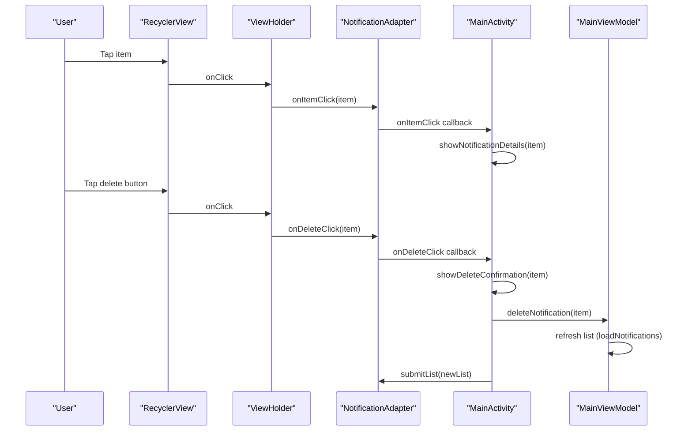
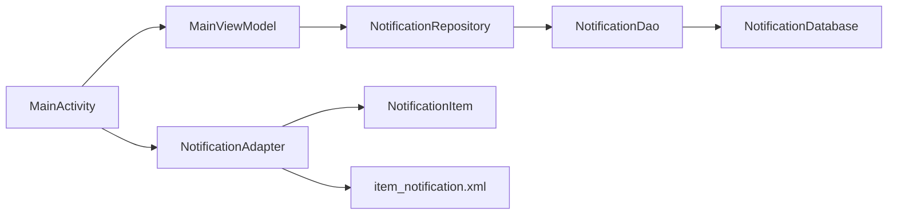

# Notification List Display

<cite>
**Referenced Files in This Document**
- [NotificationAdapter.kt](file://app/src/main/java/com/notificationlog/adapter/NotificationAdapter.kt)
- [NotificationItem.kt](file://app/src/main/java/com/notificationlog/model/NotificationItem.kt)
- [item_notification.xml](file://app/src/main/res/layout/item_notification.xml)
- [notification_item_menu.xml](file://app/src/main/res/menu/notification_item_menu.xml)
- [MainActivity.kt](file://app/src/main/java/com/notificationlog/MainActivity.kt)
- [MainViewModel.kt](file://app/src/main/java/com/notificationlog/MainViewModel.kt)
- [activity_main.xml](file://app/src/main/res/layout/activity_main.xml)
- [NotificationDao.kt](file://app/src/main/java/com/notificationlog/data/NotificationDao.kt)
- [NotificationDatabase.kt](file://app/src/main/java/com/notificationlog/data/NotificationDatabase.kt)
- [NotificationRepository.kt](file://app/src/main/java/com/notificationlog/repository/NotificationRepository.kt)
- [colors.xml](file://app/src/main/res/values/colors.xml)
- [styles.xml](file://app/src/main/res/values/styles.xml)
- [content_main.xml](file://app/src/main/res/layout/content_main.xml)
- [dialog_notification_detail.xml](file://app/src/main/res/layout/dialog_notification_detail.xml)
- [main_menu.xml](file://app/src/main/res/menu/main_menu.xml)
</cite>

## Table of Contents
1. [Introduction](#introduction)
2. [Project Structure](#project-structure)
3. [Core Components](#core-components)
4. [Architecture Overview](#architecture-overview)
5. [Detailed Component Analysis](#detailed-component-analysis)
6. [Dependency Analysis](#dependency-analysis)
7. [Performance Considerations](#performance-considerations)
8. [Troubleshooting Guide](#troubleshooting-guide)
9. [Conclusion](#conclusion)

## Introduction
This document explains the notification list display system, focusing on the RecyclerView implementation with LinearLayoutManager for vertical scrolling, the NotificationAdapter with DiffUtil for efficient updates, click handlers for viewing details and deleting items, and the item layout design. It also covers styling, color coding, responsive design, and performance optimizations for large datasets.

## Project Structure
The notification list UI is built around a single-activity architecture:
- UI container: activity_main.xml defines the root ConstraintLayout with a Toolbar, status bar, RecyclerView, and bottom buttons.
- Adapter: NotificationAdapter extends ListAdapter with DiffUtil to render list items efficiently.
- Item layout: item_notification.xml defines the per-item UI with app name, timestamp, title, delete button, and divider.
- Data layer: Room database with DAO queries, Repository wrapper, and ViewModel expose LiveData to the UI.
- Interaction: MainActivity wires up RecyclerView, handles click events, and delegates deletion to ViewModel.

**Diagram sources**
- [activity_main.xml:114-120](file://app/src/main/res/layout/activity_main.xml#L114-L120)
- [MainActivity.kt:146-153](file://app/src/main/java/com/notificationlog/MainActivity.kt#L146-L153)
- [NotificationAdapter.kt:13-59](file://app/src/main/java/com/notificationlog/adapter/NotificationAdapter.kt#L13-L59)
- [item_notification.xml:11-74](file://app/src/main/res/layout/item_notification.xml#L11-L74)
- [MainViewModel.kt:59-77](file://app/src/main/java/com/notificationlog/MainViewModel.kt#L59-L77)
- [NotificationRepository.kt:6-27](file://app/src/main/java/com/notificationlog/repository/NotificationRepository.kt#L6-L27)
- [NotificationDao.kt:6-26](file://app/src/main/java/com/notificationlog/data/NotificationDao.kt#L6-L26)
- [NotificationDatabase.kt:7-10](file://app/src/main/java/com/notificationlog/data/NotificationDatabase.kt#L7-L10)

**Section sources**
- [activity_main.xml:1-240](file://app/src/main/res/layout/activity_main.xml#L1-L240)
- [MainActivity.kt:146-153](file://app/src/main/java/com/notificationlog/MainActivity.kt#L146-L153)

## Core Components
- RecyclerView with LinearLayoutManager: The list occupies the central area between the toolbar/status bar and bottom buttons, enabling smooth vertical scrolling.
- NotificationAdapter: Uses ListAdapter with a DiffUtil.ItemCallback to compute minimal updates when the dataset changes.
- ViewHolder: Binds NotificationItem data to views, formats timestamps, and attaches click listeners for item and delete actions.
- Item layout: ConstraintLayout-based item with app name, timestamp, title, delete button, and divider for visual separation.
- ViewModel and Repository: Load sorted notifications and handle deletions; submitList updates the adapter efficiently.

**Section sources**
- [MainActivity.kt:146-153](file://app/src/main/java/com/notificationlog/MainActivity.kt#L146-L153)
- [NotificationAdapter.kt:13-59](file://app/src/main/java/com/notificationlog/adapter/NotificationAdapter.kt#L13-L59)
- [item_notification.xml:11-74](file://app/src/main/res/layout/item_notification.xml#L11-L74)
- [MainViewModel.kt:59-77](file://app/src/main/java/com/notificationlog/MainViewModel.kt#L59-L77)

## Architecture Overview
The display pipeline flows from data to UI:
- DAO queries return sorted lists via Repository.
- ViewModel exposes LiveData to the UI.
- MainActivity observes LiveData and submits lists to NotificationAdapter.
- Adapter renders items using item_notification.xml and reacts to clicks.

**Diagram sources**
- [MainViewModel.kt:59-77](file://app/src/main/java/com/notificationlog/MainViewModel.kt#L59-L77)
- [NotificationRepository.kt:10-14](file://app/src/main/java/com/notificationlog/repository/NotificationRepository.kt#L10-L14)
- [NotificationDao.kt:9-16](file://app/src/main/java/com/notificationlog/data/NotificationDao.kt#L9-L16)
- [MainActivity.kt:339-342](file://app/src/main/java/com/notificationlog/MainActivity.kt#L339-L342)
- [NotificationAdapter.kt:25-28](file://app/src/main/java/com/notificationlog/adapter/NotificationAdapter.kt#L25-L28)

## Detailed Component Analysis

### RecyclerView and LayoutManager
- RecyclerView is declared in activity_main.xml and constrained between the status bar and bottom buttons.
- MainActivity sets LinearLayoutManager to provide vertical scrolling.
- The adapter is attached to the RecyclerView.

**Diagram sources**
- [activity_main.xml:114-120](file://app/src/main/res/layout/activity_main.xml#L114-L120)
- [MainActivity.kt:146-153](file://app/src/main/java/com/notificationlog/MainActivity.kt#L146-L153)
- [MainActivity.kt:339-342](file://app/src/main/java/com/notificationlog/MainActivity.kt#L339-L342)

**Section sources**
- [activity_main.xml:114-120](file://app/src/main/res/layout/activity_main.xml#L114-L120)
- [MainActivity.kt:146-153](file://app/src/main/java/com/notificationlog/MainActivity.kt#L146-L153)

### NotificationAdapter Implementation
- Extends ListAdapter with DiffUtil.ItemCallback to minimize UI updates.
- onCreateViewHolder inflates item_notification.xml via generated binding.
- onBindViewHolder binds item data and sets up click listeners for item and delete actions.
- ViewHolder formats the timestamp and executes pending bindings.

**Diagram sources**
- [NotificationAdapter.kt:13-59](file://app/src/main/java/com/notificationlog/adapter/NotificationAdapter.kt#L13-L59)
- [NotificationItem.kt:8-19](file://app/src/main/java/com/notificationlog/model/NotificationItem.kt#L8-L19)

**Section sources**
- [NotificationAdapter.kt:13-59](file://app/src/main/java/com/notificationlog/adapter/NotificationAdapter.kt#L13-L59)

### Item Layout Design (item_notification.xml)
- Root: ConstraintLayout with selectable background for touch feedback.
- App name: Bold, left-aligned, occupying ~60% width alongside the timestamp.
- Timestamp: Right-aligned at top, smaller font and gray color.
- Title: Single-line ellipsized label below app name.
- Delete button: Small ImageButton with borderless ripple background and tint.
- Divider: Thin horizontal line below the title for visual separation.

Styling highlights:
- Padding inside items for comfortable touch targets.
- Selectable backgrounds for both the row and delete button.
- Typography hierarchy with bold app name and subdued timestamp/title.

Responsive considerations:
- Constraint percentages and wrap/constraints adapt to varying screen widths.
- Max lines and ellipsize prevent layout overflow for long titles.

**Section sources**
- [item_notification.xml:11-74](file://app/src/main/res/layout/item_notification.xml#L11-L74)
- [colors.xml:1-12](file://app/src/main/res/values/colors.xml#L1-L12)
- [styles.xml:4-22](file://app/src/main/res/values/styles.xml#L4-L22)

### Click Handlers and Interactions
- Item click: MainActivity passes onItemClick to NotificationAdapter; clicking opens a details dialog.
- Delete click: MainActivity passes onDeleteClick to NotificationAdapter; clicking shows a confirmation dialog and deletes via ViewModel.
- Contextual action menu: A menu resource defines "View Details" and "Delete" actions for each item.

**Diagram sources**
- [NotificationAdapter.kt:40-46](file://app/src/main/java/com/notificationlog/adapter/NotificationAdapter.kt#L40-L46)
- [MainActivity.kt:416-447](file://app/src/main/java/com/notificationlog/MainActivity.kt#L416-L447)
- [MainViewModel.kt:79-90](file://app/src/main/java/com/notificationlog/MainViewModel.kt#L79-L90)
- [notification_item_menu.xml:1-9](file://app/src/main/res/menu/notification_item_menu.xml#L1-L9)

**Section sources**
- [MainActivity.kt:416-447](file://app/src/main/java/com/notificationlog/MainActivity.kt#L416-L447)
- [MainViewModel.kt:79-90](file://app/src/main/java/com/notificationlog/MainViewModel.kt#L79-L90)
- [notification_item_menu.xml:1-9](file://app/src/main/res/menu/notification_item_menu.xml#L1-L9)

### Timestamp Formatting and Presentation
- The adapter formats the item timestamp using a date/time pattern and displays it near the app name.
- The dialog for details also formats the timestamp for readability.

**Section sources**
- [NotificationAdapter.kt:36-38](file://app/src/main/java/com/notificationlog/adapter/NotificationAdapter.kt#L36-L38)
- [MainActivity.kt:417-418](file://app/src/main/java/com/notificationlog/MainActivity.kt#L417-L418)
- [dialog_notification_detail.xml:16-20](file://app/src/main/res/layout/dialog_notification_detail.xml#L16-L20)

### Color Coding and Visual States
- Row background uses a selectable item background for focus/press feedback.
- Delete button uses a borderless selectable background with a neutral tint.
- Status bar uses a prominent blue color to indicate service state.
- Theme supports day/night modes via MaterialComponents theme attributes.

Note: There is no explicit status-dependent color coding per item in the current implementation.

**Section sources**
- [item_notification.xml:15](file://app/src/main/res/layout/item_notification.xml#L15)
- [item_notification.xml:58-60](file://app/src/main/res/layout/item_notification.xml#L58-L60)
- [activity_main.xml:82](file://app/src/main/res/layout/activity_main.xml#L82)
- [styles.xml:4-22](file://app/src/main/res/values/styles.xml#L4-L22)

## Dependency Analysis
The adapter depends on:
- NotificationItem model for data.
- Item layout binding for UI rendering.
- MainActivity callbacks for click handling.

The UI depends on:
- ViewModel for LiveData of notifications.
- Repository and DAO for data retrieval and mutation.
- Database abstraction for persistence.

**Diagram sources**
- [MainActivity.kt:339-342](file://app/src/main/java/com/notificationlog/MainActivity.kt#L339-L342)
- [MainViewModel.kt:59-77](file://app/src/main/java/com/notificationlog/MainViewModel.kt#L59-L77)
- [NotificationRepository.kt:6-27](file://app/src/main/java/com/notificationlog/repository/NotificationRepository.kt#L6-L27)
- [NotificationDao.kt:6-26](file://app/src/main/java/com/notificationlog/data/NotificationDao.kt#L6-L26)
- [NotificationDatabase.kt:7-10](file://app/src/main/java/com/notificationlog/data/NotificationDatabase.kt#L7-L10)
- [NotificationAdapter.kt:13-59](file://app/src/main/java/com/notificationlog/adapter/NotificationAdapter.kt#L13-L59)
- [NotificationItem.kt:8-19](file://app/src/main/java/com/notificationlog/model/NotificationItem.kt#L8-L19)
- [item_notification.xml:11-74](file://app/src/main/res/layout/item_notification.xml#L11-L74)

**Section sources**
- [MainActivity.kt:339-342](file://app/src/main/java/com/notificationlog/MainActivity.kt#L339-L342)
- [MainViewModel.kt:59-77](file://app/src/main/java/com/notificationlog/MainViewModel.kt#L59-L77)
- [NotificationRepository.kt:6-27](file://app/src/main/java/com/notificationlog/repository/NotificationRepository.kt#L6-L27)
- [NotificationDao.kt:6-26](file://app/src/main/java/com/notificationlog/data/NotificationDao.kt#L6-L26)
- [NotificationDatabase.kt:7-10](file://app/src/main/java/com/notificationlog/data/NotificationDatabase.kt#L7-L10)
- [NotificationAdapter.kt:13-59](file://app/src/main/java/com/notificationlog/adapter/NotificationAdapter.kt#L13-L59)
- [NotificationItem.kt:8-19](file://app/src/main/java/com/notificationlog/model/NotificationItem.kt#L8-L19)
- [item_notification.xml:11-74](file://app/src/main/res/layout/item_notification.xml#L11-L74)

## Performance Considerations
- Efficient updates: ListAdapter with DiffUtil minimizes expensive view updates by computing differences between old and new lists.
- Background threading: DAO operations are suspend functions executed on Dispatchers.IO; UI updates occur on the main thread.
- Minimal work in bind: Formatting and click assignment are lightweight; avoid heavy computations in onBindViewHolder.
- Recycling: RecyclerView recycles ViewHolders; keep item layouts simple and avoid deep nesting.
- Large datasets: Pagination or limiting results can reduce memory footprint; current implementation loads all notifications.
- Image handling: No app icons are rendered in the item layout; if icons are added later, consider placeholder images and caching.

[No sources needed since this section provides general guidance]

## Troubleshooting Guide
Common issues and checks:
- Empty list: Verify ViewModel emits notifications and MainActivity observes LiveData; ensure submitList is called.
- Clicks not firing: Confirm click listeners are attached in ViewHolder and callbacks are passed to the adapter.
- Timestamps incorrect: Ensure the timestamp field is populated and formatted consistently.
- Delete not working: Confirm ViewModel.deleteNotification invokes repository delete and refreshes the list.
- UI not updating after delete: Ensure adapter.submitList is invoked with the refreshed dataset.

**Section sources**
- [MainActivity.kt:339-342](file://app/src/main/java/com/notificationlog/MainActivity.kt#L339-L342)
- [MainViewModel.kt:79-90](file://app/src/main/java/com/notificationlog/MainViewModel.kt#L79-L90)
- [NotificationAdapter.kt:40-46](file://app/src/main/java/com/notificationlog/adapter/NotificationAdapter.kt#L40-L46)

## Conclusion
The notification list display system leverages RecyclerView with LinearLayoutManager and NotificationAdapter for efficient, responsive rendering. DiffUtil ensures minimal UI updates, while item_notification.xml provides a clean, readable layout with actionable controls. The ViewModel and Repository layers maintain separation of concerns and support robust data operations. For very large datasets, consider pagination or filtering to sustain performance and responsiveness.