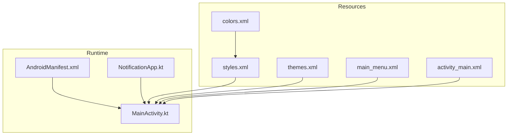
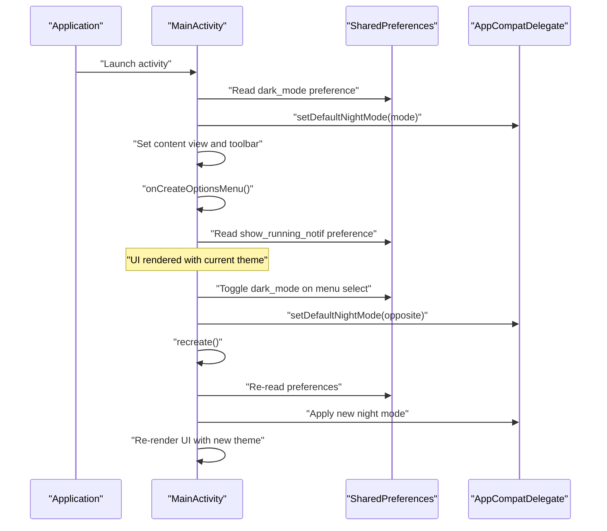
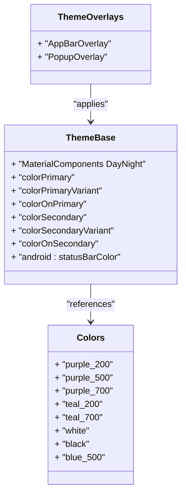
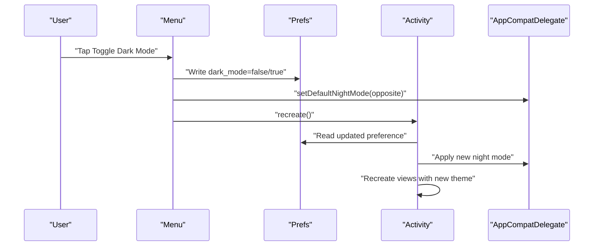
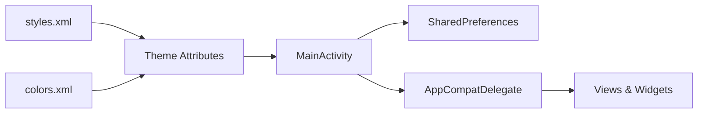

# Theme Management

<cite>
**Referenced Files in This Document**
- [themes.xml](file://app/src/main/res/values/themes.xml)
- [styles.xml](file://app/src/main/res/values/styles.xml)
- [colors.xml](file://app/src/main/res/values/colors.xml)
- [MainActivity.kt](file://app/src/main/java/com/notificationlog/MainActivity.kt)
- [NotificationApp.kt](file://app/src/main/java/com/notificationlog/NotificationApp.kt)
- [main_menu.xml](file://app/src/main/res/menu/main_menu.xml)
- [activity_main.xml](file://app/src/main/res/layout/activity_main.xml)
- [AndroidManifest.xml](file://app/src/main/AndroidManifest.xml)
- [build.gradle](file://app/build.gradle)
</cite>

## Table of Contents
1. [Introduction](#introduction)
2. [Project Structure](#project-structure)
3. [Core Components](#core-components)
4. [Architecture Overview](#architecture-overview)
5. [Detailed Component Analysis](#detailed-component-analysis)
6. [Dependency Analysis](#dependency-analysis)
7. [Performance Considerations](#performance-considerations)
8. [Troubleshooting Guide](#troubleshooting-guide)
9. [Conclusion](#conclusion)

## Introduction
This document explains the theme management system used in the NotificationLog Android application. It covers how light and dark modes are implemented using AppCompatDelegate and Material Design theming, how theme switching is triggered by user preferences and menu actions, and how theme preferences are persisted using SharedPreferences. It also documents color scheme definitions, typography choices, component styling, dynamic color application, and compatibility considerations across Android versions. Finally, it addresses integration with system-wide dark mode settings and user preference synchronization.

## Project Structure
The theme system spans resource definitions, application initialization, activity lifecycle, and menu-driven toggling. Key locations:
- Resource definitions for colors, styles, and themes
- Application class for global initialization
- Main activity for theme application and user-triggered switching
- Menu resource for theme toggle action
- Layout resource for theme-aware UI components
- Manifest for application-wide theme assignment

**Diagram sources**
- [AndroidManifest.xml:9-27](file://app/src/main/AndroidManifest.xml#L9-L27)
- [NotificationApp.kt:8-28](file://app/src/main/java/com/notificationlog/NotificationApp.kt#L8-L28)
- [MainActivity.kt:78-108](file://app/src/main/java/com/notificationlog/MainActivity.kt#L78-L108)
- [styles.xml:4-16](file://app/src/main/res/values/styles.xml#L4-L16)
- [themes.xml:2-16](file://app/src/main/res/values/themes.xml#L2-L16)
- [colors.xml:2-12](file://app/src/main/res/values/colors.xml#L2-L12)
- [main_menu.xml:30-38](file://app/src/main/res/menu/main_menu.xml#L30-L38)
- [activity_main.xml:9-19](file://app/src/main/res/layout/activity_main.xml#L9-L19)

**Section sources**
- [AndroidManifest.xml:9-27](file://app/src/main/AndroidManifest.xml#L9-L27)
- [NotificationApp.kt:8-28](file://app/src/main/java/com/notificationlog/NotificationApp.kt#L8-L28)
- [MainActivity.kt:78-108](file://app/src/main/java/com/notificationlog/MainActivity.kt#L78-L108)
- [styles.xml:4-16](file://app/src/main/res/values/styles.xml#L4-L16)
- [themes.xml:2-16](file://app/src/main/res/values/themes.xml#L2-L16)
- [colors.xml:2-12](file://app/src/main/res/values/colors.xml#L2-L12)
- [main_menu.xml:30-38](file://app/src/main/res/menu/main_menu.xml#L30-L38)
- [activity_main.xml:9-19](file://app/src/main/res/layout/activity_main.xml#L9-L19)

## Core Components
- Application theme definition: The base theme inherits from a DayNight variant of MaterialComponents to enable automatic light/dark mode selection.
- Color palette: Centralized color definitions for primary, secondary, and surface tones.
- Toolbar overlays: Separate overlay themes for app bar and popup menus to align with the current theme.
- Activity-level theme application: The main activity reads user preferences and applies the appropriate night mode before creating views.
- Menu-driven theme toggle: A menu option switches the theme preference and triggers a recreation of the activity to apply the change immediately.
- Persistent storage: SharedPreferences stores user preferences for dark mode, capture mode, and other toggles.

Key implementation references:
- Base theme and overlays: [styles.xml:4-22](file://app/src/main/res/values/styles.xml#L4-L22)
- Additional theme variants: [themes.xml:2-16](file://app/src/main/res/values/themes.xml#L2-L16)
- Color definitions: [colors.xml:2-12](file://app/src/main/res/values/colors.xml#L2-L12)
- Application-wide theme assignment: [AndroidManifest.xml:14](file://app/src/main/AndroidManifest.xml#L14)
- Preference-backed theme application at startup: [MainActivity.kt:87-90](file://app/src/main/java/com/notificationlog/MainActivity.kt#L87-L90)
- Theme toggle action and recreation: [MainActivity.kt:473-486](file://app/src/main/java/com/notificationlog/MainActivity.kt#L473-L486)
- Menu resource for theme toggle: [main_menu.xml:30-33](file://app/src/main/res/menu/main_menu.xml#L30-L33)

**Section sources**
- [styles.xml:4-22](file://app/src/main/res/values/styles.xml#L4-L22)
- [themes.xml:2-16](file://app/src/main/res/values/themes.xml#L2-L16)
- [colors.xml:2-12](file://app/src/main/res/values/colors.xml#L2-L12)
- [AndroidManifest.xml:14](file://app/src/main/AndroidManifest.xml#L14)
- [MainActivity.kt:87-90](file://app/src/main/java/com/notificationlog/MainActivity.kt#L87-L90)
- [MainActivity.kt:473-486](file://app/src/main/java/com/notificationlog/MainActivity.kt#L473-L486)
- [main_menu.xml:30-33](file://app/src/main/res/menu/main_menu.xml#L30-L33)

## Architecture Overview
The theme management architecture integrates resource-defined themes with runtime preference handling and activity lifecycle events. The flow below illustrates how the system initializes and responds to user actions.

**Diagram sources**
- [MainActivity.kt:78-108](file://app/src/main/java/com/notificationlog/MainActivity.kt#L78-L108)
- [MainActivity.kt:461-469](file://app/src/main/java/com/notificationlog/MainActivity.kt#L461-L469)
- [MainActivity.kt:471-519](file://app/src/main/java/com/notificationlog/MainActivity.kt#L471-L519)
- [main_menu.xml:30-38](file://app/src/main/res/menu/main_menu.xml#L30-L38)

## Detailed Component Analysis

### Theme Definitions and Material Design Integration
- Base theme: Inherits from a DayNight variant of MaterialComponents to support automatic light/dark mode selection based on system or user preference.
- Overlays: App bar and popup overlays are defined to ensure proper contrast and readability under both themes.
- Color tokens: Primary, secondary, and surface colors are defined centrally and applied via attributes in the base theme.

Implementation references:
- Base theme and overlays: [styles.xml:4-22](file://app/src/main/res/values/styles.xml#L4-L22)
- Additional theme variants: [themes.xml:2-16](file://app/src/main/res/values/themes.xml#L2-L16)
- Color palette: [colors.xml:2-12](file://app/src/main/res/values/colors.xml#L2-L12)

**Diagram sources**
- [styles.xml:4-22](file://app/src/main/res/values/styles.xml#L4-L22)
- [colors.xml:2-12](file://app/src/main/res/values/colors.xml#L2-L12)

**Section sources**
- [styles.xml:4-22](file://app/src/main/res/values/styles.xml#L4-L22)
- [themes.xml:2-16](file://app/src/main/res/values/themes.xml#L2-L16)
- [colors.xml:2-12](file://app/src/main/res/values/colors.xml#L2-L12)

### Theme Switching Mechanism
- Startup application: The activity reads the dark_mode preference and sets the default night mode before creating views.
- User-triggered switch: Selecting the theme toggle menu item flips the preference, updates the default night mode, and recreates the activity to apply the change immediately.
- Immediate feedback: A toast confirms the new mode, and the UI re-renders with the updated theme.

Implementation references:
- Startup theme application: [MainActivity.kt:87-90](file://app/src/main/java/com/notificationlog/MainActivity.kt#L87-L90)
- Menu toggle and recreation: [MainActivity.kt:473-486](file://app/src/main/java/com/notificationlog/MainActivity.kt#L473-L486)
- Menu resource: [main_menu.xml:30-33](file://app/src/main/res/menu/main_menu.xml#L30-L33)

**Diagram sources**
- [MainActivity.kt:473-486](file://app/src/main/java/com/notificationlog/MainActivity.kt#L473-L486)
- [main_menu.xml:30-33](file://app/src/main/res/menu/main_menu.xml#L30-L33)

**Section sources**
- [MainActivity.kt:87-90](file://app/src/main/java/com/notificationlog/MainActivity.kt#L87-L90)
- [MainActivity.kt:473-486](file://app/src/main/java/com/notificationlog/MainActivity.kt#L473-L486)
- [main_menu.xml:30-33](file://app/src/main/res/menu/main_menu.xml#L30-L33)

### Color Scheme and Typography
- Color scheme: Defined in a centralized palette and applied via theme attributes for primary, secondary, and surface roles.
- Typography: Not explicitly overridden in the provided resources; defaults from MaterialComponents are used.
- Dynamic color: No dynamic color application is present in the current implementation.

References:
- Color definitions: [colors.xml:2-12](file://app/src/main/res/values/colors.xml#L2-L12)
- Theme color application: [styles.xml:5-12](file://app/src/main/res/values/styles.xml#L5-L12)

**Section sources**
- [colors.xml:2-12](file://app/src/main/res/values/colors.xml#L2-L12)
- [styles.xml:5-12](file://app/src/main/res/values/styles.xml#L5-L12)

### Component Styling and Theme-Aware UI
- Backgrounds: Root container uses a theme-aware background attribute for proper contrast.
- Toolbar: Uses theme attributes for background and elevation, with overlay themes for app bar and popup menus.
- Surface and on-surface: Surface areas and text use theme attributes to adapt to light/dark modes.
- Status bar: The status bar color is bound to the primary variant attribute.

References:
- Root background and toolbar: [activity_main.xml:9-19](file://app/src/main/res/layout/activity_main.xml#L9-L19)
- Surface and on-surface usage: [activity_main.xml:27-75](file://app/src/main/res/layout/activity_main.xml#L27-L75)
- Status bar binding: [styles.xml:14](file://app/src/main/res/values/styles.xml#L14)

**Section sources**
- [activity_main.xml:9-19](file://app/src/main/res/layout/activity_main.xml#L9-L19)
- [activity_main.xml:27-75](file://app/src/main/res/layout/activity_main.xml#L27-L75)
- [styles.xml:14](file://app/src/main/res/values/styles.xml#L14)

### Persistent Theme Preference Storage
- Storage: SharedPreferences is used to persist dark_mode and other toggles.
- Access: The activity reads preferences during onCreate and writes updates upon user actions.
- Scope: Preferences are stored per-app and do not rely on system-wide settings.

References:
- Preference read/write: [MainActivity.kt:81-82](file://app/src/main/java/com/notificationlog/MainActivity.kt#L81-L82), [MainActivity.kt:474-476](file://app/src/main/java/com/notificationlog/MainActivity.kt#L474-L476)

**Section sources**
- [MainActivity.kt:81-82](file://app/src/main/java/com/notificationlog/MainActivity.kt#L81-L82)
- [MainActivity.kt:474-476](file://app/src/main/java/com/notificationlog/MainActivity.kt#L474-L476)

### Automatic Theme Application During App Startup
- Initialization order: The activity reads preferences and applies the night mode before inflating layouts.
- Manifest theme: The application and launcher activities specify the base theme, ensuring consistent rendering.

References:
- Startup preference application: [MainActivity.kt:87-90](file://app/src/main/java/com/notificationlog/MainActivity.kt#L87-L90)
- Manifest theme assignment: [AndroidManifest.xml:14](file://app/src/main/AndroidManifest.xml#L14), [AndroidManifest.xml:22](file://app/src/main/AndroidManifest.xml#L22)

**Section sources**
- [MainActivity.kt:87-90](file://app/src/main/java/com/notificationlog/MainActivity.kt#L87-L90)
- [AndroidManifest.xml:14](file://app/src/main/AndroidManifest.xml#L14)
- [AndroidManifest.xml:22](file://app/src/main/AndroidManifest.xml#L22)

### Compatibility Across Android Versions
- Minimum SDK: The project targets a modern minimum SDK suitable for DayNight theming.
- Dependencies: AppCompat and Material Components are included to support theme APIs and widgets.
- Behavior: DayNight theming adapts to system settings on supported platforms while allowing manual overrides.

References:
- Build configuration and dependencies: [build.gradle:72-94](file://app/build.gradle#L72-L94)

**Section sources**
- [build.gradle:72-94](file://app/build.gradle#L72-L94)

### Integration with System-Wide Dark Mode Settings
- Current behavior: The theme system respects user preference stored locally. There is no explicit code to listen for system dark mode changes or synchronize with system settings.
- Recommendation: To integrate with system-wide dark mode, consider registering a configuration change listener or observing system UI mode changes and updating the default night mode accordingly.

[No sources needed since this section provides general guidance]

## Dependency Analysis
The theme system depends on:
- Resource-defined theme attributes and overlays
- AppCompatDelegate for runtime theme selection
- SharedPreferences for persistence
- Activity lifecycle for applying and re-applying themes

**Diagram sources**
- [styles.xml:4-22](file://app/src/main/res/values/styles.xml#L4-L22)
- [colors.xml:2-12](file://app/src/main/res/values/colors.xml#L2-L12)
- [MainActivity.kt:87-90](file://app/src/main/java/com/notificationlog/MainActivity.kt#L87-L90)
- [MainActivity.kt:473-486](file://app/src/main/java/com/notificationlog/MainActivity.kt#L473-L486)

**Section sources**
- [styles.xml:4-22](file://app/src/main/res/values/styles.xml#L4-L22)
- [colors.xml:2-12](file://app/src/main/res/values/colors.xml#L2-L12)
- [MainActivity.kt:87-90](file://app/src/main/java/com/notificationlog/MainActivity.kt#L87-L90)
- [MainActivity.kt:473-486](file://app/src/main/java/com/notificationlog/MainActivity.kt#L473-L486)

## Performance Considerations
- Recreate cost: Recreating the activity on theme change triggers a full view rebuild. Keep the number of heavy views reasonable to minimize impact.
- Preference reads/writes: Batch preference updates and avoid frequent writes during rapid user interactions.
- Theme stability: Avoid toggling themes excessively during short periods to prevent unnecessary recompositions.

[No sources needed since this section provides general guidance]

## Troubleshooting Guide
- Theme does not switch immediately: Ensure the activity is recreated after updating the preference and default night mode.
- Inconsistent colors: Verify that theme attributes are used instead of hardcoded colors for backgrounds and text.
- Overlay issues: Confirm that app bar and popup overlays match the current theme.

References:
- Recreation and preference updates: [MainActivity.kt:473-486](file://app/src/main/java/com/notificationlog/MainActivity.kt#L473-L486)
- Overlay usage: [styles.xml:18-21](file://app/src/main/res/values/styles.xml#L18-L21)
- Attribute-based styling: [activity_main.xml:9-19](file://app/src/main/res/layout/activity_main.xml#L9-L19)

**Section sources**
- [MainActivity.kt:473-486](file://app/src/main/java/com/notificationlog/MainActivity.kt#L473-L486)
- [styles.xml:18-21](file://app/src/main/res/values/styles.xml#L18-L21)
- [activity_main.xml:9-19](file://app/src/main/res/layout/activity_main.xml#L9-L19)

## Conclusion
The NotificationLog application implements a robust theme management system using Material Design theming and AppCompatDelegate. It supports light and dark modes through a DayNight base theme, persists user preferences with SharedPreferences, and applies theme changes dynamically via menu actions and activity recreation. The UI leverages theme-aware attributes for surfaces and text, ensuring consistent appearance across modes. While the current implementation focuses on user preference-driven theming, integrating with system-wide dark mode settings would further enhance user experience.