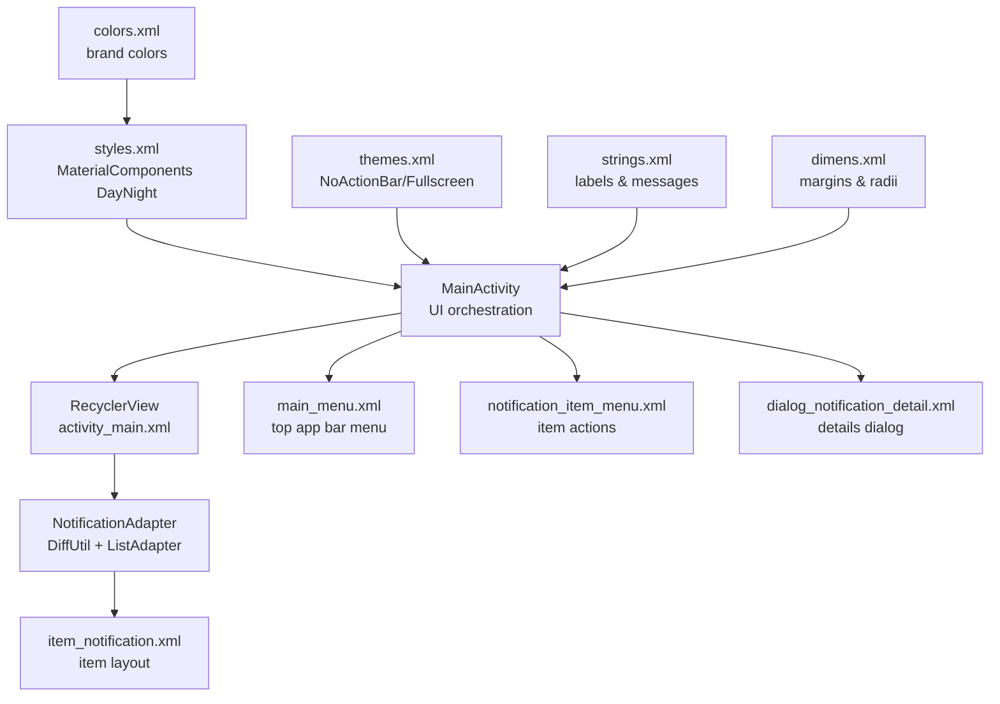
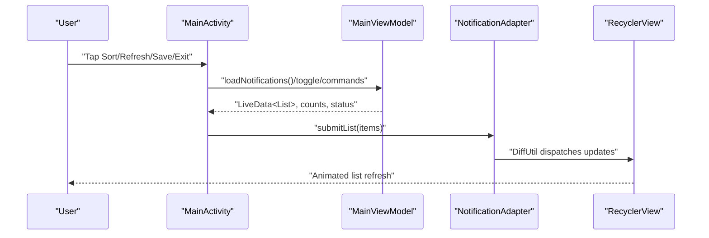
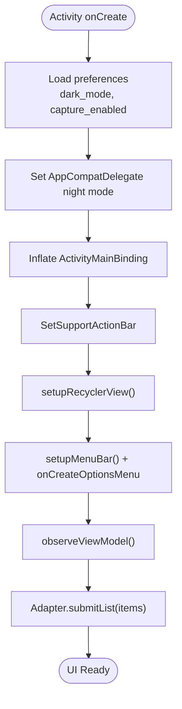
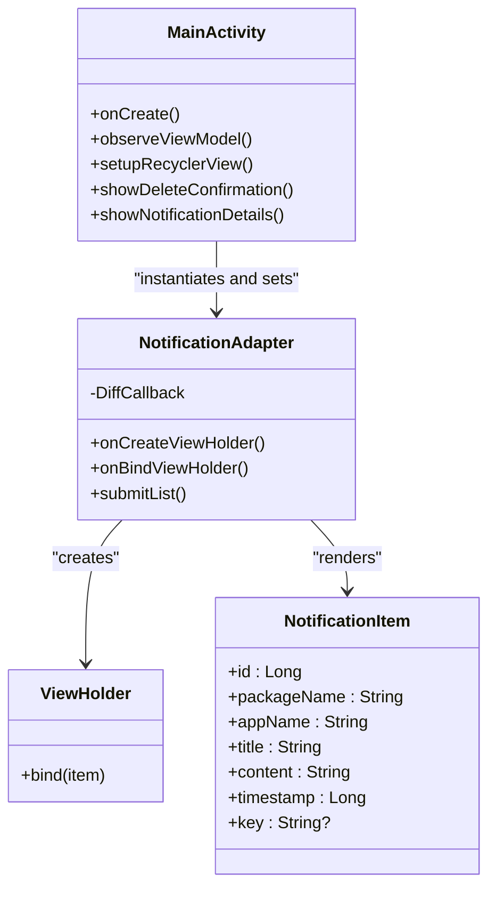
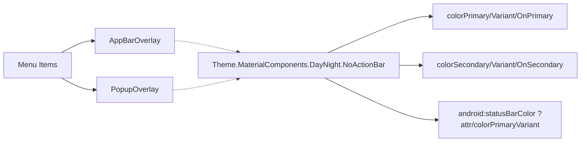
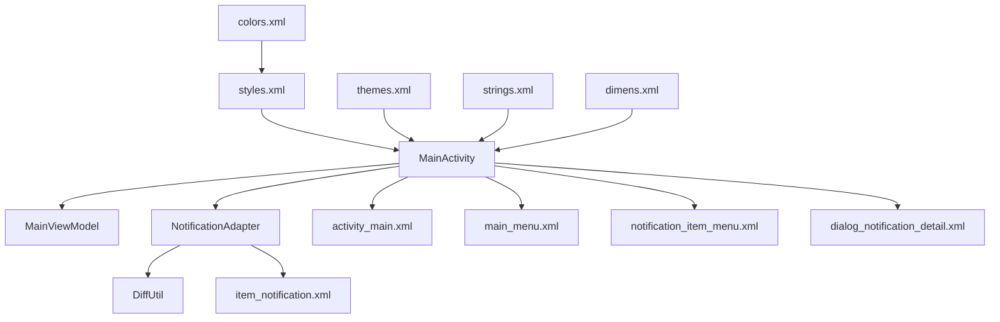
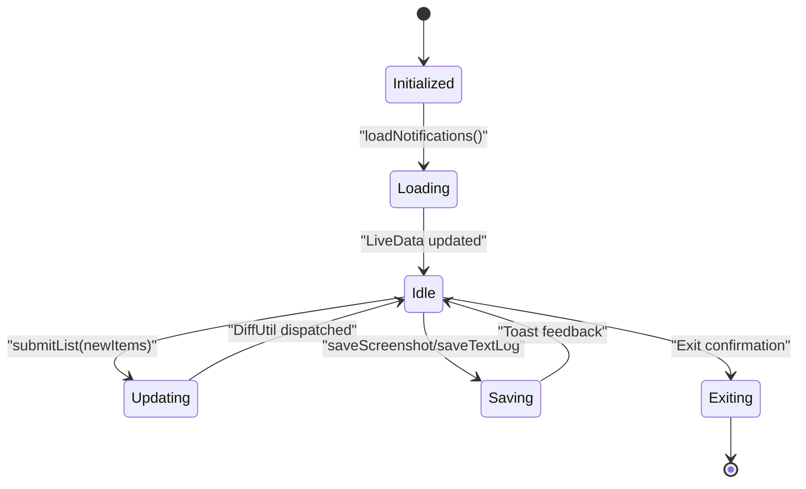

# User Interface

<cite>
**Referenced Files in This Document**
- [MainActivity.kt](file://app/src/main/java/com/notificationlog/MainActivity.kt)
- [NotificationAdapter.kt](file://app/src/main/java/com/notificationlog/adapter/NotificationAdapter.kt)
- [activity_main.xml](file://app/src/main/res/layout/activity_main.xml)
- [content_main.xml](file://app/src/main/res/layout/content_main.xml)
- [item_notification.xml](file://app/src/main/res/layout/item_notification.xml)
- [dialog_notification_detail.xml](file://app/src/main/res/layout/dialog_notification_detail.xml)
- [main_menu.xml](file://app/src/main/res/menu/main_menu.xml)
- [notification_item_menu.xml](file://app/src/main/res/menu/notification_item_menu.xml)
- [themes.xml](file://app/src/main/res/values/themes.xml)
- [styles.xml](file://app/src/main/res/values/styles.xml)
- [colors.xml](file://app/src/main/res/values/colors.xml)
- [strings.xml](file://app/src/main/res/values/strings.xml)
- [dimens.xml](file://app/src/main/res/values/dimens.xml)
- [NotificationItem.kt](file://app/src/main/java/com/notificationlog/model/NotificationItem.kt)
- [MainViewModel.kt](file://app/src/main/java/com/notificationlog/MainViewModel.kt)
</cite>

## Table of Contents
1. [Introduction](#introduction)
2. [Project Structure](#project-structure)
3. [Core Components](#core-components)
4. [Architecture Overview](#architecture-overview)
5. [Detailed Component Analysis](#detailed-component-analysis)
6. [Dependency Analysis](#dependency-analysis)
7. [Performance Considerations](#performance-considerations)
8. [Troubleshooting Guide](#troubleshooting-guide)
9. [Conclusion](#conclusion)
10. [Appendices](#appendices)

## Introduction
This document describes the user interface of the NotificationLog Android application. It covers the main activity layout, the notification list display powered by RecyclerView with a custom adapter using DiffUtil, Material Design integration, theme support for light/dark modes, and responsive layout design. It also explains user interaction patterns, menu systems, dialog implementations, UI customization options, accessibility features, cross-device compatibility considerations, UI state management, animations, user feedback mechanisms, and performance optimizations for large datasets.

## Project Structure
The UI is primarily composed of:
- An Activity that hosts the main layout and orchestrates menus, dialogs, and state updates.
- A RecyclerView list backed by a custom adapter that renders notification items efficiently.
- XML layouts for the main screen, individual list items, and dialogs.
- Menu resources for top app bar and item-level actions.
- Material Design themes and styles with day/night support.
- ViewModel-driven state for lists and counts.

**Diagram sources**
- [MainActivity.kt:78-108](file://app/src/main/java/com/notificationlog/MainActivity.kt#L78-L108)
- [activity_main.xml:114-120](file://app/src/main/res/layout/activity_main.xml#L114-L120)
- [NotificationAdapter.kt:13-59](file://app/src/main/java/com/notificationlog/adapter/NotificationAdapter.kt#L13-L59)
- [item_notification.xml:11-74](file://app/src/main/res/layout/item_notification.xml#L11-L74)
- [main_menu.xml:1-45](file://app/src/main/res/menu/main_menu.xml#L1-L45)
- [notification_item_menu.xml:1-9](file://app/src/main/res/menu/notification_item_menu.xml#L1-L9)
- [dialog_notification_detail.xml:1-23](file://app/src/main/res/layout/dialog_notification_detail.xml#L1-L23)
- [styles.xml:4-22](file://app/src/main/res/values/styles.xml#L4-L22)
- [themes.xml:3-16](file://app/src/main/res/values/themes.xml#L3-L16)
- [colors.xml:1-12](file://app/src/main/res/values/colors.xml#L1-L12)
- [strings.xml:1-21](file://app/src/main/res/values/strings.xml#L1-L21)
- [dimens.xml:1-12](file://app/src/main/res/values/dimens.xml#L1-L12)

**Section sources**
- [MainActivity.kt:78-108](file://app/src/main/java/com/notificationlog/MainActivity.kt#L78-L108)
- [activity_main.xml:6-239](file://app/src/main/res/layout/activity_main.xml#L6-L239)
- [NotificationAdapter.kt:13-59](file://app/src/main/java/com/notificationlog/adapter/NotificationAdapter.kt#L13-L59)
- [item_notification.xml:11-74](file://app/src/main/res/layout/item_notification.xml#L11-L74)
- [main_menu.xml:1-45](file://app/src/main/res/menu/main_menu.xml#L1-L45)
- [notification_item_menu.xml:1-9](file://app/src/main/res/menu/notification_item_menu.xml#L1-L9)
- [dialog_notification_detail.xml:1-23](file://app/src/main/res/layout/dialog_notification_detail.xml#L1-L23)
- [styles.xml:4-22](file://app/src/main/res/values/styles.xml#L4-L22)
- [themes.xml:3-16](file://app/src/main/res/values/themes.xml#L3-L16)
- [colors.xml:1-12](file://app/src/main/res/values/colors.xml#L1-L12)
- [strings.xml:1-21](file://app/src/main/res/values/strings.xml#L1-L21)
- [dimens.xml:1-12](file://app/src/main/res/values/dimens.xml#L1-L12)

## Core Components
- Main Activity Layout: ConstraintLayout-based layout with Toolbar, horizontal menu bar, status bar, RecyclerView, and bottom action buttons. Uses data binding and Material Design attributes.
- RecyclerView and Adapter: LinearLayoutManager-backed list with a custom adapter extending ListAdapter and DiffUtil for efficient updates.
- Menus: Top app bar menu for sorting, refresh, export, theme toggle, and exit; item-level menu for viewing details and deletion.
- Dialogs: Confirmation dialogs for delete/clear/exit and a details dialog for notification content.
- Themes and Styles: MaterialComponents DayNight base with overlays for app bars and popups; dynamic dark/light mode via preferences and delegate.
- ViewModel Integration: LiveData-driven updates for notifications, counts, and service status; adapter receives submitList updates.

**Section sources**
- [MainActivity.kt:146-153](file://app/src/main/java/com/notificationlog/MainActivity.kt#L146-L153)
- [MainActivity.kt:324-343](file://app/src/main/java/com/notificationlog/MainActivity.kt#L324-L343)
- [NotificationAdapter.kt:13-59](file://app/src/main/java/com/notificationlog/adapter/NotificationAdapter.kt#L13-L59)
- [activity_main.xml:11-239](file://app/src/main/res/layout/activity_main.xml#L11-L239)
- [main_menu.xml:1-45](file://app/src/main/res/menu/main_menu.xml#L1-L45)
- [notification_item_menu.xml:1-9](file://app/src/main/res/menu/notification_item_menu.xml#L1-L9)
- [dialog_notification_detail.xml:1-23](file://app/src/main/res/layout/dialog_notification_detail.xml#L1-L23)
- [styles.xml:4-22](file://app/src/main/res/values/styles.xml#L4-L22)
- [themes.xml:3-16](file://app/src/main/res/values/themes.xml#L3-L16)

## Architecture Overview
The UI follows MVVM with Activity hosting the layout and observing ViewModel LiveData. The adapter binds data to views declaratively and uses DiffUtil to minimize redraws.

**Diagram sources**
- [MainActivity.kt:324-343](file://app/src/main/java/com/notificationlog/MainActivity.kt#L324-L343)
- [MainViewModel.kt:59-77](file://app/src/main/java/com/notificationlog/MainViewModel.kt#L59-L77)
- [NotificationAdapter.kt:13-59](file://app/src/main/java/com/notificationlog/adapter/NotificationAdapter.kt#L13-L59)
- [activity_main.xml:114-120](file://app/src/main/res/layout/activity_main.xml#L114-L120)

## Detailed Component Analysis

### Main Activity Layout and Interaction Patterns
- ConstraintLayout root with Toolbar, horizontal menu bar, status bar, RecyclerView, and bottom button container.
- Bottom buttons provide tooltips and dynamic tinting based on service/permission state.
- Menus: Top app bar menu supports sort, refresh, save screenshots/text logs, about, theme toggle, and exit. Item menu supports view details and delete.
- Dialogs: Confirmation dialogs for delete single/all entries and exit; details dialog shows formatted notification info.
- Theme toggle persists preference and recreates activity to apply DayNight mode.

**Diagram sources**
- [MainActivity.kt:78-108](file://app/src/main/java/com/notificationlog/MainActivity.kt#L78-L108)
- [MainActivity.kt:146-161](file://app/src/main/java/com/notificationlog/MainActivity.kt#L146-L161)
- [MainActivity.kt:461-519](file://app/src/main/java/com/notificationlog/MainActivity.kt#L461-L519)
- [MainActivity.kt:324-343](file://app/src/main/java/com/notificationlog/MainActivity.kt#L324-L343)

**Section sources**
- [activity_main.xml:6-239](file://app/src/main/res/layout/activity_main.xml#L6-L239)
- [MainActivity.kt:217-298](file://app/src/main/java/com/notificationlog/MainActivity.kt#L217-L298)
- [MainActivity.kt:461-519](file://app/src/main/java/com/notificationlog/MainActivity.kt#L461-L519)
- [MainActivity.kt:416-447](file://app/src/main/java/com/notificationlog/MainActivity.kt#L416-L447)

### Notification List Display with RecyclerView and Custom Adapter
- RecyclerView configured with LinearLayoutManager and set to match parent height between status bar and bottom buttons.
- Adapter extends ListAdapter with DiffUtil.ItemCallback to compute minimal updates.
- ViewHolder inflates item layout, binds data, and wires click listeners for item tap and delete.
- Date formatting performed in adapter; executePendingBindings ensures timely UI updates.

**Diagram sources**
- [MainActivity.kt:146-153](file://app/src/main/java/com/notificationlog/MainActivity.kt#L146-L153)
- [NotificationAdapter.kt:13-59](file://app/src/main/java/com/notificationlog/adapter/NotificationAdapter.kt#L13-L59)
- [NotificationItem.kt:8-19](file://app/src/main/java/com/notificationlog/model/NotificationItem.kt#L8-L19)

**Section sources**
- [activity_main.xml:114-120](file://app/src/main/res/layout/activity_main.xml#L114-L120)
- [NotificationAdapter.kt:13-59](file://app/src/main/java/com/notificationlog/adapter/NotificationAdapter.kt#L13-L59)
- [item_notification.xml:11-74](file://app/src/main/res/layout/item_notification.xml#L11-L74)

### Material Design Integration and Theme Support
- Base theme derives from MaterialComponents DayNight.NoActionBar with primary/secondary colors and status bar color bound to variant.
- AppBarOverlay and PopupOverlay provide themed app bar and popup menus.
- Night mode toggled via preference and AppCompatDelegate; UI recreated to apply theme immediately.
- Color palette includes brand colors and surface/status variants.

**Diagram sources**
- [styles.xml:4-22](file://app/src/main/res/values/styles.xml#L4-L22)
- [themes.xml:3-16](file://app/src/main/res/values/themes.xml#L3-L16)
- [colors.xml:1-12](file://app/src/main/res/values/colors.xml#L1-L12)

**Section sources**
- [styles.xml:4-22](file://app/src/main/res/values/styles.xml#L4-L22)
- [themes.xml:3-16](file://app/src/main/res/values/themes.xml#L3-L16)
- [colors.xml:1-12](file://app/src/main/res/values/colors.xml#L1-L12)
- [MainActivity.kt:473-486](file://app/src/main/java/com/notificationlog/MainActivity.kt#L473-L486)

### Responsive Layout Design
- ConstraintLayout constraints define flexible spacing between toolbar, menu bar, status bar, RecyclerView, and bottom buttons.
- RecyclerView occupies remaining vertical space between status and buttons.
- Horizontal menu bar and bottom buttons use wrap_content and padding/margins for compactness across devices.
- Dimens resources standardize margins and radii for consistent density scaling.

**Section sources**
- [activity_main.xml:6-239](file://app/src/main/res/layout/activity_main.xml#L6-L239)
- [dimens.xml:1-12](file://app/src/main/res/values/dimens.xml#L1-L12)

### User Interaction Patterns and Menus
- Top app bar menu: sort by date/app, refresh, save screenshot/text log, about, toggle dark mode, show running notification, exit.
- Item-level menu: view details, delete.
- Bottom bar: permission, notification access, capture start/stop, clear all.
- Tooltips provide contextual help; icons change tint to reflect state.

**Section sources**
- [main_menu.xml:1-45](file://app/src/main/res/menu/main_menu.xml#L1-L45)
- [notification_item_menu.xml:1-9](file://app/src/main/res/menu/notification_item_menu.xml#L1-L9)
- [MainActivity.kt:155-240](file://app/src/main/java/com/notificationlog/MainActivity.kt#L155-L240)

### Dialog Implementations
- Details dialog: shows formatted notification metadata.
- Confirmation dialogs: delete single item, delete all, exit.
- Permission/access dialogs: guide users to grant permissions and enable notification access.

**Section sources**
- [dialog_notification_detail.xml:1-23](file://app/src/main/res/layout/dialog_notification_detail.xml#L1-L23)
- [MainActivity.kt:416-447](file://app/src/main/java/com/notificationlog/MainActivity.kt#L416-L447)
- [MainActivity.kt:449-459](file://app/src/main/java/com/notificationlog/MainActivity.kt#L449-L459)
- [MainActivity.kt:521-533](file://app/src/main/java/com/notificationlog/MainActivity.kt#L521-L533)
- [MainActivity.kt:375-414](file://app/src/main/java/com/notificationlog/MainActivity.kt#L375-L414)

### UI Component Customization and Accessibility
- Content descriptions on actionable icons (permission, access, capture, clear).
- Tooltips on bottom buttons for immediate context.
- Selectable backgrounds for interactive elements (menu bar, item background).
- Dynamic tinting reflects current state (green/red for enabled/disabled).
- Strings resource centralizes labels/messages for localization.

**Section sources**
- [activity_main.xml:140-236](file://app/src/main/res/layout/activity_main.xml#L140-L236)
- [strings.xml:1-21](file://app/src/main/res/values/strings.xml#L1-L21)

### Cross-Device Compatibility Considerations
- ConstraintLayout enables adaptive layouts across screen sizes.
- Dimens resources standardize paddings and radii.
- MaterialComponents themes adapt to platform and user preferences.
- RecyclerView virtualization handles long lists efficiently.

**Section sources**
- [dimens.xml:1-12](file://app/src/main/res/values/dimens.xml#L1-L12)
- [styles.xml:4-22](file://app/src/main/res/values/styles.xml#L4-L22)

### UI State Management and Feedback Mechanisms
- LiveData for notifications, counts, and service status drives UI updates.
- Toast messages provide immediate feedback for actions (start/stop capture, save, errors).
- Button states and icons update dynamically based on runtime conditions.
- Persistent preferences store theme and capture state across sessions.

**Section sources**
- [MainViewModel.kt:15-27](file://app/src/main/java/com/notificationlog/MainViewModel.kt#L15-L27)
- [MainActivity.kt:324-343](file://app/src/main/java/com/notificationlog/MainActivity.kt#L324-L343)
- [MainActivity.kt:242-298](file://app/src/main/java/com/notificationlog/MainActivity.kt#L242-L298)

### Animation and Visual Transitions
- DiffUtil minimizes item animations during updates.
- RecyclerView item deletions and insertions animate smoothly by default.
- No explicit custom animations are present; rely on default list animations and transitions.

**Section sources**
- [NotificationAdapter.kt:52-58](file://app/src/main/java/com/notificationlog/adapter/NotificationAdapter.kt#L52-L58)

## Dependency Analysis
The UI layer depends on:
- Activity for lifecycle and user interactions.
- ViewModel for state and data.
- Adapter for rendering and diffing.
- Resources for themes, strings, and layouts.

**Diagram sources**
- [MainActivity.kt:78-108](file://app/src/main/java/com/notificationlog/MainActivity.kt#L78-L108)
- [MainViewModel.kt:59-77](file://app/src/main/java/com/notificationlog/MainViewModel.kt#L59-L77)
- [NotificationAdapter.kt:13-59](file://app/src/main/java/com/notificationlog/adapter/NotificationAdapter.kt#L13-L59)
- [activity_main.xml:6-239](file://app/src/main/res/layout/activity_main.xml#L6-L239)
- [item_notification.xml:11-74](file://app/src/main/res/layout/item_notification.xml#L11-L74)
- [main_menu.xml:1-45](file://app/src/main/res/menu/main_menu.xml#L1-L45)
- [notification_item_menu.xml:1-9](file://app/src/main/res/menu/notification_item_menu.xml#L1-L9)
- [dialog_notification_detail.xml:1-23](file://app/src/main/res/layout/dialog_notification_detail.xml#L1-L23)
- [styles.xml:4-22](file://app/src/main/res/values/styles.xml#L4-L22)
- [themes.xml:3-16](file://app/src/main/res/values/themes.xml#L3-L16)
- [colors.xml:1-12](file://app/src/main/res/values/colors.xml#L1-L12)
- [strings.xml:1-21](file://app/src/main/res/values/strings.xml#L1-L21)
- [dimens.xml:1-12](file://app/src/main/res/values/dimens.xml#L1-L12)

**Section sources**
- [MainActivity.kt:78-108](file://app/src/main/java/com/notificationlog/MainActivity.kt#L78-L108)
- [MainViewModel.kt:59-77](file://app/src/main/java/com/notificationlog/MainViewModel.kt#L59-L77)
- [NotificationAdapter.kt:13-59](file://app/src/main/java/com/notificationlog/adapter/NotificationAdapter.kt#L13-L59)

## Performance Considerations
- RecyclerView virtualization: Efficiently recycles views for large lists.
- DiffUtil: Minimizes UI work by computing differences between old/new lists.
- Background threading: ViewModel loads data on IO dispatcher; updates posted to main thread.
- Lightweight item layout: Single ConstraintLayout item with minimal views and one divider.
- Avoid heavy work in onBindViewHolder: Date formatting occurs once per bind; keep future bindings fast.
- Large dataset tips:
  - Prefer paging for very large lists.
  - Consider stable IDs and immutable item copies to improve DiffUtil accuracy.
  - Use placeholder images only when needed; avoid expensive image decoding.
  - Limit nested views and use ConstraintLayout’s chain/percent features judiciously.

[No sources needed since this section provides general guidance]

## Troubleshooting Guide
- Theme toggle not applying: Ensure preference is saved and activity is recreated after toggling.
- Buttons disabled unexpectedly: Verify service status and permission checks; updateButtonStates reflects current state.
- Notifications not updating: Confirm broadcast receivers are registered/unregistered in lifecycle; ensure ViewModel refreshes data.
- Save operations fail: Check MediaStore URIs and permissions; handle Q+ scoped storage and legacy external storage paths.
- Permissions denied: Provide clear dialogs guiding users to settings; request appropriate runtime permissions.

**Section sources**
- [MainActivity.kt:473-486](file://app/src/main/java/com/notificationlog/MainActivity.kt#L473-L486)
- [MainActivity.kt:251-284](file://app/src/main/java/com/notificationlog/MainActivity.kt#L251-L284)
- [MainActivity.kt:110-144](file://app/src/main/java/com/notificationlog/MainActivity.kt#L110-L144)
- [MainActivity.kt:535-628](file://app/src/main/java/com/notificationlog/MainActivity.kt#L535-L628)
- [MainActivity.kt:313-322](file://app/src/main/java/com/notificationlog/MainActivity.kt#L313-L322)

## Conclusion
NotificationLog’s UI leverages modern Android patterns: ConstraintLayout for responsiveness, RecyclerView with DiffUtil for efficient list rendering, Material Design theming for consistent visuals, and ViewModel for robust state management. The design balances usability with performance, offering clear feedback, accessible controls, and smooth interactions across devices.

[No sources needed since this section summarizes without analyzing specific files]

## Appendices

### UI State Lifecycle Reference

**Diagram sources**
- [MainViewModel.kt:59-77](file://app/src/main/java/com/notificationlog/MainViewModel.kt#L59-L77)
- [MainActivity.kt:324-343](file://app/src/main/java/com/notificationlog/MainActivity.kt#L324-L343)
- [MainActivity.kt:535-628](file://app/src/main/java/com/notificationlog/MainActivity.kt#L535-L628)