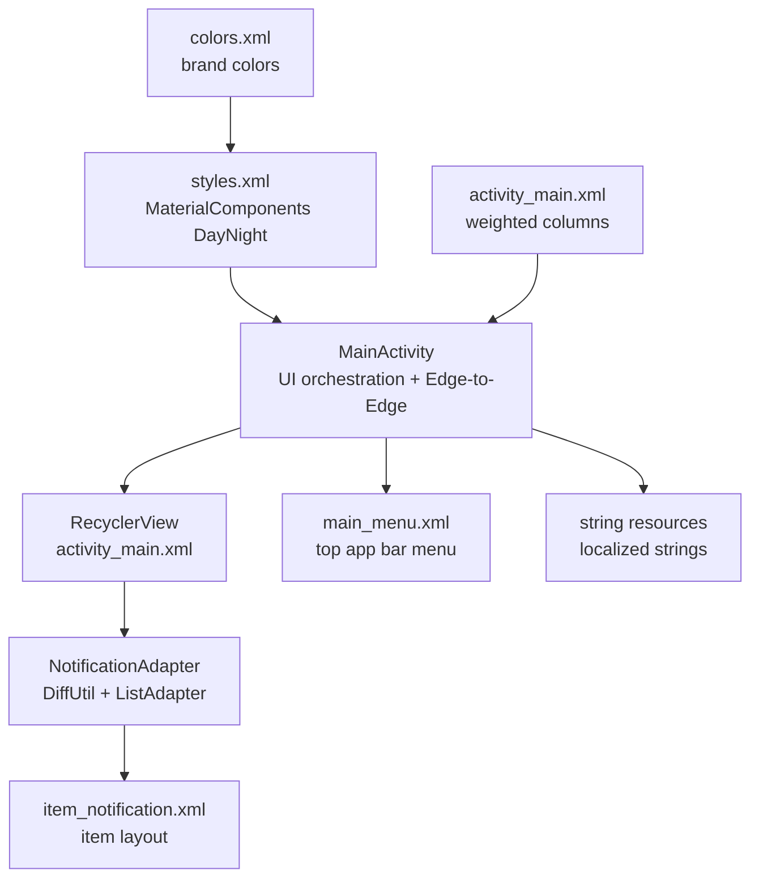
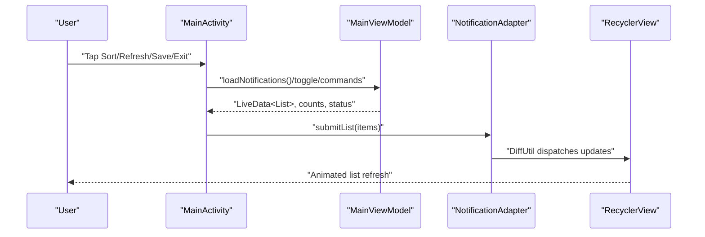
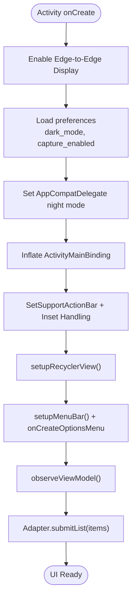
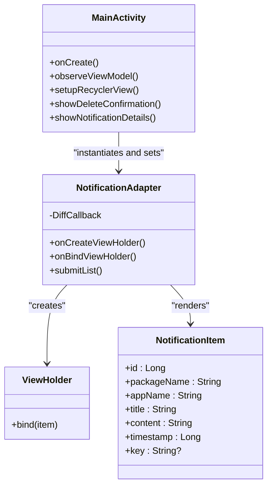
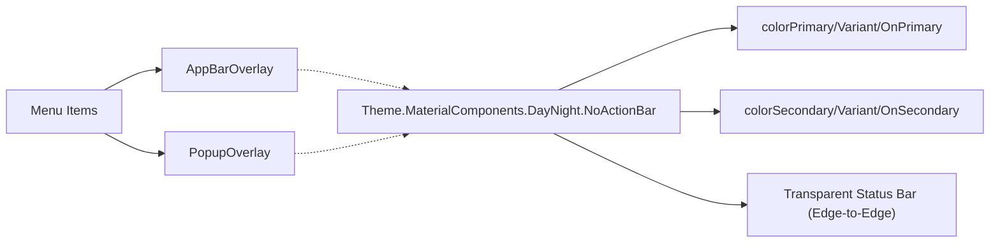
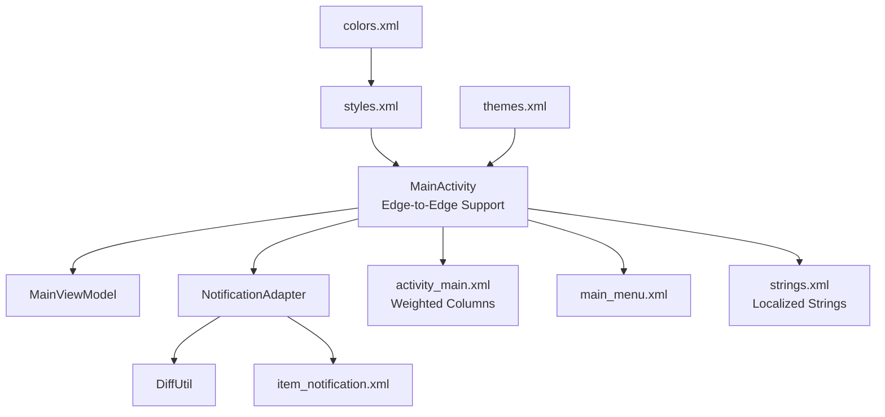
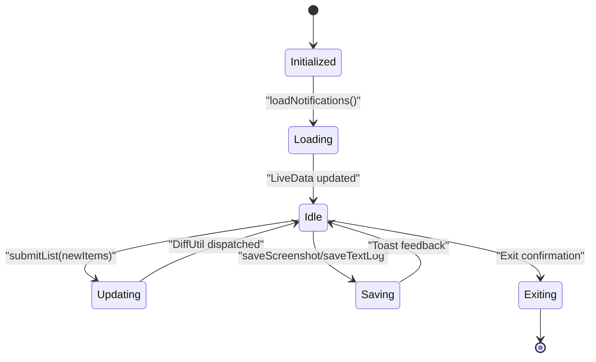

# User Interface

<cite>
**Referenced Files in This Document**
- [MainActivity.kt](file://app/src/main/java/com/notificationlog/MainActivity.kt)
- [NotificationAdapter.kt](file://app/src/main/java/com/notificationlog/adapter/NotificationAdapter.kt)
- [activity_main.xml](file://app/src/main/res/layout/activity_main.xml)
- [item_notification.xml](file://app/src/main/res/layout/item_notification.xml)
- [main_menu.xml](file://app/src/main/res/menu/main_menu.xml)
- [styles.xml](file://app/src/main/res/values/styles.xml)
- [colors.xml](file://app/src/main/res/values/colors.xml)
- [strings.xml](file://app/src/main/res/values/strings.xml)
</cite>

## Update Summary
**Changes Made**
- Updated edge-to-edge display implementation with proper system bar insets
- Migrated all user-facing strings to centralized string resources
- Redesigned layout with weighted vertical columns for bottom action buttons
- Enhanced accessibility features with content descriptions and tooltips
- Improved toolbar height adjustments for modern Android versions
- Added comprehensive string localization support

## Table of Contents
1. [Introduction](#introduction)
2. [Project Structure](#project-structure)
3. [Core Components](#core-components)
4. [Architecture Overview](#architecture-overview)
5. [Detailed Component Analysis](#detailed-component-analysis)
6. [Dependency Analysis](#dependency-analysis)
7. [Performance Considerations](#performance-considerations)
8. [Troubleshooting Guide](#troubleshooting-guide)
9. [Conclusion](#conclusion)
10. [Appendices](#appendices)

## Introduction
This document describes the user interface of the NotificationLog Android application. It covers the main activity layout with edge-to-edge display support, the notification list display powered by RecyclerView with a custom adapter using DiffUtil, Material Design integration, theme support for light/dark modes, and responsive layout design. It also explains user interaction patterns, menu systems, dialog implementations, UI customization options, accessibility features, cross-device compatibility considerations, UI state management, animations, user feedback mechanisms, and performance optimizations for large datasets.

## Project Structure
The UI is primarily composed of:
- An Activity that hosts the main layout and orchestrates menus, dialogs, and state updates with edge-to-edge display support.
- A RecyclerView list backed by a custom adapter that renders notification items efficiently.
- XML layouts for the main screen, individual list items, and dialogs.
- Menu resources for top app bar and item-level actions.
- Material Design themes and styles with day/night support.
- ViewModel-driven state for lists and counts.
- Centralized string resources for internationalization.

**Diagram sources**
- [MainActivity.kt:117-124](file://app/src/main/java/com/notificationlog/MainActivity.kt#L117-L124)
- [activity_main.xml:183-306](file://app/src/main/res/layout/activity_main.xml#L183-L306)
- [NotificationAdapter.kt:13-59](file://app/src/main/java/com/notificationlog/adapter/NotificationAdapter.kt#L13-L59)
- [item_notification.xml:11-74](file://app/src/main/res/layout/item_notification.xml#L11-L74)
- [main_menu.xml:1-50](file://app/src/main/res/menu/main_menu.xml#L1-L50)
- [strings.xml:1-79](file://app/src/main/res/values/strings.xml#L1-L79)
- [styles.xml:4-22](file://app/src/main/res/values/styles.xml#L4-L22)
- [colors.xml:1-11](file://app/src/main/res/values/colors.xml#L1-L11)

**Section sources**
- [MainActivity.kt:99-167](file://app/src/main/java/com/notificationlog/MainActivity.kt#L99-L167)
- [activity_main.xml:6-310](file://app/src/main/res/layout/activity_main.xml#L6-L310)
- [NotificationAdapter.kt:13-59](file://app/src/main/java/com/notificationlog/adapter/NotificationAdapter.kt#L13-L59)
- [item_notification.xml:11-74](file://app/src/main/res/layout/item_notification.xml#L11-L74)
- [main_menu.xml:1-50](file://app/src/main/res/menu/main_menu.xml#L1-L50)
- [strings.xml:1-79](file://app/src/main/res/values/strings.xml#L1-L79)
- [styles.xml:4-22](file://app/src/main/res/values/styles.xml#L4-L22)
- [colors.xml:1-11](file://app/src/main/res/values/colors.xml#L1-L11)

## Core Components
- Main Activity Layout: ConstraintLayout-based layout with Toolbar, horizontal menu bar, status bar, RecyclerView, and bottom action buttons with weighted vertical columns. Uses data binding, Material Design attributes, and edge-to-edge display support.
- RecyclerView and Adapter: LinearLayoutManager-backed list with a custom adapter extending ListAdapter and DiffUtil for efficient updates.
- Menus: Top app bar menu for sorting, refresh, export, theme toggle, running notification toggle, and exit; item-level menu for viewing details and deletion.
- Dialogs: Confirmation dialogs for delete/clear/exit and a details dialog for notification content.
- Themes and Styles: MaterialComponents DayNight base with overlays for app bars and popups; dynamic dark/light mode via preferences and delegate.
- ViewModel Integration: LiveData-driven updates for notifications, counts, and service status; adapter receives submitList updates.
- String Resources: Centralized localization support for all user-facing text.

**Section sources**
- [MainActivity.kt:117-124](file://app/src/main/java/com/notificationlog/MainActivity.kt#L117-L124)
- [MainActivity.kt:250-257](file://app/src/main/java/com/notificationlog/MainActivity.kt#L250-L257)
- [NotificationAdapter.kt:13-59](file://app/src/main/java/com/notificationlog/adapter/NotificationAdapter.kt#L13-L59)
- [activity_main.xml:11-310](file://app/src/main/res/layout/activity_main.xml#L11-L310)
- [main_menu.xml:1-50](file://app/src/main/res/menu/main_menu.xml#L1-L50)
- [strings.xml:1-79](file://app/src/main/res/values/strings.xml#L1-L79)
- [styles.xml:4-22](file://app/src/main/res/values/styles.xml#L4-L22)

## Architecture Overview
The UI follows MVVM with Activity hosting the layout and observing ViewModel LiveData. The adapter binds data to views declaratively and uses DiffUtil to minimize redraws. Edge-to-edge display is handled through proper system bar insets and toolbar padding adjustments.

**Diagram sources**
- [MainActivity.kt:578-645](file://app/src/main/java/com/notificationlog/MainActivity.kt#L578-L645)
- [NotificationAdapter.kt:13-59](file://app/src/main/java/com/notificationlog/adapter/NotificationAdapter.kt#L13-L59)
- [activity_main.xml:174-180](file://app/src/main/res/layout/activity_main.xml#L174-L180)

## Detailed Component Analysis

### Main Activity Layout and Interaction Patterns
- ConstraintLayout root with Toolbar, horizontal menu bar, status bar, RecyclerView, and bottom button container with weighted vertical columns.
- Bottom buttons provide tooltips and dynamic tinting based on service/permission state.
- Edge-to-edge display enabled with proper system bar insets and toolbar height adjustments.
- Menus: Top app bar menu supports sort, refresh, save screenshot/text log, about, theme toggle, running notification toggle, and exit. Item menu supports view details and delete.
- Dialogs: Confirmation dialogs for delete single/all entries and exit; details dialog shows formatted notification info.
- Theme toggle persists preference and recreates activity to apply DayNight mode.

**Updated** Enhanced with edge-to-edge display support and improved system bar handling.

**Diagram sources**
- [MainActivity.kt:117-124](file://app/src/main/java/com/notificationlog/MainActivity.kt#L117-L124)
- [MainActivity.kt:179-195](file://app/src/main/java/com/notificationlog/MainActivity.kt#L179-L195)
- [MainActivity.kt:250-265](file://app/src/main/java/com/notificationlog/MainActivity.kt#L250-L265)
- [MainActivity.kt:578-645](file://app/src/main/java/com/notificationlog/MainActivity.kt#L578-L645)

**Section sources**
- [activity_main.xml:6-310](file://app/src/main/res/layout/activity_main.xml#L6-L310)
- [MainActivity.kt:99-167](file://app/src/main/java/com/notificationlog/MainActivity.kt#L99-L167)
- [MainActivity.kt:179-195](file://app/src/main/java/com/notificationlog/MainActivity.kt#L179-L195)
- [MainActivity.kt:250-265](file://app/src/main/java/com/notificationlog/MainActivity.kt#L250-L265)
- [MainActivity.kt:578-645](file://app/src/main/java/com/notificationlog/MainActivity.kt#L578-L645)

### Notification List Display with RecyclerView and Custom Adapter
- RecyclerView configured with LinearLayoutManager and set to match parent height between status bar and bottom buttons.
- Adapter extends ListAdapter with DiffUtil.ItemCallback to compute minimal updates.
- ViewHolder inflates item layout, binds data, and wires click listeners for item tap and delete.
- Date formatting performed in adapter; executePendingBindings ensures timely UI updates.

**Diagram sources**
- [MainActivity.kt:250-257](file://app/src/main/java/com/notificationlog/MainActivity.kt#L250-L257)
- [NotificationAdapter.kt:13-59](file://app/src/main/java/com/notificationlog/adapter/NotificationAdapter.kt#L13-L59)

**Section sources**
- [activity_main.xml:174-180](file://app/src/main/res/layout/activity_main.xml#L174-L180)
- [NotificationAdapter.kt:13-59](file://app/src/main/java/com/notificationlog/adapter/NotificationAdapter.kt#L13-L59)
- [item_notification.xml:11-74](file://app/src/main/res/layout/item_notification.xml#L11-L74)

### Material Design Integration and Theme Support
- Base theme derives from MaterialComponents DayNight.NoActionBar with primary/secondary colors and status bar color bound to variant.
- AppBarOverlay and PopupOverlay provide themed app bar and popup menus.
- Night mode toggled via preference and AppCompatDelegate; UI recreated to apply theme immediately.
- Color palette includes brand colors and surface/status variants.
- Edge-to-edge display compatible with transparent system bars.

**Updated** Enhanced with edge-to-edge display compatibility and improved system bar styling.

**Diagram sources**
- [styles.xml:4-22](file://app/src/main/res/values/styles.xml#L4-L22)
- [colors.xml:1-11](file://app/src/main/res/values/colors.xml#L1-L11)
- [MainActivity.kt:117-124](file://app/src/main/java/com/notificationlog/MainActivity.kt#L117-L124)

**Section sources**
- [styles.xml:4-22](file://app/src/main/res/values/styles.xml#L4-L22)
- [colors.xml:1-11](file://app/src/main/res/values/colors.xml#L1-L11)
- [MainActivity.kt:117-124](file://app/src/main/java/com/notificationlog/MainActivity.kt#L117-L124)
- [MainActivity.kt:816-829](file://app/src/main/java/com/notificationlog/MainActivity.kt#L816-L829)

### Responsive Layout Design
- ConstraintLayout constraints define flexible spacing between toolbar, menu bar, status bar, RecyclerView, and bottom buttons.
- RecyclerView occupies remaining vertical space between status and buttons.
- Horizontal menu bar and bottom buttons use wrap_content and padding/margins for compactness across devices.
- Bottom button container uses weighted vertical columns for consistent layout across different screen sizes.
- Edge-to-edge display requires proper inset handling for system bars.

**Updated** Enhanced with weighted vertical columns in bottom button container and edge-to-edge display support.

**Section sources**
- [activity_main.xml:6-310](file://app/src/main/res/layout/activity_main.xml#L6-L310)
- [MainActivity.kt:179-195](file://app/src/main/java/com/notificationlog/MainActivity.kt#L179-L195)

### User Interaction Patterns and Menus
- Top app bar menu: sort by date/app, refresh, save screenshot/text log, about, toggle dark mode, show running notification, compact duplicates, exit.
- Item-level menu: view details, delete.
- Bottom bar: permission, notification access, capture start/stop, clear all with weighted vertical columns.
- Tooltips provide contextual help; icons change tint to reflect state.
- Search functionality with debounced filtering.

**Updated** Enhanced with search functionality and improved menu structure.

**Section sources**
- [main_menu.xml:1-50](file://app/src/main/res/menu/main_menu.xml#L1-L50)
- [MainActivity.kt:259-265](file://app/src/main/java/com/notificationlog/MainActivity.kt#L259-L265)
- [MainActivity.kt:267-298](file://app/src/main/java/com/notificationlog/MainActivity.kt#L267-L298)

### Dialog Implementations
- Details dialog: shows formatted notification metadata.
- Confirmation dialogs: delete single item, delete all, exit, compact duplicates, delete matching.
- Permission/access dialogs: guide users to grant permissions and enable notification access.
- Disclosure dialog: explains data collection policy before first launch.

**Updated** Enhanced with disclosure dialog and improved confirmation dialogs.

**Section sources**
- [MainActivity.kt:681-692](file://app/src/main/java/com/notificationlog/MainActivity.kt#L681-L692)
- [MainActivity.kt:739-759](file://app/src/main/java/com/notificationlog/MainActivity.kt#L739-L759)
- [MainActivity.kt:761-800](file://app/src/main/java/com/notificationlog/MainActivity.kt#L761-L800)
- [MainActivity.kt:868-880](file://app/src/main/java/com/notificationlog/MainActivity.kt#L868-L880)

### UI Component Customization and Accessibility
- Content descriptions on actionable icons (permission, access, capture, clear).
- Tooltips on bottom buttons for immediate context.
- Selectable backgrounds for interactive elements (menu bar, item background).
- Dynamic tinting reflects current state (green/red for enabled/disabled).
- Strings resource centralizes labels/messages for localization.
- Enhanced accessibility with proper content descriptions and semantic labeling.

**Updated** Significantly enhanced accessibility features with comprehensive content descriptions and tooltips.

**Section sources**
- [activity_main.xml:204-305](file://app/src/main/res/layout/activity_main.xml#L204-L305)
- [strings.xml:72-78](file://app/src/main/res/values/strings.xml#L72-L78)
- [MainActivity.kt:400-431](file://app/src/main/java/com/notificationlog/MainActivity.kt#L400-L431)

### Cross-Device Compatibility Considerations
- ConstraintLayout enables adaptive layouts across screen sizes.
- Weighted vertical columns ensure consistent button layout across devices.
- MaterialComponents themes adapt to platform and user preferences.
- RecyclerView virtualization handles long lists efficiently.
- Edge-to-edge display support ensures compatibility with modern Android versions.

**Updated** Enhanced with edge-to-edge display support and improved cross-device compatibility.

**Section sources**
- [activity_main.xml:183-306](file://app/src/main/res/layout/activity_main.xml#L183-L306)
- [styles.xml:4-22](file://app/src/main/res/values/styles.xml#L4-L22)
- [MainActivity.kt:117-124](file://app/src/main/java/com/notificationlog/MainActivity.kt#L117-L124)

### UI State Management and Feedback Mechanisms
- LiveData for notifications, counts, and service status drives UI updates.
- Toast messages provide immediate feedback for actions (start/stop capture, save, errors).
- Button states and icons update dynamically based on runtime conditions.
- Persistent preferences store theme and capture state across sessions.
- Service status indicators with reconnect functionality.

**Section sources**
- [MainActivity.kt:578-645](file://app/src/main/java/com/notificationlog/MainActivity.kt#L578-L645)
- [MainActivity.kt:443-468](file://app/src/main/java/com/notificationlog/MainActivity.kt#L443-L468)

### Animation and Visual Transitions
- DiffUtil minimizes item animations during updates.
- RecyclerView item deletions and insertions animate smoothly by default.
- No explicit custom animations are present; rely on default list animations and transitions.

**Section sources**
- [NotificationAdapter.kt:52-58](file://app/src/main/java/com/notificationlog/adapter/NotificationAdapter.kt#L52-L58)

## Dependency Analysis
The UI layer depends on:
- Activity for lifecycle and user interactions with edge-to-edge display support.
- ViewModel for state and data.
- Adapter for rendering and diffing.
- Resources for themes, strings, and layouts.

**Diagram sources**
- [MainActivity.kt:117-124](file://app/src/main/java/com/notificationlog/MainActivity.kt#L117-L124)
- [activity_main.xml:183-306](file://app/src/main/res/layout/activity_main.xml#L183-L306)
- [NotificationAdapter.kt:13-59](file://app/src/main/java/com/notificationlog/adapter/NotificationAdapter.kt#L13-L59)
- [main_menu.xml:1-50](file://app/src/main/res/menu/main_menu.xml#L1-L50)
- [strings.xml:1-79](file://app/src/main/res/values/strings.xml#L1-L79)
- [styles.xml:4-22](file://app/src/main/res/values/styles.xml#L4-L22)
- [colors.xml:1-11](file://app/src/main/res/values/colors.xml#L1-L11)

**Section sources**
- [MainActivity.kt:117-124](file://app/src/main/java/com/notificationlog/MainActivity.kt#L117-L124)
- [NotificationAdapter.kt:13-59](file://app/src/main/java/com/notificationlog/adapter/NotificationAdapter.kt#L13-L59)

## Performance Considerations
- RecyclerView virtualization: Efficiently recycles views for large lists.
- DiffUtil: Minimizes UI work by computing differences between old/new lists.
- Background threading: ViewModel loads data on IO dispatcher; updates posted to main thread.
- Lightweight item layout: Single ConstraintLayout item with minimal views and one divider.
- Avoid heavy work in onBindViewHolder: Date formatting occurs once per bind; keep future bindings fast.
- Debounced search: Reduces database queries during typing.
- Large dataset tips:
  - Prefer paging for very large lists.
  - Consider stable IDs and immutable item copies to improve DiffUtil accuracy.
  - Use placeholder images only when needed; avoid expensive image decoding.
  - Limit nested views and use ConstraintLayout's chain/percent features judiciously.

**Updated** Added debounced search functionality for improved performance.

## Troubleshooting Guide
- Theme toggle not applying: Ensure preference is saved and activity is recreated after toggling.
- Buttons disabled unexpectedly: Verify service status and permission checks; updateButtonStates reflects current state.
- Notifications not updating: Confirm broadcast receivers are registered/unregistered in lifecycle; ensure ViewModel refreshes data.
- Save operations fail: Check MediaStore URIs and permissions; handle Q+ scoped storage and legacy external storage paths.
- Permissions denied: Provide clear dialogs guiding users to settings; request appropriate runtime permissions.
- Edge-to-edge display issues: Verify system bar insets are properly applied and toolbar has correct padding.
- Search not working: Check debounce timing and query filtering logic.

**Updated** Added troubleshooting for edge-to-edge display and search functionality.

**Section sources**
- [MainActivity.kt:816-829](file://app/src/main/java/com/notificationlog/MainActivity.kt#L816-L829)
- [MainActivity.kt:503-538](file://app/src/main/java/com/notificationlog/MainActivity.kt#L503-L538)
- [MainActivity.kt:267-298](file://app/src/main/java/com/notificationlog/MainActivity.kt#L267-L298)
- [MainActivity.kt:179-195](file://app/src/main/java/com/notificationlog/MainActivity.kt#L179-L195)

## Conclusion
NotificationLog's UI leverages modern Android patterns: ConstraintLayout for responsiveness, RecyclerView with DiffUtil for efficient list rendering, Material Design theming for consistent visuals, and ViewModel for robust state management. The recent modernization includes edge-to-edge display support, comprehensive string localization, weighted vertical column layouts, and enhanced accessibility features. The design balances usability with performance, offering clear feedback, accessible controls, and smooth interactions across devices.

## Appendices

### UI State Lifecycle Reference

**Diagram sources**
- [MainActivity.kt:578-645](file://app/src/main/java/com/notificationlog/MainActivity.kt#L578-L645)
- [MainActivity.kt:882-956](file://app/src/main/java/com/notificationlog/MainActivity.kt#L882-L956)
- [MainActivity.kt:868-880](file://app/src/main/java/com/notificationlog/MainActivity.kt#L868-L880)